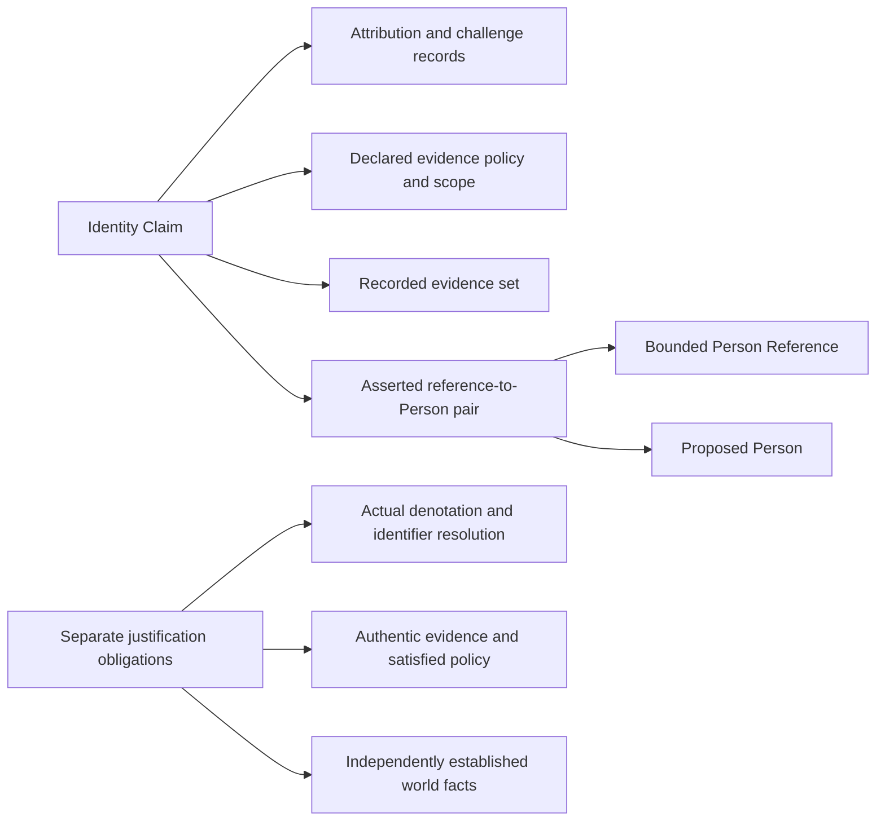

# Identity Claim formalization review

Candidate partial translation only. This delivery advances the definitions/types/logical priority, preserving exact source and earlier evidence. It does not approve source fidelity, establish actual identity or finish the full formalization episode.

## Source identity, lineage and precedence

The current source is `cal.definition.identity-claim@1.0.0-candidate.1`, SHA-256 `5de86228d02bc0167b55d275dc519b9a4fc1bc2bee4f1a881d651f511892c6b1`, admitted through decision 0053. Its normalized record combines a normalization scaffold, a target-specific Identity Claim paragraph and an inherited CAV2-D68 Person section. Aliases still include Person/human individual and the formal expression primarily describes Person. These are unresolved precedence findings; neither shared lineage nor names merge Identity Claim, Person Reference and Person.

The local D68 section is 3,361 bytes, SHA-256 `4d23e94e91ce2c4d626536b760e8b0cf71174f3b48196585e363d066e543f9b3`. Its recorded admission binds all three distinct targets. Twelve read-only source checks bind exact source/schema/renderer/registry/admission bytes, two identical 7,726-byte renders and the existing projection. The producer-declared legacy path is absent; only the selected local copy matches the recorded admission file and section. Live repository identity and canonical legacy currentness remain unestablished. Historical embedded unadmitted language is retained separately from the current source overlay.

Twenty-four nonempty source units have complete character accounting: 28 clauses, three encoded, nine explanatory and sixteen deferred. Deferred clauses include the normalization scaffold, participation/non-implication/privacy/minimization rules and actual source testable-condition obligations. Exact record identity/schema/projection/source checks are evidence rather than universally asserted logical axioms.

## Definition and typed signature

An Identity Claim is modeled as an attributable, challengeable assertion of a reference-to-Person relation under declared evidence, assurance policy and scope. Eight nonempty nominal sorts are Claim, Entity, Policy, EvidenceSet, Owner, Route, Scope and Identifier. Eight total functions select the claim's reference, proposed Person, evidence set, policy, owner record, challenge route, scope and asserted identifier. Thirty-seven predicates/relations distinguish recorded/asserted content, normative permission to infer and independently supported world propositions. There are 53 declarations.

Reference and proposed Person use a shared Entity carrier so equality is meaningful. The candidate requires the selected bounded reference and referent to differ; it does not obtain that result by assigning different nominal sorts. The primary theory does not impose globally disjoint Person/Reference categories on every unselected entity. That broader correspondence is for the Person/Person Reference owners. Competing claims and multiple claims sharing one reference/identifier are permitted by this partial theory; assertion alone establishes no functional resolver or identity merge.

The arrows are selected structural roles and proof obligations. They are not claims of executed actions, causal effect or established truth.

## Logical theory, evidence and inhabitance

Three first-order axiomatic clauses are selected. The target-specific assertion clause records attribution/challenge, bounded reference, proposed Person, distinct reference/referent, evidence/policy/scope markers and their exact links. The no-claim-only-inference clause prohibits the four target-specific conclusions of private attributes, roles, membership and authority. The inherited `Person(p) => HumanIndividual(p)` condition is separately typed; it never turns a Claim into a Person. Total selection functions do not prove real-world reference resolution or authentic attribution.

`ClaimsDenotes(c,r,p)` is the claim's asserted content. `ActualDenotes(r,p)`, `IdentifierDenotes(i,p)`, evidence authenticity, policy satisfaction and verification of the actual attributor remain outside the theory. The theory does not assert they are false. Independently justified facts may be true alongside a claim. Likewise, normative no-claim-only authorization is distinct from actual consumer enforcement or world facts.

Seven required populations connect a hypothetical Claim to Person Reference, Person, policy, recorded evidence, attribution and challenge markers; thirty other population questions remain unresolved. No real Person, account, reference, evidence attestation or identity claim is created. Inhabitance prevents vacuous finite validation; it does not approve the existence or identity of actual people.

## Finite models and countermodels

Fifty-five authored controls are independently evaluated against the typed theory and required populations, or rejected for malformed structures. They cover missing assertion/attribution/challenge/policy/evidence links, wrong pairs and selector disagreement, inherited HumanIndividual typing, meaningful reference/referent equality, permitted competing claims, vacuity, forbidden claim-only conclusions and independently supported outcomes. Five malformed models are rejected for totality, sorting, arity, duplicate tuples or empty domain.

Sixteen supplied countermodels each satisfy the selected theory and required populations, falsify a target and satisfy the target's explicit witness condition. Targets remain outside the theory: eleven world conclusions (including ownership, permission, admission, consent, identity verification, runtime activation and external effect), actual reference and identifier denotation, authentic evidence, satisfied assurance policy and verified actual attributor. This is bounded finite evidence, not exhaustive enumeration, a mechanized unbounded proof or a whole-definition translation.

## Assurance and history profiles

Forty-one candidate bounded profiles meet authored expectations; 36 are rejected and five accepted. Exact symbolic reference/identifier/Person-hypothesis/scope, policy, evidence-support assessment, assurance label, parsed UTC calendar time, expiry, limitations and challenge markers are checked. A verified label without corresponding separate symbolic support fails this candidate profile. A verified label with a hypothetical support marker can pass, while actual identity verification remains explicitly false. Such markers are hypothetical example inputs, not real evidence or a verification implementation.

Thirteen finite state-history frames include five accepted and eight rejected examples. The selected policy retains the asserted reference/Person pair, separates symbolic confirmation or assurance promotion review, and prevents claim lifecycle alone from changing independent authority facts. Withdrawal and expiry are terminal only in this candidate policy. Separate independent authority decisions may coexist. These are stronger selected profile obligations, not source-owner-approved transition rules or operational clauses in the primary theory. Actual challenge, withdrawal, correction, minimization, privacy compliance, reference lifecycle and unbounded history preservation remain deferred.

## Actual carrier and relation observations

Seventeen read-only checks bind Identity Claim/v1's current Type overlay through admission 0070, its exact Definition 0053 binding, closed schema, shared renderer/validator digests, four hostile fixtures, generated projections, historical candidate wording, owner-review refinement, sibling fixtures and the current relation surface. The receipt-writing canonical validator is not invoked.

The fixture's Person Reference token equals the selected Person Reference fixture's node ID. Its asserted workspace identifier differs from that reference's opaque `reference_value`; neither record directly points to the selected Person fixture. The claim is not listed in that Person fixture's identity evidence. These observations are not contradictions by themselves: identifier correspondence may be intentional. They require an exact semantic/reference map. No policy resolution, authentic attestation or actual Person denotation is established.

Eleven actual Claim schema probes preserve observations. Six pass: upgrading to `verified` with unchanged evidence; nonexistent reference/policy/evidence strings; invalid calendar digits; expiry before assertion; current after expiry; and owner-route text different from owner-ref. Five fail: empty evidence, duplicate evidence, an extra direct Person field, an extra permission field and an unsupported assurance label. Schema vocabulary and string patterns therefore record claims without discharging semantic/time/evidence obligations.

Current `relation.asserts-identity-of` has four exact ordered endpoint pairs: Claim-to-PersonReference, PersonReference-to-Person, PersonReference-to-PersonReference and PrincipalReference-to-Principal. Its closed qualifiers are `assertion_kind` and `claim_scope`. It forbids identity merge, authority transfer and private-attribute inference. Seven current Typed Relation/v3 probes retain observed outcomes: four accepted and three rejected. A Claim-to-Reference shape, unresolved target string, different scope string and separately permitted Reference-to-Person shape pass. Direct Claim-to-Person, an extra identity-verification qualifier and a missing scope qualifier fail. Accepted shapes do not establish actual correspondence, consistent qualifier scope, actual graph edges or identity truth.

## Closure and open obligations

Eighteen authored dependencies cover Person, Person Reference, Definition, Artifact Type, Schema, evidence, policy, authority, identity carriers/relations, Team membership, Team, responsibility, decisions, classification/orthogonality and typed relations/Kinds. Exact graph selection is regenerated: 61 nodes, 215 edges and 40 missing counterpart packets. One unresolved strongly connected component contains 21 authored draft members and 115 internal edges. The dependency denominator still requires independent review; cyclic declarations do not prove a meaning-aligned joint model.

Seven owner findings remain: source precedence and sibling identities; asserted versus actual denotation/identifier-to-Person map; reference/referent and Person/Human common-carrier scope; actual attribution/evidence/policy/assurance meaning; normative no-inference versus actual consumer behavior; time/lifecycle/participation/privacy/minimization/history semantics; and complete dependency/source-currentness closure. No field rename, canonical repair, new admission, authenticated evidence, actual identity merge, relation, authority or runtime effect is performed.

## Episode coverage

Twenty-one partial current Definition drafts now account for 475 source units, 656 clauses (192 encoded, 166 explanatory, 298 deferred), 163 required populations and 409 unresolved populations. There are 162 current identities without per-definition drafts. Whole source-owner-accepted translations and whole-definition proofs remain zero; the full episode remains active. The I04 report keeps its exact earlier eight-draft selected scope. Next definitions/types/logical task: `F05-T.cal.definition.person-reference`.
