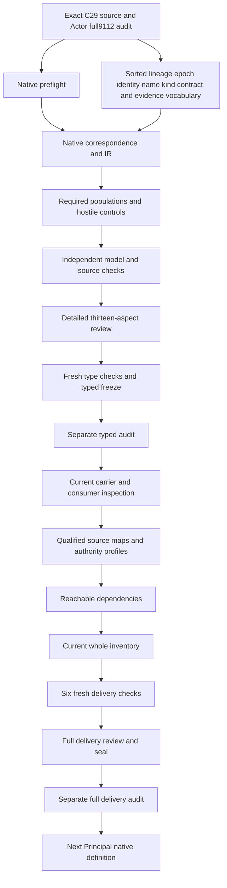

# Identity Lineage: complete candidate delivery review

Identity Lineage is formalized as immutable,typed,evidence-backed continuity among exact identity epochs. The record binds its identifier,subject kind,predecessor,successor,lineage kind,owner Decision,evidence and non-effects. A proposed explicit contract nomination keeps subject-kind-specific use and admitted generalization visible. Rename preserves declared identity while changing declared name;successor identity and other declared lineage kinds remain distinct. No actual continuity instance,authority transfer,deletion or supersession is performed.

Native creation followed Actor's full9,112-file seal and separate actual audit0. All prior sealed files and201sourcebytes remain hash verified. Working native drafts now number100among183currentidentities,leaving83withoutT. The current whole inventory now records100partialdrafts83missing;the preserved prior Actor inventory remains99/84. The original183identities189versions201sources and121tasks511edges797SWUs36frontiers stay fixed. Accepted whole translations and whole-definition proofs remain zero;source fidelity and shared meaning maps remain pending. The complete episode and final review stay active.

## 1. Exact source and C29 admission

The selected source is cal.definition.identity-lineage@1.0.0-candidate.1,SHA32c15860fb0621edaf172efea9f1f5ab467763a5ca4454d0d2424e7783c499bf. Its current admission is CAL-DECISION-0029-CML07-SEMANTIC-FOUNDATION-V1. Exact selection fixes which positive Definition the candidate interprets. The selected source is not replaced with a nearby carrier description,Craft example,Context lineage record or a later architecture summary.

The source checker binds C29 decision,authorization,candidate,manifest,validation and exact selected chain. C29 admits separate semantic/source/architecture artifacts and makes S2 evaluable without executing it. Its historical counts do not define the current183identityinventory. Definition admission does not instantiate Craft continuity,admit an endpoint,accept this translation or authorize a runtime effect. Later carrier and instance effects require their own evidence and are reserved for consumer review.

Three upstream references retain exact local Definition_v1,Product_v1 and chain0001bytes and their embedded postures. The symbolic chain0002consumer is resolved through the exact C29 selection rather than treated as a filename. A current source may cite older candidate material without silently promoting that material to current runtime truth. The review keeps these source and effect boundaries separate while preserving the original bytes.

## 2. Sorted signature and reference discipline

Fourteen nonempty sorts are proposed:LineageReference,LineageIdReference,KindDefinitionReference,EpochReference,IdentityReference,NameReference,LineageKindReference,DecisionReference,OwnerReference,EvidenceReference,NonEffectsReference,ContractReference,ScopeReference and Token. One EMPTY Token constant supports reference-presence guards. Fifteen selectors and thirteen reference-handle functions yield28totalfunctions. There are114predicate/relation signatures and157declarations in total.

The lineage record,endpoint epoch,identity and name are separate carriers. Subject-kind Definition and lineage-kind meaning are also separate sorts. Decision and owner,evidence and non-effects,contract and scope retain distinct nominations. Descriptive sorts do not become new canonical Definitions solely from their spelling. Current exact dependencies are selected where available;Project,Method,Goal,owner and other unavailable labels remain explicit unresolved concepts rather than fabricated current IDs.

Each selected field has a nonempty handle,declared target and exact BindingDeclared relation matching its selector. Totality alone supplies a well-sorted model value but cannot authenticate its referent. Symbols are qualified by exact source version and candidate scope. Similar type names in another packet do not import its theory or establish a shared domain. Missing,conflicting,undeclared and empty selected nominations fail independently of actual lookup and authority.

## 3. Immutable typed evidence-backed genus

LineageApplicable is equivalent to LineageInScopeDeclared. A selected lineage must be governed,typed,immutable,evidence backed and a continuity record by declaration. It must have all exact tuple fields,both exact epoch records,a recorded owner Decision and a recorded contract. These guards preserve necessary structure from the source's applicability and normative genus.

An immutable declaration is not enforced storage or a proof of unbounded retention. Evidence-backed posture does not establish that evidence is authentic,adequate or accepted by an owner. Typed relation membership does not prove that the real predecessor and successor belong to the claimed kind or that actual continuity holds. Each actual outcome has an independent query and supplied countermodel.

The candidate does not define a complete identity registry or require every real lineage record to be in its finite domain. One selected tuple per record is a nomination map,not global uniqueness across versions,aliases and historical consumers. No universal chronological arithmetic or temporal order is invented. Exact epoch references preserve the source's precision while timestamp interpretation,immutable storage and identity-history fidelity remain unresolved. A successful finite witness establishes consistency of the declared guards,not a historical continuity certificate.

## 4. Eight tuple coordinates and exact endpoints

The source's formal tuple has eight coordinates:lineage identifier,subject-kind Definition reference,predecessor,successor,lineage kind,owner Decision,evidence and non-effects. The candidate preserves each coordinate and adds one explicit contract nomination for subject-kind/generalization correspondence. That added nomination is a proposed implementation map requiring owner review;it is not quietly attributed to the original eight-coordinate expression.

Both endpoint epochs nominate exact identity,name and subject-kind coordinates. LineageExactEndpointsResolvedDeclared is a necessary selected-record guard reflecting the test that predecessor and successor resolve exactly. Its truth in a supplied model does not execute a resolver or authenticate an endpoint. PredecessorResolution and SuccessorResolution are actual targets outside T.

A record cannot replace exact endpoint nominations with similar paths or labels. Nor is a universal inequality between the endpoint references introduced. Under rename,equal identity and different name constrain what the selected endpoint records can jointly express. Other lineage kinds may use the same endpoint reference where their independent semantics permit it. Actual alias equivalence,epoch identity and endpoint currentness remain separate source-owner obligations.

## 5. Subject-kind and lineage-kind distinction

Subject kind identifies which semantic family the lineage concerns. Lineage kind identifies what continuity relation is asserted within that family. A Product rename is therefore not represented merely as a generic alias or as a Context evolution relation with a renamed label. The two kinds have independent exact references and typed nominations.

The candidate uses rename,successor identity and other declared lineage kind as mutually exclusive categories. Root category flags agree with the nominated lineage-kind classifiers,and exactly one category holds in selected scope. This is a proposed discriminator map;the source owners must accept its relationship to concrete lineage-kind values. The other category remains open to source-specific kinds rather than inventing a closed universal taxonomy.

Removing a category,disagreeing with its classifier or assigning overlapping rename/successor categories fails. This makes the source's distinction between same-identity rename and successor identity observable. It does not infer actual continuity from a kind string. Actual SubjectKindFidelity and LineageKindFidelity remain independently queried. Other category semantics do not inherit rename or successor equations merely because the same tuple shape is used.

## 6. Same-identity rename

A selected same-identity rename requires equal declared predecessor and successor identity coordinates and unequal declared name coordinates. These two conditions preserve the explicit formal implication. Changing identity while retaining a rename classifier fails;using unchanged names also fails. Complete owner,evidence and endpoint labels cannot substitute for either condition.

The rename branch excludes declarations that the rename creates a new Product,Project,Method,Goal or Context. These exclusions apply to rename-derived inference. They do not universally prohibit an independently governed creation event or make all actual outcomes false. Each NoNewKind actual query is conditioned on selected rename scope,so a counterexample cannot rely only on an unrelated successor or other-kind record.

The illustrative DomainSpec v2-to-Craft example is explanatory. It is not executed as a Product identity decision or used to supply real migration completion. Identity/name token equality is necessary declaration coherence and still needs accepted reference maps to prove real same-identity continuity. The record preserves exactly what the source says stayed the same and changed without treating the name change as an authority transfer or proof of an admitted endpoint.

## 7. Successor identity and other kinds

A selected successor category requires different declared endpoint identity coordinates. This is an explicit proposed interpretation of the source's successor-identity distinction. The abbreviated formal expression states the rename implication directly;the corresponding successor inequality is retained as a finding needing owner acceptance. It is not reported as an already accepted formal equivalence.

Successor names may remain equal or change independently. The model demonstrates a successor with unchanged name,which makes clear that identity change is not reducible to a display-name difference. A successor classifier does not automatically supersede an existing artifact,admit a new carrier or transfer authority. Real successor creation and resolution remain source-conditioned actual targets.

Other declared lineage kinds receive no invented equality or inequality rule for identity or name. Required populations demonstrate other-kind records with equal identity and with different identity. A positive same-endpoint-reference control also remains possible for an other-kind record. Their actual meaning still requires a specific governed contract. This separation prevents the candidate from forcing every continuity relation into rename semantics or equating every different identity token with an authorized successor.

## 8. Subject-kind-specific contracts

Every selected lineage nominates a recorded contract with exact subject-kind and scope fields. In the nongeneralized branch,the contract's subject kind must equal the record's bound kind and both endpoint kinds. This expresses subject-kind-specific scope as necessary declaration coherence. It does not prove actual contract applicability or infer meaning from a schema name.

A Context-specific contract in that branch requires Context kind and excludes Product kind. Assigning a Context-specific flag to a Product contract fails. The source's prohibition on using a context-specific lineage contract for Product by analogy is retained directly. Similar history,owners or endpoint field names cannot supply a cross-kind scope extension.

No universal equality between contract scope and every external governance scope is invented. Exact scope nomination is distinct from accepted scope meaning. The current Identity Lineage and Context Lineage Record contracts will be inspected separately during consumer review. Their field shapes may support different records and constraints;those shapes are insufficient evidence of a shared semantic map. SubjectKindScope and ContractAuthenticity remain independent actual targets rather than inherited authority from a qualified contract reference.

## 9. Explicit generalized contract

A selected generalized branch must agree with the nominated contract's generalized classifier. It requires recorded contract admission and explicit coverage of the bound subject kind and both endpoint kinds. Removing any coverage tuple or the admission declaration fails. Cross-kind endpoints are therefore possible only through an explicit proposed generalization structure.

Recorded admission is a necessary declaration rather than an authentic owner decision or current contract-admission proof. GeneralizedContractAdmission and GeneralizedContractApplicability queries are conditioned on actual selected generalized scope. Their countermodels contain selected generalization declarations while leaving the real outcomes unsupported. An absent optional generalized contract cannot serve as their counterexample.

The contract's anchor kind is separately nominated from the kinds it covers. No unsupported rule requires the anchor to enumerate every covered kind. A positive control changes that anchor while preserving explicit bound/endpoint coverage. Nor does generalization imply every other kind is covered,merge endpoint identity or transfer authority. Accepted denotations for contract,coverage,admission and source precedence remain pending. This retains the source's exception without turning a generalized label into permission to apply any lineage theory anywhere.

## 10. Owner Decision,evidence and non-effects

The selected record has an exact OwnerDecision reference. The Decision is declared recorded and nominates an exact nonempty owner. OwnerReference and DecisionReference remain separate types. A label in either field does not authenticate the decision or prove that its scope authorizes the particular continuity assertion.

No global one-subject-per-Decision restriction is imposed. A legitimate decision may cover several records;the record merely binds its nominated decision. OwnerDecisionAuthenticity and OwnerAuthorization remain separate actual outcomes. Likewise,EvidenceReference is an aggregate nomination for the source's evidence_refs coordinate. The proposed single reference does not mean that actual supporting evidence has cardinality one or that every evidence item is adequate.

NonEffectsReference preserves a declared non-effects coordinate. Boundary predicates separately exclude inferred admission,authority transfer,deletion and automatic supersession. A reference to non-effects does not establish their actual absence in the real system. NoAdmission,NoAuthorityTransfer,NoDeletion and NoAutomaticSupersession remain queried outcomes. This arrangement keeps exact governance accountability visible without replacing independent evidence with schema fields,token equality or a successful finite model.

## 11. Similarity noninference and effect independence

A lineage is not a generic alias list. Identity continuity cannot be inferred from aliases,similar names,paths,shared owner,similar content or history. Those are excluded inference declarations in selected scope. They do not become a universal prohibition on independently supported same identity for objects that happen to have similar properties.

Endpoint references cannot authenticate continuity,owner-decision references cannot grant authority,evidence references cannot prove continuity and contract references cannot prove admission. Parent meaning and Definition admission do not grant instance effects or accept this translation. Carrier,instance,runtime,publication,release,deployment and external-effect grant declarations are independently excluded.

Actual authority and other outcomes remain outside T and are permitted when independently supplied. Positive controls support each target without destroying necessary theory. Outside records can carry excluded flags without violating selected scope. Rename-only exclusions also remain conditional rather than governing unrelated other-kind records. No real Product or Context continuity is created,no endpoint is admitted or deleted,and no authority is transferred. The candidate keeps structural coherence,invalid inference and independent real governance actions as distinct conclusions.

## 12. Source account,queries and independent checks

All26nonempty source units have exact selectors and complete-character correspondence. Fifteen clauses are encoded,nine explanatory and two deferred. Eight primitive formulas cover eligibility,genus,kind,endpoint resolution,contract,rename,successor and boundaries. Scientific notation,plain-language explanation and Craft/Context examples remain explanatory. Authority-scope and retained candidate claim ceiling remain deferred correspondence.

The native suite passes205controls:79T-true,118T-false and eight malformed-input rejections. Seventeen required populations demonstrate selected/outside,independent authority,rename/successor/other,kindspecific/generalized and no-actual-outcome cases. T and I are evaluated independently. No selected records or missing independent authority can satisfy theory while failing the requested demonstrations. That distinction is retained in the report.

Thirty-four queries have supplied T-and-I countermodels. Ten are conditioned on rename,successor or generalized-contract selection. Fifty-two source-query obligations bind exact selectors,spans,hashes and clause/query identifiers. Actual targets are never assumptions in T. Source checks verify exact C29 bytes,three local upstreams,separate consumers and two identical pure4506-byte projections without mutation. Prepared contract/control checking reached38,010steps under unchanged limits:one million bytes,fifty thousand IR nodes,one hundred thousand steps and thirty seconds. These observations support bounded evidence without source-owner acceptance or whole proof.

## 13. Retained preparation,delivery DAG and remaining work

The first preparation script failed from string escaping before any native unit or prepared builder existed. Its exact producer and reported terminal evidence are retained. Correcting the escaping changed no semantic formula or checker limit. All four native producers subsequently passed. The full prepared contract had already validated signature,population uniqueness,exact chosen source clauses and every supplied control before native creation.

The initial successful native builder still carried copied Actor prefixes in two opaque interpretation/profile labels. Its exact producer,context,outputs and successful terminal captures are retained. The labels were corrected to Identity Lineage without changing source,scope,clauses,formulas,dependencies,required populations or symbol denominator. The current model and source reports bind the corrected native output. No successful earlier stage is silently substituted for the current one.

This seventeen-node,seventeen-edge work DAG is acyclic and separate from semantic dependency cycles. Three fresh contract/model/source checks passed. The sixteen-input typed freeze and separate audit passed. Current carrier/consumer comparisons,qualified profiles,reachable dependencies and whole100draftinventory now have actual results. Six fresh delivery checks passed with exit0. Full review is prepared for seal and separate audit,which require their own terminal evidence. Principal native work follows that full Identity Lineage audit. Prior Actor inventory99/84 and current IdentityLineage inventory100/83 remain separately preserved.

Twenty exact dependency meanings are separately qualified;their complete theories and authority are not imported. All9,112priorsealedfiles201sourcebytes and original183/189/201scope remain preserved. Source fidelity,shared denotations,consumer alignment,whole translation and whole proofs remain pending. The complete original episode and its final aspect-by-aspect review remain required;this bounded typed packet does not redefine success around a verified subset.
- IDL-FINDING-001: Exact current C29 Definition admission does not instantiate continuity,admit carriers/endpoints or accept this formal translation. Status: unresolved;owner review and accepted map references pending.

- IDL-FINDING-002: Immutable typed evidence-backed continuity genus is represented by necessary declarations,not real storage,identity truth or unbounded retention. Status: unresolved;owner review and accepted map references pending.

- IDL-FINDING-003: Lineage,identifier,kind Definition,epoch,identity,name,kind,Decision,owner,evidence,non-effects,contract and scope are proposed qualified sorts. Status: unresolved;owner review and accepted map references pending.

- IDL-FINDING-004: The eight formal tuple coordinates are preserved;an extra contract nomination is a proposed explicit subject-kind/generalization map. Status: unresolved;owner review and accepted map references pending.

- IDL-FINDING-005: One predecessor/successor tuple per record does not impose global uniqueness,complete alias coverage or a universal identity registry. Status: unresolved;owner review and accepted map references pending.

- IDL-FINDING-006: Exact endpoint resolution is a necessary declaration;actual lookup,authentic identity and current epoch fidelity remain independent. Status: unresolved;owner review and accepted map references pending.

- IDL-FINDING-007: Subject-kind and lineage-kind references are distinct;kind classifiers are proposed denotations requiring exact owner correspondence. Status: unresolved;owner review and accepted map references pending.

- IDL-FINDING-008: Rename/successor/other are mutually exclusive candidate categories;other remains open to declared source-specific lineage kinds. Status: unresolved;owner review and accepted map references pending.

- IDL-FINDING-009: Rename requires equal declared endpoint identity and unequal declared name,without universally denying independently supported identity for similar objects. Status: unresolved;owner review and accepted map references pending.

- IDL-FINDING-010: Successor uses distinct declared identity coordinates as a proposed distinction;the abbreviated formal expression explicitly states rename only. Status: unresolved;owner review and accepted map references pending.

- IDL-FINDING-011: Other lineage kinds receive no invented rename or successor identity/name constraint;their accepted semantics remain unresolved. Status: unresolved;owner review and accepted map references pending.

- IDL-FINDING-012: No universal unequal endpoint references are imposed for rename;identity/name selector coherence determines whether such a nomination can satisfy T. Status: unresolved;owner review and accepted map references pending.

- IDL-FINDING-013: Subject-kind-specific contract nominates the same kind as both endpoints;actual kind and contract applicability remain independent. Status: unresolved;owner review and accepted map references pending.

- IDL-FINDING-014: Context-specific contract requires Context kind and excludes Product in the nongeneralized branch;no analogy supplies cross-kind scope. Status: unresolved;owner review and accepted map references pending.

- IDL-FINDING-015: An explicitly generalized contract has recorded admission and coverage declarations for bound/predecessor/successor kinds;actual admission and coverage need independent evidence. Status: unresolved;owner review and accepted map references pending.

- IDL-FINDING-016: Generalization does not authenticate its owner,transfer endpoint authority or imply all other subject kinds are covered. Status: unresolved;owner review and accepted map references pending.

- IDL-FINDING-017: Owner Decision and recorded owner are nominated without requiring globally one subject per Decision or authenticating authority from labels. Status: unresolved;owner review and accepted map references pending.

- IDL-FINDING-018: One EvidenceReference is a proposed aggregate evidence nomination,not cardinality one for actual evidence_refs or sufficient supporting evidence. Status: unresolved;owner review and accepted map references pending.

- IDL-FINDING-019: NonEffectsReference preserves declared non-effects without proving actual absence of admission,transfer,deletion or supersession. Status: unresolved;owner review and accepted map references pending.

- IDL-FINDING-020: Exact local Definition_v1/Product_v1/chain0001 source bytes and symbolic C29 chain0002 consumer remain separate from later carrier/instance overlays. Status: unresolved;owner review and accepted map references pending.

- IDL-FINDING-021: Examples,Craft rename and Context evolution remain explanatory;no actual Product continuity or owner decision is executed. Status: unresolved;owner review and accepted map references pending.

- IDL-FINDING-022: Finite T/I witnesses and complete character accounting do not accept source fidelity,shared meanings,whole translation or whole-definition proof. Status: unresolved;owner review and accepted map references pending.

Actual native counts: {"countermodel_queries": 34, "declarations": 157, "deferred_clauses": 2, "direct_semantic_uses": 20, "encoded_clauses": 15, "explanatory_clauses": 9, "mapped_clauses": 26, "required_populations": 17, "source_units": 26, "unresolved_populations": 114}. Source checks: 89. Projection SHA: 5fe6f64e08017c1a3f230c6759b99f3bc21c767657466d8f5e9b5937ba91b027.

Detailed current carrier and consumer evidence

Current C30 IdentityLineage/v1 directly binds the current C29 Definition but specializes to Product same-product-renamed records. It does not represent every broad source lineage kind or generalized contract. Source-to-carrier correspondence remains unaccepted even where the type has an independently admitted semantic binding. Definitions,types and logic remain first;all16typedinputs and the separate typed audit were checked before consumer work.

The consumer binds25exactcurrentmeanings:IdentityLineage plus20primaryqualifieddependencies and four separate legacy Project,Method,CraftMethod and Goal sources. CAV2-D60 is Project,CAV2-D32 is Method,CAV2-D20 is Craft Method,and CAV2-D59 is Goal. No cal.definition.project/method/goal identity is fabricated. The initial successful24meaningconsumerstage is retained before adding generic Method as a separate comparison. Primary theory,source bytes,frozen inputs and checker limits remain unchanged.

Seven current contracts are inspected separately:IdentityLineage,ContextLineage,ProductIdentity/v2,ProjectIdentity,MethodBinding,Goal and IdentityGraph. The registry has143contracts121currentcontracts. Each selected schema/artifact digest,retained candidate body and valid fixture is bound. Current registered semantic refs,artifact semantic dependencies and schema const lists are recorded separately. Equal-looking field names or a shared schema shape do not establish shared source denotations.

IdentityLineage/v1 fixes subject_kind to product and lineage_kind to same-product-renamed. It names exact predecessor/successor references and names,preserved assertions,changed attributes,evidence,lineage owner and challenge route. Direct owner Decision,non-effects,immutable-storage,epoch identity and generalized-contract fields are absent. Those concepts need explicit accepted mapping,aggregation or specialization residue rather than inserted unsupported fields or claimed automatic enforcement.

Fifty Definition-shape probes include fourteen acceptances. Eight hypothetical normative overclaims about names,paths,owners,storage,shape continuity,Context-to-Product analogy,generalized admission and effects are accepted structurally and rendered reproducibly. These are in-memory shape observations. No full package validator,writer,native/live consumer or new continuity instance was executed. Shape acceptance cannot be promoted to admission or actual continuity.

Seven carriers received281whole-hypothetical-fixture shape probes,with43acceptances. Missing required fields,unsupported source coordinates,publication effects,unsupported successor/Context kinds and required evidence/assertion omissions fail. The specialized rename carrier accepts equal endpoint labels,unchanged predecessor/successor names,opaque endpoints/owner and unproved preserved-identity prose. Those observations identify necessary meaning maps;they do not certify a defect in an unexecuted full validator or prove actual identity relationships.

C31 separately admits the exact unchanged Craft lineage carrier and recognizes the exact schema/identity-contract conformance assessment. Its retained body stays candidate-unadmitted/authoritynone under that admission overlay. The historic assessment has implementation/runtime conformance not_evaluable and migration completion not_proven. Those original claims are preserved exactly. They are not accepted formalization-owner correspondence,immutable storage,all-kind generalization or a new runtime continuity proof.

C57 admits ProductIdentity/v2 and transitions the v1 type to admitted-historical. It admits no instance and activates no consumer. The exact C31Product/v1instance fails current v2 shape;it is not silently rebound to the current contract. Actual lineage and Product identity correspondence must account for type versions,instance overlays,legacy predecessor references and retained scope. Current schema shape is distinct from prior exact admission.

ContextLineage/v2 retains its own Context meaning and successor semantics. Whole hypothetical records allow equal endpoint labels,null predecessor,empty evidence and contradictory preserved/changed prose while forbidding inferred equivalence/admission. Those shape rules do not govern Product lineage by analogy. Project,MethodBinding,Goal,IdentityGraph and ProductIdentity carry independent meanings,owner scopes and legacy exact references. Generic Method and Craft Method remain separate throughout.

Sixteen IdentityLineage-only T/I models are independently re-evaluated. They retain no-selected/insufficient-population distinctions,rename/successor/other categories,other-kind same-endpoint and successor same/name-change freedom,explicit generalization coverage and independent actual authority. Wrong rename identity/name,successor identity,Context-to-Product analogy and missing generalized coverage fail necessary theory. No whole upstream theory or accepted common denotation is imported.

Thirty-three pending source-map obligations and qualified authority profiles follow. Eight consumer findings and22sourcefindings remain unresolved. Reachable and current100draftwholeinventory,sixfreshchecks,full13aspectreview,seal and separate audit must supply their own evidence. Principal native work follows full IdentityLineage audit. Preserve9112priorsealedfiles201sourcebytes and original183/189/201and121/511/797/36scope. Source fidelity,whole translation,whole proofs and semantic readiness remain pending;goalactive.

- IDL-CONSUMER-FINDING-001: C30 current IdentityLineage/v1 directly binds the C29 positive Definition but is specialized to same-product-renamed/Product. It is not an admitted generalized carrier for every rename,successor or other lineage kind. Status: unresolved;accepted map references empty.

- IDL-CONSUMER-FINDING-002: Definition/v1 shape and pure projections accept hypothetical normative prose inferring continuity from names/paths/owners,immutable storage from wording,authority from admission and cross-kind applicability by analogy. Shape probes do not establish admission by an unexecuted full validator. Status: unresolved;accepted map references empty.

- IDL-CONSUMER-FINDING-003: The specialized lineage schema binds explicit predecessor/successor names,references,preserved assertions,changed attributes,evidence and owner,while lacking direct exact epoch/identity coordinates,owner Decision,non-effects,immutable storage and generalized-contract fields. Accepted source-to-carrier tuple and aggregate evidence mappings are absent. Status: unresolved;accepted map references empty.

- IDL-CONSUMER-FINDING-004: Whole specialized fixtures accept equal endpoint reference labels and unchanged rename names,opaque endpoints/owner and unproved preservation prose. Runtime lookup and accepted identity/name denotations require more than local schema validation. Status: unresolved;accepted map references empty.

- IDL-CONSUMER-FINDING-005: Exact C31 admits the unchanged Craft lineage carrier by a separately scoped overlay and recognizes schema/identity-contract conformance. That historic assessment is retained exactly;it is not current formalization-owner acceptance,immutable storage,runtime continuity,full migration completion or a generalized contract. Status: unresolved;accepted map references empty.

- IDL-CONSUMER-FINDING-006: C57 admits ProductIdentity/v2 and transitions v1 type to historical without instance admission or consumer activation. The exact C31 Product/v1 instance fails current v2 shape and is not silently rebound;its relationship to current lineage and Product identity maps remains explicit. Status: unresolved;accepted map references empty.

- IDL-CONSUMER-FINDING-007: ContextLineage/v2,CML07 Project/Method/Goal/IdentityGraph and current ProductIdentity/v2 bind separate meanings and legacy current IDs. CAV2-D60 Project,D32 Method,D20 Craft Method,D59 Goal sources are separately compared without fabricating cal.definition.project/method/goal or importing whole theories. Cross-kind correspondence,cycle closure and owner scope remain unresolved. Status: unresolved;accepted map references empty.

- IDL-CONSUMER-FINDING-008: Sixteen independently evaluated IdentityLineage-only T/I models retain rename/successor/other,scope/generalization,independent authority and coverage distinctions. Source-owner acceptance of successor inequality,kind partition,contract nomination and real continuity/evidence/immutability remains pending. Status: unresolved;accepted map references empty.

Current full-scope inventory and dependency evidence

The original inventory remains183identities189versions201sourcefiles. Both the initial current-inventory producer and its fresh replay recomputed exact source/core/IR/correspondence accounting for100partialdrafts. Each definition has one supplied model freshly and independently evaluated for its own T and I. There is no assembled shared-carrier meaning model or inherited owner acceptance. Combined count is2350sourceunits2930mappedclauses989encoded823explanatory1118deferred1236requiredpopulations5785unresolvedpopulations. Identity Lineage contributes26/26/15/9/2and17/114without changing the denominator or silently removing missing source identities.

The joint declared graph has144nodes2511edges44missingcounterpartpackets and one unresolved cycle. It retains all sources and edges from Actor's144node2491edgegraph and adds20direct Identity Lineage uses. The missing count drops from45to44because the exact Identity Lineage packet now exists. No other absent source is treated as translated or consistent. Its reachable graph has142nodes2456edges98selectedexistingpackets44missingcounterparts and one unresolved cycle. Root reachability is separate from the whole inventory. Cycle classification and edge-denominator acceptance remain unresolved;neither a traversal nor a larger draft count establishes semantic closure.

Thirty-two qualified profiles include31rejections. One hundred six finite source-map frames include105rejections across33pendingmapobligations. The one passing profile/frame is an explicit complete hypothesis with empty accepted-map and owner-review references. It does not turn C30,C31orC57admission into formalization-owner source correspondence. Rejected cases retain identity/reference distinctions,recorded versus actual immutable/evidence/owner posture,subject-kind/generalization scope,existing assessment ceilings and Method/CraftMethod independence. Eight consumer findings remain unresolved alongside all22sourcefindings.

Fifteen static-snapshot differential/adversarial checks passed. Only identical canonical static snapshot bytes may reuse static verification;live repository currentness still delegates the unchanged original checker. Changed snapshots,malformed inputs,result mutation,in-place snapshot mutation and exception restoration are tested. Source accounting,model evaluation,IR compilation and graph construction remain active. Each of the100currentT/Iwitnesses is actually evaluated. Shared sealed verifiers are unchanged. The unchanged limits are one million bytes,fifty thousand qualified nodes,one hundred thousand steps and thirty seconds. Performance improvements do not widen a proof claim or replace required source review.

Exact admission and semantic correspondence

C29Definition admission,C30specialized carrier admission,C31exact Craft lineage instance admission and C57Producttype succession have separate subjects,digests and effect scopes. C31recognizes schema and identity-contract conformance at its recorded boundary while leaving implementation/runtime not_evaluable and migration completion not_proven. Current formalization does not revoke or rewrite that evidence. It also does not promote it to whole-source translation acceptance,immutable runtime storage,all-kind generalized lineage or owner-approved common denotations. The source tuple and current carrier fields need explicit mappings even though a narrower instance has a legitimate existing admission.

CAV2-D32Method and CAV2-D20CraftMethod are separately current meanings. The initial successful consumer comparison omitted generic Method while including Craft Method;its exact producer,report and terminal captures are retained. The current comparison adds generic Method without changing primary theory,scope,source bytes,required populations or the16frozen typed inputs. Current consumer checks number123with25meaningobservations. This distinction matters because a MethodBinding that refers to Craft Method does not silently define every Method's identity semantics. Project and Goal likewise keep their exact CAV2IDs. No new cal.definition.project/method/goal aliases are fabricated.

Retained failures and next-source readiness

One actual preparation-script escaping failure remains retained from before native creation. One successful native builder stage before correcting copied opaque interpretation/profile labels also remains retained. Neither changed the semantic formulas or checker limits. Full consumer work retained one successful earlier meaning-selection stage. The Principal source inspector initially checked whether Actor native output was absent;the copied target was wrong because Actor was already completed. Its failed producer and terminal captures are preserved. The corrected check targets Principal and adds its explicit normative nonimplication check. There was no failed native definition producer,no failed qualified profile,and no failed fresh delivery check.

Principal is source-only preparation:exact current C65Principal@1.0.0-candidate.1SHA60180d24ef3e83c517ea8f51f5ab863801c248ac80d19864353b58f70aaad794 passed29checks24sourceunits and two identical4698-byte projections. Its embedded actor-model-review hash and local integrated consumer are exact. Recognition boundaries,independent represented-subject identity/lifecycle and consequential authorization through exact current grant/scope are retained in the next types/logic design. No Principal native interpretation,identity recognition,grant or actual authorization is created before the full IdentityLineage audit.

Full delivery and final episode obligations

Six actual fresh checks passed:contract,model,source,qualified profile,reachable dependencies and current whole inventory. Their exact executable arguments,stdout and empty stderr captures remain bound. A fresh separate carrier inspection also matches the current report. This review and its seventeen-node,seventeen-edge acyclic work DAG are prepared for the full seal and separate exact-fileset audit. Those two operations must supply their own terminal outcomes before Principal native creation. Source fidelity,whole translation,common meaning alignment,whole proofs and semantic readiness remain pending.

Every9,112priorsealedfile and all201originalsourcefiles stay preserved. The full candidate package leaves unrelated tracked work untouched:30files4833insertions518deletions at inspection. Original121tasks511planningedges797SWUs36frontiers remain exact. The goal remains active across the remaining83missingcurrentdrafts and the final episode-wide aspect-by-aspect review and completion audit. A verified100draftcandidate inventory is concrete progress toward that full objective;it cannot redefine the original episode around a successful subset or provide evidence for absent owner acceptance and whole-definition proof.
