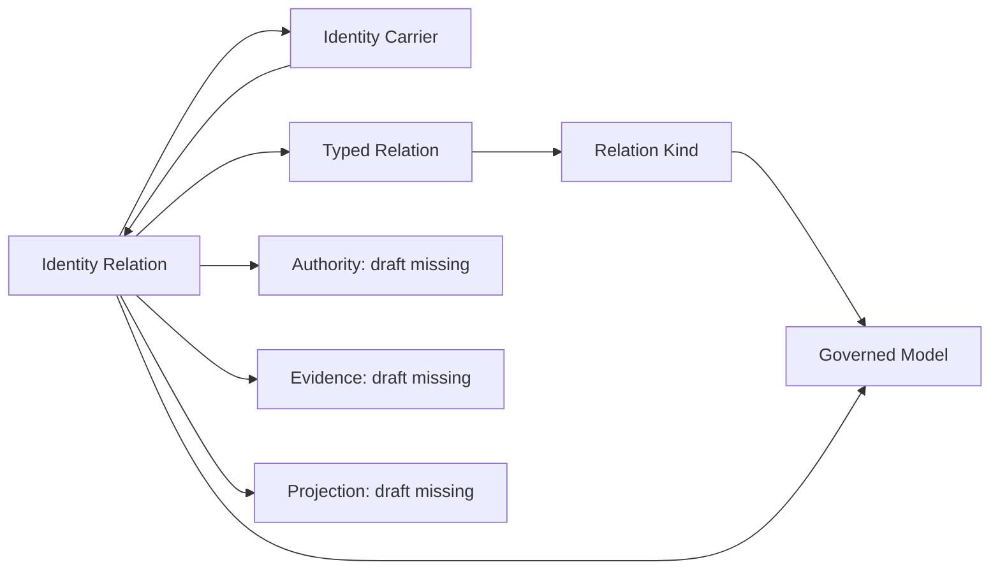

# Identity Relation: explicit edges, independent endpoints and authority review

This partial candidate translates `cal.definition.identity-relation@1.0.0-candidate.1`, exact source SHA-256 `cf6a40999ffab4e25f8766d1cd3f6085b7b3ab9468828539521c18e9ca30f28e`, from `authority/definitions/candidates/0006-craft-identity/definitions/identity-relation/v1/definition.json`. F05-T prerequisites A04, C01 and E02 and the absent output were verified before production. All selected source bytes and 1,474 prior candidate files remain preserved.

The work advances the user's definition/type/logical priority. It creates no canonical relation, graph edge, endpoint, admission, authority grant, classification axis or runtime action. Source admission determines the selected semantic source; it does not confer owner fidelity on this translation. Whole translation and whole-definition proof remain pending.

## 1. Definition, statement roles and source completeness

An Identity Relation is a separately governed typed edge. It has its own relation identity, declared kind/direction, source and target endpoint references, owner, evidence and lifecycle. Each endpoint resolves independently. Relations preserve endpoint identity and authority, while dependent classifications and convenience descriptions cannot be synthesized from duplicate labels, shared folders or owners.

The source inventory contains 23 nonempty string units. All characters map into 26 spans: 13 encoded, 7 explanatory and 6 deferred. The two positive contract descriptions, endpoint/kind conditions, role distinctions and label rule are encoded as an axiomatic specification. Two allowed-state preservation rules are operational constraints. The formal non-entailment expression is checked as a target rather than inserted into the assumptions.

Deferred content includes the scope/applicability and claim ceiling, the full dependent-classification rule, validator enforcement and the remaining formal implication boundary. Explanation and Craft examples remain available without admitting their relation vocabulary or creating their named edges. Full accounting does not mean full semantic translation or owner acceptance.

No membership biconditional defines `IdentityRelation(r)` from a bundle of tags. The selected clauses are necessary conditions, not a sufficient recognizer for an actual governed relation. No selected assumptions, assumption links or owner-approved exemptions are fabricated.

## 2. Typed signature and mathematical denotation

There are 52 declarations: 10 nonempty sorts, 11 total functions, an initial-state constant and 30 predicates/relations. Sorts distinguish Relation, Identity, Kind, OwnerRoute, EvidenceRef, Lifecycle, State, AuthorityState, Label and Location.

Functions select the relation's identity, ordered endpoint identities, kind, owner and lifecycle, plus state-dependent endpoint/authority values. Endpoint owner and path selectors support separate context-inference queries. Evidence is a nonempty relation to EvidenceRef rather than a fabricated single evidence item. Derived labels have a separate sort and a relation to the edge they describe.

Totality and nonempty domains are the chosen mathematical profile. They do not prove live endpoint resolution, owner authentication, evidence sufficiency or service availability. State and AuthorityState are explicit carriers with uninterpreted values. Their presence does not turn a static first-order guard into a temporal, deontic or empirical proof.

Equality in the shared local Identity carrier can compare edge and endpoint identities. Names from other scopes still require reviewed common-carrier maps. Two nominally different record sorts alone would not establish a semantic distinction or justify an alias to TypedRelation.

## 3. Separately governed edge and its identity

An IdentityRelation must have the eight selected explicit/governed/typed/owner/lifecycle statuses, at least one evidence binding and an initial relation record. The initial source/target state must match the explicit endpoint selectors. Its kind has DeclaredInterpretation and DeclaredDirection status. Actual Kind version, accepted ordered pair and qualifier contracts need separate alignment with the RelationKind draft and live selected catalogs.

The selected candidate reading of “Identity Relation is not an endpoint identity” requires its edge identity to differ from both selected endpoint identities in the shared semantic carrier. It also rejects the EndpointIdentityRole tag. This is a common-identity distinction, not a proof obtained from nominal Relation versus Identity sorts.

Whether literal strings in a legacy record inhabit that common namespace is a pending owner mapping decision. The source does not specify a complete namespace encoding; the stronger synthetic string policy is therefore a declared profile choice, not an already accepted universal repository rule. The actual legacy-checker acceptance below makes that distinction reviewable.

This condition does **not** require source identity to differ from target identity. The source's `R(a,b) does not imply a=b` is a non-entailment statement. It does not say every valid relation has `a!=b`. A selected self-relation remains possible when its Kind/pair policy permits it. The source's plain-language “two separate things” and validator-collapse language need interpretation together with that formal boundary; this candidate has no owner fidelity decision resolving their whole meaning.

## 4. Independent identity and independent authority

Both endpoint identities must resolve independently and have initial endpoint records. These are necessary semantic conditions; they do not fabricate actual endpoint admission or bind a reference merely because a name resembles an existing artifact.

The base model deliberately gives source and target **different authority states**. Another valid model permits equal authority states while retaining distinct endpoint identities. Thus neither authority equality nor inequality follows universally from the edge. Relation presence alone grants or transfers nothing.

Nine non-entailment targets remain outside the theory: five test admission, grant, endpoint admission, runtime and Bounded Context shortcuts; two test endpoint identity/authority equality; two test whether shared endpoint owner/path generates a directed edge. Every target has an independently evaluated finite countermodel satisfying the selected theory and all required populations.

Shared owner/path values are kept separate from relation selection. In the countermodel, independently resolvable endpoints share those context values while a required reverse/self directed edge does not exist. This is evidence against contextual inference within the partial theory, not proof that no meaningful externally selected relationship could exist.

## 5. Allowed changes, relation removal and labels

The first operational constraint preserves source/target identities and their selected authority states across an AllowedRelationStep. It specifies desired behavior at a declared scope; it is not a measurement of live execution or a proof that authority values were legitimate before the step.

The second constraint says that an allowed relation removal, starting with both endpoint records present, preserves both endpoint records. An in-memory example removes the relation while retaining the endpoint records. No actual file, graph or endpoint is removed. Exact removal preconditions, success effects, policy enforcement, reachability, atomicity and rollback still need implementation/semantic bindings.

A control outside the AllowedRelationStep guard can erase an endpoint without falsifying these guarded clauses. It is **not certified** by the theory. This retained case exposes the guard's scope rather than pretending the constraints establish every runtime transition.

Convenience labels derived from an IdentityRelation must be generated projections and must not be canonical classification axes. A reverse description does not create a reverse edge or another Kind. The full dependent-classification meaning and actual generator derivation remain deferred; a GeneratedProjection predicate is not a proof of arbitrary generator behavior.

## 6. Required populations and independent finite checking

Fifteen populations require one hypothetical edge, its eight contract statuses, nonempty evidence, independent/resolvable endpoints, declared Kind interpretation/direction, initial relation presence and initial endpoint presence. Fifteen remaining role/outcome/transition/label populations are unresolved. Real edge, owner, admission, grant and runtime existence are not manufactured to discharge them.

Forty-seven supplied model controls are independently evaluated against the source-qualified IR. They test missing metadata/status/populations, initial endpoint binding, edge-versus-endpoint identity collapse, source/target replacement, authority copying, endpoint deletion with relation removal, generated label rules, self-relations, equal-authority coexistence, guard scope and independent outcomes. Five malformed structures test sort, totality, tuple arity, duplicate extension tuple and initial-state constant rejection.

The empty IdentityRelation extension satisfies guarded clauses but fails required inhabitation. The distinction prevents a vacuous passing consistency report. Model SHA bindings, exact clause results and population results are retained. These controls and countermodels are supplied finite evidence, not exhaustive provider enumeration, unbounded preservation proof or a common-meaning model of every definition.

## 7. Bounded explicit-edge profile and traces

The synthetic closed edge record has exactly seven fields: edge ID, versioned Kind reference, ordered endpoints, owner, evidence and lifecycle. Endpoint records carry explicit identity/kind/owner/authority values. Two declared synthetic Kind signatures control the accepted pairs; they are fixture contracts, not admitted vocabulary.

Twenty shape controls include 4 accepted and 16 rejected cases. They exercise missing fields, empty evidence, unversioned kind, reversed pair, unresolved/Boolean endpoint, edge/endpoint ID collision in the selected common namespace, duplicate edge ID, implicit authority field and a derived label becoming a canonical axis. Different edge identities can connect the same pair, and a self-edge is permitted by the selected same-kind signature.

Eight finite traces include 4 preserved and 4 rejected cases. Valid changes remove an edge or its generated label, add another edge identity and change a reverse description without inventing an edge. Invalid changes erase/merge an endpoint, copy authority or promote a convenience label to a canonical axis. These traces preserve exact fixture endpoint records; they do not prove every valid owner/lifecycle revision is forbidden or establish live authority semantics.

## 8. Actual legacy graph: what its checks establish

Read-only evidence selects the current admitted Identity Graph/v1 contract and its exact schema, shared semantic checker, generator, six current admitted semantic Definition bindings and positive/hostile fixtures. Seventeen actual checks pass, including three hostile rejections at their declared schema/semantic layer. The positive fixture has five unique explicit nodes and five separate directed edge IDs. Descriptor and fixture projections reproduce their existing bytes twice without changing input.

Only the pure `semantic_errors` and hostile materialization helpers are invoked from the bound shared validator. Its receipt-writing `run` function and generator entry points are not executed. Exact captures and closing hashes bind every selected file, including mutation fixture bases.

The legacy schema closes each edge to `relation_id`, `relation_kind`, `source_ref` and `target_ref`. Graph-level owner/evidence exist, while edge lifecycle has no literal field. The checker resolves endpoints to the graph's declared nodes and checks five local signatures: contains_product, coordinated_by, embodies_method, uses_method and pursues_goal. It does not establish live carrier resolution or mappings to the selected modern 41-Kind catalog.

The descriptor retains candidate wording and historical admission residue while the selected registry records admitted-current. Those are distinct source/admission layers. The positive fixture remains a fixture; its validation does not create Craft edges or admit its endpoints.

## 9. Seven actual boundary probes and remaining gaps

All seven expected checker-boundary observations are retained with their mutated in-memory data:

| Probe | Schema | Local semantic checker | Implication |
| --- | --- | --- | --- |
| Edge ID equals its source endpoint ref | Accepts | Accepts | The selected checker does not enforce the candidate common-identity inequality |
| contains_product self-edge | Accepts | Accepts | Duplicate-node rejection is not a universal self-edge prohibition |
| Reversed coordinated_by edge | Accepts | Rejects | Direction is checked by semantic signature, not the record schema |
| Duplicate edge ID | Accepts | Rejects | Edge uniqueness depends on the semantic layer |
| Literal per-edge owner field | Rejects | Accepts | Closed legacy shape needs external/aggregate metadata mapping, not extra fields silently added |
| Remove one edge | Accepts | Accepts | Five endpoint node records remain intact |
| Remove all edges | Rejects | Accepts | Graph minItems=1 differs from endpoint preservation; no endpoint is erased |

The acceptance of an edge/endpoint literal ID collision is an exact bounded fact about the selected checker. It is not automatically a whole-repository bug verdict: namespace mapping and the source's intended role distinction still require owner review. Likewise, absent literal per-edge metadata is a mapping gap, not a fabricated conformance verdict. Graph aggregate owner/evidence or external lifecycle records may provide a reviewed embedding, but none is assumed here.

The last-edge removal observation separates representation validity from relation semantics. A declared graph representation requires at least one edge; preserving endpoint identities does not by itself make an empty graph schema-valid. No canonical schema/validator repair, admission change or real deletion is performed under this translation unit's write scope.

## 10. Dependencies, current coverage and next work

Eight authored semantic uses bind Definition, GovernedModel, TypedRelation, RelationKind, IdentityCarrier, Authority, Evidence and ProjectionSpecification. Their explicit links are not an independently complete dependency denominator or reviewed meaning alignment. No alias between IdentityRelation and TypedRelation is assumed.

The root and current joint graph have 43 nodes, 95 edges and 30 missing counterpart packets. All 13 available drafts form one unclassified strongly connected component with 42 internal edges. Adding this IdentityRelation packet replaces one missing counterpart and adds its eight declared edges. Separate T/I witnesses for private theories do not prove the joined theory's consistency after shared meanings are aligned.

This shows representative connections. The full graph remains authoritative for the 95-edge count. Unclassified cycles imply a joint review boundary, not inconsistency, valid recursion, a forbidden value cycle or a least fixed point.

The current inventory contains 13 partial drafts and 170 current identities without T drafts. It accounts for 297 source units and 444 clauses: 155 encoded, 106 explanatory and 183 deferred, with 128 required and 176 unresolved populations. Each draft has a supplied independently checked T/I witness. Whole accepted translations and whole-definition proofs remain zero.

Six findings require attributable decisions on common edge/endpoint identity namespaces, authority semantics, Kind/direction mapping, per-edge metadata embedding, allowed removal/frame scope and independently complete/jointly aligned closure. The selected I04 eight-draft report remains valid at its original manifest; reporting this evolved delivery through that CLI requires a later scoped update.

Next is **F07-T.cal.definition.typed-coupling-invariant**, with actual A04/C01/E02 prerequisites available. It extends the relation/type/logical priority toward constraint semantics. The full episode remains active across all 183 current definitions and 189 admitted source versions, including remaining translations, fidelity decisions, obligations, joint evidence and the final episode-wide explanation.
