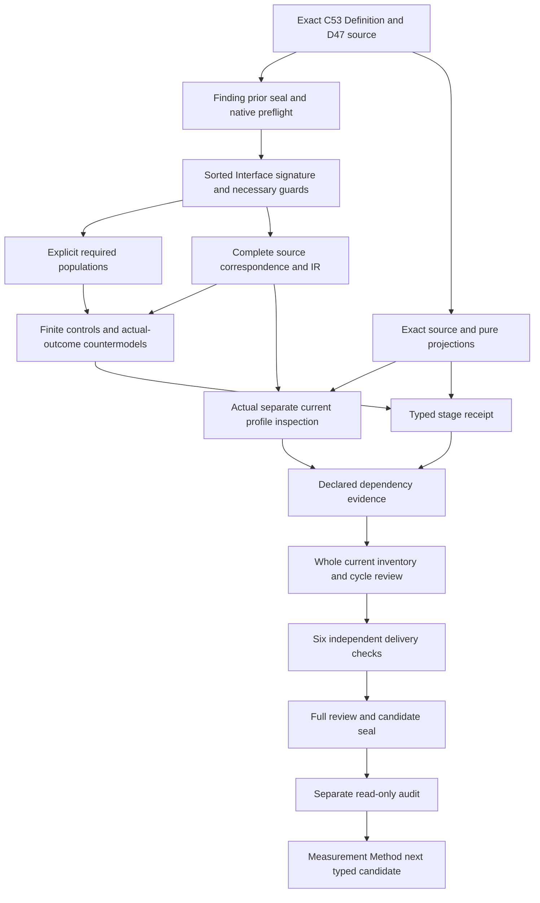

# Interface Claim-Support Compatibility Invariant: typed candidate review

## 1. Exact target and candidate stage

The selected target is cal.definition.interface-claim-support-compatibility-invariant@1.0.0-candidate.1,with current C53 Definition admission and exact Definition digest59775ceff8eff5c7683b8c2513b669a0b20b3b38a5f93c124e62d2fd28c4ced7. This review explains a partial typed interpretation with proposed denotations and explicit unresolved source obligations. It does not establish an accepted whole translation,consumer implementation,interface quality,governing authorization or formal proof. Types and logical direction precede carrier inspection and closure evidence.

The native author,corrected builder,corrected model checker and source checker have actual successful terminal results. Two failed builder attempts and one failed model attempt are retained with their exact original scripts,stdout,stderr,command results and hashes. Success does not erase those attempts. Independent contract,model and source checks must qualify the typed receipt;carrier/profile observations,whole dependency and inventory refresh,six-check delivery replay,full review,seal and separate audit remain later work. The stage cannot be promoted to a completed episode merely because its supplied interpretation passes.

The source concern is evidence honesty for interface claims. The theory separates classification and necessary declaration guards from actual adequacy,human outcomes,calibration,approval,authority and execution. Every required population and source precedence finding remains ownerpending. No source-owner acceptance is supplied by the candidate author or verifier. The complete project goal remains active with its original scope and final aspect-by-aspect review obligation.

## 2. D47 source lineage and authority separation

The current Definition retains CAV2-D47:Interface Evidence Boundary. The bound H2 extractor selects3,068bytes atf8d187d383d536b6e4271808161e7d103173380b89f3774692faefff76b37e2b from the local whole-file copy /home/vlad_/projects/cyberAlchemy-v2/authority/definitions/DEFINITIONS.md. That whole file matches the recorded admission digestecfbd64f334954809e83ffd5d4f9adfb759f39716de96c3ac1227d4ee869c6f8. C53 source-use admission CAL-SOURCE-FULL-DEFINITION-QUEUE-035 has exactly this one Definition target. The extractor strips trailing whitespace and supplies one newline;an untrimmed raw slice has different bytes.

C12 normalization planning splits D47 into semantic.interface-claim-support-compatibility-invariant and profile.ux-evidence-compatibility. The retained prototype is a scaffold with authority effect none. Its invariant kind,type.invariant carrier and scope.ux-ui context are separate from the source record's Definition/v1 representation and from any current profile carrier. The embedded source admission posture remains candidate-unadmitted with a null historical admission reference;the current C53 overlay is inspected independently instead of rewriting that history.

Exact local source bytes and a current admission overlay do not authenticate the separately declared live producer repository. That producer file is absent at its configured location. Selected local currentness therefore has a bounded claim ceiling. Accepted source-role equivalence,owner precedence and translation fidelity remain unresolved. Neither the legacy term nor the normalized invariant identity grants an interface claim deterministic authority or imports a sibling profile's meaning.

## 3. Sorted signature and identity qualification

The signature has nine nonempty sorts:Invariant,InterfaceClaim,ClaimClass,EvidenceKind,ProxyLimit,OwnerRoute,Residue,Context and Token. An invariant is separate from a claim governed by it. Class and evidence kind remain separate sorts,so matching is a relation rather than an accidental equality of strings. Proxy limits,owner routes and residues preserve their different obligations instead of being conflated with the evidence record. Context qualifies interpretation of class/evidence matching.

Six Token constants represent EMPTY,the normalized meaning identity,kind,carrier,owner scope and D47 lineage. Twenty-two total functions include five invariant metadata projections,seven claim projections and ten explicit reference handles. A total function means the supplied model assigns a result for every argument in its typed finite domain. Selected-scope guards require declared values and nonempty handles;totality itself does not establish external identity,accepted reference resolution or actual evidence. Outside-scope values remain possible and are tested separately.

There are74predicates and relations,including71unary predicates,two binary invariant-to-token sibling relations and the ternary ClassEvidenceMatches relation. All111declarations are qualified by the exact source version and candidate scope. Printed names or matching reference labels cannot silently identify symbols from another interpretation. Semantic-use dependencies are also exact current version references. No absent InterfaceClaim,ClaimClass,EvidenceKind,ProxyLimit or calibration Definition identity is invented merely because the candidate needs a descriptive sort. The distinction between a typed model carrier and an admitted canonical Artifact Type remains explicit.

## 4. Invariant classification and applicable claims

InterfaceClaimSupportInvariant is characterized by declared classification preservation,source-relation preservation,no silent sibling merge and exact normalized metadata tokens. This gives the proposed invariant a stable classification context. It does not declare a canonical instance admitted or create owner authority. The normalized type.invariant context must remain separate from the Definition/v1 artifact that records the meaning and from the interface claims governed by the rule.

InterfaceClaimApplicable is equivalent to UXClaimInScopeDeclared in this candidate. That is an explicit proposed scope map rather than an assertion that every artifact or browser event is an interface claim. Every applicable claim references the selected invariant and has typed projections for class,evidence kind,proxy limit,owner route,residue and context. Its tuple values require declared carriers and nonempty handles. Every applicable claim must also have a proxy limit declared to state what remains unproven,including a record that is not declared valid.

The source's operational examples cover validator specifications,Playwright reports,UI review findings,pattern cards,screenshot reviews and studio mutation handoffs. These explain applicability but do not prove that such activities have run or that a current consumer uses this exact tuple. Required populations and outside-scope controls expose the chosen scope boundary. Owner review must still determine concrete claim identities,contexts,reference resolution and adequate residue. A passing declaration model does not convert a current source classification into an implementation or authorization.

## 5. Five claim classes and taxonomy limits

HardGateClass,SoftFlagClass,ScreenshotReviewClass,HumanStudyClass and NotAutomatableClass retain the five named source categories. An applicable claim's projected class must have at least one of those labels. The supplied model has a witness for each category. The candidate does not require the labels to be mutually exclusive;an overlap control passes. Additional class-domain values can exist outside the selected scope. Their existence alone does not make them accepted new categories for an applicable claim.

The source says at minimum claims must be classified as one of these five. It supplies neither a universal ranking nor a numeric UX score. The single-valued claimClass projection and the selected five-label guard are proposed correspondence choices. They are not proof of an exhaustive taxonomy for every future interface or a universally accepted label algebra. A future extra category needs an explicit accepted map or a changed scope rather than being smuggled in through another carrier's enum.

ClassEvidenceMatches(ClaimClass,EvidenceKind,Context) keeps a proposed match specific to its context. Matching values are declared in the supplied model;the verifier does not infer them from the English class names or assume that every browser measurement belongs to a hard gate. A screenshot is not automatically a human study and a soft flag is not a calibrated risk estimate merely because of its label. These distinctions keep browser observations,accessibility evidence,heuristics,human-study needs and nonautomatable residue independently reviewable.

## 6. Necessary validity and explicit proxy disclosure

For an applicable claim,ValidClaimDeclared implies ClassEvidenceMatches and ProxyLimitStatesUnproven for its projected limit. The source says valid only when,so the formalization preserves necessary implication. It does not replace that statement with an iff. A required matched-but-not-valid population demonstrates that a matching tuple can exist without a validity declaration. A separate valid-declared witness demonstrates the necessary guards without actual truth,adequacy,authority or any other actual outcome.

Proxy disclosure is also a genus obligation for every applicable interface claim. The correction before successful construction added this guard to the common tuple structure. A discriminating negative control gives a not-valid-declared claim its own declared proxy-limit value that does not state unproven residue;that model fails T. The earlier candidate preparation had applied this condition only through the valid-declared guard. The successful native builder preserves the stronger source genus while retaining the necessary logical direction of validity.

The typed declaration does not establish that a real proxy limit adequately explains every unsupported claim dimension. Nonempty handles can still be unresolved or misleading,and an opaque evidence/class pair can be declared to match without accepted evidence semantics. Actual ProxyLimitAdequacy,SupportAdequacy and Truth therefore remain separate predicates with valid countermodels. The known losses retain those mappings as owner obligations. No countermodel denies that genuine adequate evidence or valid claims may exist;it shows only what this proposed theory and its supplied populations fail to entail.

## 7. Direct browser topics and measurement ceilings

The source names nine kinds of claim browser automation may directly support:page load,accessibility tree,keyboard,layout,interaction,screenshot,trace,console/network and DOM measurement. Each is retained as a separate InterfaceClaim topic label with a required browser-used witness. The selected evidence kind must be declared and marked BrowserEvidenceKind when browser evidence is used. This preserves the kind of supporting surface without automatically asserting actual adequacy or a complete browser investigation.

The word may is important for the claim ceiling. The theory does not force every browser observation to prove a direct topic or infer accuracy from an available trace. It also does not turn a passing keyboard control into complete accessibility compliance,declare screenshot quality a universal UX score,or treat successful page loading as evidence of user comprehension. The topic labels can overlap with human-topic labels in a candidate model;no unsupported exclusivity is imported from a schema.

Concrete browser fixtures,measurement thresholds,trace provenance,test conditions,scope and reproducibility remain separate correspondence work. The formalization does not run a browser or execute a validator implementation. Source artifact tests concern selected identity,source digests,schema and projections;they are not browser measurements. Independent countermodels retain actual Truth,SupportAdequacy,CompleteAccessibilityAudit and ConsumerAlignment outside T. Required direct-topic witnesses are deliberate finite examples rather than evidence of real UI performance or a calibrated acceptance gate.

## 8. Human claims and calibration plus approval

Cognitive,Attention,Perception,Trust,Comprehension,Delight and RealUserSuccess remain seven separate human-topic labels. Browser automation may prepare evidence for those claims. A required population for each topic preserves browser preparation without a deterministic-authority posture or actual deterministic authority. The theory does not infer what a human understood,felt,trusted or preferred from browser observations. Topic overlap is allowed without treating the overlap as a measured psychological result.

For an applicable human-topic claim using browser evidence,a declared deterministic-authority posture requires CalibratedFixturesDeclared AND OwnerApprovalDeclared,plus nonempty calibration and approval handles. Removing either declaration or either handle fails the supplied theory. These are necessary declaration guards. A witness with both declarations and no actual deterministic authority passes,so the rule does not turn the conjunction into a sufficient authority-creation theorem. Nonhuman or outside-scope postures are not silently subjected to this specific human/browser guard.

The real source prohibition concerns actual unsupported deterministic authority. This candidate does not implement that external enforcement or prove actual fixture calibration,actual owner approval,causal human outcomes or authorized governing effects. Those are deferred semantic obligations and separately typed actual-outcome queries. The countermodels show that reference and label guards cannot establish them. Owner review must resolve fixture populations,calibration criteria,approval principals,claim scope and evidence standards before a concrete consumer could rely on the declarations for consequential gating.

## 9. Weaker evidence and declared responses

WeakerEvidenceDeclared requires at least one DowngradeDeclared,RouteDeclared or BlockDeclared response and an explicit nonempty treatment handle. Each alternative has a required population and a negative control that removes the only response. Alternatives may overlap. The candidate does not infer an exclusive treatment state machine or equate a declared block with an executed governing action. A response reference remains a reference until its meaning and effective execution are independently established.

The D47 formal expression explicitly refers to CAV2-D38 when evidence class is weaker than the claim. The current Claim-Support Compatibility Invariant is therefore an exact qualified semantic-use dependency and separately selected comparison meaning. Its earlier theory,owner fidelity,domain strength relation,default wording choices and whole-proof status are not imported into this primary T. D47's three named responses are preserved directly. The weakness declaration has no assumed universal numeric ordering of UX evidence or claim strength.

Concrete consumers still need accepted maps for weakness,appropriate downgrade wording,routing authority,blocking scope and treatment effectiveness. A model can satisfy the response guard while ClaimActualRemediationExecuted remains false. That result is an honest logical ceiling,not evidence that real remediation failed or that weaker support should be ignored. Native command success,syntax validity and named references cannot supply the missing support assessment or authorize a mutation handoff. The correspondence packet retains the D38 cross-reference and response denotations as visible owner findings.

## 10. Dense expert blocking and role boundaries

A declared dense-expert blocking posture requires FalsePositiveCalibrationDeclared and a nonempty calibration handle. A supplied witness satisfies this necessary guard without actual false-positive calibration. Controls reject removal of the declaration or handle. The source excludes a license to block dense expert interfaces without false-positive calibration;this theory does not manufacture that license or determine an acceptable empirical false-positive rate. Concrete blocking policy remains separate from the candidate declaration shape.

The invariant cannot have ValidatorImplementationRole,CompleteAccessibilityAuditRole,UserResearchRole or UniversalUXScoreRole. These exclusions preserve the source's distinction between an evidence boundary rule and the activities or outcomes it constrains. They do not assert that those activities are impossible or that no complete audit,user study or useful score can ever exist. The source boundary is not silently turned into a denial of legitimate independently supported outcomes.

Conditional sibling meaning assignments require an explicit reference and a nonempty target token. The source's separate UX evidence profile is not merged into the invariant because the two share a D47 origin. Reference declarations do not establish accepted adoption or actual relation eligibility. All current role,calibration,blocking and sibling maps remain source-owner correspondence obligations. No Artifact Type,Typed Relation,new authority or private/live consumer is created by this stage. This keeps the rule useful while preventing declaration success from becoming an unsupported implementation or compliance claim.

## 11. Character account,compiled logic and finite checks

The character account covers22sourceunits with28mappedspans:9encoded,9explanatory and10deferred. Every selected nonempty source string is accounted for,including gaps,source boundaries,scope,notation and claim ceiling. The nine encoded spans have eight distinct formula values assembled from ten primitive formulas. Repeated source boundaries retain their own provenance rather than being deduplicated out of the account. No unreviewed premise or actual-outcome assumption is introduced.

The finite model checker evaluates84authoredcontrols:34satisfyT,43failT and7are structurally malformed. It independently checks31requiredpopulations where requested. Controls cover normalized identity,tuple/class declarations,proxy disclosure,necessary matching,browser kind,human fixture/approval guards,weakness responses,dense-expert calibration,role exclusions,sibling references,overlap and outside-scope behavior. Malformed controls exercise the native signature denominator,total-function completeness,sort correctness,tuple arity,duplicate tuples and domain nonemptiness. Their expected fault names now match the existing native verifier.

Twenty-two countermodel queries separate seven invariant actual outcomes and fifteen claim actual outcomes. Each supplied countermodel satisfies T and required populations while falsifying its queried target and satisfying its witness condition. Eleven exact source-query obligations retain necessary encoded declaration guards while explicitly leaving actual-outcome targets outside T. Thirty-four native source observations pass,including C53/C12 selections,the exact D47 section and two deterministic6,501byteDefinitionprojections at137effd7c3682c95ce057f3e9d5a6fd2a189db6da3426bdb20292816d1df36a3. Finite evidence does not prove universal source fidelity or a whole Definition.

## 12. Execution DAG and remaining carrier work

The execution plan separates the acyclic order of work from semantic dependency closure. The current candidate declares32exactsemanticuses,including the source's D38 comparison,without resolving their joint denotations. No semantic cycle is classified merely because the author,builder or verifier completed. The full dependency and inventory refresh must still evaluate the new candidate alongside all earlier drafts and preserve qualified sources and edges.

The current registry inspection in preparation found no admitted-current Artifact Type directly binding this invariant. Subsequent profile inspection must use actual current separate surfaces and their own admission/meaning records. It must preserve the C12 split between invariant and UX evidence profile. A nonexistent direct carrier,payload,relation-role table or relation-model binding must not be invented. Even a real admitted profile would need accepted correspondence to the complete five-field tuple,necessary guards and source boundaries;its schema cannot automatically establish the invariant's semantics.

The typed stage first needs three independent actual contract,model and source replays,its complete review and frozen receipt. Actual profile observations then feed dependency and whole inventory evidence,six separate delivery checks,the complete delivery review,candidate seal and separate audit. Measurement Method cannot create its next native unit before that audit. Required source-owner fidelity,whole proofs,consumer maps,semantic cycle review and final complete episode explanation remain explicit obligations rather than being hidden behind successful finite checks.

## 13. Failed attempts,preservation and continuation

Finding completed its full candidate seal and separate read-only audit before this unit was created. All6,068previoussealedfiles and201selectedsourcefiles are preserved by the successful native preflight. The first builder attempt called a nonexistent correspondence.inventory_source helper and created no interpretation. The second used an incorrect five-paragraph assertion;the actual source has six paragraphs because the class heading and list are separate. It also created no interpretation. The corrected builder uses correspondence.inventory and preserves the exact source paragraph boundaries.

The first model attempt reached a malformed-model control whose expected fault name differed from the native verifier's model-signature-denominator-mismatch. It created no model report. The retained attempt remains actual exit one. Correction also uses the native nontotal-function name for the incomplete total-function control. Successful model and source results are separate actual terminal observations with empty stderr. Original preparation files remain unchanged inside Finding's seal;repairs are confined to this newly authorized candidate unit.

The working typed draft count is73,leaving110currentidentities without per-definition T files. The last full delivery inventory remains72until the later refresh executes. The episode scope remains183currentidentities189admittedversions201sourcefiles121tasks511planningedges797SWUs and36frontiers. Whole-owner-accepted translations and whole-definition proofs remain zero. The historical I04 inventory remains its exact selected eight drafts and requires a separate reporting update. Continue current carrier/profile inspection and closure after the typed receipt,then Measurement Method after the full delivery audit. Preserve canonical authorities,private/live state,unrelated dirty work and every prior seal. The sixteen owner findings remain unresolved below;the overall goal remains active.

- **ICSI-FINDING-001** — C53 Definition/source admission,C12 planning scaffold and source-owner fidelity remain separate.

- **ICSI-FINDING-002** — Normalized invariant identity,type.invariant and scope.ux-ui need accepted denotations;classification grants no instance authority.

- **ICSI-FINDING-003** — Applicable InterfaceClaim scope and five-field tuple projections are proposed typed maps,not actual consumer implementations.

- **ICSI-FINDING-004** — Five at-minimum class labels and a single-valued projection do not prove an exhaustive,exclusive or universally accepted taxonomy.

- **ICSI-FINDING-005** — ClassEvidenceMatches is a context-qualified declaration relation,not an accepted numeric strength order or actual evidence adequacy.

- **ICSI-FINDING-006** — Valid only when remains a necessary implication;matching and proxy-limit declarations are not sufficient actual validity or truth.

- **ICSI-FINDING-007** — Direct browser topic labels retain nine possibilities;may support does not grant accuracy,complete accessibility compliance or hard-gate authority.

- **ICSI-FINDING-008** — Seven human-topic labels and browser preparation remain separate from cognition,perception,trust,understanding,delight or real-user outcome proof.

- **ICSI-FINDING-009** — Calibrated fixture and owner approval declarations are necessary human deterministic-posture guards,not actual calibration,approval or sufficient authority.

- **ICSI-FINDING-010** — D38 is an explicit cross-reference;its whole theory,owner fidelity and treatment semantics are not imported into primary T.

- **ICSI-FINDING-011** — Weaker-evidence comparison and downgrade/route/block declarations require accepted meaning and do not execute remediation.

- **ICSI-FINDING-012** — Dense-expert blocking requires declared false-positive calibration;references do not establish measured calibration or a license to block.

- **ICSI-FINDING-013** — Invariant role exclusions do not prove actual completeness of audits,studies or validator implementations.

- **ICSI-FINDING-014** — Owner route,residue and proxy-limit handles require accepted reference resolution and adequate disclosure;nonempty labels are insufficient.

- **ICSI-FINDING-015** — Conditional sibling assignments require explicit references without proving adoption or collapsing meanings.

- **ICSI-FINDING-016** — Every actual outcome,source test condition,carrier/consumer map and semantic cycle needs independent review;finite supplied witnesses are not whole proofs.

