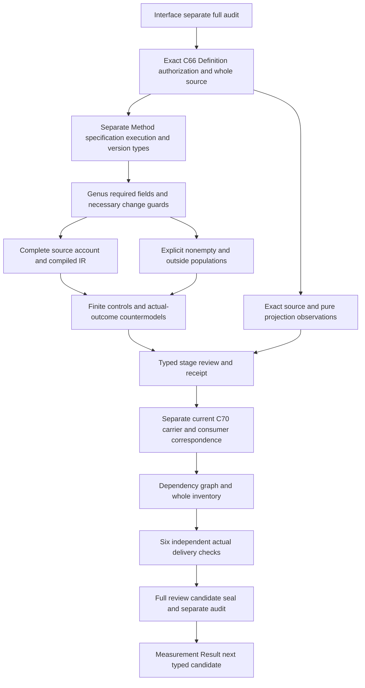

# Measurement Method: next types and logic design

Prepare F03-T.cal.definition.measurement-method after Interface Claim-Support Compatibility Invariant passes full delivery and its separate audit. No next native unit,theory,model,carrier or source-owner acceptance is created here.

The current positive Definition has C66 specialization admission,version1.0.0-candidate.1,digestb63f9192cc3141856e89aa9d603f16dac04d3530df27082486f999a0dc6f7b94. Its source is cal.source.step3.remaining,whole-file,at authority/artifact-types/candidates/0005-remaining-18-complete-model/model.json,digest9e80895df1887113cfc407de6ed4d11f6cd37d4ac10857389ee060e1139c9f36. Inspect exact C66 authorization,candidate,resolution and source bindings. This is a new positive Method meaning rather than borrowed generic Definition meaning. C66 admits Definitions and a resolution overlay;it explicitly admits/rebinds zero carriers and activates zero consumers. Current C70 Method carrier inspection is separate. Preserve historical source candidate/null posture.

Proposed sorts separate Method,MethodVersion,Procedure,Property,SubjectSpecification,ActualSubject,Conditions,UnitSystem,Tool,ToolVersion,Implementation,ImplementationVersion,CalibrationState,SamplingRule,Computation,UncertaintyRule,Evidence,Applicability,OwnerRoute,FailureContract,ReproducibilityCriterion,Execution,MethodChange and Token. Exact sort boundaries and reference maps need owner review. Do not invent corresponding canonical Definition identities simply to label descriptive sorts.

The genus is a declared versioned reproducible procedure for one declared property of a subject under conditions. Total typed projections retain the property,procedure,subject specification,conditions,units,Tool or instrument,Implementation,calibration,sampling,computation,uncertainty,evidence,applicability,owner and failure boundaries. Declared reproducibility criterion is distinct from actual repeated-measurement reproducibility. Nonempty handles and bound declared versions do not authenticate physical calibration,evidence or correct execution. Residue Measurement is one use;the Method remains applicable to other governed properties rather than becoming a residue-only alias.

Keep Method specification and Execution separately typed. Selected execution declarations bind exact actual subject,conditions,Method version,Tool version,Implementation version and calibration state. Reference equality in a proposed map is not proof of real subject suitability,calibration or execution. Do not infer an execution or Measurement Result merely because a Method specification exists. Required populations include a complete Method without execution,a Method without actual outcomes,a bounded execution declaration without actual correctness and an outside-scope record.

For a declared MethodChange,changing the procedure OR uncertainty treatment requires a distinct new Method version. Preserve that necessary condition without imposing an unsupported total ordering,semantic-version arithmetic or automatic owner admission. Unchanged inputs do not force version equality or prohibit legitimate other revisions. Preserve actual version provenance and the meaning of changed procedure/uncertainty as unresolved maps rather than comparing opaque text strings as physical procedures.

Exclude Method-as-MeasurementResult,Observation,metric value,Finding,EvidenceSet,Decision or authority rule. Governed and bounded declaration guards do not imply actual authority. Countermodels must retain T and explicit populations while falsifying actual calibration,reproducibility,correct execution,subject suitability,result acceptance,truth,Finding,decision,authority,owner fidelity and consumer alignment. Source testable conditions are partly semantic requirements here,not the four migration-observation tests of D47;classify them individually instead of copying that old rule.

Controls should reject missing required procedure fields,empty selected handles,missing governed/bounded declarations,missing reproducibility criterion,wrong declared execution versions/calibration state and changed procedure or uncertainty with an unchanged Method version. Controls should preserve outside-scope records,multiple independent governed properties across different Methods,Method-without-result and independent actual outcomes. Malformed controls must use exact native verifier APIs and fault codes. Inspect correspondence.inventory and source paragraph structure before constructing the builder;do not reproduce the retained Interface helper/paragraph/fault-oracle mistakes.

Original episode scope183currentidentities189admittedversions201sourcefiles121tasks511planningedges797SWUs36frontiers remains unchanged. Accepted source fidelity,whole proofs,carrier/consumer maps,semantic cycle review and the final complete episode explanation remain required.
