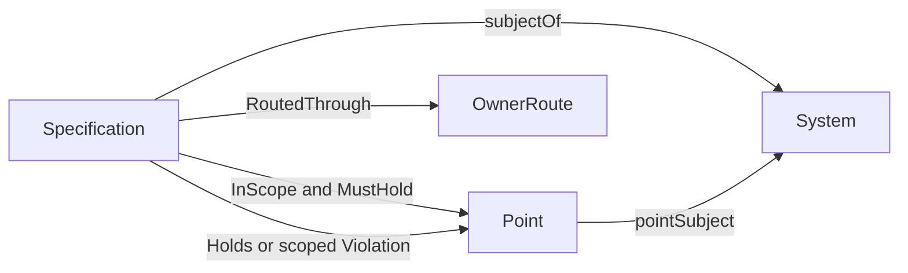

# Invariant: formalization review

Candidate progress, 2026-10-08. Authority effect: none. `F01-T.cal.definition.invariant` has a verified **partial** interpretation of requirement metadata and scoped breach, with separate satisfaction targets and authored finite operational examples. Whole translation, fidelity, dependency closure, population policy and implementation preservation remain pending. The episode still covers 183 current identities and 189 admitted source versions.

The selected source is `cal.definition.invariant@1.0.0-candidate.1`, SHA-256 `cf04f6e6e5adadc778059b0227248eff2c63130b73b84955507512f421eb3654`. It is the Invariant Definition/v1 record in the admitted reconstruction pipeline. Twenty-two selected string units are accounted through 38 exact character spans: eleven encoded, nine explanatory and eighteen deferred. Encoding a span reports a proposed static interpretation; it does not certify that every nuance has survived translation.

## 1. Requirement, satisfaction and proof obligation

The source describes a condition on a system's own behavior or artifacts which must remain true across its declared scope. It explicitly permits the system to violate that condition, with the violation indicating drift or defect. Consequently, normative requirement and observed satisfaction cannot be the same relation in this interpretation.

`MustHold(i,p)` records that specification i requires its condition at point p. `Holds(i,p)` records the satisfaction assigned in a mathematical structure. Neither executes the condition or authenticates a world observation. A structure may have MustHold true and Holds false without contradicting the concept of an invariant. The bad implementation is then represented by a breach, rather than making the specification concept inconsistent.

The target “every scoped invariant point actually satisfies the condition” is outside the theory T. A checked countermodel satisfies T and its required populations while falsifying that target. A second countermodel shows that Invariant membership alone does not entail GovernanceActive. These are two separate targets and authored witnesses, not exhaustive searches or universal prohibitions on satisfaction and governance.

`INV-MUST-001` retains the semantic question: this static slice does not lower deontic necessity, temporal always, or a particular implementation's preservation theorem into metadata. An implementation proof must supply its own justified initial conditions, transition semantics, condition evaluator and scope, then establish the target. Recording the target as an assumption would not prove preservation.

## 2. Definition artifact and typed signature

The source artifact defines the concept Invariant. It is not a particular runtime condition, a measured system trace, a Constitution or an executing validator. The candidate signature contains 26 declarations: four nonempty sorts, two total functions, thirteen unary predicates and seven binary relations.

Specification is the carrier of abstract requirement descriptions; System is the carrier of their subjects; Point represents a declared state, transition, decision or transformation evaluation point; OwnerRoute represents a declared governance route. This is a candidate mathematical interface, without an admitted storage shape or selected condition language.

`subjectOf : Specification -> System` and `pointSubject : Point -> System` are total accessors within the model. Every scoped point for an invariant must belong to its system subject and have at least one declared point kind. The point kinds use inclusive or: the model does not assume disjoint extensions or require every kind to exist. Separate points and payloads for transition endpoints may be needed in a reviewed operational profile.

The evaluator rejects an accessor with an ill-sorted result, an incomplete total-function table, a relation with the wrong arity and a duplicate predicate tuple. These checks substantiate the selected model's structure; they do not prove canonical serializers or real system identity mappings. `INV-SCOPE-002` keeps those mappings and operational scope choices unresolved.

## 3. Necessary conditions and role boundaries

Invariant implies OwnSystemCondition, Checkable and SingleCondition. The source's explicit boundaries also exclude AxiomRole, ConstitutionRole, ValidatorRole and GateRole on the same candidate Specification carrier. These are necessary-condition implications, not a complete membership biconditional.

Checkable is a primitive property here. Its presence does not establish a correct, complete or implemented checker. SingleCondition does not assert syntactic atomicity: a condition may have internal structure, and a chosen expression language must determine what counts as one condition. The contrast with Constitution distinguishes a single required condition from a scoped rulebook rather than equating their serialized forms.

The role tags do not import actual counterpart predicates from independently translated Axiom, Constitution or Gate definitions. Source-qualified symbols and carriers must be aligned through reviewed contracts before a cross-definition disjointness or inclusion claim can be checked. Nominal types and different printed labels do not supply semantic distinction evidence. `INV-PARENT-005` retains this limitation.

GovernanceActive requires an Invariant and a declared OwnerRoute witness. Membership does not force governance, and a route alone does not force activation. A positive routed model demonstrates hypothetical compatibility. It is not an owner decision, authorization, admission or successful governance execution.

## 4. Scoped breach and diagnostic interpretation

The candidate abbreviation is `Violation(i,p) iff Invariant(i) and InScope(i,p) and not Holds(i,p)`. Violation requires Drift or Defect, using inclusive or. Controls permit either diagnosis alone and their overlap, while rejecting a scoped failure without its breach tag, a breach without diagnosis, and a satisfied point labelled as a breach.

An unsatisfied point outside the declared scope does not become a violation of that scoped invariant. This is a checked boundary of the candidate interpretation, without a claim that the point is globally harmless or that no other requirement applies.

The source's “can violate” does not require an actual breach in every admissible structure. Both compliant and defective authored structures satisfy the requirement metadata. Countermodel availability explains the distinction; it does not prove reachability in an actual system or modal possibility under unspecified operational laws. `INV-BREACH-003` retains the possibility and diagnostic contracts. Drift and defect tags remain assigned properties without an admitted diagnostic evaluator.

## 5. Nonvacuity and assumptions

Five population obligations require a hypothetical Invariant, OwnSystemCondition, Checkable, SingleCondition and a joint Invariant/InScope witness. The joint obligation is separate from nonempty sort domains. A nonempty Specification sort can still have no Invariant instances; a populated Invariant predicate can still have empty scope.

Controls demonstrate that either of these vacuous cases can satisfy the directional theory while failing required population obligations. This prevents a passing static theory from silently claiming an inhabited scoped concept. The witness is hypothetical, not evidence of a live invariant or an observed failing system.

Nine auxiliary population policies remain unresolved: five Specification role/governance predicates and four point kinds. No owner exemption, actual authority instance, validator or mandatory occurrence of every point kind is invented. The selected assumption list is empty. The satisfaction and preservation queries remain separate from all definitions and population policies.

## 6. Operational examples and their distinct denominators

The finite scenario interface retains the exact primary clauses and population selection. It extends the signature only with InitialPoint and Next. The three typed targets are initial satisfaction, step preservation together with scope retention, and satisfaction throughout the declared scope. They add no premises to T. Actual reachability is computed independently by breadth-first traversal of the authored finite graph, without trusting a recursive Reachable predicate.

| Authored scenario | Initial target | Step target | Reachable points satisfy | Entire declared scope satisfies |
| --- | --- | --- | --- | --- |
| Good start, later bad reachable step | true | false | false | false |
| Bad declared point is unreachable | true | true | true | false |
| Every declared point is good | true | true | true | true |
| Initial point is bad | false | true, vacuously | false | false |
| Initial set is empty | true, vacuously | true | no profile claim | true |
| A step exits the declared scope | true | false | no profile claim | true |

All six retain valid primary requirement metadata and required populations. Four satisfy the synthetic profile's nonempty-initial and closed-state-scope conditions. The other two explicitly fail that profile and cannot supply positive reachability claims. The closure policy belongs to this illustrative profile; it is not introduced as an unconditional source axiom forbidding every real scope exit.

For the bad reachable case, independent traversal returns `p0 -> p1 -> p2`; p2 fails the assigned condition. In the unreachable case, the traversal reaches only p0 and p1, while the larger declared scope still includes bad p2. This difference prevents a reachable-state result from certifying a broader scope. No case is bound to executable production transitions, a live condition evaluator or an unbounded trace theorem.

## 7. Grounding, enforcement, children and semantic cycles

Eight authored direct uses bind exact Axiom, Constitution, Gate and Definition versions and the four named child invariants: Typed Coupling, Root Axis Independence, Claim/Support Compatibility and Closed Authority Kind. These are use-site provenance, without selecting the children as axioms or proving their generic-parent inclusion.

The source says grounding answers why a condition holds, a Constitution operationalizes it, and a validator or gate enforces it. Those references are deferred operational contracts. Guidance to trace a relationship, a declared enforcer, and successful actual enforcement are different claims. No current `cal.definition.validator` identity is manufactured. The selected Gate definition still needs an owner-reviewed mapping to a concrete enforcement contract. `INV-ENFORCER-004` retains these questions.

Including the available partial Axiom and Definition packets produces thirteen nodes, fifteen edges and ten missing counterpart packets. Axiom references Invariant, and Invariant references Axiom. The graph correctly retains their strongly connected component and reports unresolved cycle classification. Joint analysis is required; arbitrarily ordering the references cannot remove the cycle. It also cannot infer a recursive constructor, least fixed point, consistency proof or fidelity approval from that component.

## 8. Source and admission evidence

Twelve read-only checks pass for the selected Definition identity, schema and generator digests, actual Definition/v1 schema validation, deterministic rendering, exact stored projection, selected legacy section and exact admission/registry bindings. The projection has 7,422 bytes, SHA-256 `fec942c6e7863a63c466241260fbb7b651e5243c837f64e621c4bf878b03434d`.

The existing bounded extraction function selects 4,799 bytes for CAV2-D54, SHA-256 `722012e8ba37de92d0f13886380e8510db2ebec622f679f45b7a875a698945de`. Its unique-heading and trailing-whitespace normalization policy is retained. Decision `CAL-DECISION-0053-FULL-DEFINITION-QUEUE-ADMISSION` binds the exact source-admission record with the sole Invariant target. The current registry source is admitted despite historical candidate wording embedded in the record. That overlay concerns source use; it does not approve this interpretation.

The checked local copy is `/home/vlad_/projects/cyberAlchemy-v2/authority/definitions/DEFINITIONS.md`. Its complete bytes match the recorded admission-time digest. The producer's declared file under `domainspec-core/cyberAlchemy-v2` is absent. A content match does not authenticate repository identity or live routing/currentness. Accordingly the source's digest condition remains PARTIAL for live-source currentness. Producer configuration and external sources were not changed.

## 9. Verification strength and remaining work

Thirty-two authored model controls, two separate countermodel outcomes, six finite scenarios, twelve bounded source checks and the dependency graph are reproducibly checked. Fresh replays preserve the outcomes. All 201 captured source/provenance files, the selected external file and all 869 files in the predecessor delivery are rechecked. A failed scenario-interface attempt is preserved: the closed contract required nonempty source clauses, so the corrected interface retains primary clauses and extends only its signature.

This evidence supplies neither native-provider enumeration nor mechanized, temporal or deontic proof. Eighteen clauses, five interpretation findings, nine population policies, ten counterpart packets, cycle meaning, operational contracts, four-child inclusions and source-owner fidelity remain unresolved. The task result stays PARTIAL. Premise is the next independent foundational draft, followed by Schema and Semantic Primitive. Complete episode translation and the final whole-episode aspect review are still pending.
