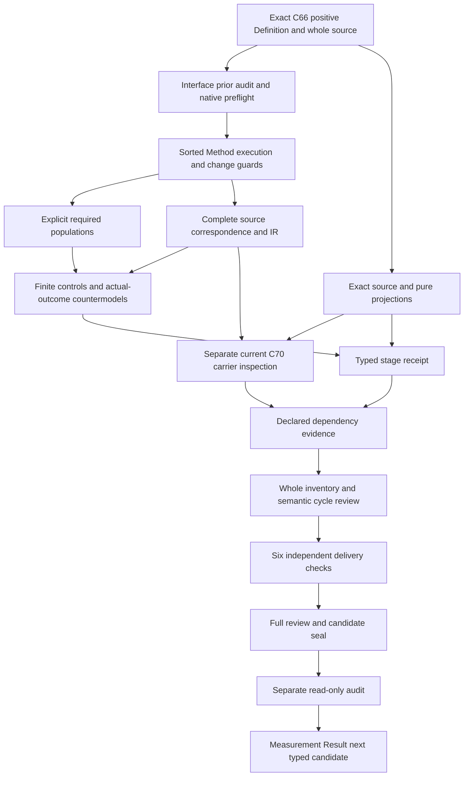

# Measurement Method: full candidate delivery review

## 1. Exact target and actual full candidate delivery

This delivery review selects cal.definition.measurement-method@1.0.0-candidate.1 at b63f9192cc3141856e89aa9d603f16dac04d3530df27082486f999a0dc6f7b94. It explains a partial typed candidate with exact C66 positive Definition and local whole-file lineage. Definition admission,source-owner acceptance of this translation,current carrier admission,consumer implementation and actual measurement outcomes remain different claims. This review does not establish accepted whole translation or a complete Definition proof.

The author,builder,model,source,profile,dependency and inventory producers each have actual terminal exit zero and empty stderr. The independent contract,model and source replay qualified a frozen sixteen-input types-stage receipt;its separate semantic audit passed. The audit's first printed summary contained a stale working-draft count of73 although the assertions and receipt correctly required74. That diagnostic was corrected and the original checker and tool-observed exit-zero summary are retained. The later audit correctly prints74. No semantic audit failure is fabricated from that reporting correction.

Carrier and dependency evidence now follows the typed theory. Six independent actual delivery checks pass with fresh stdout matching their initial producer observations. The candidate can be sealed only after those observations,the complete review and exact input preservation are verified. Its separate seal audit is a further required step. Whole source fidelity,calibration,reproducibility,correct execution,suitability,results,authority and consumer correspondence remain pending. The priority continues to be definitions,types and logic,with Measurement Result next after the independent full audit.

## 2. Exact C66 source and admission lineage

The selected Definition is a new positive meaning in authority/definitions/candidates/0014-definition-specialization-resolution. Its admission is CAL-DECISION-0066-DEFINITION-SPECIALIZATION-RESOLUTION-ADMISSION. The checker binds the exact current registry row,C66 decision,authorization,candidate and resolution overlay. The authorization binds the selected Definition digest;the candidate lists its disposition as new-positive-definition. This matters because Measurement Method now has its own primary semantic identity rather than borrowing the broader Definition meaning.

The declared source is cal.source.step3.remaining with selector whole-file. Its exact local path is authority/artifact-types/candidates/0005-remaining-18-complete-model/model.json. The selected whole file has 60,288 bytes and digest 9e80895df1887113cfc407de6ed4d11f6cd37d4ac10857389ee060e1139c9f36. Candidate source bindings name CyberAlchemy-lab and the whole-file selector. This lineage does not use a C53 source-use row,a D47 H2 extractor,a C12 normalization scaffold,or an external legacy producer. Those earlier patterns are deliberately absent from this unit's observations.

The source body retains candidate-unadmitted posture and a null source_admission_ref. C66's current admission overlay is inspected separately,without rewriting historical fields. Its recorded effects admit seven Definitions and one resolution overlay;Artifact Type admissions,rebindings and consumer activations are zero. The historical decision counts are not substituted for the episode's current 183 identities and 189 versions. Exact byte bindings establish which materials were selected;they do not by themselves establish accepted translation fidelity,consumer alignment or a proof of the Method's actual suitability.

## 3. Signature,qualification and descriptive sorts

The candidate's nonempty sorts distinguish Method,MethodVersion,Property,Procedure,SubjectSpecification,Conditions,UnitSystem,Tool,Implementation,CalibrationContract,SamplingRule,Computation,UncertaintyRule,Evidence,Applicability,OwnerRoute,FailureContract,ReproducibilityCriterion,ActualSubject,ToolVersion,ImplementationVersion,CalibrationState,Execution,MethodChange and Token. The actual declaration list below is authoritative for the count and spelling. Method is a versioned specification record;Execution and MethodChange have independent domains. Printed names cannot identify symbols from a different source version or scope.

One Token constant represents EMPTY. Seventeen total Method projections preserve its version and declared components. Nine execution projections retain the selected Method,actual subject,conditions,exact versions and calibration state. Two change projections identify the proposed source and target Method records. Typed handle functions retain explicit references for these carriers. Totality means every finite domain argument has a result in the supplied model;it does not mean every record is a valid Method or every handle resolves to a real external object. Selected guards require declared values and nonempty references.

The signature also separates declaration predicates,role exclusions,actual-outcome predicates and version-binding relations. ToolVersionBoundTo and ImplementationVersionBoundTo relate distinct version and object sorts. They do not equate opaque strings or force a global latest version. Every declaration is qualified by exact source and candidate scope. Descriptive labels such as SubjectSpecification,CalibrationContract and ReproducibilityCriterion are proposed model sorts,not invented canonical Definition identities. Owner review must still accept their denotations and concrete reference maps.

## 4. Genus and complete specification obligations

MeasurementMethod is equivalent to MethodSpecificationInScopeDeclared in the candidate. That equivalence records a proposed selection map. It is not a sufficient test of physical reproducibility or a claim that any schema-shaped artifact is a valid admitted Method. A selected Method must declare a versioned procedure and a stated reproducibility criterion. Its single-valued property projection represents one declared property per specification. Different Method records can retain different properties;the model includes that distinction explicitly.

All seventeen Method projections require declared targets and nonempty handles. They cover version,property,procedure,subject specification,conditions,unit system,instrument-or-Tool specification,Implementation specification,calibration contract,sampling,computation,uncertainty,evidence contract,applicability,owner route,failure contract and reproducibility criterion. This retains the genus's complete component list rather than reducing Measurement Method to a numerical formula or a name. Necessary guards reject missing fields,declarations or references in selected records. Outside-scope records remain possible and do not inherit those requirements automatically.

The source's first testable condition reinforces naming of property,units,procedure,conditions,calibration,sampling,computation,uncertainty,evidence and failure contract. Here those are semantic requirements,not migration-only observations. They therefore contribute to the typed structure guard. Declared completeness does not establish adequacy of a sampling plan,valid units,a sound uncertainty model or an appropriate failure response. Those require accepted interpretations,measurement-domain evidence and owner decisions. No owner acceptance is inferred from the successful source account or from a complete finite witness.

## 5. One property,subject parameterization and breadth

The single property function means each selected Method specification has exactly one declared property value in a supplied interpretation. It does not mean all Methods share the same property or that a Procedure is universally adequate for every subject. The model includes a residue-oriented Method and another Method with a distinct property. Residue Measurement is preserved as one permitted semantic use,while other governed properties remain possible. The source's breadth is not translated into a requirement that every Method have both residue and other-use labels.

SubjectSpecification and ActualSubject are separate sorts. A reusable Method can describe a class or contract of subjects while individual executions bind different actual subjects. The supplied model contains two selected executions of one Method with different actual subjects. No function from Method to one universal ActualSubject is introduced. Instrument-or-Tool and Implementation specification components likewise remain distinct from the exact selections named by each execution. The candidate permits different declared selections under WithinMethodConditionsDeclared;that guard requires an accepted map before it can establish real compatibility.

Source applicability,units,evidence requirements and failure boundaries constrain the declared procedure. They do not automatically authenticate those subjects or demonstrate suitability. The reference handles are structural witnesses,not credentials or physical identity tests. Controls preserve an outside Method and independent use labels. Owner review must determine how subject specifications,actual subjects,tools,implementations and applicability rules correspond in a concrete consumer. Passing the candidate demonstrates that these distinctions are expressible without collapsing the source's broader Method meaning into its residue-entropy example.

## 6. Calibration and reproducibility declarations

CalibrationContract and CalibrationState are deliberately distinct proposed sorts. A Method specifies calibration requirements,whereas an execution binds a particular declared state. A named contract and a nonempty state handle do not demonstrate that an instrument was calibrated,that the calibration remains valid,or that a calibration fixture is appropriate. Actual calibration predicates remain outside the encoded declaration theory. Countermodels satisfy the complete Method and execution guards while those actual predicates are false.

ReproducibilitySpecified and the ReproducibilityCriterion projection preserve a stated criterion. The source's second testable condition says repeated execution under declared equivalent conditions has a stated reproducibility criterion. The candidate encodes that naming obligation for selected Methods. It does not turn declared equivalence into proof that conditions are physically identical or that repeated measurements meet the criterion. Actual Method and execution reproducibility are separate query targets. There is no inferred experimental result,confidence interval or numerical error bound merely because the uncertainty treatment is named.

SamplingRule,Computation and UncertaintyRule remain distinct typed components. Their semantic adequacy depends on the measured property,subject class,conditions and instrumentation. Source-owner findings explicitly retain that unresolved meaning. A calibration declaration can coexist with actual calibration outcomes independently;controls permit independently supported positive outcomes as well as their absence. The no-inference boundary is therefore an independence condition,not a prohibition on calibrated Methods or reproducible measurements. Concrete experiments and accepted consumer correspondence remain required for those stronger claims.

## 7. Execution scope and exact binding

MethodExecution is equivalent to ExecutionInScopeDeclared in the candidate. Every selected execution references a selected Method and carries WithinMethodConditionsDeclared. Its typed projections bind the actual subject,conditions,Method version,Tool,Tool version,Implementation,Implementation version and calibration state. Each target needs a declared carrier and nonempty handle. The execution's Method version must equal the version of its referenced Method specification. Its Tool and Implementation versions must have their corresponding declared version-to-object relations.

This translates the source's exact execution-binding boundary without inventing a live latest-version rule. A historical Tool version may be a legitimate declared selection;the theory does not compare version labels numerically or silently update references. The Method's subject specification does not replace an execution's actual subject,and its calibration contract does not replace a bound calibration state. Whether those selections actually satisfy the procedure remains an unresolved correspondence obligation. Reference equality proves only the selected model equality,not authentication or operational correctness.

Negative controls remove execution scope,component declarations,handles,Method membership and version-binding relations. They also substitute the wrong Method version. Separate controls allow outside-scope records without imposing selected requirements. A complete Method can remain without any selected execution,and all selected execution populations are requested independently. No execution is inferred from the Method specification itself. The candidate records actual execution correctness,suitability,result existence,result acceptance and authority as independent targets that finite countermodels can falsify while preserving the declared bindings.

## 8. Procedure and uncertainty revision logic

MethodChange is independently typed and selected by ChangeInScopeDeclared. A selected change has a nonempty reference and projects to selected source and target Method records. If ProcedureChangedDeclared OR UncertaintyTreatmentChangedDeclared holds,those records must have distinct Method versions. The disjunction is inclusive:changing either component is enough,and changing both does not weaken the requirement. Controls exercise procedure-only,uncertainty-only and both-change cases that incorrectly retain the old version.

The implication is necessary rather than sufficient. Distinct version labels do not prove that the procedure was changed correctly,that uncertainty treatment is adequate,or that the revised Method was admitted. The model imposes no total order on MethodVersion,no semantic-version arithmetic and no relation that identifies a higher version with greater authority. An otherwise declared opaque distinct label is permitted. A declaration without either selected change flag can retain a version or have a distinct version;unchanged inputs do not become a ban on other legitimate revisions.

ProcedureChangedDeclared and UncertaintyTreatmentChangedDeclared require accepted meanings. They are not computed by comparing raw strings as if text inequality proved a physical procedure change. The source/target Method projections likewise do not prove actual provenance or lineage of the revision. The candidate does not impose an unsupported identity rule across all revisions. Version bindings preserve the necessary source boundary,while owner review must resolve conceptual method identity,property continuity,content history and the circumstances that justify a new admitted version.

## 9. Role separation and no inference of outcomes

A selected Method cannot be labeled as the Measurement Result,Observation,metric value,Finding,Evidence Set,Decision or authority rule itself. These explicit role exclusions protect the source's genus from collapsing into an outcome or governance decision. They do not ban separately typed results,observations or Findings produced through legitimate later work. The theory can coexist with actual outcomes when independently supported. Positive controls add individual actual predicates without turning them into consequences of specification completeness.

GovernedDeclared and BoundedDeclared preserve the formal expression's necessary governance and boundary guards. The expression also states that MeasurementMethod does not imply authority_effect. That non-inference is represented by an explicit actual-authority countermodel query,rather than by asserting that authority can never be present. The same approach applies to the source's no-result-or-conclusion condition. A complete specification without execution is witnessed;result existence,Finding,Decision and truth are independent actual targets. This distinguishes a procedure declaration from an performed measurement or accepted conclusion.

Fourteen Method actual outcomes and nine execution actual outcomes remain separately queryable. Method-does-not-force-Execution adds a further target. A supplied witness can satisfy the declaration theory and explicit populations while each queried implication is false. These checks establish bounded non-entailment in the candidate's sorted finite semantics. They do not establish whole source fidelity or universally characterize every possible measurement system. Actual authority,admission,activation,consumer alignment and owner acceptance remain separate processes requiring their own evidence and scope.

## 10. Complete source account and compiled logic

All selected nonempty string leaves in voices,boundaries,scope and claim ceiling receive correspondence spans. Repeated source boundaries retain their separate provenance instead of being removed because their text matches. The normative statement is split at its explicit role-exclusion sentence,so the genus and the exclusions have distinct source locations. Encoded requirements cover structure,governance,role separation,execution binding and necessary version changes. Explanatory strings retain intuition,notation and the residue-entropy example. Deferred clauses remain visible with exact rationales and owner findings.

The character account is checked against the exact selected Definition bytes. Every mapped excerpt has its source selector,start offset and digest. Source-query obligations bind actual-outcome queries to the formal expression,scope exclusions and semantic testable conditions. Some such clauses also encode necessary declaration guards;the actual-outcome targets remain outside T. The account therefore does not conceal a partially translated clause or promote a missing outcome into an assumption. No interpretation assumptions or assumption links are introduced.

The compiled intermediate representation qualifies every symbol by source version and candidate scope. The verifier recomputes it and checks exact equality with the saved IR and correspondence interpretation. It evaluates encoded formulas and required populations independently from authored expectations. Dependency links name exact current source versions rather than free text labels. Complete character accounting is a necessary traceability property;it is not evidence that the proposed interpretation fully captures the source meaning. Eighteen unresolved source-owner findings retain that ceiling explicitly.

## 11. Finite controls,malformed inputs and source observations

The supplied finite controls cover complete specifications,distinct properties,reusable subject bindings,Method-without-execution,independent actual outcomes,scope boundaries,required components,nonempty handles,role exclusions,execution versions and procedure/uncertainty changes. Their actual counts are reported below from the native model output. Structural malformed cases cover a missing signature symbol,an incomplete total function,an ill-sorted constant,wrong relation arity,duplicate predicate tuples,an empty domain and duplicate function tuples. The expected errors use the existing verifier's native fault names.

Every non-entailment query uses a complete independently evaluated supplied model satisfying both the selected declaration theory and required populations. Its target is false and its witness condition true. The populations include Method,execution and change witnesses,outside-scope records,Methods without actual outcomes or execution,and different property uses. These requirements make key boundaries nonvacuous. They are separately requested examples,not universal claims that every real domain must contain those exact cases. A control satisfying T while failing a requested witness is reported distinctly.

Source observations check the exact C66 admission and authorization chain,current registry row,positive Definition selection,local whole source,schema/generator bindings and deterministic pure projections. No package validator or generator writer is invoked. The projected Markdown is compared twice with the existing source projection while input preservation is checked. Semantic testable conditions are classified individually. None of these shape or byte observations prove actual calibration,reproducibility,execution,result acceptance,carrier correspondence or source-owner fidelity.

Actual native denominators:23sourceunits24mappedspans11encoded6explanatory7deferred;25sorts1constant51totalfunctions66unarypredicates2binaryrelations145declarations;13requiredpopulations68unresolvedpopulations;6uniqueformula-values9primitiveformulas;117controls38Ttrue72Tfalse7malformed;24countermodels14exactsource-queryobligations;32sourcechecks;two4874byteprojectionsatf52c4c30349ec0ae4c426f00426d93d27c945300a9f641e7c085fdbe79d8e720.

## 12. Actual carrier gaps,dependency evidence and execution DAG

The actual current catalog has143 contract rows and121 admitted-current rows. Exactly one current carrier binds this positive Definition:cal.artifact-type.measurement-method/v1 through C70. Its exact artifact digest is96a25b42ea259e7175136b25dd96be2b26208dd5e1d622f76b84827fb5cb87f1 and schema digestc7182a5ad0e48bfd417159a7e59eddadfc9ce9203af4976a6bf0765e932c76f0. The retained artifact body stays candidate-unadmitted with authority effect none. Its semantic Definition binding names C66. Current overlay admission and historical body posture are inspected separately without rewriting either.

The closed carrier has24 required root fields and23 declared semantic fields,the latter including status. It fixes property to residue entropy. The positive Method Definition permits other governed properties. A temperature Method is therefore a useful explicit source-breadth example rejected by this carrier shape. Thirteen general obligations have no direct fields:Method version,subject specification,tools,Implementation,calibration,sampling,computation,evidence,applicability,failure contract,reproducibility criterion,execution bindings and version change. These may have proposed mappings through prose or other records,but no accepted mapping is supplied. Neither the carrier's Definition reference nor its valid fixture resolves that gap.

Twenty exact catalog/package observations pass. Thirty Definition shape probes have five acceptances;105 actual carrier shape probes have19 acceptances. Required roots,empty or whitespace references,duplicate or oversized conditions,extra general fields,wrong discriminator/property and four retained hostile fixtures are rejected where required. Arbitrary unresolved references,unverified formula/unit strings and overclaimed prose can still be shape-valid. Twelve claim-status/authority-treatment products and75 observable/register/scope products are all schema-accepted. The theorem label does not prove a theorem,and a compatible enum product does not establish formula,unit,register or scope semantics. Only schema and pure projection functions run;the package validator,canonical writer and live consumers do not.

Thirty-two qualification hypotheses have30 rejections;65 finite correspondence frames have60 rejections. Nineteen map obligations retain proposed mappings or explicit residue. Hypothetical map references are not actual owner acceptance. The direct source/carrier correspondence remains unaccepted. Generic Definition/v2 retains its own meaning and its comparison does not invalidate the selected C66 Definition/v1 record. These distinctions prevent carrier shape from replacing the positive Method meaning.

The reachable declared graph has133 nodes and1790 edges,with60 missing counterpart packets. The whole graph has134 nodes and1824 edges. Every prior edge is preserved;the Method adds29 declared edges. Joint missing packets number60. Semantic cycles remain explicitly unresolved,including components with [73] members. The new inventory freshly checks one supplied T/I witness for each of74 partial drafts. Its counts are{"deferred_clauses": 947, "encoded_clauses": 709, "explanatory_clauses": 600, "mapped_clauses": 2256, "required_populations": 867, "source_units": 1702, "unresolved_populations": 3403}. None of these checks supplies common-carrier consistency,owner fidelity or whole proofs.

The DAG remains an acyclic order of work,distinct from the semantic graph. Exact source and prior audit precede sorts,guards,populations,correspondence and finite controls. Independent source observations qualify the frozen typed receipt. Actual carrier observations then feed dependency/inventory evidence,the six-check replay,the full review,candidate seal and separate audit. Measurement Result follows only after that audit. The source owners must still accept the denotations,carrier/consumer maps,version lineage,calibration/reproducibility requirements and semantic cycle interpretation.

The process-local static snapshot reuse is separately checked by15 adversarial/differential controls. The inventory observes222 static reuses and2 delegated live repository checks;dependency observes73 static reuses and1 delegated live checks. Exact canonical serialized snapshot equality is the only reuse key. Live checks and every per-definition model/source/IR/graph evaluation still run. The original verifier is restored after start/end original static validation. Shared sealed validators remain unchanged. This is a bounded efficiency observation,not semantic proof.

## 13. Preservation,retained corrections and continuation

Interface Claim-Support Compatibility Invariant was sealed and separately audited before this unit's creation. All6,180 previous sealed files and201 selected source files remain preserved. Parent-Instance Authority Separation and every prior candidate remain part of that preserved lineage. The Method review,source account,models,source observations and frozen typed receipt are retained without mutation by this separate delivery review. Canonical authorities,private/live state and unrelated tracked changes remain unchanged.

The new actual whole inventory is74 partial drafts with109 current identities still lacking per-definition T files. The episode retains183 current identities,189 admitted versions,201 source files,121 tasks,511 planning edges,797 SWUs and36 frontiers. Source-owner-accepted whole translations and whole proofs remain zero. The immutable I04 inventory remains its exact selected eight drafts and needs a separate scoped reporting update. A count of working partial interpretations is not a count of accepted Definitions or finished proofs.

One preparation-manifest attempt exited one before producing a manifest because it applied relative_to(absolute cwd) to a relative preparation path. Its tool-observed result,cause and absence of output are retained separately from the seven successful Definition-delivery producers. Resolving the preparation directory against cwd fixes only the file-reference construction. The corrected source-only manifest bound five files. It is retained in preparation history;the expanded manifest also binds four syntax-checked Result construction scripts,nine files in total. Those scripts have not run natively and create no Result interpretation or model. This preparation failure and the corrected audit summary are not concealed or mislabeled as failures of the Method theory.

Measurement Result's current C66 source at4bc1e7d96b821dd384cb6ff731d56030a560c00a30ff6415d82d57d9fac89dec and whole-file lineage have16 exact preparation checks at exit zero. Its projection has4794 bytes. The separate type design prioritizes Result versus Method/Execution,subject revision,values/units/uncertainty,provenance,validity/support independence and successor corrections preserving original evidence. It creates no next native unit,theory,model,carrier acceptance or actual immutable record. Measurement Method's full seal and separate audit are still required before that next unit begins.

Eighteen source-owner findings remain unresolved below. Complete translation acceptance,actual measurement and revision evidence,carrier/consumer correspondence,semantic cycle review and whole proofs remain required. The overall goal stays active through the remaining definitions and the final aspect-by-aspect explanation. No successful model or carrier label is promoted to actual calibration,reproducibility,execution,result acceptance,authority or episode completion.

The first full finalizer audit exited one before producing any seal outputs because a copied count adaptation incorrectly expected the retained historical audit summary to be74. The actual historical summary remains73,while the current frozen receipt and corrected audit require74. The original finalizer and tool-observed error are retained. The corrected seal guard preserves that historical distinction;no typed theory,model,source,profile,dependency,inventory or six-check result is changed.

- **MM-FINDING-001** — Exact C66 Definition admission and local whole-file source binding do not accept this translation or independently admit the retained candidate source.

- **MM-FINDING-002** — Method is a versioned specification record;in-scope,versioned-procedure and reproducibility declarations require accepted source denotations.

- **MM-FINDING-003** — One single-valued property per Method is a proposed map;different Methods can measure different properties and no universal residue-only restriction is assumed.

- **MM-FINDING-004** — SubjectSpecification is distinct from ActualSubject;the specification does not identify one universal actual subject across all executions.

- **MM-FINDING-005** — Instrument-or-Tool and Implementation projections are declared specification components;tool alternatives,actual instruments and consumer implementations need accepted maps.

- **MM-FINDING-006** — CalibrationContract and CalibrationState are distinct proposed sorts;declared requirements and exact state references do not prove physical calibration.

- **MM-FINDING-007** — Conditions,units,sampling,computation and uncertainty handles need owner-approved interpretation and applicability;nonempty names do not prove correctness.

- **MM-FINDING-008** — Evidence contract,owner route,applicability and failure-boundary references do not establish actual evidence,ownership,suitability or runtime response.

- **MM-FINDING-009** — A stated reproducibility criterion is required;its declaration does not prove repeatability or reproducibility under actually equivalent conditions.

- **MM-FINDING-010** — Execution binds a declared actual subject,conditions,Method version,Tool and Implementation versions,and calibration state without implying correct execution.

- **MM-FINDING-011** — Version-to-Tool and version-to-Implementation relations are proposed typed declaration maps;no live-current version or latest-version requirement is imported.

- **MM-FINDING-012** — Procedure-changed and uncertainty-changed flags require accepted meaning;neither opaque text inequality nor version-label arithmetic establishes the change.

- **MM-FINDING-013** — A changed procedure OR uncertainty requires distinct versions,not version ordering,sufficient revision admission or automatic authority.

- **MM-FINDING-014** — MethodChange source/target projections do not establish the actual lineage,same conceptual method identity or content history of a revision.

- **MM-FINDING-015** — Excluding Method-as-Result,Observation,metric,Finding,EvidenceSet,Decision or authority rule does not prohibit separately typed legitimate results or related records.

- **MM-FINDING-016** — Governed and bounded declarations preserve necessary guards without proving authority,admission,activation,execution or downstream result acceptance.

- **MM-FINDING-017** — The scientific-formal testable conditions contain semantic requirements here;their no-inference rule is tested by independence controls rather than made into a ban on legitimate outcomes.

- **MM-FINDING-018** — All actual outcomes,owner fidelity,carrier/consumer correspondence,dependency cycles and whole proofs remain pending despite complete source character accounting and supplied finite controls.

