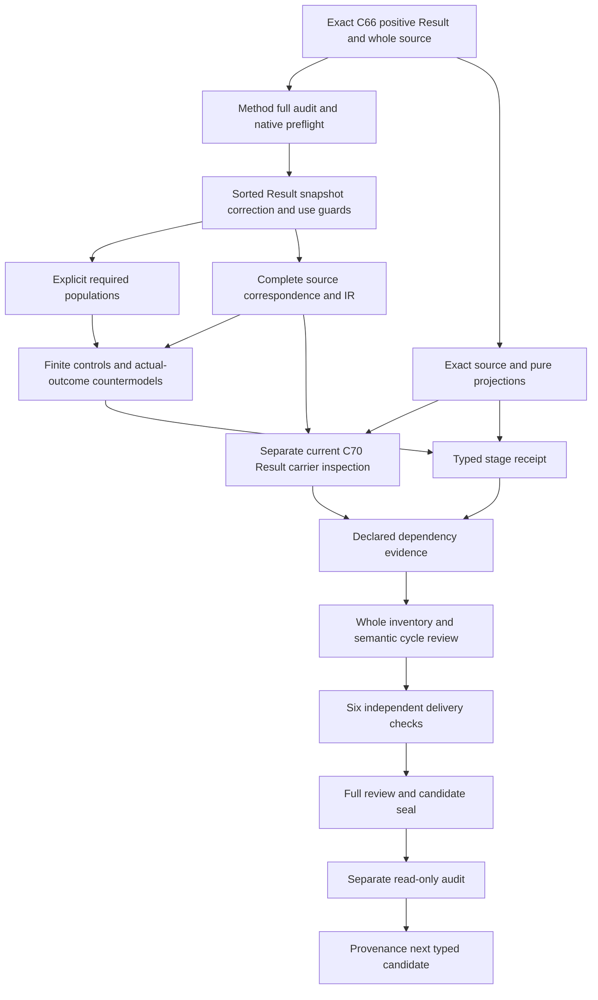

# Measurement Result: full candidate delivery review

## 1. Exact target and actual candidate delivery

The selected positive Measurement Result Definition is cal.definition.measurement-result@1.0.0-candidate.1 at4bc1e7d96b821dd384cb6ff731d56030a560c00a30ff6415d82d57d9fac89dec. This full-delivery review explains a partial candidate translation,complete source account and actual finite evidence. C66 Definition admission,source-owner acceptance of this translation,carrier admission,immutable production storage and accepted measurement outcomes remain separate claims. No accepted whole translation,complete Definition proof or live immutable record is established.

The author,builder,model,source,profile,dependency and inventory producers have actual terminal exit zero. The independent contract,model and source replay qualified a frozen sixteen-input typed receipt;its separate audit passed. The candidate then received actual current-carrier observations and freshly evaluated dependency and whole-inventory evidence. All six independent full-delivery checks pass with outputs matching the initial producer observations. The candidate seal and its separate read-only audit are the next required delivery boundary.

The theory separates an exact attributable Result from Method,execution,subject revision,values and units. Declared snapshots preserve its original contents. Corrections require distinct successors and preserved original record/evidence. Interpretation,acceptance and Finding use are separately governed declarations. Actual storage,attribution,provenance,validity,support,retention,execution,acceptance and authority remain independent outcomes. The overall goal stays active through the remaining definitions and final aspect-by-aspect explanation;types and logic continue to control the order of work.

## 2. C66 admission and exact whole-file lineage

C66 admits this positive Measurement Result meaning through the Definition specialization resolution candidate. The checker binds the exact current registry row,decision,authorization,candidate and resolution overlay. The authorization includes the selected Definition digest,and the candidate gives it the new-positive-definition disposition. This keeps the Result's own primary semantic identity separate from the broad generic Definition meaning previously borrowed by the carrier. Current Definition admission does not itself accept this interpretation's source fidelity.

The declared source is cal.source.step3.remaining with selector whole-file. Its exact local source is authority/artifact-types/candidates/0005-remaining-18-complete-model/model.json,60,288bytes at9e80895df1887113cfc407de6ed4d11f6cd37d4ac10857389ee060e1139c9f36. Candidate source bindings identify CyberAlchemy-lab and the whole-file selector. The source body retains candidate-unadmitted posture and a null source_admission_ref. The current admission overlay is examined separately from those historical fields. No C53 legacy H2 selection,C12 normalization split or external producer is assumed for this unit.

C66 admits seven Definitions and one resolution overlay;it admits or rebinds zero Artifact Types and activates zero consumers. Its historical source counts are not the episode's current counts. Exact byte and registry observations establish the selected lineage and current source version. They do not establish authenticated raw evidence,actual attribution,immutable storage,consumer correspondence or a whole formal proof. These claim boundaries remain explicit in the source account,model report and unresolved owner findings.

## 3. Sorted signature and qualified identities

The signature has21 nonempty sorts:Result,MethodExecution,MethodVersion,SubjectRevision,Conditions,Value,UnitSystem,Uncertainty,Evidence,ToolVersion,ImplementationVersion,ExecutionInterval,ValidityPosture,OwnerRoute,Receipt,Provenance,Timestamp,ResultSnapshot,ResultCorrection,ResultUse and Token. One EMPTY Token constant supports explicit nonempty reference guards. Values and units are separately typed;Result is distinct from the execution and from the subject revision it records. These descriptive model sorts do not create corresponding canonical Definition identities.

Sixty-eight total functions include16 Result projections,10 execution-output projections,a snapshot-to-Result projection,16 snapshot content projections,four correction projections,a governed-use Result projection and20 typed reference handles. Totality means the supplied model gives every argument a result in its declared domain. Selected guards require declared targets and nonempty handles. Total functions alone do not authenticate references or imply that every domain record is a conforming Result. Outside-scope records remain possible and receive dedicated controls.

Seventy-three unary predicates and one binary SuccessorResultDeclared relation distinguish membership,component declarations,role exclusions,snapshot/correction/use guards and actual outcomes. All164 declarations are qualified by the exact source version and candidate scope. Matching printed names cannot silently import Method's theory or identify symbols from another interpretation. The dependency sources remain separately qualified. Owner review must still accept the actual carriers and maps for execution,subject revision,provenance,validity posture,snapshots and governed use.

## 4. Genus,attribution and required record components

MeasurementResult is equivalent to ResultInScopeDeclared in this candidate. That equivalence is an explicit proposed scope map,not a sufficient test of physical correctness or admission. Selected Results require ImmutableRecordDeclared and AttributableRecordDeclared. They name one MethodExecution,MethodVersion,SubjectRevision,conditions,value,units,uncertainty,raw evidence,Tool and Implementation versions,execution interval,validity posture,owner route,receipt,provenance and timestamp. Every component has a declared typed carrier and nonempty handle.

This structure preserves the source's required record contents rather than reducing a Result to a numerical value and a label. The first scientific-formal testable condition reinforces exact Method version,subject revision,execution interval,conditions,values,units,uncertainty,evidence and receipt. A value lacking these declarations is not conforming in the selected theory. These source testable conditions are semantic obligations here,not the four migration-observation checks used by some legacy Definitions.

AttributableRecordDeclared preserves a naming obligation. It does not demonstrate that the owner actually performed the measurement,that the subject revision is authentic,or that the raw evidence belongs to that execution. Provenance and receipt handles require accepted reference resolution and evidence. ImmutableRecordDeclared likewise does not prove storage behavior. The snapshot guards below give a declared preservation condition,while actual immutability and attribution remain independent query targets. A successful complete record witness remains a partial interpretation requiring source-owner fidelity review.

## 5. Exact execution and subject-revision binding

Each selected Result references one declared MethodExecution. Ten Result projections must equal that execution's declared MethodVersion,SubjectRevision,conditions,value,units,uncertainty,raw evidence,ToolVersion,ImplementationVersion and execution interval. These equalities preserve the source's exactness requirement in the supplied interpretation. The Result is not interchangeable with the Method or its subject. A particular subject revision remains distinct from an unversioned subject handle,and the procedure remains a separately qualified source dependency.

Exact declared binding does not authenticate a live execution,prove calibration or establish correct computation. The execution-output projections are proposed maps,not a runtime integration. There is no implicit latest Tool or Implementation version requirement,no numerical comparison of version labels,and no proof of chronology from a Timestamp token. The candidate does not assume valid calendars,clock accuracy or interval ordering merely because those components are named.

Negative controls replace each execution-output projection with an incompatible declared value and check that the selected binding fails. Structural controls remove component declarations or references. Separate outside-scope records remain permitted. Actual execution correctness,calibration,value correctness,provenance authenticity and chronology are independent Result outcomes. The complete record can therefore be represented without claiming that its underlying procedure was performed accurately or that its physical subject was suitable. Those stronger claims require separate measurement and consumer evidence.

## 6. Values,uncertainty and validity-support independence

Value,UnitSystem and Uncertainty remain separate sorts. Opaque value denotations and nonempty unit references do not establish numerical accuracy,dimensional compatibility or adequate error treatment. The source's example of an entropy value and uncertainty interval explains a possible record without becoming a universal formula,unit,threshold or accepted experiment. Different Result identities may retain identical declared values. The candidate requests that possibility explicitly so record identity is not reduced to numerical inequality.

ValidityPosture is explicit in every selected record. It has a declared carrier and reference but no invented exhaustive state taxonomy or strength ordering. The source says validity posture is independent from support for any claim. The candidate therefore does not encode a validity-to-support implication or an iff between a posture label and actual correctness. Its supplied model contains different validity postures without claim support. Actual validity and actual support remain separate predicates and countermodel targets.

Controls permit independently supported positive outcomes as well as their absence. The no-inference boundary is not a prohibition on valid measurements,accepted results or supported claims. Interpretation,acceptance and Finding use remain separate governed acts. A measured value,an uncertainty label or a declared validity posture cannot replace those acts. Owner review must still determine the meaning of each posture,the adequacy of uncertainty and evidence,and the concrete correspondence between record fields and actual measurement or claim support.

## 7. Declared snapshots and immutability logic

ResultSnapshot has its own domain and is selected by SnapshotInScopeDeclared. Every selected snapshot refers to a selected Result and has a nonempty handle. Its16 content projections must equal the referenced Result's original projections. These cover the execution,Method and subject revision,conditions,value,units,uncertainty,evidence,versions,interval,validity,owner,receipt,provenance and timestamp. This is a declared content-preservation invariant across the selected states,not merely an immutable label.

The model includes before and after snapshots of an original record. Negative controls silently alter each snapshot field while retaining the same Result identity. The preservation guard rejects those changes. This addresses the source's requirement that no Measurement Result silently changes after recording. It does not assert that a production writer is atomic,a database is immutable,a filesystem is protected or all actual history has been authenticated. Actual immutability remains outside the encoded declaration theory and is falsified by a complete supplied countermodel.

A Result declaration does not force actual storage snapshots into existence. Requested snapshot populations are separately declared examples used to make the preservation condition nonvacuous. Outside snapshots may exist without selected content guards. Owner review must resolve how real snapshots,storage states,record digests and evidence correspond to these proposed carriers. Passing equality checks on finite states demonstrates the guard's behavior;it does not supply durable immutable storage,physical retention or a complete history proof.

## 8. Successor corrections and original retention

ResultCorrection is selected independently from Result. A selected correction names selected original and successor Results,requires their identities to be distinct,and declares the successor relation. It also declares preservation of the original record and original evidence. Its original and preserved snapshots both refer to the original Result and satisfy the snapshot content invariants. These necessary guards reject correction-as-overwrite and missing retention declarations while keeping the original contents visible.

The guard does not require a numerically different value for every correction. A correction may change metadata,interpretation or other relevant details while retaining the same numerical value. A dedicated positive control uses a distinct successor with the same declared value. Multiple declared successors are not globally forbidden by an unsupported uniqueness rule. The candidate also imposes no automatic acyclic lineage,no timestamp order and no automatic successor admission. Those questions require accepted source and revision-policy evidence.

Declared preservation does not execute retention or authenticate the retained raw evidence. OriginalRetention,EvidenceRetention,CorrectCorrection and SuccessorAdmission remain separate actual targets. Countermodels satisfy the complete correction and snapshot guards while those outcomes are false. A record can exist without a selected correction;correction populations are requested independently. This preserves the source's successor boundary without promoting a model relation or nonempty reference into proof of an actual immutable revision history.

## 9. Separate interpretation,acceptance and Finding use

ResultUse is distinct from Result,MethodExecution,Snapshot and Correction. A selected use references a selected Result and is classified as an interpretation,acceptance or Finding-use declaration. It requires SeparateGovernedActDeclared and a nonempty handle. This keeps the source's interpretation,acceptance and use-in-a-Finding meanings separate from the recorded value itself. The Result's governed/bounded declaration is not substituted for the governance of a use act.

The candidate does not perform those acts. UseActualExecuted,UseActualAccepted,UseActualSupported and UseActualAuthority remain independent predicates. The supplied model has a declaration witness for each use category without actual outcomes. Controls remove scope,classification or the separate governed-act declaration and observe the necessary guard failure. A Result can remain without any selected use;the record does not force an interpretation,acceptance decision or Finding into existence.

A use classification is a proposed typed map. It does not establish a concrete decision scope,owner approval,Finding support or executed consumer behavior. The source owners must accept how these carriers correspond to real governance acts and their evidence. The candidate intentionally does not import a whole Decision or Finding theory into this primary interpretation. Separate qualified dependencies retain those obligations without granting an actual Result authority or treating a successful declaration as a supported conclusion.

## 10. Role exclusions,governance and non-entailment

A selected Result cannot be labeled as the Method,subject,Observation narrative,Evidence Set,Finding,causal claim,Decision,accepted fact or authority effect itself. Those role exclusions preserve the source's distinction between an attributable record and other meanings or governing conclusions. They do not ban legitimate separately typed observations,Findings,decisions or independently supported outcomes. Actual truth,acceptance and authority predicates can be interpreted independently;positive controls verify that the declaration theory does not forbid them universally.

GovernedDeclared and BoundedDeclared retain the necessary formal-expression guards. The source's non-inference of authority is represented by a countermodel target,not by asserting that authority can never be present. Twenty Result actual outcomes,six correction actual outcomes and four use actual outcomes are queried independently. They include immutability,attribution,provenance,execution,calibration,validity,truth,support,retention,acceptance,Finding use,authority,owner fidelity and consumer alignment.

Each supplied countermodel satisfies T and the required populations while its queried target is false and its witness true. These are bounded non-entailment checks in the candidate's sorted finite semantics. They do not establish source-owner acceptance or a whole Definition proof. Actual measurement validity,authenticated history,correct corrections,governed acceptance and claim support require additional evidence and accepted correspondence. Complete source character accounting and a green finite checker must retain that ceiling rather than manufacture the missing real-world outcomes.

## 11. Source account,compiled logic and actual controls

The source account covers23 nonempty source units with24 mapped spans:15 encoded,six explanatory and three deferred. The normative statement is split at its role-exclusion sentence. Repeated scientific-formal and general boundaries retain their individual provenance. The15 encoded spans have nine distinct formula values built from11 primitive formulas. All three scientific-formal testable conditions contribute semantic declaration or preservation guards. Explanatory intuition,notation and the entropy example remain distinct from normative claims.

The signature compiles into exact source-qualified IR. The checker recomputes it and compares it with the saved IR and correspondence interpretation. It checks complete character accounting,absence of assumptions and exact dependency references. Seventeen source-query obligations bind actual-outcome targets to their exact source selectors,offsets and excerpt digests. Necessary declaration guards may be encoded in those clauses while the actual targets remain outside T. Eighteen source-owner findings retain unresolved denotations and fidelity explicitly.

The native model report has147 controls:43 satisfy T,97 fail T and seven are structurally malformed. It checks13 requested populations and74 unresolved population maps. Thirty complete countermodels keep the queried outcomes independent. Thirty-five source observations pass,including C66 authorization,candidate,resolution,local whole source,schema and two exact4,794byteprojections at8a777260464cb24faddccc0afbe67f86929f6b7011850eeffd8b22f6e7f37391. Malformed controls use native signature,total-function,sort,tuple,duplicate and domain fault codes. The fresh three-check replay must independently qualify the typed receipt.

## 12. Actual carrier gaps,graph evidence and execution DAG

The actual catalog has143 contract rows and121 admitted-current rows. One current C70 cal.artifact-type.measurement-result/v1 carrier directly binds this C66 positive Definition. Its artifact digest iscc349602cdb6cfb2d03998c4f64678392c4fb5e680399cb77ba176ed96996c26 and schema digest5270a01a13f2dcd86facbd9625eea1ba02aed33a56774ea66c2fe9fba1af35d7. Its retained artifact body stays candidate-unadmitted with authority effect none. Overlay admission and historical body posture are observed separately rather than rewritten. Generic Definition/v2 retains its own semantic identity and does not invalidate the selected admitted Definition/v1 source.

The carrier is a closed25-root contract with24 declared semantic fields,the latter including status. It records a number,unit,nonnegative uncertainty value plus interpretation,and Method/subject/residue/evidence/receipt strings. The schema requires entropy register,source operation,observable and scope labels. Fourteen general Result obligations have no direct fields:execution reference,Method version,subject revision,conditions,Tool and Implementation versions,execution interval,validity posture,provenance,immutable record,successor reference,original preservation,raw evidence digest and separate governed uses. Accepted correspondence through other records or prose is not supplied. A referenced Definition and a valid fixture do not resolve that gap.

Twenty-one actual package/catalog checks pass. Thirty Definition shape probes have five acceptances;111 carrier shape probes have21 acceptances. Missing roots,extra general fields,wrong discriminators,invalid labels,negative uncertainty,malformed uncertainty objects and four hostile fixtures are rejected as specified. Unresolved references,unverified formula/unit strings,overclaimed prose,negative root values and impossible calendar dates can be schema-valid. The observed_at pattern checks syntax without a calendar or interval semantics. These acceptances do not demonstrate measurement correctness,attribution,immutable storage,validity,claim support or retention.

Twelve claim-status/authority-treatment products and75 observable/register/scope products are all shape-accepted. A theorem label does not provide theorem evidence,and a numerical uncertainty does not prove calibration. Package-level target-specific graph consistency remains separate from the pure schema observations. Two pure artifact and fixture renders match their existing projections while preserving input. No package validator writer,canonical generator writer or live consumer is invoked. Thirty-six qualification hypotheses have34 rejections;69 finite correspondence frames have64 rejections. Twenty source-map obligations retain proposed maps or explicit residue,with no actual accepted carrier correspondence.

The reachable declared graph has133 nodes,1819 edges and59 missing packets. The joint graph has134 nodes,1853 edges and59 missing packets. Every earlier edge is preserved;Result adds29 direct declared edges. Cycles remain explicitly unresolved,with member counts[74]. The native inventory freshly evaluates one supplied T/I model for each of75 partial drafts. Its exact counts are{"deferred_clauses": 950, "encoded_clauses": 724, "explanatory_clauses": 606, "mapped_clauses": 2280, "required_populations": 880, "source_units": 1725, "unresolved_populations": 3477}. This is not a common-carrier model,accepted semantic closure or whole proof.

Static verification reuse is separately checked by15 adversarial/differential controls. The inventory records225 static reuses and2 delegated live repository checks;dependency records74 static reuses and1 live delegations. Exact canonical serialized snapshot equality is the only key. Live repository checks,per-definition T/I evaluation,source correspondence,IR and graph evaluation still run. Start/end original static checks preserve the boundary and the original verifier is restored. Shared sealed validators remain unchanged;no semantic proof is claimed by reuse.

The acyclic execution DAG remains separate from semantic cycle review. Exact source and prior audit precede sorted record,snapshot,correction and use guards. Populations and source correspondence precede finite controls;source observations qualify the typed receipt alongside them. Current carrier hypotheses then feed dependency and inventory evidence,the six actual delivery checks,the full review,seal and separate audit. Provenance follows only after that audit. Accepted source fidelity,actual measurement and retention evidence,consumer maps,semantic cycle interpretation and whole proofs remain required.

## 13. Preservation,Provenance preparation and continuation

Measurement Method's6,286-file candidate seal and separate audit completed before Result creation. Every prior sealed file and all201 selected source files remain preserved,including Parent-Instance Authority Separation and all earlier definitions. The frozen Result typed inputs and receipt remain unchanged by this separate delivery review. Canonical authorities,private/live state and unrelated tracked changes are preserved. No native Result producer failure is hidden or replaced with a simulated success.

The actual whole inventory is75 partial drafts and108 current identities without per-definition T files. The episode retains183 current identities,189 admitted source versions,201 sources,121 tasks,511 planning edges,797 SWUs and36 frontiers. Source-owner-accepted whole translations and whole Definition proofs remain zero. The immutable I04 inventory remains its exact selected eight drafts and needs a separate reporting update. A fresh partial inventory is not a count of accepted translations or completed proofs.

Provenance preparation selects its current C53 Definition at514e2c9e19882553cbdfb1f10b94dacb510bf010a9aa0727b1068aff839ca86b. Its D35 H2 is2,422bytes atb7855fd81c1ed14fe1bdb097fddfa2b1d32c2f88c8dc2f56dbf131f0164c5439;the selected local whole book matchesecfbd64f334954809e83ffd5d4f9adfb759f39716de96c3ac1227d4ee869c6f8. C53 source-use CAL-SOURCE-FULL-DEFINITION-QUEUE-025 has exactly that Definition target. Sixteen actual source-preparation checks pass,including two exact5931byteprojections. C12 prototype disposition is revise,not keep or split,and its context issemantic.provenance,type.definition,scope.lineage. Historical source candidate/null posture is preserved. Selected local digests do not authenticate the unavailable configured live producer.

Six source/design preparation files are bound without creating a native Provenance unit,theory or model. Its design prioritizes typed ordered origin/transformation paths,the source/relation/operation/owner/posture tuple,precise operation distinctions,and explicit residue with owner routing for each missing segment. Empty-path policy and actual completeness remain owner questions. Provenance alone does not establish truth,proof,authority,trust,validation or credit assignment. The Result full seal and separate audit are required before Provenance's native construction.

Eighteen Result findings remain unresolved below. Continue Provenance after the full audit,then the remaining manifest definitions while maintaining types and logic first. Required source-owner acceptance,whole proofs,carrier/consumer maps,actual outcomes,semantic cycle review and final complete episode explanation remain pending. Successful finite declarations,validity labels,compatible shape fields and source trails are never promoted to actual measurement support,immutable storage,retention,authority or episode completion.

- **MR-FINDING-001** — Exact C66 positive Definition admission and local whole-file lineage do not accept this translation or independently admit retained candidate source posture.

- **MR-FINDING-002** — Result is a selected attributable immutable record;scope,immutability and attribution declarations need accepted denotations.

- **MR-FINDING-003** — MethodExecution,MethodVersion and SubjectRevision are distinct proposed carriers with exact selected projection maps rather than actual execution or subject authentication.

- **MR-FINDING-004** — Values and units are separately sorted opaque denotations;neither a numeric-looking value nor unit label proves correctness or dimensional validity.

- **MR-FINDING-005** — Uncertainty,conditions and raw evidence handles do not prove adequate error treatment,physical conditions or real retained evidence.

- **MR-FINDING-006** — Tool and Implementation versions remain exact declared references without current-live or latest-version requirements.

- **MR-FINDING-007** — ExecutionInterval and Timestamp declarations do not prove valid calendars,clock accuracy,chronological ordering or actual execution duration.

- **MR-FINDING-008** — ValidityPosture is explicitly declared and independent of actual claim support;no ordering,exhaustive taxonomy or validity-to-support implication is assumed.

- **MR-FINDING-009** — Provenance,owner and receipt handles require accepted reference resolution and authenticity;nonempty strings are structural only.

- **MR-FINDING-010** — Result-to-execution projection equalities preserve declared exact bindings but do not prove actual correct execution or calibration.

- **MR-FINDING-011** — Snapshot content equalities preserve the selected declared record across states;they do not prove durable immutable storage,authenticated history or atomic writer behavior.

- **MR-FINDING-012** — A selected correction requires a distinct successor and explicit original/evidence preservation;declarations do not perform retention or admit a successor.

- **MR-FINDING-013** — Correction and successor maps do not assume one global successor,acyclic lineage,timestamp ordering or unequal numerical values for every legitimate correction.

- **MR-FINDING-014** — Interpretation,acceptance and Finding use remain separate declared governed acts;scope labels do not execute,accept or support those acts.

- **MR-FINDING-015** — Result role exclusions preserve Method,subject,narrative,Finding,causal claim,Decision,accepted fact and authority distinctions without prohibiting separately supported outcomes.

- **MR-FINDING-016** — All three source testable conditions contain semantic obligations;declaration and snapshot guards do not replace actual validity,provenance or immutable-storage evidence.

- **MR-FINDING-017** — Method,execution,Result,correction and use sources are qualified independently;no prior whole theory or owner fidelity is imported.

- **MR-FINDING-018** — Actual outcomes,carrier/consumer maps,semantic cycles,owner acceptance and whole proofs remain pending despite complete character accounting and finite controls.

