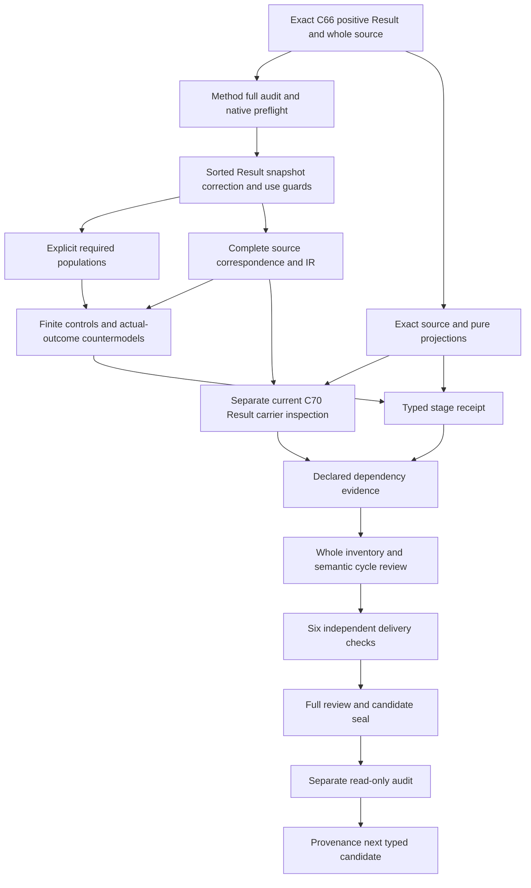

# Measurement Result: typed candidate review

## 1. Exact target and types-first boundary

The selected target is cal.definition.measurement-result@1.0.0-candidate.1. Its current positive Definition has digest4bc1e7d96b821dd384cb6ff731d56030a560c00a30ff6415d82d57d9fac89dec and C66 admission. This review explains a partial candidate translation with proposed denotations,complete source character accounting and actual finite evidence. It does not establish an accepted whole translation,a proof of a complete Definition,an immutable production record or an accepted measurement outcome. Types and logical requirements precede carrier correspondence and consumer behavior.

Measurement Method completed its full candidate seal and separate audit before this native unit was created. The Result author,builder,model checker and source checker have actual terminal exit zero. Their observations are retained independently from the requested fresh contract,model and source replay. A frozen typed receipt and separate audit qualify this stage. Current carrier hypotheses,dependency and whole inventory refresh,six-check delivery replay,full review,seal and independent full audit remain later work.

The central distinction is between an exact attributable record and the procedure,subject,execution or conclusions associated with it. A Result binds what one declared execution produced. Its validity posture does not by itself establish support for a claim. Corrections preserve the original record and evidence while creating a successor. The candidate retains those requirements without claiming actual execution,authenticated provenance,durable storage,acceptance or authority. The overall formalization goal remains active with its original scope and final explanation obligation.

## 2. C66 admission and exact whole-file lineage

C66 admits this positive Measurement Result meaning through the Definition specialization resolution candidate. The checker binds the exact current registry row,decision,authorization,candidate and resolution overlay. The authorization includes the selected Definition digest,and the candidate gives it the new-positive-definition disposition. This keeps the Result's own primary semantic identity separate from the broad generic Definition meaning previously borrowed by the carrier. Current Definition admission does not itself accept this interpretation's source fidelity.

The declared source is cal.source.step3.remaining with selector whole-file. Its exact local source is authority/artifact-types/candidates/0005-remaining-18-complete-model/model.json,60,288bytes at9e80895df1887113cfc407de6ed4d11f6cd37d4ac10857389ee060e1139c9f36. Candidate source bindings identify CyberAlchemy-lab and the whole-file selector. The source body retains candidate-unadmitted posture and a null source_admission_ref. The current admission overlay is examined separately from those historical fields. No C53 legacy H2 selection,C12 normalization split or external producer is assumed for this unit.

C66 admits seven Definitions and one resolution overlay;it admits or rebinds zero Artifact Types and activates zero consumers. Its historical source counts are not the episode's current counts. Exact byte and registry observations establish the selected lineage and current source version. They do not establish authenticated raw evidence,actual attribution,immutable storage,consumer correspondence or a whole formal proof. These claim boundaries remain explicit in the source account,model report and unresolved owner findings.

## 3. Sorted signature and qualified identities

The signature has21 nonempty sorts:Result,MethodExecution,MethodVersion,SubjectRevision,Conditions,Value,UnitSystem,Uncertainty,Evidence,ToolVersion,ImplementationVersion,ExecutionInterval,ValidityPosture,OwnerRoute,Receipt,Provenance,Timestamp,ResultSnapshot,ResultCorrection,ResultUse and Token. One EMPTY Token constant supports explicit nonempty reference guards. Values and units are separately typed;Result is distinct from the execution and from the subject revision it records. These descriptive model sorts do not create corresponding canonical Definition identities.

Sixty-eight total functions include16 Result projections,10 execution-output projections,a snapshot-to-Result projection,16 snapshot content projections,four correction projections,a governed-use Result projection and20 typed reference handles. Totality means the supplied model gives every argument a result in its declared domain. Selected guards require declared targets and nonempty handles. Total functions alone do not authenticate references or imply that every domain record is a conforming Result. Outside-scope records remain possible and receive dedicated controls.

Seventy-three unary predicates and one binary SuccessorResultDeclared relation distinguish membership,component declarations,role exclusions,snapshot/correction/use guards and actual outcomes. All164 declarations are qualified by the exact source version and candidate scope. Matching printed names cannot silently import Method's theory or identify symbols from another interpretation. The dependency sources remain separately qualified. Owner review must still accept the actual carriers and maps for execution,subject revision,provenance,validity posture,snapshots and governed use.

## 4. Genus,attribution and required record components

MeasurementResult is equivalent to ResultInScopeDeclared in this candidate. That equivalence is an explicit proposed scope map,not a sufficient test of physical correctness or admission. Selected Results require ImmutableRecordDeclared and AttributableRecordDeclared. They name one MethodExecution,MethodVersion,SubjectRevision,conditions,value,units,uncertainty,raw evidence,Tool and Implementation versions,execution interval,validity posture,owner route,receipt,provenance and timestamp. Every component has a declared typed carrier and nonempty handle.

This structure preserves the source's required record contents rather than reducing a Result to a numerical value and a label. The first scientific-formal testable condition reinforces exact Method version,subject revision,execution interval,conditions,values,units,uncertainty,evidence and receipt. A value lacking these declarations is not conforming in the selected theory. These source testable conditions are semantic obligations here,not the four migration-observation checks used by some legacy Definitions.

AttributableRecordDeclared preserves a naming obligation. It does not demonstrate that the owner actually performed the measurement,that the subject revision is authentic,or that the raw evidence belongs to that execution. Provenance and receipt handles require accepted reference resolution and evidence. ImmutableRecordDeclared likewise does not prove storage behavior. The snapshot guards below give a declared preservation condition,while actual immutability and attribution remain independent query targets. A successful complete record witness remains a partial interpretation requiring source-owner fidelity review.

## 5. Exact execution and subject-revision binding

Each selected Result references one declared MethodExecution. Ten Result projections must equal that execution's declared MethodVersion,SubjectRevision,conditions,value,units,uncertainty,raw evidence,ToolVersion,ImplementationVersion and execution interval. These equalities preserve the source's exactness requirement in the supplied interpretation. The Result is not interchangeable with the Method or its subject. A particular subject revision remains distinct from an unversioned subject handle,and the procedure remains a separately qualified source dependency.

Exact declared binding does not authenticate a live execution,prove calibration or establish correct computation. The execution-output projections are proposed maps,not a runtime integration. There is no implicit latest Tool or Implementation version requirement,no numerical comparison of version labels,and no proof of chronology from a Timestamp token. The candidate does not assume valid calendars,clock accuracy or interval ordering merely because those components are named.

Negative controls replace each execution-output projection with an incompatible declared value and check that the selected binding fails. Structural controls remove component declarations or references. Separate outside-scope records remain permitted. Actual execution correctness,calibration,value correctness,provenance authenticity and chronology are independent Result outcomes. The complete record can therefore be represented without claiming that its underlying procedure was performed accurately or that its physical subject was suitable. Those stronger claims require separate measurement and consumer evidence.

## 6. Values,uncertainty and validity-support independence

Value,UnitSystem and Uncertainty remain separate sorts. Opaque value denotations and nonempty unit references do not establish numerical accuracy,dimensional compatibility or adequate error treatment. The source's example of an entropy value and uncertainty interval explains a possible record without becoming a universal formula,unit,threshold or accepted experiment. Different Result identities may retain identical declared values. The candidate requests that possibility explicitly so record identity is not reduced to numerical inequality.

ValidityPosture is explicit in every selected record. It has a declared carrier and reference but no invented exhaustive state taxonomy or strength ordering. The source says validity posture is independent from support for any claim. The candidate therefore does not encode a validity-to-support implication or an iff between a posture label and actual correctness. Its supplied model contains different validity postures without claim support. Actual validity and actual support remain separate predicates and countermodel targets.

Controls permit independently supported positive outcomes as well as their absence. The no-inference boundary is not a prohibition on valid measurements,accepted results or supported claims. Interpretation,acceptance and Finding use remain separate governed acts. A measured value,an uncertainty label or a declared validity posture cannot replace those acts. Owner review must still determine the meaning of each posture,the adequacy of uncertainty and evidence,and the concrete correspondence between record fields and actual measurement or claim support.

## 7. Declared snapshots and immutability logic

ResultSnapshot has its own domain and is selected by SnapshotInScopeDeclared. Every selected snapshot refers to a selected Result and has a nonempty handle. Its16 content projections must equal the referenced Result's original projections. These cover the execution,Method and subject revision,conditions,value,units,uncertainty,evidence,versions,interval,validity,owner,receipt,provenance and timestamp. This is a declared content-preservation invariant across the selected states,not merely an immutable label.

The model includes before and after snapshots of an original record. Negative controls silently alter each snapshot field while retaining the same Result identity. The preservation guard rejects those changes. This addresses the source's requirement that no Measurement Result silently changes after recording. It does not assert that a production writer is atomic,a database is immutable,a filesystem is protected or all actual history has been authenticated. Actual immutability remains outside the encoded declaration theory and is falsified by a complete supplied countermodel.

A Result declaration does not force actual storage snapshots into existence. Requested snapshot populations are separately declared examples used to make the preservation condition nonvacuous. Outside snapshots may exist without selected content guards. Owner review must resolve how real snapshots,storage states,record digests and evidence correspond to these proposed carriers. Passing equality checks on finite states demonstrates the guard's behavior;it does not supply durable immutable storage,physical retention or a complete history proof.

## 8. Successor corrections and original retention

ResultCorrection is selected independently from Result. A selected correction names selected original and successor Results,requires their identities to be distinct,and declares the successor relation. It also declares preservation of the original record and original evidence. Its original and preserved snapshots both refer to the original Result and satisfy the snapshot content invariants. These necessary guards reject correction-as-overwrite and missing retention declarations while keeping the original contents visible.

The guard does not require a numerically different value for every correction. A correction may change metadata,interpretation or other relevant details while retaining the same numerical value. A dedicated positive control uses a distinct successor with the same declared value. Multiple declared successors are not globally forbidden by an unsupported uniqueness rule. The candidate also imposes no automatic acyclic lineage,no timestamp order and no automatic successor admission. Those questions require accepted source and revision-policy evidence.

Declared preservation does not execute retention or authenticate the retained raw evidence. OriginalRetention,EvidenceRetention,CorrectCorrection and SuccessorAdmission remain separate actual targets. Countermodels satisfy the complete correction and snapshot guards while those outcomes are false. A record can exist without a selected correction;correction populations are requested independently. This preserves the source's successor boundary without promoting a model relation or nonempty reference into proof of an actual immutable revision history.

## 9. Separate interpretation,acceptance and Finding use

ResultUse is distinct from Result,MethodExecution,Snapshot and Correction. A selected use references a selected Result and is classified as an interpretation,acceptance or Finding-use declaration. It requires SeparateGovernedActDeclared and a nonempty handle. This keeps the source's interpretation,acceptance and use-in-a-Finding meanings separate from the recorded value itself. The Result's governed/bounded declaration is not substituted for the governance of a use act.

The candidate does not perform those acts. UseActualExecuted,UseActualAccepted,UseActualSupported and UseActualAuthority remain independent predicates. The supplied model has a declaration witness for each use category without actual outcomes. Controls remove scope,classification or the separate governed-act declaration and observe the necessary guard failure. A Result can remain without any selected use;the record does not force an interpretation,acceptance decision or Finding into existence.

A use classification is a proposed typed map. It does not establish a concrete decision scope,owner approval,Finding support or executed consumer behavior. The source owners must accept how these carriers correspond to real governance acts and their evidence. The candidate intentionally does not import a whole Decision or Finding theory into this primary interpretation. Separate qualified dependencies retain those obligations without granting an actual Result authority or treating a successful declaration as a supported conclusion.

## 10. Role exclusions,governance and non-entailment

A selected Result cannot be labeled as the Method,subject,Observation narrative,Evidence Set,Finding,causal claim,Decision,accepted fact or authority effect itself. Those role exclusions preserve the source's distinction between an attributable record and other meanings or governing conclusions. They do not ban legitimate separately typed observations,Findings,decisions or independently supported outcomes. Actual truth,acceptance and authority predicates can be interpreted independently;positive controls verify that the declaration theory does not forbid them universally.

GovernedDeclared and BoundedDeclared retain the necessary formal-expression guards. The source's non-inference of authority is represented by a countermodel target,not by asserting that authority can never be present. Twenty Result actual outcomes,six correction actual outcomes and four use actual outcomes are queried independently. They include immutability,attribution,provenance,execution,calibration,validity,truth,support,retention,acceptance,Finding use,authority,owner fidelity and consumer alignment.

Each supplied countermodel satisfies T and the required populations while its queried target is false and its witness true. These are bounded non-entailment checks in the candidate's sorted finite semantics. They do not establish source-owner acceptance or a whole Definition proof. Actual measurement validity,authenticated history,correct corrections,governed acceptance and claim support require additional evidence and accepted correspondence. Complete source character accounting and a green finite checker must retain that ceiling rather than manufacture the missing real-world outcomes.

## 11. Source account,compiled logic and actual controls

The source account covers23 nonempty source units with24 mapped spans:15 encoded,six explanatory and three deferred. The normative statement is split at its role-exclusion sentence. Repeated scientific-formal and general boundaries retain their individual provenance. The15 encoded spans have nine distinct formula values built from11 primitive formulas. All three scientific-formal testable conditions contribute semantic declaration or preservation guards. Explanatory intuition,notation and the entropy example remain distinct from normative claims.

The signature compiles into exact source-qualified IR. The checker recomputes it and compares it with the saved IR and correspondence interpretation. It checks complete character accounting,absence of assumptions and exact dependency references. Seventeen source-query obligations bind actual-outcome targets to their exact source selectors,offsets and excerpt digests. Necessary declaration guards may be encoded in those clauses while the actual targets remain outside T. Eighteen source-owner findings retain unresolved denotations and fidelity explicitly.

The native model report has147 controls:43 satisfy T,97 fail T and seven are structurally malformed. It checks13 requested populations and74 unresolved population maps. Thirty complete countermodels keep the queried outcomes independent. Thirty-five source observations pass,including C66 authorization,candidate,resolution,local whole source,schema and two exact4,794byteprojections at8a777260464cb24faddccc0afbe67f86929f6b7011850eeffd8b22f6e7f37391. Malformed controls use native signature,total-function,sort,tuple,duplicate and domain fault codes. The fresh three-check replay must independently qualify the typed receipt.

## 12. Carrier boundary and execution DAG

Current carrier inspection is a separate later stage. Preliminary read-only inspection finds a closed C70 Measurement Result contract with25 required roots and24 declared semantic fields,the latter including status. It has a numerical value,a nonnegative uncertainty value with interpretation,and string Method/subject/evidence/receipt references. It is residue-oriented and lacks direct fields for an execution interval,subject revision,Tool and Implementation versions,conditions,validity posture,provenance and immutable successor correction behavior. These observations do not establish complete correspondence to the broader positive Result Definition.

Exact current carrier schema,fixtures,projections and rejection probes must be checked separately. A timestamp syntax pattern does not by itself prove calendar validity or actual chronology;numeric shape does not establish a correct entropy value or compatible units. The package's target-specific graph consistency purpose also remains separate from pure schema observations. No canonical validator or generator writer is invoked by the typed stage. Carrier admission cannot replace accepted source maps or a live consumer implementation.

The candidate declares29 exact semantic-use dependencies. Their whole theories are not silently imported. The execution DAG places exact source and prior audit before typed construction,populations and correspondence before finite checks,and source observations alongside them. The frozen typed receipt precedes carrier hypotheses,dependency and whole inventory refresh,six independent delivery checks,full review,seal and separate audit. Provenance follows only after the full Result audit. Semantic graph cycles remain a separate review concern;an acyclic work plan does not prove semantic closure.

## 13. Preservation,remaining scope and continuation

Measurement Method's full candidate seal contains6,286 files and its separate audit passed before this unit's preflight. Those files and all201 selected source files remain preserved. Parent-Instance Authority Separation and every earlier candidate are retained in that lineage. The Result unit writes only its authorized candidate artifacts and execution evidence. Historical source posture,canonical authorities,private/live state and unrelated tracked changes remain untouched.

The working count is75 partial per-definition interpretations,with108 current identities still without T files. The last whole delivery inventory remains74 until the later Result inventory refresh actually runs. The full episode scope stays183 current identities,189 admitted versions,201 sources,121 tasks,511 planning edges,797 SWUs and36 frontiers. Whole source-owner-accepted translations and whole Definition proofs remain zero. The immutable I04 inventory remains its exact selected eight drafts and needs a separate reporting update.

Continue by completing the fresh three checks,freezing the typed review and receipt,and auditing that stage independently. Then inspect the actual carrier and map gaps,refresh dependency and whole inventory evidence,run six actual delivery checks,and produce the full review,seal and separate audit. Provenance is next,with exact C53/D35 selection and typed path,residue and owner-route distinctions rather than borrowed C66 source assumptions. Eighteen findings remain unresolved below. The goal stays active through the remaining definitions,accepted correspondence,whole proofs and final aspect-by-aspect episode explanation.

- **MR-FINDING-001** — Exact C66 positive Definition admission and local whole-file lineage do not accept this translation or independently admit retained candidate source posture.

- **MR-FINDING-002** — Result is a selected attributable immutable record;scope,immutability and attribution declarations need accepted denotations.

- **MR-FINDING-003** — MethodExecution,MethodVersion and SubjectRevision are distinct proposed carriers with exact selected projection maps rather than actual execution or subject authentication.

- **MR-FINDING-004** — Values and units are separately sorted opaque denotations;neither a numeric-looking value nor unit label proves correctness or dimensional validity.

- **MR-FINDING-005** — Uncertainty,conditions and raw evidence handles do not prove adequate error treatment,physical conditions or real retained evidence.

- **MR-FINDING-006** — Tool and Implementation versions remain exact declared references without current-live or latest-version requirements.

- **MR-FINDING-007** — ExecutionInterval and Timestamp declarations do not prove valid calendars,clock accuracy,chronological ordering or actual execution duration.

- **MR-FINDING-008** — ValidityPosture is explicitly declared and independent of actual claim support;no ordering,exhaustive taxonomy or validity-to-support implication is assumed.

- **MR-FINDING-009** — Provenance,owner and receipt handles require accepted reference resolution and authenticity;nonempty strings are structural only.

- **MR-FINDING-010** — Result-to-execution projection equalities preserve declared exact bindings but do not prove actual correct execution or calibration.

- **MR-FINDING-011** — Snapshot content equalities preserve the selected declared record across states;they do not prove durable immutable storage,authenticated history or atomic writer behavior.

- **MR-FINDING-012** — A selected correction requires a distinct successor and explicit original/evidence preservation;declarations do not perform retention or admit a successor.

- **MR-FINDING-013** — Correction and successor maps do not assume one global successor,acyclic lineage,timestamp ordering or unequal numerical values for every legitimate correction.

- **MR-FINDING-014** — Interpretation,acceptance and Finding use remain separate declared governed acts;scope labels do not execute,accept or support those acts.

- **MR-FINDING-015** — Result role exclusions preserve Method,subject,narrative,Finding,causal claim,Decision,accepted fact and authority distinctions without prohibiting separately supported outcomes.

- **MR-FINDING-016** — All three source testable conditions contain semantic obligations;declaration and snapshot guards do not replace actual validity,provenance or immutable-storage evidence.

- **MR-FINDING-017** — Method,execution,Result,correction and use sources are qualified independently;no prior whole theory or owner fidelity is imported.

- **MR-FINDING-018** — Actual outcomes,carrier/consumer maps,semantic cycles,owner acceptance and whole proofs remain pending despite complete character accounting and finite controls.

