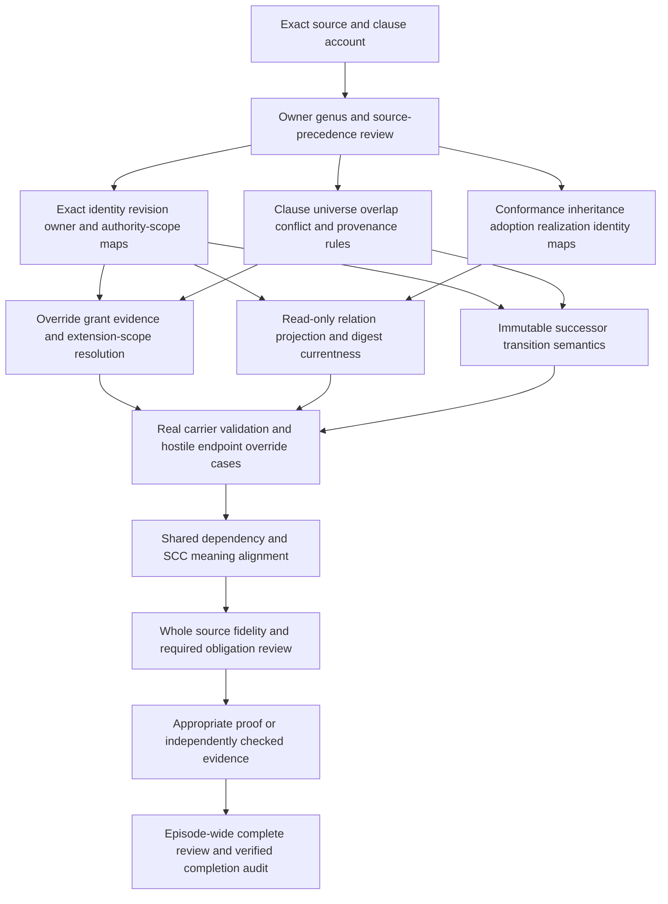

# Model Instance Binding formalization review

This is a source-bound **partial candidate** for one definition in the full 183-current-identity / 189-admitted-version formalization episode. It puts definitions, forms, types and logic first. It supplies a reviewable interpretation, exact character correspondence, typed intermediate representation, independently evaluated models, selected source/carrier observations and a dependency map. It does not establish whole-definition source-owner fidelity, universal conformance, a shared meaning-aligned theory, real instance activation or episode completion.

The controlling source is `cal.definition.model-instance-binding@1.0.0-candidate.1`, at `authority/definitions/candidates/0014-definition-specialization-resolution/definitions/model-instance-binding/v1/definition.json`, SHA256 `f5338122a26ebbf89d8e1f4b9255ba619d66b59b7542ce88edcd974687550ca3`. Current registry admission is C66. The source's retained candidate posture and claim ceiling are historical content; the later registry/decision record supplies exact admission provenance. That admission does not accept this newly authored interpretation.

The selected work unit is `F06-T.cal.definition.model-instance-binding`, with A04, C01 and E02 prerequisite receipts. Its write scope is this directory. The earlier Semantic Event History delivery sealed 3,977 files; all those bytes and the 201 captured source/provenance files are preserved. Subsequent inventories retain the full original denominator and every earlier partial draft.

## 1. Positive meaning and formalization form

The source describes a lifecycle-bearing canonical contract separating one exact parent model revision and its authority from one exact local instance revision and its authority. It declares inherited contracts, extension scope, overrides, conformance, adoption, owner, succession and challenge handling. It is neither endpoint and transfers no parent ownership or unrestricted authority.

The candidate uses a genus/differentia biconditional between `ModelInstanceBinding` and five markers: LifecycleBearing, CanonicalContract, ExactParentRevision, ExactLocalRevision and DeclaredBindingSettings. The same source paragraph is also associated with explicit endpoint, clause and declared-replacement constraints. Other clauses add provenance, override, projection and claim-separation obligations. This is a proposed interpretation of the source's positive meaning; the biconditional is stronger than the supplied one-way formal expression. Owner review must settle whether every object with those markers qualifies as the Binding and what each marker denotes.

The 18 encoded source spans have three combinations of forms: two genus/differentia + axiomatic + operational spans, six axiomatic spans and ten axiomatic + operational spans. Operational here means a predicate exposes a reviewable requirement or guard. It does not mean that a storage, permission or endpoint resolver ran. There are eleven distinct encoded source formula values assembled from eleven primitive theory formulas. Repeated source statements produce repeated correspondence spans, rather than extra independent evidence.

No recursive, equational, algorithmic or temporal semantics is claimed. Total functions make endpoint selection mathematically functional; that does not prove a deployed resolver or successful lookup. [Clause analysis](clause-analysis.json) and [the interpretation](t.json) show the selected forms and unresolved meaning questions.

## 2. Complete source accounting and the ceiling of coverage

[The correspondence](correspondence.json) inventories all 24 nonempty string leaves under voices, boundaries, scope and claim ceiling. It partitions them into 28 exact spans: 18 encoded, six explanatory and four deferred. Every character has a disposition. The source unit, start/end offsets and excerpt hashes are checked independently, and [the correspondence result](correspondence-check.json) records complete accounting.

All four testable-condition strings have candidate constraints. The authority nonentailment expression stays outside the theory. Non-normative plain-language and domain examples remain explanatory, including the curator-profile example that permits budget overrides while prohibiting admission authority. The scope authority reference remains documentary and deferred.

Character coverage is an accounting property. A paragraph with many semantic requirements can be mapped to a formula that leaves its owner, adoption or challenge details abstract. For example, DeclaredBindingSettings does not resolve an adoption decision, verify a challenge route or instantiate lifecycle transitions. These gaps are explicit in ten owner findings; coverage does not discharge them. There are no accepted source-precedence decisions, imported comparison theories, assumptions, population exemptions or source-owner acceptance records.

## 3. Types, signature and exact identities

There are 97 declarations: two nonempty sorts, one constant, nine total functions, 67 unary predicates, 16 binary relations and two ternary relations. Entity denotes a candidate carrier for bindings, endpoints, owners, clauses, evidence/authority citations, claim objects and generated projections. Token denotes opaque revisions, authority-scope identifiers and provenance. EMPTY is the distinguished Token forbidden at binding endpoint revisions and authority scopes.

The functions parent, instance, parentOwner and instanceOwner return Entity. ParentVersion, instanceVersion, parentAuthorityScope, instanceAuthorityScope and clauseProvenance return Token. Their formal symbol spellings are recorded in the IR. Each function has a complete table in the finite models, including values outside its intended application scope; the theory constrains the values used by Bindings. This is explicit total-function semantics, without hidden partial-function lookup.

Each Binding has one functional parent and one functional instance. Parent and instance must differ, and the Binding must differ from both. ParentModelRole, LocalInstanceRole and OwnerRole type the selected endpoint and owner values. Revision/scope tokens are nonempty, but they can still be opaque unresolved strings in a real carrier. Equal parent/instance version tokens and equal authority-scope tokens are not prohibited merely by equality of their spelling; independently scoped interpretation remains necessary. One principal can hold both owner routes. Candidate controls preserve these cases so an undocumented global distinct-owner requirement is not introduced.

Each symbol is qualified by exact source identity/version and candidate scope. A similarly named symbol in Governed Model, Contract, Conformance or Capability Instance is not automatically this symbol. Static type checking and namespace separation do not establish semantic equivalence or compatibility. [The typed IR](static-ir.json) is independently recompiled and compared with the stored output.

## 4. Clause universe, inheritance and extension scope

For each Binding, RelevantClause identifies the selected clause universe. Each selected clause must have ClauseRole and at least one of Inherited, Extended, Overridden, Prohibited or UnresolvedClause. Conversely, a clause with one of those dispositions must be selected as relevant. This makes the declared universe and documentary coverage testable.

The source says dispositions must be explicit; it does not give a mutually exclusive partition or conflict-resolution algebra. This candidate therefore permits overlap. An inherited clause may also be overridden if its parent provenance remains explicit and the override requirements hold. A prohibited clause may also be marked overridden in a supplied model; the theory exposes that unresolved conflict rather than inventing an owner precedence rule. A typed clause outside the selected RelevantClause relation is also possible. Discovering an omitted real clause requires an accepted enumeration/map, not just this relation's name.

An inherited clause's provenance token equals the Binding's exact parent version token. SilentlyWeakened must be false for inherited clauses. ParentOwnsContractRequired marks the parent-ownership obligation. LocalControl requires ClauseRole and InExtensionScope. These obligations do not authenticate actual ownership or mechanically decide whether a textual change weakens an inherited clause. A single shared clause object used under different parent versions can violate the equality constraint; real clause identity may need revision qualification. The review leaves that choice to the contract and definition owners.

## 5. Overrides, citations and authority boundaries

Every Overridden clause is inside the declared extension scope and has an AuthorityCitation and an EvidenceCitation. Typed citation witnesses are required. The candidate records the same constraints regardless of whether an override is also inherited, extended or prohibited.

The theory forbids TransfersParentOwnership and TransfersUnrestrictedAuthority markers on the Binding. Eighteen inference flags are false, including admission, authority, successful execution, identity equivalence, relation availability, publication/deployment, conformance, inheritance, adoption and realization. Those flags describe forbidden inferences from Binding presence; they are not tests of every actual consumer or real issuer.

A citation's existence and role do not prove its issuer, grant, validity period, scope, trust, applicability or evidence truth. Real authorization remains an independent actual-outcome target with a countermodel. The candidate does not grant an override just because a string says `authority:approved`. This distinction is central to the source's separation of parent authority and local authority.

## 6. Separate claims and generated projections

Conformance, inheritance, adoption, realization and identity are represented as five separate claim relations with corresponding claim-object roles. A claim made through one relation must have its own role and cannot have the other four roles in this candidate. Supplied populations include one object of each kind.

This is a selected claim-distinctness interpretation, not a conclusion that all actual evidence documents or assertion carriers must be disjoint. The source separates claims. An owner must accept how multi-claim documents, references and relation instances map to these objects. Conformance depends on an exact contract/profile/evidence relation; adoption depends on an actual adoption decision; realization depends on its own endpoint/evidence/lifecycle rules. None follows from naming or inheritance alone.

For a specialized canonical Binding, a GenericProjection object must have GenericProjectionRole, be ReadOnly and differ from the Binding. A digest-bound projection, generated relation direction, synchronization, currentness and write enforcement still need actual contracts. The theory does not emit a Typed Relation or prove that every generic consumer treats it as read-only. Specialized Capability Realization Binding remains a separate exact source with its own Product Capability/Implementation association and adoption posture.

## 7. Change and succession

The key comprises parent identity, instance identity, both exact revisions and both authority-scope tokens. If a declared ReplacementBinding changes any key value, it must be a different Binding and satisfy SuccessorBinding. Every declared successor is a different typed Binding. This exposes the source's successor requirement without pretending a static predicate creates a successor artifact.

There are two important limits. First, the theory does not discover absent replacement pairs: a changed configuration without a declared ReplacementBinding can remain unconstrained. Second, one static interpretation has no before/after storage identity, so it cannot detect an in-place mutation of the same Binding identifier. A separate finite frame guard tests six changes to the stored key and requires a new identifier and explicit successor link. That guard also checks inherited provenance/weakening, override scope/citations, read-only projection and transfer boundaries. These are supplied examples, not a universal temporal proof or a persistence test.

The source does not name an owner-route-only change as a successor trigger. The finite examples therefore allow that case while flagging it for owner semantics review. A same-configuration successor is also permitted by the static candidate; the source does not establish an iff rule that only key changes can justify succession.

## 8. Populations, theory and query obligations

T consists of the encoded formulas, and I has 17 required population statements. They require a Binding, a Binding without actual outcomes, a raw association outside the Binding genus, a current Binding without actual conformance, each of the five clause dispositions, a cited scoped override, a read-only projection, a changed replacement with successor obligation and each of the five separate claim kinds. Another 84 populations have unresolved dispositions. None has an owner exemption or accepted review.

A required population is a demand for a witness in the selected candidate interpretation. It is not a universal existence theorem or a real artifact lookup. T can permit a Binding with no relevant clauses while I is unsatisfied. The checker reports theory truth and population truth separately, so vacuous or uninhabited interpretations cannot silently count as full witness success.

[Query policy](query-policy.json) contains 24 targets outside T: 22 actual outcomes, raw-association-to-Binding promotion and current-Binding-to-real-conformance promotion. A base model satisfies T and I while falsifying every selected target and satisfying its stated counterexample witness. This establishes those candidate nonentailments for the selected interpretation with a supplied checked model. It does not establish them for every source-faithful interpretation or prove any actual permission.

The exact source substring `ModelInstanceBinding(x) =/=> authority_effect(x).` is retained with source offset and SHA in [the source obligation](source-query-obligation.json), associated with Binding-not-ActualAuthority. It remains deferred as source formalization and is not inserted into T as its own desired conclusion. The preceding governed/bounded one-way expression is encoded separately.

## 9. Independent models and retained failures

[Model controls](model-controls.json) contains 112 actual controls: 34 models satisfy T, 71 falsify at least one encoded constraint and seven are rejected as malformed. The selected base carrier has 20 Entity values and seven Token values. It includes two Bindings, five clause objects, five separate claim objects, typed authority/evidence citations, a read-only projection and a changed local revision with declared successor.

Negative controls cover missing genus/types, endpoint collapse, empty revision/scope tokens, missing dispositions, provenance mismatch, silent weakening, local control or overrides outside scope, missing/untyped citations, projection collapse/write permission, claim-role collapse, missing successor and forbidden inferences. Structural controls cover incomplete functions, ill-sorted results/constants, wrong citation arity, duplicate tuples, empty domain and duplicate function rows. Positive controls expose opaque revisions, shared owners/scopes, overlapping dispositions, raw clauses and static succession limitations.

Two failed iterations are preserved. [The dependency-lookup attempt](attempts/0001-build-dependency-lookup/attempt.json) stopped before theory output because generic Profile and Promotion labels were not exact current identities; the corrected selection uses Agent Profile and Authority Promotion. [The model-step-limit attempt](attempts/0002-model-population-step-limit/attempt.json) retains the earlier theory, checker, source observations and actual terminal error. Its flat four-variable override-citation witness exhausted the unchanged 100,000-step limit. The repaired witness is a logically equivalent guarded existential expression. All 20 Entity/seven Token values, 17 required populations, theory obligations and 30-second checker ceiling remain intact. No provider/checker source or limit was changed.

## 10. Source and carrier observations

[Source checks](source-checks.json) records 14 read-only observations. The selected Definition passes its bound Definition/v1 schema. Exact schema and renderer digests, current registry row, C66 selected admission row and recorded authorization bytes are checked. Two deterministic source renders match the 4,794-byte stored projection, SHA256 `6d1c6011fce14e1925311fac0e0de06cea77d453f4e0695d81747dae7ab22c74`. The renderer preserves its input.

The embedded complete-model source hash `9e80895df1887113cfc407de6ed4d11f6cd37d4ac10857389ee060e1139c9f36` matches its retained local document. That document selects a historical candidate.2 carrier bound to Parent Instance Authority Separation Invariant. The current C70 type registry selects candidate.3 descriptor bytes bound to this C66 positive Definition. This is observable documentary evolution, not an unexplained hash drift and not proof that the old and new carriers are semantically equivalent.

[Carrier/profile checks](authority-profile-checks.json) records 15 actual catalog/projection/source observations, four rejected hostile fixtures, 41 actual schema probes (20 accepted, 21 rejected), 15 hypothetical qualification profiles (14 rejected) and 25 finite frames (16 rejected). The type registry has 143 rows and 121 admitted-current rows. The exact current Model Instance Binding carrier is admitted-current under C70; its retained descriptor and fixture still say candidate-unadmitted, and the fixture binding_state is active. These independent axes are preserved.

The schema is closed and requires every declared property, including nonempty inherited-contract references and explicit arrays for extension/override/conformance/successor references. It restricts array length/uniqueness, rejects blank identifiers, unknown states and extra inferred-authority fields. However, accepted probes include unresolved parent versions, an unversioned/missing instance reference, collapsed endpoint references, uncited overrides outside an empty extension scope and a changed parent version under the same Binding identifier with no successor. It has no separate instance_version_ref, prohibited/unresolved clause lists, adoption/realization fields or structured override authority/evidence fields; adding those fields is rejected.

The shared artifact-surface validator was inspected by AST/source, not executed because its entry point writes canonical package receipts. It checks generic package/schema/projection and Definition bindings, not the Binding's endpoint resolutions, clause rules, override scope or successor relations. Only its bound pure generator functions were extracted and executed on captured data. A distinct CTX01 Capability Instance validator has parent/local authority and identity inequality checks, but those do not become Model Instance Binding checks by proximity. There was no runtime activation, receipt overwrite, relation creation, admission or external effect.

The historical Definition/v1 source fails four shape requirements of current Definition/v2. This observation neither migrates the admitted source nor invalidates its exact C66 admission.

## 11. Dependency closure and detailed completion DAG

The candidate declares 29 exact semantic-use dependencies. Each has an independently source-bound version/path/hash and a correspondence edge. Eight comparison definitions remain separately qualified: Governed Model, Contract, Conformance, Parent Instance Authority Separation Invariant, Capability Realization Binding, Capability Instance, Agent Instance and Identity Relation. No generic Adoption, Inheritance, Override or Succession definition is invented where the current snapshot lacks that exact label.

[The local declared graph](dependency-graph.json) and [the joint current graph](current-dependency-graph.json) expose authored edges, missing counterparts and unresolved cycles. The local and joint declared structures currently have 113 nodes, 981 edges and 64 missing counterpart interpretations. The earlier unresolved SCC retains 48 members and 614 internal edges; the new Binding draft is an additional singleton. Graph reachability and existing draft count do not prove common-carrier composition or aligned meanings. Any semantic SCC requires an accepted classification and explicit maps; it does not turn the execution DAG into a cycle.

The following review DAG is a detailed remaining sequence for this definition. It preserves the project's foundations-first priorities. It is explanatory and does not add edges to the sealed native task plan.

| Node | Concrete output and acceptance evidence | Owner or remaining decision |
| --- | --- | --- |
| G | Accepted source precedence, genus direction, lifecycle/settings interpretation and all ten finding dispositions | Definition owner |
| E | Resolved exact parent/instance revision identities, owner principals and separately scoped authority maps, including alias equality policy | Parent/local instance and authority owners |
| C | Complete clause enumeration, disposition overlap/conflict rules, parent provenance and a testable weakening relation | Contract and model owners |
| Q | Separate exact claim contracts and accepted evidence/profile/adoption/realization maps | Conformance, adoption and realization owners |
| O | Every override demonstrably inside permitted scope with current authentic grant and evidence | Authority/evidence owners |
| R | Canonical Binding to generated generic relation map, deterministic digest/currentness and enforced write direction | Relation/carrier owner |
| T | Immutable before/after identity, declared successor causality and preserved predecessors under all defined changes | Lifecycle/storage owner |
| V | Carrier can express the full accepted definition; real resolution and hostile validation results for the specified scope | Artifact Type/consumer owners |
| D | Accepted counterpart interpretations and semantic SCC/namespace alignment | Dependency owners |
| F | Whole source statement coverage accepted for meaning, with explicit required/exempt/unresolved populations | Definition owner |
| P | Required logical and operational evidence of appropriate strength; no conclusion assumed as a premise | Assurance/proof reviewers |
| Z | Every episode requirement audited across all 183 current identities and 189 admitted versions, with explanations of each formalization aspect | Project completion review |

Each branch can progress independently until its genuine dependency is reached. The next authoring priority, Ontology, is the next native definition SWU; queue order itself is not a semantic-use edge or proof prerequisite.

## 12. Full-scope status and delivery

[The current inventory](current-inventory.json) independently evaluates one supplied T/I witness for each of 49 partial drafts. There remain 134 current identities without a per-definition draft. Whole source-owner-accepted translations and whole-definition proofs are both zero. The historical I04 eight-draft report remains unchanged; the new inventory is a separate scoped status report.

Producer checks and six fresh terminal replays cover contract, model, source, carrier/profile, dependency graph and whole inventory. [The receipt](receipt.json), [coverage row](coverage-row.json), [episode status](episode-status.json) and [delivery manifest](delivery-manifest.json) bind the selected inputs and outputs and preserve earlier candidate bytes, including failed attempts. The delivery audit covers preservation and the partial claim boundary, not whole semantic readiness.

The formalization episode remains active. This review explains the newly formalized aspects and the exact gaps that prevent its whole meaning/proof obligations from being called complete.
