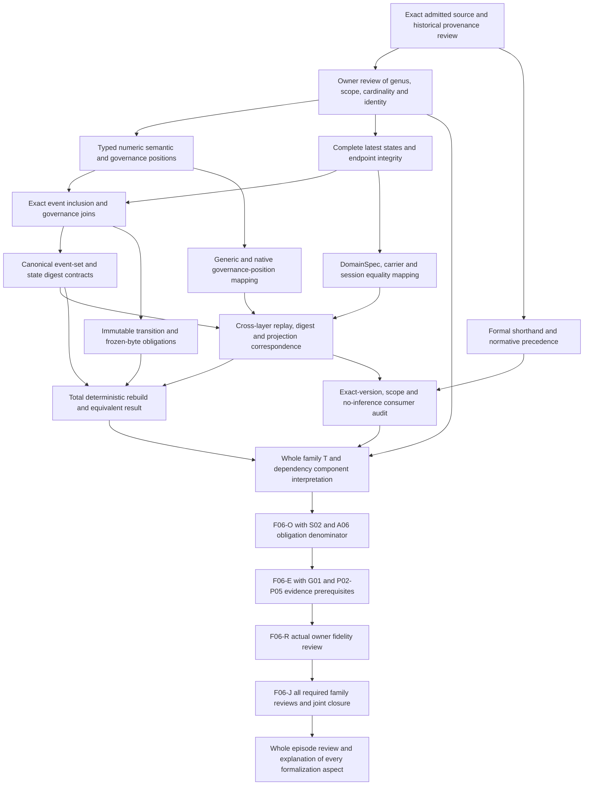

# Ontology Cut: formalization review and completion DAG

This is a partial candidate formalization of **cal.definition.ontology-cut@1.0.0-candidate.1**. It prioritizes definition forms, types, logical obligations and evidence boundaries. It has no admission or authority effect. The selected source says that a cut is a derived immutable consistent state of one ontology at exact semantic and governance cursors with an event-set digest. It is rebuildable, never a canonical replay source, and cannot silently mix incompatible event positions.

The main finding is a concrete mismatch: the current generic cut carrier records a semantic cursor and governance join-policy reference, while the definition requires exact semantic and governance cursors. The generic carrier has no governance-cursor field and rejects one as an additional property. Native `ConsistentOntologyCut` also has a semantic cursor without an explicit governance cursor. Neither observation establishes that the omitted information cannot be recovered elsewhere; recovery and its exact meaning require an accepted mapping. Schema validity alone does not supply that mapping.

Selected source SHA256: `4fcb9ad5200ed0e0a6d1d91acea8ce6236bed6800724c8896cc0d4dd7b9a4417`. C65 admits these Definition bytes. Current C70 registry records independently select the carrier. Historical candidate wording in the source and descriptor remains preserved. This review is an agent self-review, with eleven unresolved source-owner findings. Whole source fidelity, shared semantic closure and whole-definition proof remain pending.

The evidence is available in [the interpretation](t.json), [complete source correspondence](correspondence.json), [typed IR](static-ir.json), [source checks](source-checks.json), [independent models](model-controls.json), [carrier and qualification checks](authority-profile-checks.json), [inventory](current-inventory.json), and [fresh terminal results](fresh-command-results.json). Final sealing records are [the coverage row](coverage-row.json), [receipt](receipt.json), [episode status](episode-status.json), and [preservation manifest](delivery-manifest.json).

## 1. Source selection, authority and precedence

The source selection binds the exact Definition identity, version, repository path and SHA256. The preflight verifies all 201 captured source/provenance files and preserves 4,131 previously sealed candidate files. It also binds the A04, C01 and E02 prerequisite receipts and the selected F06-T small working unit. The write scope is this candidate directory. No canonical Definition, carrier, source admission, runtime state or previous draft is rewritten.

Fourteen read-only source checks cover current lookup, exact registry row, C65 decision and authorization bytes, candidate-manifest selection, Definition/v1 schema and generator digests, and two pure renders matching the existing projection. The projection is 4,374 bytes, SHA256 `3ea5ed2cde57e460325f6ca9e83e0821777eda9068bf917f8687387d9ee7fa58`. Rendering preserves the source object. These checks establish selected artifact correspondence, rather than acceptance of this interpretation.

The source embeds a historical interaction-review whole-file SHA of `3c6e2afff90d07c7ea30f40bf7f3e2df8a05a7ff3e9da38c8ffdfd1d717b2c0f`. Selected local review bytes differ. Historical bytes were not recovered, and the current review was not admitted into T. The exact source's positive formal shorthand is weaker than its normative paragraph: governed identity and bounded scope do not specify the promised dual cursors, consistency, immutability, digest or rebuilding. The candidate accounts for both texts while retaining precedence and owner interpretation as unresolved obligations.

## 2. Definition forms and semantic roles

Three source spans use a candidate genus–differentia interpretation: the applicability statement, its repeated scientific boundary condition, and the positive normative paragraph. `OntologyCut(h)` is selected as equivalent to seven qualifiers: derived state, immutable state, consistent state, one ontology, exact semantic cursor, exact governance cursor, and recorded event-set digest. Additional axioms give selected qualifier obligations. The reverse implication is an explicit candidate choice requiring owner review; the source does not itself settle a globally sufficient recognition procedure.

The cut's negative boundary receives axiomatic and operational treatment: noncanonical replay role, no silent incompatible mixing, immutable-copy preservation and declared rebuild equivalence. Operational here describes a formalized requirement about related records. It does not mean that a runtime operation ran. Scope and no-inference tests become guarded candidate requirements. Exact-version/admitted-successor resolution remains deferred as a universal consumer obligation.

No recursive, inductive, coinductive or probabilistic definition is supplied. No measure, temporal modality, cryptographic theory, cursor arithmetic or unique global identity axiom is introduced. Plain-language explanation, domain examples and notation retain explanatory roles. The explanatory example at semantic cursor 842 is useful intuition, but it is not evidence of actual event inclusion or a verified governance join.

## 3. Types, signature and qualification

There are **72 declarations**: two nonempty sorts, one constant, ten total unary functions, 51 unary predicates, seven binary relations and one ternary relation. `Entity` holds candidate cuts, ontologies, states, events and consumers. `Token` holds cursor and digest values. `EMPTY` is one selected Token constant, not a native null, numeric zero, empty byte sequence or cryptographic genesis value.

Four Entity-valued functions are `cutOntology`, `stateOntology`, `eventOntology` and `resultingState`. Six Token-valued functions are `semanticCursor`, `governanceCursor`, `eventSetDigest`, `stateDigest`, `eventSemanticCursor` and `eventGovernanceCursor`. These functions are total for every Entity. A role guard determines when their values matter. Totality does not establish that every real source record has a corresponding field or that all references resolve.

Membership, immutable-copy, rebuild and consumer-use relations use typed Entity arguments. `CompatiblePositions(ontology, semanticToken, governanceToken)` uses Entity × Token × Token. It is a declared relation, with no arithmetic semantics assumed. All symbols are qualified by exact source and candidate scope in the IR. Neighboring definitions retain separate namespaces. No label such as Governance Cursor or Event Set Digest is invented as an admitted primitive Definition.

## 4. Logical theory and source accounting

The source account contains **21 source units and 25 spans: 13 encoded, six explanatory and six deferred**. Every admitted inventory string is accounted for character by character. Repeated source clauses remain distinct spans, with selectors, offsets and excerpt hashes. Complete accounting means that no selected source text disappeared; it does not mean that all source semantics were translated or accepted.

The thirteen encoded spans contain five distinct combined formula values, assembled from ten primitive theory templates: GENUS, COORDINATES, STATES, EVENTS, IMMUTABLE, REBUILD, NONCANONICAL, BOUNDED_RECORD, NO_INFERENCE and USE_SCOPE. Positive source spans combine genus, coordinate, state and event obligations. Negative spans combine immutable-copy, rebuild and noncanonical boundaries. Repetition therefore does not represent thirteen independent theorems.

The logic is many-sorted first-order logic with equality. Universals restrict selected cuts and their related states, events or uses. Existentials express required witness populations. There are no extra assumptions, assumed query targets, accepted source-owner review records or population exemptions. Static typing and correspondence checks establish software-level admissibility of the candidate. They do not provide a mechanized proof of whole-definition truth.

## 5. One ontology, exact positions and compatibility

For a selected cut, `cutOntology(h)` must have an Ontology role. Semantic cursor, governance cursor, event-set digest and state digest must differ from EMPTY. The cut's ontology and cursor tokens must appear together in CompatiblePositions. A total cutOntology function gives one selected ontology value per cut, while allowing different cuts to refer to the same ontology. It does not authenticate any real ontology identity.

Selected states must have a State role, at least one NodeState or EdgeState role, and the same ontology value as the cut. Node and edge roles are not made disjoint. That is a visible limitation rather than an accidental assertion that the source author approved overlapping roles. Nor does the candidate guarantee that every ontology state is selected, that every selected state is latest, or that retired and removed states are excluded.

Selected semantic events must have the semantic-event role, share the cut ontology, map through resultingState to a selected state, and carry a declared compatible semantic position against the cut's governance position. Selected governance events share the ontology and carry compatible event coordinates. This supplies a reviewable relation skeleton. It does not require numeric positions to be at or below the cut, compute an exact event-set prefix, bind each governance observation to a semantic tuple, or implement the actual join policy. Those stronger obligations need separate accepted maps.

## 6. Digests, identity and extensionality

The candidate distinguishes event-set digest and state digest. Both are nonempty opaque tokens. Distinct function names do not require distinct values; a supplied control permits both to share a token. No SHA algorithm, canonical serialization, membership order, event-set completeness, collision property or authenticated byte binding is encoded in this first-order theory.

That choice makes the proof boundary explicit. Native code computes the cut digest over active projected-subject references, whereas its source event count counts semantic events through the requested cursor. Project Session computes an event-set digest over captured histories and a calculated cut digest over selected node and edge records. The generic carrier requires two hex-shaped strings. These are different selected digest inputs. Calling each an event-set digest does not establish a common denotation.

A supplied witness contains two distinct cut identities with matching coordinates, digests and memberships. Equality of selected fields does not force Entity identity equality. The DomainSpec source separately states cut equality in terms of cursor and sorted complete subject-state maps. The candidate does not silently import that equality rule or identify it with Definition identity, generic node_id identity or Project session identity. The required cross-layer identity and extensionality mapping remains a source-owner finding.

## 7. Immutability, rebuilding and replay direction

`ImmutableCopy(h,k)` requires k to be a cut with the same selected ontology, cursors, digest tokens, state membership and event membership as h. `RebuiltFrom(k,h)` imposes the same selected preservation requirements. `RebuildRequired(h)` is true for selected cuts. These are conditional preservation obligations: declaring a copy or rebuilt result constrains its selected fields. The theory does not require such a relation to exist for every cut.

A supplied populated witness does include both a distinct immutable copy and a declared equivalent rebuild. It demonstrates that the chosen requirements can coexist. Additional controls remove those relations and retain T while losing required witness populations. That exposes the difference between a universal constraint on declared results and actual rebuild availability. No procedure, termination argument, deterministic replay theorem or immutable storage enforcement follows from the marker.

Seventeen finite frames add concrete content-level review examples. Sixteen reject changes to retained coordinates, digests, membership, node meaning or edge endpoints, unequal rebuilt values, canonical replay promotion, incompatible mixing or an actual temporal-proof claim. These frames are hypothetical observations, with actual runtime execution false. The cut is constrained against becoming a canonical replay source. Native source also contains a separate rejection of noncanonical inputs; this turn inspects that code without claiming runtime execution.

## 8. Populations, nonvacuity and unresolved denotations

There are **eleven required populations**: a cut, a cut without actual outcomes, a current-marked cut without actual consistency, an empty cut, a selected node state, a selected edge state, a semantic event, a governance event, a distinct immutable copy, a declared equivalent rebuild without actual success, and a scope-qualified consumer use. Each is checked in the independently supplied base model.

The supplied domains contain eleven Entity values and seven Token values. Three cuts share one ontology; two share selected node/edge states and semantic/governance events, while the third has empty selected membership. The populated and empty cuts are deliberate probes of source cardinality, rather than a claim that every ontology admits an empty valid cut. A genus model can omit all selected semantic or governance events; separate required populations prevent accepting such omissions as the only episode witness.

**Fifty-six populations remain unresolved.** They record missing real denotations, including state, event, consumer, coordinate, digest, compatibility and outcome meanings. Required witness satisfaction does not reduce that unresolved denominator to zero. Nonempty sorts alone would permit vacuous guarded universals, so the candidate checks explicit positive populations. Even these witnesses are supplied finite models, rather than automatically enumerated production states or source-owner-approved interpretations.

## 9. Queries, countermodels and inference boundaries

The exact source fragment `OntologyCut(x) =/=> authority_effect(x).` is recorded separately as a deferred nonentailment obligation. It is not selected as an axiom or assumed successful query target. The normative no-inference boundary is encoded through separate inference predicates. `ActualAuthority` remains independently interpretable; a boundary against inference does not assert that no separately authorized authority can ever exist alongside a cut.

There are **eighteen countermodel queries**: sixteen actual outcomes, a current cut's actual consistency, and execution from a rebuild requirement. Each query is false in a supplied model that satisfies T and all required populations. Outcomes include immutable storage, exact semantic and governance positions, event-set digest verification, complete state, endpoint integrity, successful rebuild, no silent mixing in actual behavior, owner acceptance, admission, authority, publication, release, deployment and external effect.

The independent engine validates every countermodel's types, total functions, tuples, T, populations and witness condition. A supplied counterexample establishes nonentailment for this selected candidate theory. It is not a theorem about the whole natural-language Definition or every future accepted interpretation. The current-marker countermodel is particularly useful: current source lookup or a current cut marker does not establish actual state consistency, while source-owner interpretation remains pending.

## 10. Independent controls and qualified use

The model checker evaluates **92 controls**: 29 satisfy T, 56 falsify T, and seven are rejected as malformed structures. Positive controls include empty membership, overlapping node/edge roles, equal cursor tokens, equal digest tokens, unconstrained unselected state roles, and equal selected fields across distinct identities. Negative controls remove required genus qualifiers, break ontology/coordinate/state/event typing, introduce incompatible declared positions, change copied or rebuilt values, or violate no-inference and replay boundaries.

Malformed controls cover a nontotal cursor function, ill-sorted ontology result, ill-sorted EMPTY constant, wrong compatibility arity, duplicate state tuple, empty Entity domain and duplicate function tuple. The unchanged finite engine keeps its configured step/time limits. No domain shrink, higher budget, checker bypass or assumed outcome was used to produce these results.

Twenty-nine qualification profiles explore nine exact context axes and eleven support axes. Twenty-six reject mismatched contexts, missing support or inferred roles/outcomes. The three non-rejected cases are a qualified hypothetical cut, a stale cut with reuse disabled, and changed bindings with reuse disabled. Hypothetical support flags do not authenticate actual cursor/hash/storage/rebuild evidence. Every profile keeps source-fidelity acceptance and actual runtime execution false.

## 11. Actual carrier and implementation observations

Twenty-three read-only catalog, binding, projection and code observations passed. The current type registry contains 143 rows, 121 marked admitted-current. One selected current direct Definition binding is OntologyCut/v1. Its descriptor and schema digests match the registry and root binding. The retained descriptor version is candidate.1 with candidate-unadmitted wording, and its fixture remains candidate with authority_effect none. These postures are separate from current registry admission.

Forty-four actual JSON-schema probes produced fifteen acceptances and twenty-nine rejections; four hostile fixtures were also rejected. Accepted records include unresolved ontology/node/edge/join references, plausible incorrect digests, empty membership, an edge without any node references, the same reference as node and edge, changed contents under one cut ID, admitted record-state text with no authority effect, and permission-sounding claim text. The schema accepts large positive integers and an integral floating JSON number. It does not prove cursor range or native deserialization correspondence.

Rejections include missing required payload fields, zero/negative/fractional/boolean cursors, duplicate node/edge references, malformed digest strings, replay_source true, integrity_result fail, extra governance_cursor, inline complete state and authority-inference fields. Thus closure is real, but its selected shape cannot directly express a governance cursor. `integrity_result=pass` is a constant string assertion, with no endpoint-resolution or digest-computation rule in this schema.

The bound package validator writes its receipt and therefore was inspected rather than executed. Its selected function checks generic schema, source and projection obligations without cut-specific cursor, membership or digest computation. Only the pure record-render function was extracted and executed. Native cut, DomainSpec equality and Project Session `_build` were inspected as separate source surfaces; no native replay, session/store operation or materialization writer ran. Applying current Definition/v2 schema to the admitted source produces four known metadata-contract errors; the source was neither migrated nor its exact C65 admission invalidated.

## 12. Dependency scope, findings and completion DAG

The candidate declares **27 exact semantic uses**, spanning Ontology and components, both event histories, views/manifests/projections, epochs/revisions, identity, context, source/provenance/evidence, validation, policy/decision/challenge, authority and residue. These are declared alignment obligations. Neighbor theories remain separately qualified. No cross-layer rule was copied into primary T merely because a source name matched.

The cut-root graph has 112 nodes, 1,021 declared edges, 62 missing counterpart packets, and one unresolved component with 50 members and 658 internal edges. The all-draft graph has 115 nodes, 1,050 edges, 64 missing counterpart packets and the same unresolved 50-member, 658-internal-edge component. It has 51 roots, while the cut-root graph has one. Its greater reach is not required to equal the single-cut graph. A semantic dependency component is not a cycle in the task-execution DAG: the former may require simultaneous interpretation review, while execution stages remain ordered and acyclic.

The eleven findings map the remaining work:

| Finding | Unresolved aspect | Completion evidence |
| --- | --- | --- |
| CUT-FINDING-001 | Genus, one ontology, cardinality and identity | Owner-accepted recognition and identity maps, including empty cut |
| CUT-FINDING-002 | Exact dual cursors and compatibility | Numeric domains, inclusion bounds, watermarks and explicit join semantics |
| CUT-FINDING-003 | Selected states and endpoint completeness | Latest complete node/edge states with active/retired rules and endpoint proof |
| CUT-FINDING-004 | Event selection and governance joins | Source-bound causal event inclusion and exact semantic-tuple joins |
| CUT-FINDING-005 | Event-set/state digest meaning | Canonical bytes, algorithm, ordered input set and independently checked hash |
| CUT-FINDING-006 | Immutability and rebuild equivalence | Frozen-byte transitions, total rebuild procedure and deterministic equivalence |
| CUT-FINDING-007 | Replay direction and silent mixing | Accepted canonical-input rules plus negative runtime and compatibility evidence |
| CUT-FINDING-008 | Source precedence and consumer scope | Owner resolution of shorthand/normative mapping and actual version/scope uses |
| CUT-FINDING-009 | Generic carrier mismatch | Accepted governance-position representation and semantic carrier validation |
| CUT-FINDING-010 | Native, DomainSpec and Project differences | Qualified cross-layer coordinate, state, equality and digest maps |
| CUT-FINDING-011 | Historical source and joint closure | Exact provenance/precedence review and accepted dependency-component meaning |

The existing foundations-first DAG remains 121 tasks, 511 dependency edges and 797 small working units. This draft addresses one F06-T unit. It does not satisfy the whole-family T gate or advance F06-O, F06-E, F06-R or F06-J. The following more detailed cut-completion graph explains the remaining dependencies without modifying the preserved parent plan.

Each node has a concrete output. Source/precedence work produces accepted source selection and findings disposition. Cursor/event work produces typed domains, exact event selectors and join maps. State/identity work produces complete-state and equality obligations. Digest work produces authenticated input-byte contracts and independent vectors. Freeze/rebuild work produces transition requirements, terminating procedure and equivalence evidence. Runtime/carrier work reconciles the observed semantic-only structures with the source's dual-position meaning. Consumer work resolves actual version, scope and no-inference uses. Closure work accounts for all required dependencies and semantic components before the existing family obligation/evidence/owner gates can advance.

## 13. Delivery status and whole episode boundary

The current inventory is independently recomputed from current shallow per-definition draft directories, rather than from archived attempts or status labels. For each draft, the checker rebinds source/core/IR, verifies complete correspondence, and evaluates one supplied model satisfying its partial T and required populations. Those separately qualified witnesses do not establish a shared-meaning combined model.

After this unit the intended scope remains 183 current Definition identities and 189 admitted versions. The inventory contains 51 partial drafts, leaving 132 current identities without a per-definition draft. Aggregate accounting is 1,164 source units, 1,589 spans, 443 encoded spans, 413 explanatory spans, 733 deferred spans, 480 required populations and 1,828 unresolved populations. Source-owner-accepted whole translations and whole-definition proofs both remain zero.

The delivery procedure runs six fresh commands: contract, model, source, profile, dependency and inventory checks. It records actual terminal exit codes and retained stdout/stderr, then audits bindings, counts, source-query separation, review links, all prior file hashes and the new sealed file set. Finalized records are issued only after all six pass. The separate preservation audit confirms the delivered file set and partial claim boundary. The exact I04 eight-draft reporting artifact is preserved; any current reporting update remains separately scoped.

This bounded unit has no failed validation attempts to conceal or promote. Whole-definition interpretation, actual dual-cursor/hash/immutability/rebuild/runtime evidence, source-owner acceptance and joint semantic closure remain work to do. The next planned draft is **F06-T.cal.definition.ontology-edge**. The broader formalization goal remains active. Completion ultimately requires the full authorized episode and an explanation of every formalization aspect, beyond a count of drafted Definitions.
