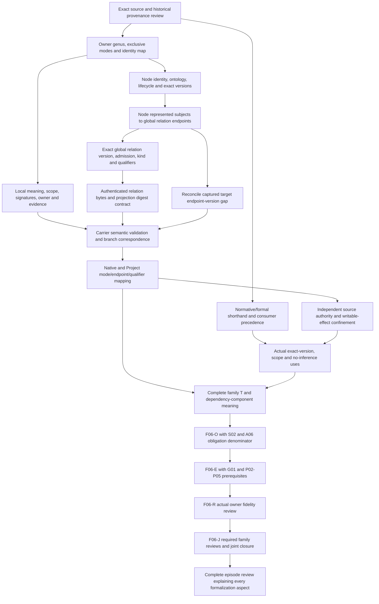

# Ontology Edge: formalization review and completion DAG

This is a **partial candidate formalization** of cal.definition.ontology-edge@1.0.0-candidate.1. The source defines an independently identified governed connection between Ontology Nodes, either a digest-bound projection of one global Typed Relation or an explicitly ontology-local interpretation. A local edge is not a global connection. A projected edge cannot override its source Typed Relation or become a second writable authority for it.

The principal design choice is to separate four identities: edge, Ontology Node, represented endpoint subject, and global Typed Relation. A projected edge connects nodes whose represented subjects match the global relation's endpoints. A local edge has an interpretation scoped to its ontology. The candidate does not identify those layers, authenticate actual versions or digests, or create a global connection.

Two current observations matter to completion. First, the generic carrier enforces projected/local object-versus-null branches, but its field named closed_qualifiers accepts arbitrary object contents. Qualifier closure comes from a separate Relation Kind validator. Second, the captured first-Agent edge's global relation digest matches the relation bytes, while its target node's represented-subject version differs from the relation's target version. Both observations remain visible, with no canonical repair or normalization.

Selected source SHA256: `c5eeab76f0ba40c769256c0709206282bcb18ab05a0cdfd311208cf5927b0844`. C65 admits this exact Definition; current C70 registry selection independently records the carrier. Twelve owner findings remain unresolved. Source fidelity, whole-definition translation, proof and shared semantic closure remain pending. This is an agent self-review and has authority_effect none.

Evidence links: [interpretation](t.json), [correspondence](correspondence.json), [typed IR](static-ir.json), [source checks](source-checks.json), [models and countermodels](model-controls.json), [carrier, qualification and captured-function checks](authority-profile-checks.json), [dependency graph](dependency-graph.json), [current inventory](current-inventory.json), and [fresh terminal results](fresh-command-results.json). Final records are [coverage](coverage-row.json), [receipt](receipt.json), [episode status](episode-status.json), and [preservation manifest](delivery-manifest.json).

## 1. Exact source, admission and precedence

The preflight binds Definition identity, exact version, path and source hash. It verifies all 201 captured source/provenance files and preserves 4,190 previously sealed candidate files. A04, C01 and E02 prerequisite receipts are checked before output creation. The selected F06-T small working unit permits writes only in this directory. Prior candidate status and manifests are preserved as historical records.

Fourteen read-only source checks establish current lookup, the exact admitted registry row, C65 decision/authorization bytes, candidate-manifest selection, Definition/v1 schema and generator hashes, and two pure generated projections equal to the source projection. The projection is 4,825 bytes with SHA256 `bcb2e38be0e50eb4ad1872aa6ee206a167d1385bf1a02a7b9a214f28c60e2f70`. The pure renderer leaves the source object unchanged. None of these checks is an owner acceptance of the candidate interpretation.

The embedded historical interaction-review whole-file hash differs from current local bytes. Historical bytes were not recovered, and the local review was not made an axiom. The scientific formal shorthand says only governed identity/record and bounded scope, plus authority nonentailment. Its positive implication is weaker than the normative paragraph's branch, endpoint and digest requirements. Both texts are accounted for, with precedence and fidelity retained as owner-review obligations.

## 2. Definition forms and roles

The candidate uses genus–differentia and axiomatic forms for the positive source paragraph. A selected edge has independently identified, governed connection and between-Ontology-Nodes qualifiers, together with exactly one projected/global or local interpretation mode. The reverse genus implication is a candidate sufficiency choice. The exclusive mode choice is consistent with the selected carrier's two branches, but carrier closure is separately governed and does not automatically prove the source author's intended logic of “either.”

The projected branch adds typed global relation, subject-endpoint mapping and declared digest-equality obligations. The local branch adds interpretation role, nonempty meaning and ontology scope. The negative boundary is axiomatic: local-global collapse is forbidden, and a projection cannot override or duplicate writable source authority. Operational forms represent candidate constraints on mappings and uses; no runtime operation follows from that classification.

No recursive, inductive, coinductive, temporal, probabilistic or cryptographic definition is introduced. Plain language, notation and the TR-204/local-represents example retain explanatory roles. The example suggests the intended separation of global projection from local meaning, but it does not resolve actual global relation identity, endpoint versions, local signature availability or write permissions.

## 3. Types and qualified signature

There are **71 declarations**: two nonempty sorts, one constant, fourteen total unary functions, 52 unary predicates and two binary relations. `Entity` contains candidate edges, nodes, represented subjects, global relations, ontologies, interpretations and consumers. `Token` holds identity, digest and meaning values. EMPTY is a Token constant with selected candidate meaning, not a native null or a cryptographic value.

Ten functions return Entity: edgeOntology, nodeOntology, sourceNode, targetNode, nodeSubject, boundRelation, relationSourceSubject, relationTargetSubject, localInterpretation and interpretationOntology. Four return Token: edgeIdentity, edgeRelationDigest, relationDigest and interpretationMeaning. All functions are total over Entity. A branch guard determines when a function's value is semantically constrained. In particular, boundRelation on a local edge and localInterpretation on a projected edge have no branch-specific denotation asserted by this theory.

Unary predicates express roles, genus qualifiers, modes, boundaries, actual outcomes and independent inference flags. ConsumerUse and UseInApplicability are Entity × Entity relations. Symbols are qualified by exact Definition source and candidate scope in the typed IR. The candidate does not invent Global Connection, Local Interpretation or Digest Binding as admitted Definition primitives. Their selected role symbols require accepted maps rather than meaning inferred from labels.

## 4. Logical theory and complete source account

The source account contains **21 source units and 25 spans: thirteen encoded, six explanatory and six deferred**. Every selected string is accounted for character by character, with selector, offset and excerpt hash. Source repetitions remain separate spans. Complete accounting means no selected text disappeared; the six deferred spans and pending source-owner findings make incomplete semantic translation explicit.

There are five distinct encoded combined formula values, built from nine primitive templates: GENUS, IDENTITY, ENDPOINTS, PROJECTED, LOCAL, AUTHORITY_BOUNDARY, BOUNDED_RECORD, NO_INFERENCE and USE_SCOPE. The positive paragraph combines five templates; the negative paragraph uses the authority boundary; the formal positive implication, scope-use requirement and no-inference clauses use their corresponding templates. Repeated paragraphs do not become independent theorems.

The logic is many-sorted first-order logic with equality. Universals guard selected edge and use constraints. Existentials specify required witness populations. No extra assumptions, query targets or source-owner acceptance decisions are inserted into T. The contract, namespace, static-IR and correspondence checks establish supported candidate structure. They do not supply a proof of the natural-language Definition or common meaning across source, carrier and runtime.

## 5. Independent edge identity and endpoint ontology

For a selected edge, edgeIdentity must differ from EMPTY. The Entity representing the edge must differ from its source and target nodes. It cannot also have the selected Node or TypedRelation role. A projected edge must also differ from its bound global relation. These guards represent independent identities in the chosen model, without proving the uniqueness or authenticity of real identifiers.

Both endpoints have Node roles and the same nodeOntology value as edgeOntology. The edge ontology has an Ontology role. A total sourceNode and targetNode function provides one selected endpoint in each position. Actual endpoint reference resolution, Node version selection, completeness, membership in a cut and active lifecycle remain separate obligations. The theory does not impose a distinct-source-and-target axiom, so a self-loop can satisfy T when the represented-subject mapping agrees.

Distinct edges can share an identity Token in a supplied positive control. That exposes the difference between per-Entity identification and global identifier injectivity. The source's independent-identity meaning needs an accepted identity map before such a model can establish real recognition or uniqueness. A separate witness distinguishes Node identity from represented-subject identity, while T alone does not universally enforce that distinction for every Node; the Ontology Node definition remains separately qualified.

## 6. Projected global relation and subject mapping

A selected projected edge binds one Entity with TypedRelation and GlobalRelation roles. The edge and this relation are distinct Entities. Its edgeRelationDigest is nonempty and equals relationDigest of the bound relation. This is declared token equality. No hash algorithm, source byte selection, current global version, exact Typed Relation instance admission or cryptographic integrity is assumed.

Projection preserves endpoint subjects through nodes: nodeSubject(sourceNode(edge)) equals relationSourceSubject(boundRelation(edge)); the target side follows the corresponding target functions. The represented subjects have Subject roles. This avoids an incorrect direct equality between Ontology Node identity and the global relation endpoint artifact. The map still requires actual subject versions, kinds, digest bindings, direction and Relation Kind qualifiers before faithful projection can be claimed.

The current global carrier includes relation reference, version reference and digest, plus a semantic event tuple. These selected carrier fields are observations, rather than unmentioned source axioms added to T. A role marker for a global relation does not prove that its instance is admitted. Similarly, a digest-shaped string in an otherwise schema-valid edge does not establish projection fidelity, endpoint consistency or permission to use its connection as an authoritative path.

## 7. Local interpretation and scope

A local edge's selected localInterpretation has an Interpretation role. Its interpretationOntology equals the edge ontology, and interpretationMeaning differs from EMPTY. This supplies a typed, nonempty, ontology-scoped local meaning. It does not calculate what the meaning is, authenticate its owner or evidence, determine allowed local predicate signatures, or make a local connection globally available.

The local branch forbids LocalIsGlobalConnection. Global relation digest and binding functions on local edges remain uninterpreted rather than automatically serving as a hidden relation admission. The generic carrier makes the global binding null for the local branch and requires a local object with interpretation, local_scope, owner_ref and evidence_refs. Those fields require a carrier/source map; their syntactic existence does not resolve actual local scope or evidence.

Actual Project graph source restricts local predicates and endpoint kinds through a separate local_edge_signatures profile. That restriction is a distinct runtime contract. It is not imported into the admitted Definition or treated as an accepted common denotation. An explicitly local interpretation can satisfy candidate T while ActualLocalGovernance remains false, demonstrating the remaining gap between a role/scope map and governed available behavior.

## 8. Authority, mutation and temporal frames

The negative boundary is conditional on edge mode. Projected edges cannot carry OverridesBoundRelation or SecondWritableAuthority. Local edges cannot carry LocalIsGlobalConnection. Separate no-inference predicates forbid admission, authority, success, identity equivalence or external effect inferred from the term. ActualAuthority remains independently interpretable because a boundary against inference is not a claim that separately admitted authority never exists nearby.

Static flags do not implement write confinement. Supplied controls deliberately expose their guards: projection-only override flags on a local edge are unconstrained by the projected boundary, and the local-only global-collapse flag is unconstrained on a projected edge. These are formal scope limits, not permissions to perform source mutations. Accepted universal source-write behavior requires policy, identity, runtime and authority maps beyond this partial T.

Seventeen finite frames make source mutation consequences explicit. Fourteen reject changes to global source identity, endpoints, kind, digest or meaning; changed projected relation bindings; unscoped local interpretation; retained global binding in a local interpretation; source-write authority or actual behavior-proof claims. Three hypothetical frames permit an unchanged projection, an independent display-label update, and an explicitly local edge with no global source binding. No frame executed a live write or proves universal confinement across transitions.

## 9. Populations, nonvacuity and unresolved meanings

There are **ten required populations**: an edge, projected/global edge, scoped local edge, distinct projected and local identities, edge without actual outcomes, current projection without actual endpoint versions, local interpretation without actual governance, independent edge/relation identity, distinct Node/represented-subject identity, and a scope-qualified consumer use. Each is independently evaluated in the supplied base model.

The model contains twelve Entity values and seven Token values. Two edge Entities represent the projected and local alternatives. They share two selected Nodes and one ontology. The projected edge maps those nodes to two represented subjects and one global relation; the local edge has an explicit interpretation role in that ontology. Separate current and use markers allow currentness and applicability claims to be challenged independently of actual outcome predicates.

**Fifty-three populations remain unresolved.** They retain missing actual denotations for roles, modes, endpoints, subject identity, digest and local meaning values, authority/inference predicates and outcomes. Nonempty sorts alone would permit vacuous guarded constraints. Required populations force populated witnesses of both branches, while remaining finite supplied models. They neither enumerate real ontology edges nor establish a shared-carrier interpretation across neighboring Definitions.

## 10. Countermodels, source query and independent controls

The exact source fragment `OntologyEdge(x) =/=> authority_effect(x).` is retained as a deferred source-query obligation outside T. The positive formal implication is encoded separately. The boundary against inference is not an assumed successful authority query. Every use resolving the exact Definition or an admitted successor also remains a deferred universal consumer obligation, despite the selected version/current registry being checked.

There are **21 countermodel queries**: nineteen actual outcomes, current projection's actual endpoint versions, and actual governance from a scoped local interpretation. Each target is false in a supplied well-typed model satisfying T and all required populations. Outcomes cover identity/reference resolution, exact endpoint versions, relation digest authentication, global admission, faithful projection, closed qualifiers, local scope/governance, no actual source override, single writable authority, consumer compliance, owner acceptance, authority, admission, publication, release, deployment and external effect.

The independent checker evaluates **88 controls**: thirty satisfy T, 51 falsify T, and seven reject malformed structure. Negative controls test branch exclusivity, missing genus/identity/ontology roles, endpoint mapping errors, relation digest mismatch, local scope/meaning failures and forbidden authority/inference flags. Positive limitations include self-loops, shared identity Tokens, opaque matching digest Tokens, branch-uninterpreted function values and no selected consumer uses. Malformed controls cover nontotal functions, ill-sorted result/constant, wrong tuple arity, duplicate tuples and empty domains. Engine limits remain unchanged; no test budget, domain or checker was relaxed to pass.

Thirty-one hypothetical qualification profiles test eleven exact context axes and ten support axes. Twenty-eight reject context mismatches, missing supports, inferred source/global authority or actual-compliance claims. Three non-rejected profiles cover the qualified hypothetical envelope and stale/changed bindings with reuse disabled. The support envelope covers both branches; it is not an accepted minimal per-mode policy. Actual endpoint/version/hash/local-scope behavior and source-fidelity acceptance remain false in every profile. These checks make reuse prerequisites reviewable without authenticating real records or granting authority.

## 11. Actual carrier, captured records and implementation boundaries

Twenty-eight read-only catalog, projection, schema, captured-record and static code observations passed. The current type registry has 143 rows, 121 admitted-current. One current direct Definition binding selects OntologyEdge/v1, with matching descriptor/schema/root binding bytes. Retained descriptor wording and the fixture remain candidate, with no authority effect. These postures are preserved independently of current C70 type admission.

Fifty schema probes produced nineteen acceptances and 31 rejections; four hostile fixtures were rejected. Accepted probes include unresolved endpoint/global/version references, plausible incorrect relation/event digests, same-node endpoints, symmetric direction without a Relation Kind compatibility check, arbitrary nested qualifier properties, empty qualifiers, weak forbidden-collapse labels, changed source relation under the same edge ID, admitted record-state text and permission-sounding claims. Local scope can differ from ontology/top-level scope, and local owner/evidence/meaning can be unresolved.

The schema rejects wrong branch object/null shapes, missing required fields, extra global/local authority properties, empty local evidence, empty collapse lists, invalid modes/direction, malformed digest strings, replay_source true and authority_effect admitted. This proves meaningful structural closure without proving global availability or local denotation. The selected package validator writes a receipt, so it was inspected without execution. Only the pure generated-record render function was executed for carrier projection checks.

Captured first-Agent records provide stronger but incomplete correspondence. The edge's bound digest equals the exact relation bytes: `70be6198f3866c330db68a09a8e90e675e18ae16a86067b6e0c0d5daf83c0378`. Edge node references and represented subject identities match the relation endpoints. Source endpoint versions agree. The target relation names `project:cyberalchemy-v2-to-lab-migration@candidate.1`, while the target Node represents `project:cyberalchemy-v2-to-lab-migration@decision-0071`. Matching identity and relation digest do not erase that version difference.

Sixteen captured/authored in-memory frames execute the existing pure validate_relation function and bound resolve/protocol helpers. Six pass and ten reject. The original normalized Node-version frame rejects the unresolved target version; an authored target-version alignment passes with candidate endpoints. That authored record changes relation content and is not the original digest-bound projection, a canonical repair or a runtime projection. Other negatives cover unknown Relation Kind, wrong endpoint identity/pair, withdrawn endpoints and missing/extra/wrong qualifiers. Direct historical or unrecognized endpoint status, inconsistent internal version label, top-level authority text and candidate Relation Kind state can pass this narrow function. Caller selection and schema/authority checks supply separate guarantees.

Native relation state has identity, lifecycle, endpoints, direction, properties and forbidden collapses without an explicit projected/local mode or global binding field. Native endpoint code requires active nodes in the same ontology for active relations. Project graph separately filters global relations by effective admission, validates Relation Kind endpoints/qualifiers, restricts local signatures, and excludes unresolved global paths. Session code projects source hashes and constructs local scope objects. These code surfaces were inspected, with no native replay, graph/session/store execution or source mutation. No common semantic map is accepted merely from compatible names.

## 12. Dependencies, findings and completion DAG

There are **34 exact semantic-use dependencies**, covering Ontology/Node/cut/view/manifest/projection, Typed Relation/Relation Kind/coupling, identity/classification, contexts, event histories/epochs/revisions, authority, evidence/provenance/source, policy/decision/challenge, schema/validation, governed model and residue. Every dependency keeps its exact source/version. Neighbor theories and implementations remain separately qualified; no runtime relation closure rule was imported into T.

The edge-root graph has 112 nodes, 1,055 declared edges and 61 missing counterpart packets. It contains one unresolved component with 51 members and 683 internal edges. The joint graph is independently recomputed over all 52 current draft roots: 115 nodes, 1,084 declared edges, 63 missing counterpart packets and the same unresolved 51-member component. Declared semantic dependencies can require coordinated interpretation of a component; that does not add a cycle to the preserved task-execution DAG.

| Finding | Missing acceptance or evidence | Concrete next output |
| --- | --- | --- |
| OED-FINDING-001 | Genus, mode exclusivity and independent identity | Owner-approved recognition/cardinality/identity map |
| OED-FINDING-002 | Endpoint ontology, direction and lifecycle | Exact Node/cut/version map and lifecycle/direction obligations |
| OED-FINDING-003 | Node-to-global-subject projection | Exact subject/version/kind and relation endpoint correspondence |
| OED-FINDING-004 | Relation digest/current global instance | Bound source-byte/version/admission and hash contract |
| OED-FINDING-005 | Local scope, meaning and governance | Local signature, owner/evidence/qualifier and availability map |
| OED-FINDING-006 | Source authority and writable confinement | Policy/runtime effect and transition confinement evidence |
| OED-FINDING-007 | Separate carrier/runtime obligations | Explicit admitted contract alignment without source axiom leakage |
| OED-FINDING-008 | Source shorthand and consumer scope | Owner precedence disposition and universal use-resolution audit |
| OED-FINDING-009 | Generic schema/reference limitations | Semantic validation for endpoint/digest/qualifier/collapse fields |
| OED-FINDING-010 | Native and Project common meaning | Qualified cross-layer mode, endpoint and source-authority maps |
| OED-FINDING-011 | Captured target endpoint-version gap | Accepted exact-version reconciliation and independently checked witness |
| OED-FINDING-012 | Historical provenance and joint closure | Source-precedence resolution and component interpretation review |

The foundations-first plan remains 121 tasks, 511 dependency edges and 797 small working units. This draft is one F06-T unit. Whole-family T, S02 and A06 remain prerequisites to F06-O; F06-E requires its evidence prerequisites, then F06-R requires actual owner fidelity review. F06-J joins the required family reviews. The following detailed edge-completion graph explains work remaining within those gates, without replacing the preserved plan or treating this draft as whole-family completion.

Each node has a reviewable output. Source/meaning work produces accepted selection, forms and identity rules. Node/subject work produces version-exact projection maps and lifecycle obligations. Relation/digest work binds global instance, admitted kind, qualifier schema and exact authenticated bytes. Local work identifies governed signatures and scope without promoting them globally. Carrier/runtime work states which fields and checks enforce each accepted rule. Writes/consumer work supplies separate authority and actual use evidence. Closure work resolves all required dependencies before family obligation, evidence and owner gates can advance.

## 13. Delivery and whole episode status

The inventory checker independently selects current shallow per-definition draft directories. It rebinds source/core/IR, checks complete source accounting, and evaluates one supplied model satisfying each partial theory and required populations. Those separate finite witnesses do not establish a single meaning-aligned joint model. Archived attempts and status labels are not counted as current drafts.

After this unit the original scope remains **183 current Definition identities and 189 admitted versions**. There are 52 partial drafts and 131 current identities without per-definition drafts. Aggregate accounting is 1,185 source units, 1,614 spans, 456 encoded spans, 419 explanatory spans, 739 deferred spans, 490 required populations and 1,881 unresolved populations. Accepted whole translations and whole-definition proofs remain zero.

The delivery procedure retains six fresh terminal checks: contract, model, source, profile, dependency and inventory. Sealing occurs only after all exit successfully with no stderr and reproduce the selected producer outputs. The final audit rechecks source/prerequisite bindings, candidate counts, source-query separation, model/profile scopes, review links, prior hashes and the sealed file set. No validation failure is hidden; the current bounded producer checks passed. The exact I04 eight-draft report remains preserved and requires a separate scoped reporting update.

The next planned candidate is **F06-T.cal.definition.ontology-manifest**. The formalization goal remains active. Its final completion still requires the whole authorized episode, owner acceptance and required semantic/evidence gates, together with a complete explanation of every formalization aspect. The current typed edge model, useful countermodels, matching relation digest and green schema checks are concrete progress within that larger objective.
