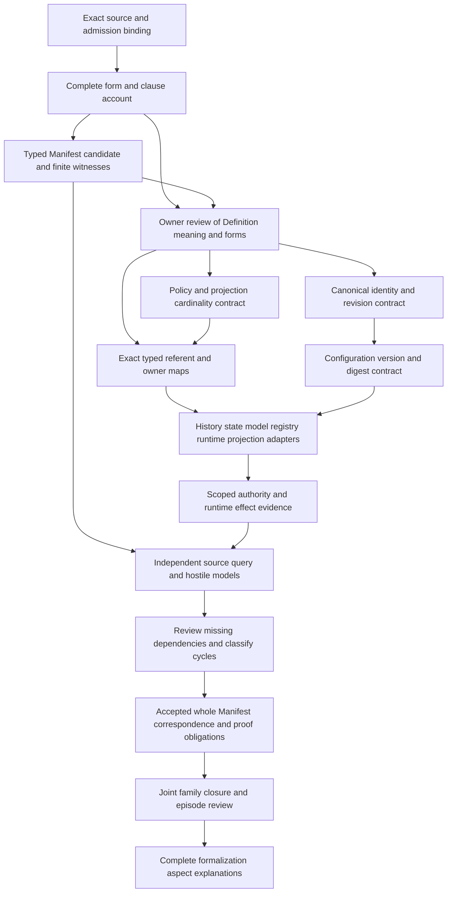

# Ontology Manifest: formalization review and completion DAG

Candidate SWU **F06-T.cal.definition.ontology-manifest**. This review advances the definitions, forms, types and logical semantics lane first. It completes a bounded candidate packet, not the whole formalization episode. The episode retains 183 current Definition identities, 189 admitted source versions and 201 captured source files. Source-owner-accepted whole translations and whole-definition proofs remain zero. This packet has 21 source units, 25 mapped spans, 13 encoded spans, six explanatory spans and six deferred spans; character accounting is complete.

The main result is a typed model of stable ontology identity and configuration bindings. Its finite witnesses distinguish a Manifest from represented subjects and event-derived state. Its successor relation preserves identity and ontology while allowing configuration changes. Neither those bindings nor their schema validation establish runtime activation or configuration authority. A material cardinality choice remains open: this candidate requires nonempty Policy and projection collections; the current generic carrier accepts empty collections.

## 1. Exact source, authority and evidence boundaries

The selected source is `cal.definition.ontology-manifest@1.0.0-candidate.1`, at `authority/definitions/candidates/0013-integrated-lab-definition-model/definitions/ontology-manifest/v1/definition.json`, SHA256 `34289df770ad7df33a9bc26109f485b18ce40e4cb72b50872cb1be3785195b58`. The exact C65 admission selection, admission authorization, candidate manifest, registry source binding, source schema and generated human projection are checked by [source-checks.json](source-checks.json). Its two deterministic source renders are 4,839 bytes with SHA256 `dcd96f690b4b381e4a899915a3a7b6901983eaeaedf359e1a6923d5e20de7291`.

The Definition describes a canonical stable identity and configuration record for one Ontology, binding its Definition, owner, state model, Relation Kind registry, Policies, runtime, projections and challenge route. It excludes mutable snapshots, event histories, consistent cuts, transport packages and that Ontology's represented subjects. Separate contracts govern carriers, relation availability, behavior and authority effects. This source admission establishes the selected Definition record's posture; it does not accept our translation, examples or shared semantic maps.

The historical interaction-review reference records a different whole-file digest from the current local document. Historical bytes were not recovered. Current bytes can inform a separately qualified comparison but cannot silently replace the admitted historical reference. No external literature or live service observation is claimed. The owner has not accepted the correspondence or resolved precedence findings.

## 2. Definition forms and source accounting

[correspondence.json](correspondence.json) and [correspondence-check.json](correspondence-check.json) retain each selected source unit and its disposition. The normative paragraph, applicability and positive scientific boundary are represented by one combined genus, identity, binding, collection and stability statement. Four negative boundary spans share the exclusion statement. The formal positive shorthand receives the bounded-record statement. Separate noninference and applicability guards cover relevant scope, claim-ceiling and testable-condition spans.

The candidate uses genus-differentia, axiomatic-implicit and operational forms. These names describe the selected translation technique; they do not turn prose into a proof. Thirteen encoded spans reduce to five distinct formula values and nine primitive templates. Repeated source sentences are accounted for rather than counted as independent axioms. Six explanatory spans retain intuition, example and notation without importing runtime rules. Six deferred spans preserve unresolved meaning, including the exact-version/admitted-successor consumer obligation and source nonentailment query.

The source's event-sourced example is an example of a permitted configuration. It is not a universal requirement that every Ontology use that state model. Formalizing it as such would strengthen the source without an accepted owner decision. The selected forms and their omissions are recorded in [clause-analysis.json](clause-analysis.json).

## 3. Signature, types and interpretation maps

[t.json](t.json) declares 75 symbols: two sorts, one constant, eight functions, 58 unary predicates and six binary relations. `Entity` represents candidate subjects and configuration referents. `Token` represents opaque identity values. Both finite domains are nonempty; `EMPTY` is a Token. Seven total Entity-valued functions bind ontology, Definition, owner, state model, Relation Kind registry, runtime and challenge route. `manifestIdentity` is Entity-to-Token.

The role predicates constrain the range of each binding for Manifest entities. They are candidate denotation markers, not admission checks, URI resolution, authenticated principals, schema contracts or implementation types. `BoundPolicy` and `BoundProjection` model collections. `OntologyRepresents` supplies the own-Ontology subject boundary. `StableIdentityRevision` relates retained records. `ConsumerUse` and `UseInApplicability` qualify declared uses.

Total functions have values on non-Manifest entities too. Those values carry no Manifest meaning unless the guarded axioms apply. Role overlap is allowed except at explicit boundaries. For example, a candidate Entity may carry both Definition and state-model roles; the source does not establish universal disjointness. Identical-looking strings in different repositories also do not establish identity. [static-ir.json](static-ir.json) qualifies symbols by exact source and interpretation scope so dependencies cannot collapse by short label alone.

## 4. Logical theory and what it actually entails

The genus biconditional identifies a Manifest with the joint candidate predicates CanonicalRecord, StableIdentity, IdentityRecord, ConfigurationRecord and OneOntology. This is stronger than the source's simple implication shorthand and requires owner review. The identity axiom requires a nonempty identity Token and a Manifest entity different from its bound Ontology entity. The binding axiom requires the seven proper roles. Collection axioms require at least one Policy and one projection for every Manifest and type every bound member.

The successor axiom says that a declared successor of a Manifest is also a Manifest, has the same identity Token and binds the same Ontology. The boundary axiom excludes the four sibling record roles and every subject represented by that Manifest's own Ontology. BoundedRecord requires governed identity/record and bounded scope. NoInference rules out 14 candidate inference flags. UseScope qualifies declared consumers and applicability.

The theory does not assert a globally unique canonical record, a total revision order, universal consumer compliance, authenticated identity, correct configuration hashing, authority to revise, runtime activation, or actual Policy and projection conformance. It also does not assert that no Manifest can ever be represented in another Ontology. Those are additional semantic choices and maps. Neither adding an actual-outcome predicate nor satisfying a role marker manufactures such a map.

## 5. Stable identity, configuration revision and canonical selection

The supplied base witness has two Manifest entities with the same identity Token and the same Ontology. Their runtime referents differ. This satisfies the selected successor theory and required populations while actual configuration-change authorization remains false. It demonstrates that stable identity does not freeze every configuration field under this candidate interpretation. It does not prove that any actual update was authorized.

Positive controls permit overlapping canonical records with the same identity and Ontology, changed Definition or runtime bindings on a successor, and a Manifest represented by another Ontology. They expose choices that the current theory deliberately leaves open. Negative controls reject changing the successor identity or Ontology, identifying a Manifest with its own Ontology, representing it as its own Ontology's subject, and substituting empty identity.

Finite configuration frames add a separately labelled hypothetical update policy: retain the before-record, preserve identity and Ontology, authorize changed configuration under the supplied hypothesis, and leave represented subject state untouched. That authorization rule is not an axiom of primary T. An owner must decide canonical uniqueness, revision identity, immutable versions, the update protocol and how records are selected as current before a complete temporal contract exists.

## 6. Binding referents and collection cardinality

A Definition reference requires exact-version interpretation; owner binding requires an accountable role/principal map; state-model and registry bindings require admitted contracts and referent resolution. Runtime and projection references require compatible contracts. The challenge route must be distinguished from its challenge contract. Top-level record owner and payload Ontology owner may be different roles; equality is not assumed simply because the fixture currently uses one value.

The nonempty Policy/projection choice is a candidate strengthening of plural binding language. The schema uses unique arrays of nonempty strings but specifies no `minItems`. Thus an empty list is structurally accepted. Review must decide whether an empty set means valid absence, deferred selection, inherited defaults or an incomplete Manifest. A decision must specify both collection cardinality and closure: a nonempty list of unresolved references still cannot prove governed configuration.

Actual referent closure also requires a version/alias policy. The selected Node fixture references `ontology-manifest:artifact-governance/v1`; the Manifest fixture's `node_id` is `ontology-manifest:artifact-governance`. The selected history fixture identities describe individual Node histories, while Manifest references describe Ontology-level histories. These exact selected IDs do not match. This is an unresolved mapping observation, not proof that the targets are absent repository-wide or that an intentional alias/global-history role is invalid.

## 7. State, replay and runtime effects

The primary theory excludes mutable snapshots, histories, cuts and packages from Manifest entities. The generic carrier separately fixes `subject_replay_source` to false. That allows the Manifest to name histories and state models without itself becoming the subject-event replay source. A configuration record, a complete-state semantic event, an integrated cut and a transport envelope have different obligations even when one refers to another.

Selected native Rust source shows EventStore loading semantic and governance directories, sorting cursors and validating histories. Its noncanonical-source guard requires `canonical_event`. There is no `pub struct OntologyManifest` in the selected native library. Selected binding code materializes navigation and loads EventStore from event directories. These are static source observations; no Rust execution, service start, migration or materialization ran in this SWU.

Project Session supplies `runtime-head:` plus its head as `ontology_manifest_ref`. A separate versioned graph manifest has schema `cal.system-ontology-graph-version/v1`, status `admitted-versioned-read-model` and replay-source false. It does not satisfy the current Manifest carrier schema. These surfaces require qualified adapters or an owner decision about their roles. Filename similarity and a reference field name cannot establish one shared Manifest interpretation or invalidate their historical posture.

## 8. Existence, populations and finite witnesses

Ten required populations cover a Manifest, one with no actual outcomes, a current Manifest without runtime activation, bound Policy and projection, a distinct stable-identity successor, changed runtime configuration without actual authorization, a represented subject separate from the Manifest, all typed configuration bindings and scope-qualified use. There are 61 unresolved populations. Their unresolved status records the absence of accepted existence/type maps, not a proof of nonexistence.

The base finite witness uses 15 Entity values and four Token values. All actual-outcome predicates are false. It has two Manifest records, role-tagged referents, separate represented subject and consumer, Policy/projection bindings and a stable successor. The finite evaluation establishes consistency of this supplied interpretation with selected T and I. It does not establish the existence, admission, fidelity or operational success of those objects in the repository.

Population-free variants can satisfy universal T while failing I. Keeping those results separate prevents vacuous universals from being counted as existential fulfillment. Missing-role, collection, successor and boundary controls further distinguish typing, existence and authority. Actual ontology/configuration denotations remain pending.

## 9. Queries, countermodels and negative controls

[model-controls.json](model-controls.json) records 93 controls: 34 T-true, 52 T-false and seven malformed structures rejected. All controls are evaluated under the existing engine budgets. Malformed cases cover function totality, sorting, relation arity, duplicate tuples/domain values and empty domains; these are model-structure rejections, not semantic counterexamples.

Twenty-three separate query countermodels satisfy T and their designated witness condition while falsifying the proposed consequence. Twenty-one target actual outcomes: canonical selection, stable identity, exact Definition binding, owner accountability, state-model conformance, registry resolution, Policy admission, projection conformance, runtime adoption/activation, configuration digest verification/change authorization, subject truth, consumer compliance, owner acceptance, authority, admission, publication, release, deployment and external effect. Two more target current-Manifest runtime activation and successor authorization.

The exact source fragment `OntologyManifest(x) =/=> authority_effect(x).` is retained by [source-query-obligation.json](source-query-obligation.json). It is a deferred nonentailment obligation outside T, with the matching Manifest-not-ActualAuthority countermodel. Encoding its desired conclusion as an assumption would invalidate this check. These are supplied finite countermodels, not general mechanized completeness or universal system proofs.

## 10. Carrier checks and hypothetical qualifications

[authority-profile-checks.json](authority-profile-checks.json) records 30 actual selected checks, four rejected hostile fixtures and 59 schema probes, of which 21 are accepted. The current catalog has 143 rows, 121 admitted-current rows and one direct current Manifest type binding. C70 records that carrier admission; the retained descriptor remains candidate-unadmitted and the example fixture remains candidate. The exact descriptor, schema, root binding and pure source projections are rehashed. Only extracted `render_record` executes; the generator module and receipt-writing package validator do not run.

Accepted probes include empty collections, unresolved or cross-kind references, whitespace references, multiple bindings, plausible unverified digest, same-ID changed runtime/owner/version, distinct record/Ontology owners, identical history strings, admitted record state with effect none, and a permission-sounding claim. Rejected probes cover every missing required payload field, empty scalar references, duplicate/wrong-type/empty collection items, malformed digest, replay-source true, effect inflation and extra snapshot/activation fields. Schema validation therefore establishes shape and these exact limits, not full semantic closure.

Thirty-two hypothetical qualification profiles include 29 rejected cases. Thirteen exact context axes and ten support axes prevent reuse under changed identities, versions, owners, bindings or epochs. Six forbidden role/effect claims are rejected; stale Manifest and changed-binding cases receive no reuse. Nineteen finite configuration frames include 15 rejected cases. They check retained-record mutation, stable identity/Ontology, hypothetical revision authorization and subject/effect separation. Their hypotheses are explicit; none demonstrates actual configuration authority or universal temporal behavior.

## 11. Recorded runtime binding admission and adoption

The fixture runtime reference exactly selects `cal.binding.ontology-product-event-runtime/v2`. Its retained binding says `test-candidate`, authority effect none and `runtime_source.adopted: false`. Separate C47 records binding admission of the exact current binding bytes: SHA256 `28253f456733f75650cea4f52440c302de575c7c0e4af58a5cedab23afb65e9d`, effect `implementation-binding-admission-only`. C48 records adoption of the exact selected Rust source SHA256 `f1b3f7cf463ebcc6e7b887b374d75adeac29ba38acfec3bafacfe4d3159f3a7b`, effect `runtime-adoption-only`. The selected implementation-material library hash also matches the binding record.

The apparent frozen-field/status difference is intentional in those records: the external decisions supply status without rewriting the frozen candidate. It must not be “repaired” by mutating the binding. Both recorded scopes exclude runtime activation; C48 also excludes service start. This SWU verifies selected status, subject ID/path and exact bytes, not the complete legitimacy of every referenced decision, live activation state or fresh authorization from historical quoted user text.

The Manifest's reference alone consequently proves neither those recorded statuses nor a particular Ontology's runtime conformance. A scoped adapter must establish referent closure and contract compatibility. Activation, actual configuration changes, migration and publication require their own evidence and owner scope.

## 12. Dependency analysis and detailed completion DAG

The candidate declares 36 direct exact-version semantic dependencies. [dependency-graph.json](dependency-graph.json) expands one local root; [current-dependency-graph.json](current-dependency-graph.json) expands all 53 current partial drafts. The local edge set is contained in the joint declared graph. Their distinct root scopes mean missing counts and edge totals need not match. The local graph has 112 identities, 1,091 edges and 60 missing counterpart packets. The joint graph has 115 identities, 1,120 edges and 62 missing counterpart packets. Both retain one unclassified 52-member component with 708 internal edges. Missing packets and that component remain obligations; cycles have not been accepted as definitions, recursion or fixed points.

The complete foundations-first project DAG remains preserved: 121 tasks, 511 edges, 797 SWUs and 36 frontiers. The sequence below gives this Manifest's completion obligations without promoting it to whole-family completion. Each exit criterion requires evidence and the appropriate accepted owner map. Candidate checks are ready for review; ownership decisions have not been fabricated.

| Node | Depends on | Concrete output and exit criterion |
|---|---|---|
| S/A/T | A04, C01, E02 | This exact packet, source account, signature, witnesses and source projection; bounded checks pass. |
| P | S/A/T | Owner disposition for all 12 findings; accepted forms, meanings and source precedence. |
| I | P | Canonical selection, stable identity, allowed version successors and update protocol with exact denotations. |
| C | P | Decided zero/nonzero cardinality, inheritance/default rules and closed collection membership. |
| B | P/C | Versioned referent resolver and accepted role/principal maps; Node alias/history scopes addressed. |
| H | I | Specified digest input, canonicalization and scope; immutable configuration/version evidence. |
| R | B/H | Separately qualified history, runtime, registry and projection contracts; accepted native/Project/read-model adapters. |
| E | R | Scoped decision and behavior evidence distinguishing admission, adoption, revision and activation. |
| Q | T/E | Independent fidelity obligations, population maps, countermodels and effect-boundary checks under accepted meanings. |
| D | Q plus counterpart packets | Missing dependencies completed and every component classified with accepted semantics. |
| F | P/I/C/B/H/R/E/Q/D | Accepted whole correspondence, reviewed assumptions and complete declared proof obligations. |
| J/V | F plus all remaining definitions | Current/historical scope reconciliation and comprehensive formalization review. |

OMF-FINDING-001: canonical genus/selection and stable identity. OMF-FINDING-002: typed binding versions, referents and accountable owners. OMF-FINDING-003: Policy/projection cardinality. OMF-FINDING-004: identity-preserving revisions and authorization/immutability. OMF-FINDING-005: own-subject and sibling boundaries. OMF-FINDING-006: example/runtime rules excluded from universal T. OMF-FINDING-007: shorthand weakness, nonentailment and exact-version consumer obligation. OMF-FINDING-008: carrier shape versus semantic/digest closure. OMF-FINDING-009: frozen binding fields, external admission/adoption and activation separation. OMF-FINDING-010: native/Project/versioned-read-model adapters. OMF-FINDING-011: Node alias and history referent gaps. OMF-FINDING-012: historical source drift, precedence and joint closure. Each remains pending, with no owner principal, decision or accepted review invented.

## 13. Delivery, preservation and episode status

Six fresh terminal checks cover interpretation contract, models, source, profile, dependencies and current inventory. The bounded delivery is sealed only after all exit successfully, producer and fresh outputs agree, source/checker hashes remain current and the final preservation audit passes. [receipt.json](receipt.json), [coverage-row.json](coverage-row.json), [episode-status.json](episode-status.json) and [delivery-manifest.json](delivery-manifest.json) retain the exact evidence and pending claim boundaries. An initial detached-producer attempt did not survive its command session; its empty logs and note are preserved under attempts. Awaited producer sessions supply successful checks; the fresh replay supplies actual terminal results.

The candidate inventory advances to 53 partial drafts and 130 current identities without a per-Definition T draft. Aggregate counts are 1,206 source units, 1,639 mapped spans, 469 encoded spans, 425 explanatory spans, 745 deferred spans, 500 required populations and 1,942 unresolved populations. All 4,249 previously sealed candidate files and 201 captured source files must remain byte-exact. These counts describe partial supplied interpretations, not 53 completed Definitions or proofs. The old I04 inventory is preserved and requires a separate reporting update when its gate is addressed.

The next priority is **F06-T.cal.definition.ontology-node**. The goal remains active. Whole-owner fidelity, accepted dependency closure and complete episode explanations cannot be reported complete while the identified obligations and 130 missing current drafts remain.
