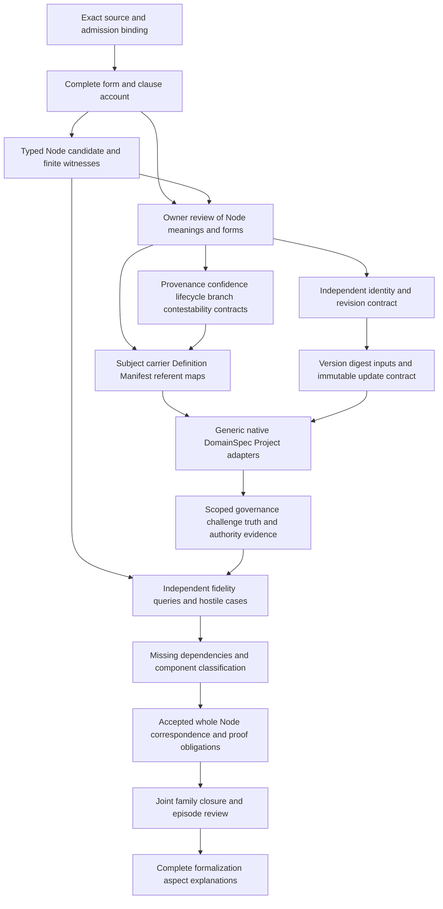

# Ontology Node: formalization review and completion DAG

Candidate SWU **F06-T.cal.definition.ontology-node**. This review prioritizes definition forms, types and logical obligations. The delivered unit is a verified partial candidate; the whole formalization episode remains active across 183 current Definition identities, 189 admitted source versions and 201 captured source files. No source-owner-accepted whole translation or whole-definition proof is claimed. The packet accounts for 21 source units and 25 spans: 13 encoded, six explanatory and six deferred.

The selected model treats an Ontology Node as an independently identified governed representation of one exact subject revision in one Ontology, with provenance, confidence, lifecycle, branch and contestability facets. It distinguishes the representation from its own subject, revision, subject identity carrier and subject Definition. Typed revision/version/digest bindings can satisfy this candidate theory without authenticating actual bytes, calibrating confidence or proving claims globally true. The review makes those gaps explicit and supplies a detailed dependency plan for completing them.

## 1. Exact source, authority and source precedence

The source is `cal.definition.ontology-node@1.0.0-candidate.1`, at `authority/definitions/candidates/0013-integrated-lab-definition-model/definitions/ontology-node/v1/definition.json`, SHA256 `976d20f5da63bf6fa774859a878d3d172ccd7b44484364d8caa2fd80f4d36f3e`. [source-checks.json](source-checks.json) binds this selection to the current registry, exact C65 admission row and authorization, candidate manifest, source schema and human projection. Two source renders are byte-identical: 4,667 bytes, SHA256 `09aba54e14aa57db80f2bd708ba2d5564a85c7a477046a417442b3f7945cf792`.

The positive source defines an independently identified governed representation of one exact subject revision within one Ontology. Its negative boundary says the Node is not the represented subject, its identity carrier, its Definition or proof that its claims are globally true. This draft reads the carrier and Definition references as subject-relative; the owner must confirm that pronoun scope. Meaning alone does not supply admitted carrier shape, relation availability, runtime behavior or authority effects. Identity, lifecycle, evidence, authority and relations remain separately governed.

The recorded historical interaction-review digest differs from current local whole-file bytes. Historical bytes were not recovered. The current document is a separately qualified comparison, not an authenticated replacement for that historical reference. Source admission authenticates the selected Definition record; it does not accept this interpretation, reconcile historical/current documents or close dependency semantics. All 12 precedence findings remain unresolved with no owner principal, decision or accepted review fabricated.

## 2. Definition forms and complete clause accounting

[correspondence.json](correspondence.json) records exact source-unit selectors, excerpts, character positions, digests, dispositions and dependency links. [correspondence-check.json](correspondence-check.json) verifies complete character accounting. The normative statement, scope applicability and positive scientific boundary share the combined genus, identity, typed binding, exact-revision and provenance formula. Four negative spans share the subject/carrier/Definition/truth-proof boundary. The weaker positive formal expression gets the bounded-record implication. Relevant scope, claim-ceiling and testable-condition spans supply noninference and scope-use guards.

The selected forms are genus-differentia, axiomatic-implicit and operational. Thirteen encoded spans yield five distinct formula values and nine primitive templates. Repetition across voices contributes source coverage rather than extra independent premises. Six explanatory spans retain plain-language intuition, example and notation. Six deferred spans retain unresolved obligations, including universal exact-version/admitted-successor resolution and the authority nonentailment fragment.

The example of a Node representing an Artifact Type at an exact digest does not establish universal Artifact Type-only subjects or one runtime algorithm. The theory allows subjects represented under separately governed contracts. It does not derive global truth from the word representation, evidence references or candidate status. [clause-analysis.json](clause-analysis.json) explains the selected strengthening and losses, preventing a tidy signature from hiding unresolved source meaning.

## 3. Signature, sorts and typed facet maps

[t.json](t.json) declares 79 symbols: two sorts, one constant, 13 total functions, 60 unary predicates and three binary relations. Entity and Token are nonempty candidate domains. EMPTY is a Token. Nine Entity-valued Node functions bind Ontology, subject, subject revision, subject identity carrier, subject Definition, confidence state, lifecycle state, branch state and contestability state. `revisionSubject` is a tenth Entity-valued function. `nodeIdentity`, `revisionVersion` and `revisionDigest` return Tokens.

Role predicates constrain each Node binding. They are candidate denotation markers, not repository identities, principal authentication, schema ownership, numerical confidence, lifecycle admission or effective contestability. `HasProvenance` relates a Node to provenance entities. `ConsumerUse` and `UseInApplicability` qualify declared uses. [static-ir.json](static-ir.json) gives symbols exact source-and-scope qualification so matching short labels cannot silently merge theories.

Total functions have values on all Entity values, including non-Node objects; the guarded axioms only impose Node meanings where OntologyNode holds. Entity is intentionally coarse. Confidence/branch roles or identity-carrier/Definition roles may overlap on referents unless an explicit boundary forbids a particular Node self-identification. This is a known interpretation choice, not evidence that actual contracts are interchangeable. More precise disjoint sorts, partial functions or role maps require owner review and their own typed obligations.

## 4. Theory, definition sufficiency and exact revision

The genus biconditional equates OntologyNode with nine candidate markers: independently identified, governed representation, exact subject revision, one Ontology and the five named facets. A Node must have a nonempty identity Token. Each bound object must have its proper role. Its revision-to-subject function must equal its represented subject; that revision's version and digest Tokens must be nonempty. Each Node must have at least one provenance member and every bound provenance member must have ProvenanceRole.

The boundary makes a Node Entity different from its own subject, revision, subject identity carrier and subject Definition. It also excludes GlobalTruthProof on that Node. BoundedRecord supplies governed identity/record and bounded scope. NoInference forbids 15 candidate inference flags, including global truth. UseScope qualifies declared consumers and applicability. These nine templates account for selected meaning while leaving actual maps open.

The genus biconditional and facet/identity choices are stronger than the source's positive formal shorthand and need accepted correspondence. The theory does not authenticate a revision, establish a cryptographic algorithm, make Node identity globally injective, force one Node per subject, require every representation to use one confidence scheme or establish immutable updates. Nor does it prove actual claims false: positive controls can add independent actual truth without treating the Node as proof. Nonentailment concerns what follows from the Definition alone.

## 5. Identity, representation and orthogonality

The base witness has two independently identified Nodes representing one revision in two Ontologies. Their identity Tokens differ; their represented subject, revision, carrier and Definition referents are shared. Each Node differs from those own referents. This models local representation identities without identifying either representation with the represented object.

Positive controls also permit two Nodes with the same identity Token, two Nodes in one Ontology, two revision entities with identical subject/version/digest values, referent-role overlap and a Node represented as the subject of another Node. Some satisfy all required populations; others satisfy universal T while failing a designated existence population. These cases expose uniqueness and ontology-relative identity choices that have not been accepted. The own-reference boundary does not mean every Node is globally forbidden from being represented elsewhere.

Four focused self-collapse controls preserve the relevant role/revision bindings while identifying a Node with its own subject, revision, identity carrier or Definition; each is rejected by T. A separate proof-role control rejects treating the Node as global truth proof. Actual identity namespaces, revision-recognition equivalence, subject-carrier binding and Definition applicability remain owner obligations. Exact byte equality can support a selected source binding while leaving those semantic identity relations unresolved.

## 6. Provenance, confidence and governed state

The candidate reads “with provenance” as a nonempty collection of typed provenance referents. It does not specify source authentication, chain membership, selector granularity, completeness or a minimum evidence set. Nonempty provenance is therefore distinct from actual authenticated provenance. Required and unresolved populations keep that distinction visible.

Confidence, lifecycle, branch and contestability are generic Entity-valued facets. Primary T imports no probability, calibration procedure, enum, challenge response, Policy effect or event-join rule. The current generic carrier separately has evidence and commitment confidence references. An accepted map must explain how their pair or scheme-qualified values realize the Definition's general confidence facet without collapsing the two kinds of confidence.

The carrier's branch enum includes business, system, bridge, mixed and unknown; lifecycle permits active, retired and removed. Those values are structurally valid choices in this carrier, not universal logical classifications or proof of current governance. Contestability similarly requires effective challenge contracts, owners, response routes and scopes rather than a bare reference string. Confidence can be recorded while claims, use authority and currentness remain unproven. Dependencies and qualification hypotheses name these distinctions instead of supplying fictional actual maps.

## 7. Carrier version, schema and generic binding limits

The current C70 registry selects `cal.artifact-type.ontology-node/v2`, with descriptor SHA256 `12569910b16d65804ea847e6731c4d016c65c65b95d6ba391550eca43ecbcfd6` and schema SHA256 `447c413cc61a7a627d8f657437a1784f77b579b3d9f84f5823e0dd5c9c48317f`. Its candidate v1 predecessor is preserved and explicitly marked superseded before admission. The retained v2 descriptor still says candidate-unadmitted and the fixture remains candidate; those frozen source postures are distinct from the current admitted registry selection. No migration or correction of frozen records was performed.

[authority-profile-checks.json](authority-profile-checks.json) records 32 actual selected checks, four rejected hostile fixtures and 68 schema probes, with 29 accepted. The schema closes top level, payload, represented subject, semantic state, governance binding and nested semantic tuple. It requires ten payload fields, nonempty provenance, two confidence references, positive semantic cursor, digest-shaped strings, replay_source false and effect none. It allows empty semantic Definition and governance-event lists and arbitrary typed_properties objects.

Accepted probes include Node ID equal to represented subject ref, unresolved or cross-kind references, plausible wrong subject/event digests, same-ID changed revision, whitespace version, identical evidence/commitment confidence, huge positive cursor, arbitrary nested authority-sounding properties, weak forbidden-collapse text and admitted record state with effect none. Rejections cover missing required fields, empty/duplicate provenance, malformed digest, zero cursor, wrong facet fields, authority inflation, replay-source true and unlisted enum values. Shape alone therefore fails several primary logical or actual-binding obligations.

## 8. Generic fixture and captured episode evidence

The generic fixture represents `cal.artifact-type.definition/v2@2.0.0-candidate.1`; its identity and version labels match the selected descriptor. Its digest is the placeholder of 64 ones, while the selected descriptor hash is `f863bd4b09a28c5ca3e82e9008ddc837c1186bad9f35fe9e5cde4ea2ccfac5f7`. This exact mismatch is observed rather than normalized away. Its Manifest reference has a /v1 suffix while the selected Manifest fixture ID does not. Alias/version resolution remains unaccepted; no repository-wide absence is inferred.

Two captured episode Nodes are valid under the selected v2 schema. The State Node's represented digest matches the selected episode Project State bytes, SHA256 `112fba90aaf301023294936f8133d3883bf9562904853672b13b131ed6b55c02`. The Project Node matches its selected Project bytes, SHA256 `98a2a53b86b8a5bae60dd8a9fe5dbdd166c7dd8433fa52ee754ca7f80f0d7399`. The State uses node_id; the Project identity carrier uses project_id. These exact source identity fields are checked separately, preserving the initial failed-field-map attempt.

Both captured Nodes reference semantic cursor 2, the same semantic ID/digest and a matching governance event. The event's resulting-state subject is the State Node's subject, not the Project Node's different represented subject. This shared Project epoch can support a qualified projection context; it does not establish that every Node has its own canonical per-subject event history. Recorded represented-subject version labels, confidence references, Manifest closure and whole revision maps remain pending even where exact bytes and tuple matches are verified.

## 9. Native, DomainSpec and Project source maps

Selected native Rust OntologyNodeSemanticState carries identity, lifecycle and meaning-bearing fields but lacks the generic represented_subject, branch and Manifest fields. GovernanceState separately carries provenance, evidence/commitment confidence, challenge and exact semantic reference. GovernedOntologyNodeView joins those semantic and governance facets with the exact ID, digest and semantic cursor. The native exact-reference helper compares all three fields.

Native semantic validation requires nonempty semantic Definition references and restricts profile/typed-properties to test-empty-profile/v1 with empty values. Generic schema permits empty Definition lists and arbitrary typed properties; captured episode Nodes have empty Definition lists. The generic record therefore cannot be claimed to satisfy native semantics through field-name similarity. DomainSpec explicitly describes the semantic state as excluding governance fields and governance state as calculated for one exact semantic event. These are intent/source observations, not executed native conformance proofs.

Project Session uses source SHA when available and otherwise digest(view), references runtime-head as Manifest, leaves semantic Definition references empty and shares a Project tuple across generated Nodes. It records confidence as source-binding-only/not-evaluated. A derived graph hash has different inputs from source-file byte hashing. The source map must preserve that provenance and hash distinction. No Rust execution, Session construction, live graph, source capture writer, package receipt writer or generator materialization ran in this SWU.

## 10. Pure history checks and qualification frames

Only extracted pure render_record and existing Project validate_histories functions execute on in-memory inputs. Eighteen pure-history controls include seven accepted and 11 rejected cases. Captured semantic/governance histories pass cursor, predecessor-chain, event digest, chain digest, watermark and exact join checks. Wrong cursors/digests/chains, deleted semantic tail, wrong watermark and rehashed governance references with wrong semantic ID/cursor/digest are rejected. Rehashing those hostile governance records isolates join checking from mere stale hash rejection.

The checker accepts unchanged valid histories when accompanying Node semantic tuple, subject digest, confidence/effect, Manifest ref, replay-source flag or provenance is mutated. Its argument is histories, so these observations show its exact scope rather than a claim that a full Node validator accepts them. Every pure input remains unchanged by the function. No actual Node binding, calibrated confidence, global truth or admission is established by these passes.

Thirty-eight hypothetical qualification profiles include 35 rejected cases, across 14 exact-context and 12 support axes. Nine collapse/replay/source-write/truth/effect claims are forbidden; stale Node and changed-binding cases get no reuse. Thirty-two finite representation frames include 26 rejected cases. They retain original source and Node bytes, distinguish independent identities and impose a separately labelled immutable-record/new-representation policy under hypothetical exact support. That temporal policy is not a primary T axiom or an accepted actual update contract. No universal write confinement, immutability or truth proof follows from the finite frames.

## 11. Populations, models and nonentailment obligations

Twelve required populations cover a Node, one without actual outcomes, a current Node without global truth, coherent exact revision, provenance, all typed facets, separation from own subject/carrier/Definition, two representations of one revision, cross-Ontology representations and scope-qualified use. Sixty-two populations remain unresolved. They are pending existence/type maps, not proofs that those actual objects do not exist.

[model-controls.json](model-controls.json) records 96 controls: 31 T-true, 58 T-false and seven malformed structures rejected. The base uses 15 Entity and seven Token values. Role/facet, exact revision, provenance, self-collapse, truth-proof, noninference and consumer controls test different obligations. Malformed cases separately cover totality, sorting, tuple arity, duplicate tuples and empty domains. Engine budgets are unchanged and the authored Node domains are retained; passing cases are not manufactured by dropping source obligations or relaxing the verifier.

Twenty-one finite countermodels satisfy T and their designated witness conditions while falsifying proposed actual consequences. Twenty targets cover independent identity, exact version, subject digest, Manifest resolution, provenance authentication, confidence calibration, lifecycle, branch, contestability, semantic event, governance join, global claim truth, consumer/owner acceptance and authority/admission/publication/release/deployment/external effect. The additional query targets current-Node global truth. [source-query-obligation.json](source-query-obligation.json) preserves `OntologyNode(x) =/=> authority_effect(x).` outside T as a deferred obligation with its matching independent countermodel. These supplied evaluations establish bounded satisfiability/nonentailment under the candidate interpretation, not whole fidelity or mechanized proof of the system.

## 12. Dependencies, findings and detailed completion DAG

The candidate declares 38 direct exact-version semantic dependencies. [dependency-graph.json](dependency-graph.json) expands one local root; [current-dependency-graph.json](current-dependency-graph.json) expands all 54 partial drafts. The local graph has 112 identities, 1,129 edges and 59 missing counterpart packets. The joint graph has 115 identities, 1,158 edges and 61 missing counterpart packets. Both retain an unclassified 53-member component with 741 internal edges. Local edges are contained in the joint declared graph, while their different root scopes require separate missing counts. No cycle semantics or closure has been accepted.

The preserved project DAG still has 121 tasks, 511 edges, 797 SWUs and 36 frontiers. The bounded completion DAG below turns this Node's unresolved obligations into reviewable outputs. Dependencies through owner disposition, exact revision maps, facet contracts, adapters and hostile obligations must be satisfied before whole Node correspondence and family closure can be claimed.

| Node | Dependencies | Output and exit criterion |
|---|---|---|
| S/A/T | A04, C01, E02 | Exact source packet, complete span account, typed candidate, required populations and supplied checks. |
| P | S/A/T | Owner dispositions for all findings; accepted genus, boundaries, forms and precedence. |
| I | P | Ontology-relative Node identity, subject/revision/carrier recognition and allowed representation identities. |
| C | P | Provenance completeness/authenticity, scheme-qualified confidence, lifecycle/branch and effective challenge contracts. |
| B | P/C | Exact referent/version resolver, subject Definition applicability and Manifest alias/contract closure. |
| H | I | Specified digest inputs and algorithms; version and immutable/new-representation update semantics. |
| R | B/H | Accepted qualified semantic/governance and per-subject/shared-Project epoch adapters. |
| E | R | Actual scoped evidence for effective governance/contestability and independent truth/authority boundaries. |
| Q | T/E | Independent accepted-meaning fidelity, population, nonentailment and hostile update/join checks. |
| D | Q plus counterpart packets | Complete missing dependency packets and accepted component semantics. |
| F | P/I/C/B/H/R/E/Q/D | Accepted whole correspondence and complete declared proof obligations; no hidden assumptions. |
| J/V | F plus remaining Definitions | Current/historical coverage reconciliation, joint family review and explanations of every formalization aspect. |

OND-FINDING-001: genus sufficiency, uniqueness and one-Ontology meaning. OND-FINDING-002: independent Node/subject/revision/carrier/Definition identities. OND-FINDING-003: actual revision/version/hash and immutable binding. OND-FINDING-004: provenance cardinality, contents and authentication. OND-FINDING-005: generic confidence/state facets versus specific schemes, enums and joins. OND-FINDING-006: own-reference and global-truth/authority boundaries. OND-FINDING-007: weaker shorthand, deferred source query and universal version resolution. OND-FINDING-008: v2 carrier/v1 preservation and shape versus actual closure. OND-FINDING-009: placeholder generic digest and Manifest suffix map. OND-FINDING-010: captured subject bytes, shared Project tuple and pure-checker scope. OND-FINDING-011: native/DomainSpec/Project field and validator adapters. OND-FINDING-012: historical source drift, precedence and joint dependency closure. All remain pending rather than being treated as accepted exemptions.

## 13. Delivery, preservation and episode completion boundary

Six fresh terminal checks cover interpretation contract, models, source, profile, dependencies and current inventory. Sealing requires actual zero exit codes, empty stderr, matching producer/fresh outputs and current source/checker bindings. The separate read-only audit then checks exact sealed files, scope, DAG acyclicity and pending proof/fidelity boundaries. [receipt.json](receipt.json), [coverage-row.json](coverage-row.json), [episode-status.json](episode-status.json) and [delivery-manifest.json](delivery-manifest.json) retain these outputs and their status.

The first profile attempt exited on a Project identity-field mismatch, with no JSON report produced. Its exact checker, stdout, stderr and note are preserved under attempts/001-Project-identity-field. The successor reads the State's node_id and Project's project_id explicitly and passes the bounded observations. This correction changes the checker map without altering a source carrier or hiding failed evidence.

The inventory advances to 54 partial drafts, with 129 current identities still lacking a per-Definition T draft. Aggregate coverage is 1,227 source units, 1,664 mapped spans, 482 encoded, 431 explanatory, 751 deferred, 512 required populations and 2,004 unresolved populations. All 4,315 prior sealed candidate files and 201 captured source files must remain byte-exact. The preserved I04 report still has its selected eight-draft scope and needs a separate reporting update at its gate.

These are partial candidate counts, not 54 accepted Definitions. Source-owner-accepted whole translations and whole-definition proofs remain zero. The next priority is **F06-T.cal.definition.ontology-view**. The episode remains active until all original-scope artifacts, accepted meaning maps, proof obligations, dependency closure and comprehensive final explanations are actually complete and verified.
