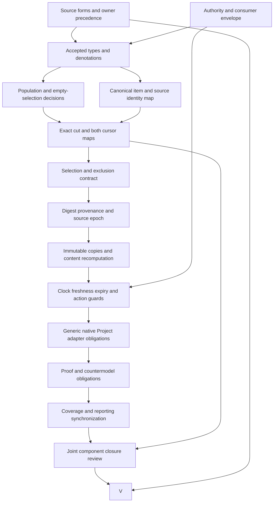

# Ontology View: definitions-first formalization review and completion DAG

Ontology View now has a checked **partial** interpretation for an immutable purpose-bounded projection of an exact Ontology cut, selected items, consumer scope, expiry and authority boundaries. The candidate makes these obligations explicit and distinguishes declared logical coherence from actual cursor, digest, clock, selection and runtime evidence. It does not establish a whole-definition translation, owner acceptance or a complete formalization episode.

This is SWU `F06-T.cal.definition.ontology-view`, following the sealed Ontology Node draft. The episode retains 183 current identities, 189 admitted source versions and 201 captured source files. The latest inventory contains 55 partial drafts and 128 current identities without a per-definition draft. Source-owner-accepted whole translations and whole-definition proofs both remain zero. The original foundations-first plan remains authoritative for planning scope; the completion DAG below expands this definition's unresolved work without replacing family gates.

## 1. Source identity, authority and exact evidence selection

The selected source is `cal.definition.ontology-view@1.0.0-candidate.1`, under C65 admission, at SHA256 `1fcc7fa38a6a77e67258ae56c49719ea35f1c853868060ab58200343fde2f81e`. The [source checks](source-checks.json) bind the exact registry row, C65 decision, recorded authorization, candidate manifest, original Definition v1 schema, renderer and Markdown projection. Two pure renders reproduce the 5,352-byte projection at SHA256 `234e8c117fc9e7d7f8ceb6d9734b6496bfb6021180282f487c13531b4f20867b`, preserving input bytes.

The source cites the whole actor-model review document. Its current 32,060 bytes match the embedded historical SHA256 `cc2fec4a1f9bd7a4796d6735866b16736087e125dcaf23d7fa6abed33862ee42`. The report's recovered-historical-bytes flag records that exact match; no separate recovered archive or historical document admission is claimed. The embedded source retains its candidate-unadmitted posture. **OVW-FINDING-012** requires accepted source precedence and downstream meaning maps despite this useful byte match.

Fourteen source checks pass within this selected scope. A current Definition v2 schema probe rejects four old metadata constants in the admitted Definition v1 document. That observation describes schema evolution; it does not invalidate the recorded source admission or authorize migration. Exact source admission authenticates which text is being translated. It does not certify this candidate interpretation, its chosen formal language, runtime compatibility or universal outcomes.

## 2. Definition forms, textual units and correspondence

The [correspondence packet](correspondence.json) inventories 28 nonempty source string units and accounts for all their characters across 32 mapped spans. Twenty-two spans are encoded, six explanatory and four deferred. Repeated boundary text has independent source locations, even when it maps to the same formula value. Eleven unique encoded formula values combine eleven primitive theory templates. These are three separate denominators: source spans, distinct combined values and primitive templates.

The principal statement supplies a genus and differentia: an Ontology View is an immutable, purpose-bounded projection of one exact consistent cut for a named consumer or Agent Session. The second normative sentence adds derived Project State, contractual expiry, canonical replay separation and separation from represented subjects. Those sentences use genus-differentia, axiomatic-implicit and operational forms together. Operational form here expresses logical guards; it does not mean an actual implementation algorithm has been proven equivalent.

The scientific shorthand is substantially weaker than the full paragraph and boundary conditions. Its positive part says View implies governed identity or record and bounded scope. Its authority nonentailment part remains a separate query obligation. **OVW-FINDING-008** tracks this difference rather than allowing a compact expression to erase the richer source requirements. Plain-language descriptions, domain examples and notation remain explanatory. In particular, an example cursor of 842 is not an axiom requiring every View to have that coordinate. Definitions, explanations, assumptions and outcome queries have separate roles; the candidate introduces no assumptions.

## 3. Types, carriers, total functions and namespaces

The [interpretation](t.json) and [compiled typed IR](static-ir.json) contain 102 declarations: two nonempty sorts, one constant, 21 total functions, 68 unary predicates and ten binary relations. `Entity` carries Views, cuts, Ontologies, consumers, selectors, items and Actions. `Token` carries opaque cursor, digest, purpose, exclusions, freshness, expiry, ceiling and content values. `EMPTY` is the distinguished token rejected by required View metadata and item-source-digest guards.

Eight functions return Entity values, including View-to-cut, View-to-consumer, item-to-cut, item-to-selector and item-to-canonical-source links. Thirteen return Token values. Functions are total over their declared domains, so irrelevant entities also have function results. Theory guards restrict those results when an entity has the relevant View or selected-item role. Totality prevents undefined denotations from silently entering evaluation; it does not authenticate every assigned result or make every Entity a real View.

All symbols are qualified by exact source revision and candidate scope. Comparison definitions remain separately qualified. A common word such as cut, consumer or canonical identity does not create an accepted equivalence between namespaces. **OVW-FINDING-002** requires interpretation of token and reference values in their actual carriers. Numeric coordinates, time ordering, content-equivalence relations and hash authentication are absent from this two-sort model. Empty and nonempty token distinctions establish a deliberately limited shape property, not those missing semantics.

## 4. Logical genus, exact cut and metadata coherence

The primary theory uses first-order logic with equality. Its genus biconditional equates View membership to five declared markers: immutable, purpose bounded, projection, exact consistent cut and named consumer. The reverse direction is a candidate reading that makes genus sufficiency explicit. **OVW-FINDING-001** remains open because those markers need accepted denotations; attaching a consistency marker is not an independent proof that a replay cut is consistent.

Metadata guards require a typed Ontology, cut, consistent-cut role, selection contract and a consumer carrying NamedConsumerRole or AgentSessionRole. The roles may overlap: a checked positive control has both consumer roles. The candidate does not invent a mutual-exclusion rule. Required cursor, event digest, purpose, exclusion, freshness, expiry, ceiling and content tokens are nonempty. View Ontology, semantic cursor, governance cursor and event-set digest must equal the corresponding bound cut fields.

**OVW-FINDING-003** covers that View-to-cut coherence. Equality prevents a supplied model from declaring mismatched fields, but it does not resolve the reference, prove event-set completeness, authenticate a coordinate or choose a governance join. A positive control replaces cut and View coordinates and digest with the same opaque `*` token and still satisfies the theory. That result explains the claim ceiling: exact declared equality is established inside the model, while actual coordinate and digest contracts remain unresolved. The [clause analysis](clause-analysis.json) records these losses explicitly.

## 5. Selected items, provenance and retained canonical identities

SelectedNode and SelectedEdge relate a View to its projected items. Each selected item requires its Node or Edge role, matching cut and selection-contract bindings, declared cut membership, selector permission and a nonempty source-digest token. A selected Node resolves to a SubjectRole entity; a selected Edge resolves to a CanonicalRelationRole entity. Item and represented canonical entity are distinct, and the View itself is distinct from the represented source.

The theory prohibits selected items from replacing canonical identity or authority. This preserves a meaningful distinction between a representation in a View and the subject or relation it represents. It also prevents View membership from becoming a substitute for canonical subject identity. **OVW-FINDING-005** requires the actual maps: canonical referent recognition, exact source-event versions and digests, selector resolution, edge semantics and agreement with the cut's selected population.

These guards are universal over declared selected items. They permit an empty projection unless additional population requirements are chosen. The supplied population suite deliberately includes selected Node and Edge witnesses; the empty-projection control satisfies universal T but fails that suite's conjunction I. This is evidence about nonvacuous model checks, not a source-owner decision that every valid production View must always contain both kinds of item. Selection cardinality, legitimate empty results and consumer-specific exclusions need separate decisions before a production constraint is adopted.

## 6. Immutable copies, recomputation and content equivalence

FrozenCopy is a declared relation between a View and another View. Its guard preserves all thirteen View fields and selected Node and Edge membership. This provides a checked snapshot-copy boundary: changing metadata, content or an item set in a declared frozen copy violates the candidate. It is not a temporal model of every write or a proof that storage prevents mutation; an execution can only be discussed after its states are mapped to these declarations.

RecomputedView has a narrower guard: another View, the same cut, the same selection contract and equivalent content as represented by the same content token. Consumer and expiry equality are not added to this narrower relation. A positive control relates Views with the same cut, selector and content but different consumer and expiry. This makes the distinction between recomputed content and a fully frozen record reviewable. **OVW-FINDING-004** requires accepted equivalence, what belongs to the selection contract and which fields recomputation must retain.

The source requires recomputation from the same cut and contract to yield equivalent content. The candidate records a conditional coherence guard and an explicit recomputation witness, rather than assuming an actual algorithm's universal determinism. In the captured episode, two pure digest computations on the same preserved projection-set input produce identical results. That bounded observed repeatability supports the selected algorithm and input; it does not establish every runtime's determinism, selector fidelity, serialization portability or immutable-write behavior.

## 7. Expiry, freshness, current-state use and consumer scope

Expired and Stale are declared flags in T. For a CurrentStateAction, either flag prevents ViewUsableForAction. The current-action guard also requires ActionRole. ActualRuntimeRejectedAction is a separate relation and stays outside these guards. The candidate therefore distinguishes a prohibited model use from an actual consumer enforcing rejection. **OVW-FINDING-006** requires accepted clocks, expiry boundaries, freshness computation and mappings between failures and runtime rejection.

A positive control allows an expired View to be usable for a different Action that is not declared to require current state. This follows the source's restricted condition rather than inventing a ban on every historical or noncurrent use. A nonempty expiry label also need not compute an Expired flag. One corrected control changes an expiry token after removing its FrozenCopy relation: T still holds, but I fails because the copy witness has disappeared. The failed earlier expectation is retained, and the correction changes no theory, domain or population requirements.

For actual selected examples, parsing the generic and captured View timestamps shows both expired at the pinned analysis instant `2026-10-09T00:00:00Z`. This instant makes the observation reproducible and is not a live session clock. Consumer linkage in the captured record is visible, but a linked Session identifier alone does not prove that consumer's Assignment, Policy, Delegation or permitted purpose. Scope enforcement remains a separate obligation.

## 8. Canonical replay, authority and nonentailment

A View is declared derived Project State. The boundary prohibits it from being canonical semantic replay, canonical governance replay, canonical subject, canonical Typed Relation, governance Decision or authority grant, and keeps it distinct from its cut. The authority guard prohibits ViewAuthorizesAction for every Action candidate and prohibits widening Assignment, Policy or Delegation. Fourteen further inference flags are excluded, including inferred admission, publication, release, deployment, identity equivalence and external effects.

**OVW-FINDING-007** requires these declarative boundaries to be connected to actual write and authorization paths. The theory permits an ActualAuthority predicate to hold independently for a View entity, while forbidding the representation's prohibited inference and authorization relations. This separates independently supplied authority facts from authority supposedly obtained by being a View. A representation cannot widen its consumer's envelope, but the candidate does not claim that no independently authorized consumer can ever act.

The [source query obligation](source-query-obligation.json) preserves the exact shorthand excerpt `OntologyView(x) =/=> authority_effect(x).` as deferred and outside T. Twenty outcome queries and one runtime-rejection query have supplied T-and-I countermodels in the [model evidence](model-controls.json). Targets include actual cut consistency, resolved cursors, authenticated digests, faithful selection, equivalent recomputation, expiry enforcement, owner acceptance and actual authority. This checks nonentailment for the chosen predicates. It does not prove that these English or runtime predicates exhaust every possible meaning of authority effect.

## 9. Independent model controls and qualification evidence

The evaluator checks 134 authored controls on 14 Entity values and 14 Token values: 32 satisfy T, 95 fail T and seven are rejected for malformed model structure. Structural rejections include a nontotal function, wrong result sort, malformed constant, wrong predicate arity, duplicate predicate tuple, empty sort domain and duplicate function tuple. Those failures are distinguished from well-formed models that violate logical clauses.

The positive controls cover a base nonvacuous View population, independently supplied actual outcomes, overlapping consumer roles, opaque coordinate tokens, permitted noncurrent use and recomputation narrower than a frozen copy. Negative controls exercise every required field, cut equality, frozen metadata and selection membership, item role and provenance guard, forbidden canonical role, authority widening, improper current use and prohibited inference. These checks target the selected theory's meaningful boundaries; no model enumeration, mechanized universal proof or owner interpretation acceptance is claimed.

Thirty-eight qualification profiles reject 35 incomplete, mismatched or forbidden hypothetical requests. Twenty-five finite View frames reject 20 changed source envelopes, mutated retained Views, inconsistent content, widening and stale current-use scenarios. Their context and support fields are explicitly hypothetical. They do not demonstrate that an actual resolver supplies those supports. The [profile evidence](authority-profile-checks.json) retains separate false flags for actual runtime verification and accepted source fidelity, so profile success cannot be promoted into source-owner or implementation proof.

## 10. Carrier schemas, captured digests and runtime observations

The current type catalog has 143 rows and 121 admitted-current rows. Its direct binding for this Definition selects `cal.artifact-type.ontology-view/v1` under C70, descriptor SHA256 `fe7eda84c27f9da45666c658307bde2295793eca2c3335314724ffd7d74f7858` and schema SHA256 `32c12b7e917e8872b82174d963d4a17e2b2e5ff64d7c798774a72cfcdb497d4b`. Retained descriptor and fixture posture remain candidate-unadmitted and candidate respectively. Thirty-three selected catalog, source, projection and captured observations pass; registry admission and retained local labels are not collapsed.

**OVW-FINDING-009** concerns the schema gap. Fifty probes yield nineteen structural acceptances and 31 rejections; all four supplied hostile fixtures are rejected. The closed schema requires fifteen payload fields, semantic cursor at least one, digest shape, nonempty strings, unique selected-item arrays, canonical replay false and authority effect none. It has no explicit governance_cursor; adding that field is rejected. Empty arrays, unresolved references, plausible wrong digests, invalid or reversed date strings and declared bindings unsupported by actual resolution can pass. These acceptances identify the schema's limited responsibility and do not establish faithful Views.

**OVW-FINDING-010** covers digest contracts. The captured event digest recomputes from semantic and governance chain digests to `528726bda7fc7abca95aefeb2160c18468c4764e8c7b0cb3896578baf2d80a44`. Its cut digest recomputes from Ontology, cursor, event digest and selected Node/Edge reference-hash lists to `a8b00b879359da4d8bd1990bce547c0cd045bc35890962d309ff3fc7db65608d`. The Cut record's whole-byte hash is different. Current Project Session hashing of whole histories and Node/Edge bodies also gives different values, while native ContextProjection hashes exact subject-event references. No common digest contract is accepted from these observations.

**OVW-FINDING-011** concerns the retained selector name containing `empty` despite two selected Nodes and one Edge, and the limits of runtime evidence. Eight isolated controls execute existing Session.context/close methods on manually initialized objects with an explicit read-only replay stub; three operations succeed. Deadline equality and later expiry reject and erase memory and pack. Changed HEAD and declared replay staleness reject while retaining memory until close. Returned-copy mutation leaves the retained pack unchanged. No real store replay, Session constructor or projection build runs. Native Rust and DomainSpec behavior are inspected statically; exact join checks and forbidden promotion lists in source are not execution results.

## 11. Dependency closure, whole-scope inventory and logical cycles

The [local dependency graph](dependency-graph.json) has 115 nodes, 1,168 declared edges, 61 missing or quarantined counterpart packets and one unclassified strongly connected component of 54 members and 771 internal edges. Direct semantic uses number 39. Numeric Cursor, Clock/Expiry, Selection Contract and Content Equivalence have no separately selected exact primitive Definition labels in this packet; carrier token names must not silently substitute for accepted primitive definitions.

The [current inventory](current-inventory.json) freshly evaluates one supplied T-and-I witness for each of the 55 partial drafts and compiles their joint declared graph. Aggregate counts are 1,255 source units, 1,696 mapped spans, 504 encoded spans, 437 explanatory spans, 755 deferred spans, 524 required populations and 2,079 unresolved populations. The joint graph contains 118 nodes, 1,197 declared edges and 63 missing or quarantined counterpart packets, with the same unresolved 54-member, 771-internal-edge component. Independent witnesses are qualified separately; their existence is not evidence for one meaning-aligned combined model.

The dependency graph is allowed to contain unresolved semantic cycles. A planning DAG orders evidence production and review, while a strongly connected meaning component may require joint interpretation and consistency work. Turning that component into an arbitrary acyclic dependency order would discard obligations. Joint counterpart packets, relation classifications, shared carrier maps and owner decisions remain pending. Whole-family tasks stay open despite this bounded SWU's checked outputs, and the original 121-task, 511-edge, 797-SWU foundations-first plan is preserved.

## 12. Completion DAG, deliverables and acceptance criteria

The following fifteen-node, eighteen-edge DAG orders unresolved work for this definition. Nodes are planned deliverables, not recorded completions. S and A establish source fidelity and authority interpretation; T and P settle types and nonvacuous populations. I, C, B and H establish identity, cut and source contracts. R, E and Q then test recomputation, use and adapters. D and F provide proof and report evidence; J requires joint closure before V can complete the whole-definition review.

| Node | Concrete output and exit criterion | Current evidence and remaining gap |
|---|---|---|
| S | Owner-reviewed source spans, forms, precedence and accepted losses | Exact bytes and full character account; twelve findings unresolved |
| A | Consumer envelope and canonical replay/authority map | Logical prohibitions and linked consumer; actual authorization/write paths pending |
| T | Typed denotations, numeric/time/hash and equality contracts | Two-sort candidate compiles; semantic maps and primitive contracts pending |
| P | Reviewed required, optional and unresolved populations | Twelve witnesses checked; legitimate empty projections unresolved |
| I | Source-relative item identity, event-version and digest map | Typed separation guards and captured refs; universal resolution pending |
| C | Exact consistent cut, semantic/governance coordinate resolution | Declared equality; schema governance-coordinate gap pending |
| B | Reproducible selection, exclusions, purpose and claim ceiling | Cut/selector markers; actual selector semantics pending |
| H | Accepted digest inputs, canonicalization and source epoch | Captured builder digest matches; distinct native/Project contracts pending |
| R | Immutable write and equivalent-content recomputation evidence | Frozen/recompute guards and one repeated digest input; whole algorithm map pending |
| E | Clock, expiry, freshness and current-action enforcement | Pinned timestamps and stub-method cases; actual consumer enforcement pending |
| Q | Explicit adapters with preserved identities and authority | Three source contracts observed separately; no accepted shared map |
| D | Accepted proof targets, assumptions and countermodel review | Twenty-one supplied countermodels; whole theorem/proof pending |
| F | Synchronized approved reporting and denominator reconciliation | Separate latest inventory; immutable older I04 report retained |
| J | Joint meaning-component consistency and dependency classification | Declared closure graph; missing counterparts and cycle classification pending |
| V | Complete whole-definition review with all required criteria met | Candidate self-review only; source-owner acceptance and proof both pending |

Each exit criterion requires a specific accepted artifact and evidence reference. A successful schema probe, supplied finite witness or digest recomputation cannot substitute for an owner decision or universal runtime obligation. These dependencies identify what can be prepared independently while meaning decisions remain open; they do not create a new authority process or presume access to live services.

## 13. Preservation, reproducibility and completion boundary

The delivery retains 4,378 files from the Ontology Node seal and all 201 captured sources by exact hash. New outputs stay inside the View candidate directory. Both failed attempts are preserved: the initial population-helper syntax error before any interpretation JSON, and the model-control expectation error after removing a required FrozenCopy witness. Their exact scripts, stdout, stderr and explanatory notes remain in [the attempts](attempts/001-population-syntax/NOTE.txt) and [the model correction record](attempts/002-frozen-copy-population-expectation/NOTE.txt). No failed attempt is reported as a passing producer.

[Replay](replay.py) runs six independent read-only commands—contract, model, source, profile, dependency and current inventory—and retains actual terminal return codes, stdout and stderr. [Finalization](finalize.py) requires all six to pass, validates source accounting, model cases, profile scope, the thirteen review aspects and the completion DAG, then emits coverage, receipt and seal. [Delivery audit](check_delivery.py) independently rehashes the complete sealed set and receipt inputs and outputs without writing evidence. The receipt is the place to verify final check disposition rather than interpreting this review prose as execution status.

This unit advances explicit definition forms, typed logic and reviewable obligations for Ontology View. Actual cursor resolution, selection fidelity, immutable storage, equivalent-content algorithms, clocks, consumer authority, source-owner fidelity and joint semantics remain pending. The next missing per-definition priority is Ubiquitous Language; Semantic Event History already has a partial draft, and earlier family gaps remain visible. The overall formalization goal stays active until the retained whole scope and every required completion gate are satisfied.
