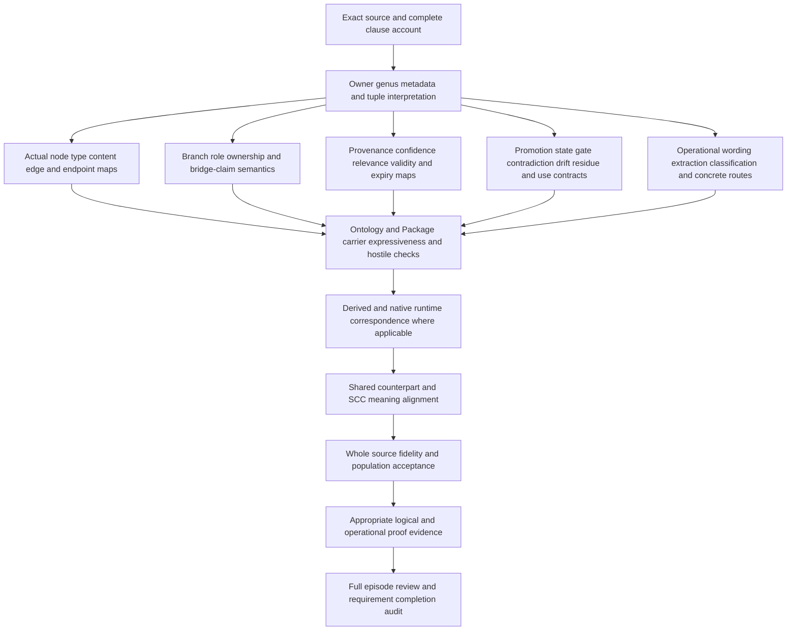

# Ontology formalization review

This is a **partial source-bound candidate**, within the full 183-current-identity / 189-admitted-version episode. It prioritizes definitions, forms, types and logic. It accounts for the whole selected source text, supplies a typed interpretation and checked models, and compares that interpretation with exact source, carrier and runtime observations. Whole source-owner fidelity, calibrated confidence, actual meaning truth, shared semantic closure and episode completion remain unestablished.

The controlling definition is `cal.definition.ontology@1.0.0-candidate.1`, admitted-current under C53, at `evidence/migrations/cyberalchemy-v2-to-lab/candidates/0004-artifact-reconstruction-pipeline/layers/l1-semantic-repeatability/definitions/ontology/v1/definition.json`. Its SHA256 is `2f14c4861b7d5b9b22768fdd6d56df8dfce08f6557594046c7842dee46f884b8`. The selected SWU is F06-T.cal.definition.ontology, with exact A04/C01/E02 prerequisite receipts. The previous Model Instance Binding delivery sealed 4,062 files. Those earlier bytes, the 201 captured source/provenance files and unrelated/private/live state are preserved.

## 1. Definition identity, ontology objects and genus

The source combines two levels. Its reconstructed metadata identifies the normalized Definition `semantic.ontology`, owned in scope.shared-authority and carried by type.definition, with accepted source relations to CAV2-D19. Its bound source meaning describes a governed layer representing a domain, workspace, system or operation through typed knowledge objects, typed relations, branch/role assignments, provenance, confidence, promotion state and use obligations.

The candidate keeps those levels separately typed. CanonicalDefinitionInstance is a role whose normalized identity, scope, carrier and source tokens must match selected constants, preserve the accepted source relation and avoid silent sibling merging. Ontology is the represented meaning-layer genus. A normalized Definition record alone does not populate a graph, validate a claim or instantiate the system it describes. The base model includes a canonical Definition object distinct from the ontology objects. Owner review must accept this interpretation of the source's canonical-instance wording.

Ontology's genus is a selected biconditional with nine qualifiers: governed meaning layer, represented scoped domain, typed knowledge objects, typed relations, branch/role assignments, recorded provenance, recorded confidence, recorded promotion posture and recorded use obligations. A supplied biconditional proposes both membership directions; it does not prove that every real artifact with those labels is an ontology. Concrete denotations and source precedence remain unresolved.

The interpretation records first-order/equality logic. Twenty encoded source spans use sixteen distinct formula values, assembled from fourteen primitive formulas. One span combines genus/differentia, axiomatic and operational forms; six are axiomatic; thirteen are axiomatic and operational. Operational means a selected requirement is exposed as a checkable constraint or guard. There is no claim of executed deployment, recursive semantics, a temporal proof or an ontology-wide truth theorem. [Clause analysis](clause-analysis.json) records the forms and eleven pending findings.

## 2. Complete source accounting

[Correspondence](correspondence.json) inventories all 22 nonempty source string leaves in voices, boundaries, scope and claim ceiling. Exact offsets and excerpt hashes partition them into 48 spans: twenty encoded, nine explanatory and nineteen deferred. [The accounting check](correspondence-check.json) confirms full character coverage.

The encoded selection covers normalized metadata, positive meaning, the actionable checklist, the seven-part tuple, branch/use applicability, pointer/index boundaries, self-promotion boundaries and Operational Ontology normalization. Explanatory migration context, local-vault examples and notation remain explanatory. Deferred spans include connective whitespace/code-fence text, the scope reference, sibling-target exclusion and four artifact-local testable conditions. No artifact-validation result is inserted into T as an axiom simply to make the desired outcome follow.

Coverage does not imply fidelity. For example, a marker saying a route is recorded does not resolve a real owner, and a clause associated with confidence constraints does not supply a calibrated confidence value. Every finding remains pending; no source-precedence decision, population exemption or assumption is manufactured. The larger native plan's whole-family and whole-definition gates remain unsatisfied by this partial draft.

## 3. Types and signature

The signature has 140 declarations: two nonempty sorts, ten constants, sixteen total functions, 104 unary predicates, six binary relations and two ternary relations. Entity denotes represented ontology objects, nodes, edges, contexts, evidence, normalized Definition records, wording/obligation objects and pointer material. Token denotes opaque types, kinds, scope/use/policy/gate/guidance identifiers, normalized references and promotion-state values.

Four total functions return Entity: edgeSource, edgeTarget, sourceAnchor and inventoryAnchor. Twelve return Token, including nodeType, edgeKind, ontologyScope, intendedUse, confidencePolicy, promotionState, nextGate, useGuidance and four normalized metadata fields. Complete function tables cover the full supplied domain; constraints apply to relevant typed subjects. No partial lookup, actual resolver or hidden uniqueness-of-reference assumption is introduced.

EMPTY distinguishes forbidden missing tokens. Other constants represent normalized identity/scope/carrier/D19 and the source's candidate, reviewed, promoted, demoted and deferred states. Symbol qualification binds every declaration to the exact Definition/version and candidate scope. Constants and opaque token equality still require a real value map; a name or a qualified symbol is not semantic acceptance. The independent checker recompiles [typed IR](static-ir.json) and compares it with the stored output.

## 4. The seven-part structure: N, E, B, R, C, P and G

The source's expression is `O_U = (N, E, B, R, C, P, G)`. This candidate interprets the tuple through the following constraints.

| Component | Selected formal surface | Remaining meaning obligation |
| --- | --- | --- |
| N: knowledge objects | HasNode requires OntologyNodeRole, usable content and a nonempty type token | Resolve real node identities, types and usable content |
| E: typed relations over N | HasEdge requires edge role, nonempty kind and source/target membership in the ontology's node set | Accepted edge-kind/signature/direction and real endpoint maps |
| B: branch/role/ownership context | Every selected node or edge has a typed context assignment; every assignment points to a member | Context/branch/role/owner reference semantics |
| R: provenance | Typed source/inventory anchors and at least one typed evidence link for each member | Exact selectors, authentic provenance and truthful support |
| C: confidence/scope/validity | Nonempty policy token; separate evidence/commitment records for load-bearing claims; validity/expiry records where relevant | Calibration, relevance, values, validity windows and expiry behavior |
| P: promotion posture | State is one of the five selected source tokens | Lifecycle mapping and actual owner gate effects |
| G: gates and use obligations | Next gate and use guidance tokens plus challenge/drift/residue-route marker | Resolved gate, contradiction/invalidation/residue and downstream use contracts |

The tuple is not a unique extensional representation theorem. Two distinct ontology objects may have matching component values, and graph-shaped, tree-shaped, branch-aware, entry-based or artifact-tree representations are not forced to a single storage shape. The source's representation flexibility remains explicit.

T does not demand nonempty node/edge sets for every Ontology. It permits a fully marked empty object; I contains an explicit empty-ontology witness as well as populated witnesses. This exposes a cardinality/usable-content question for owner review. OnlyPointerList is explicitly outside the Ontology genus. Merely naming missing references does not prove that usable content, typed relations and governance exist. Self-edges are permitted; the source gives no blanket self-relation ban.

## 5. Branch separation and actionable meaning

For BranchAware ontologies, BusinessClaim, SystemClaim and BridgeClaim are selected distinct claim classes on represented nodes. A node marked with one class cannot also have either of the other two in this candidate, and its context assignments include a matching branch role. Nodes without one of those classes are not forced into that three-part vocabulary. When BranchAware is absent, that conditional disjointness rule does not apply.

This interpretation requires owner acceptance for multi-branch nodes or documents that contain several claims. It does not assert that an entire artifact can contain only one kind of claim. Separate hypothetical frames test the source's other boundary: implementation evidence cannot silently redefine intent, and intent cannot imply implementation exists. These are reviewable constraints/examples, not actual intent-to-system alignment proofs.

Actionable is a recorded-condition marker requiring Ontology and the source checklist: scope, object types, edge rules, context assignments, evidence references, promotion/next gate, challenge/drift/residue route and retrieval/use guidance. Conditional confidence requirements also apply to members. ActualActionableUse is a separate query target. A model can satisfy every documentary condition while actual actionability remains false.

## 6. Confidence, validity and authority posture

Evidence confidence and commitment confidence have separate predicates. A load-bearing member must record both. Neither is equated with promotion posture, source admission or successful execution. ValidityRelevant conditionally requires both validity and expiry records. T does not establish whether every real claim is correctly classified as relevant or load-bearing.

The candidate does not assign probabilities, measure calibration, compute confidence decay, compare confidence policies or enforce expiry in time. Those require accepted value/evidence/time maps. The source P vocabulary differs from the selected Ontology carrier's draft, review, admitted, superseded and retired vocabulary. The schema rejects the five source-state strings in its promotion_state field, while the candidate theory rejects an unrelated token outside its chosen source vocabulary. An accepted translation must account for that mismatch rather than identifying promotion state with authority or hiding the difference behind a renamed enum.

Authority remains separately owned. Ontology objects cannot carry RawSource, Inventory, Glossary, Memory, SessionTranscript or GeneratedSearchIndex roles in this interpretation. SelfPromotesDefinitions, SelfPromotesConstitutions, SelfPromotesRuntimeContracts, SelfPromotesPublicClaims and OwnsAuthorityTransitions are false. Fourteen inference flags also remain false. These constraints state normative separation; they do not prove every actual consumer behaves correctly or prohibit a separately authorized external promotion decision.

## 7. Operational Ontology normalization

The long source boundary is formalized explicitly. Operational Ontology remains source-local operation-facing projection shorthand. OperationalPhrase requires ProjectionShorthandRole and excludes primitive, peer branch, standalone subtype and authority-lifecycle-axis alias roles.

HasObligation requires an explicit typed obligation. Meaning obligations route to ontology meaning; authority-posture obligations route to an authority-lifecycle surface; agent-operation obligations must be concretely named. If no concrete obligation remains, retirement of the phrase is required. The candidate does not create a new Operational Ontology Definition, add a primitive branch or execute wording changes. There is no exact current Authority Lifecycle Axis Definition in the snapshot; the CAV2-D23 route is an unaccepted map with exact related authority-axis sources kept separate.

Unknown/unclassified obligation categories are not automatically enumerated by the theory. One obligation can have multiple categories if all corresponding routes hold. Thus a full extractor/classifier and its owner-reviewed exhaustive coverage remain required. A retirement requirement also does not entail actual retirement; the selected countermodel preserves that distinction.

## 8. T, populations and nonentailment

[The interpretation](t.json) supplies encoded T and fifteen required population statements I. I includes populated and empty ontology witnesses, a pointer list outside the genus, canonical Definition metadata, an edge with contained endpoints, load-bearing confidence split, relevant validity/expiry, actionable-marker-without-actual-use, all three branch claims, routed Operational Ontology obligations and a retirement requirement without actual retirement. Another 111 population dispositions remain unresolved. There are no owner-approved exemptions.

[Query policy](query-policy.json) has 26 targets outside T: 23 actual outcomes and three additional targets for current-ontology usable meaning, actionable-marker actual use and retirement execution. Supplied countermodels satisfy T and every required I statement while making each target false and its corresponding witness true. This establishes the selected candidate nonentailment with a independently evaluated supplied model; it is not a whole source-faithful proof for all ontology meanings.

[The source boundary obligation](source-query-obligation.json) retains the exact first boundary paragraph and hash. Its normative separation is encoded. An associated authority query remains outside T. The source does not contain a literal `=/=>` formula for Ontology, and this review does not invent one: it associates an independently checked nonentailment target with actual source prose. No conclusion is assumed as its own premise.

## 9. Independent model checks

[Model controls](model-controls.json) has 141 actual controls: 39 models satisfy T, 95 falsify at least one encoded constraint and seven fail model structure. The base domain has eighteen Entity values and eighteen Token values, including two ontology objects, three typed branch nodes, one edge, three contexts, source/inventory evidence, a canonical Definition record, two wording objects, three obligations and pointer material. Function tables span the full domain.

Negative controls test normalized classification drift, missing content/types, external edge endpoints, missing/untyped context and evidence links, missing load-bearing/relevance records, unselected promotion tokens, absent actionable checklist fields, branch collapse, self-promotion, ontology/index collapse, primitive/peer/subtype/axis promotion of Operational wording, missing routing and missing retirement requirements. Structural controls test nontotal functions, ill-sorted constants/results, wrong relation arity, duplicate tuples and empty sorts.

Positive controls expose empty ontologies, self-edges, inventory support, source-state alternatives, unclassified obligations and multi-category routing. Exact Definition metadata also remains distinct from instantiated ontology structure in the supplied model. The finite evaluator keeps its existing 100,000-step and 30-second limits. Models, targets and population statements are independently evaluated through the existing checker, with source/provider bindings rehashed.

## 10. Exact source and admission evidence

[Source checks](source-checks.json) records fourteen read-only checks. The selected Definition/v1 schema and generator digests are current, and two deterministic renders equal the stored 10,155-byte projection, SHA256 `7bb88e1ede5baa89676d08bc1af2b9294b57142da3fdd2ce059fa76ddd9791b0`. The renderer preserves the input. Exact registry, C53 decision, authorization, admission-manifest row and recorded source-admission selection are bound.

Only the bound author.markdown_h2_section extractor is executed from the reconstruction writer's source. Its selected D19 section is 6,000 bytes with SHA256 `9039edb8c866a9d1e992aa01f746d1371fdb40882eb332d088469b2afc5a354c`. The selected local full file matches the recorded admission hash `ecfbd64f334954809e83ffd5d4f9adfb759f39716de96c3ac1227d4ee869c6f8`.

The producer-declared domainspec-core/cyberAlchemy-v2 path is absent. The separately selected local copy is read-only evidence; its repository identity and canonical/live currentness are not authenticated. Consequently, source testable conditions for selected identity, Definition/v1 shape and exact projection pass for that selected artifact, while universal/current source-section status is partial. All four test strings stay outside T. The embedded historical candidate posture is retained; C53 supplies later exact admission evidence without rewriting the source.

The historical Definition/v1 source also fails four shape checks under current Definition/v2. This neither migrates the source nor invalidates its exact C53 admission.

## 11. Two carriers, projections and implementation evidence

[Carrier/profile checks](authority-profile-checks.json) reports twenty catalog/projection/source observations, fourteen hypothetical qualification profiles (thirteen rejected), nineteen finite branch/confidence/normalization frames (fifteen rejected), 49 selected Ontology schema probes (twenty accepted), four rejected Ontology hostile fixtures, seventeen Ontology Package schema probes (eleven accepted), three rejected Package hostile fixtures, six Package identity-predicate controls and fourteen pure derived-posture controls (twelve return and two reject malformed inputs).

The current registry has 143 rows and 121 admitted-current types. Two current carriers bind the Ontology Definition: Ontology/v1 and Ontology Package/v1. Their C70 current admission, retained candidate.2 descriptors, candidate fixture statuses and distinct validation purposes remain separate. Ontology uses record.json with arrays of references; Package uses ontology-package.json with inline typed node and relation records and also binds Generated Output. Neither carrier is silently substituted for the other or imported into T.

The selected Ontology schema requires nonempty node, relation, provenance, boundary and governance-rule arrays, rejects blank identifiers and closes extra fields. Accepted probes nevertheless include unresolved nodes/relations/source/policy references, empty branch/role assignments, same-string node/relation references, unspecific governance text, an Operational Ontology label and same-ID revised manifests without successors. The fixture itself cites a provenance path absent in the workspace. Confidence values, next-gate and use-obligation fields are not represented structurally; adding them is rejected.

Ontology Package has inline node content/type/scope/source/use/collapse fields and source-binding/query restrictions. Its schema still accepts dangling endpoints, duplicate node/relation identities, unknown types, a shaped wrong source hash, empty relations/use/collapse arrays, whitespace labels and package/Product identity collapse. The exact identity predicate extracted from its validator rejects Product/output identity collapse but accepts a dangling node endpoint. These are separate actual in-memory observations, not a full validator run or a semantic acceptance decision. Its pure projections match the stored views and the Product fixture bytes.

Both canonical receipt-writing validator entry points were inspected and not executed. Only selected pure render functions, the Package identity expression and runtime posture function were evaluated on captured in-memory data. Runtime posture reflects caller-supplied status, source and confidence fields. For the selected Definition it returns not-evaluated evidence/commitment confidence, candidate-derived ontology representation, unknown domain state and not-observed runtime. Arbitrary confidence/commitment strings and a wrong source digest can pass through that pure function; it is not an authenticator.

Derived graph/query code was inspected for local/global edge separation, source-backed paths, traversal bounds, stale-edge removal, authority_effect none and replay_source false. Build/query/store entry points were not executed. Native Rust structures separate semantic node/relation states from governance state, including evidence/commitment confidence, provenance, owner, conflicts, residue and challenge/drift/invalidation routes. Its selected semantic/property validator permits only the test-empty-profile/v1 profile. This is source inspection, without native execution or an accepted common map from the full Definition or either carrier to these runtime structures.

Two failed carrier checks are retained. [Attempt one](attempts/0001-multiple-current-carrier-bindings/attempt.json) assumed a single current binding. [Attempt two](attempts/0002-wrong-alternate-carrier-label/attempt.json) used the wrong alternate label before inspecting the returned rows. [The erratum](attempts/0001-multiple-current-carrier-bindings/errata.json) identifies Ontology Package accurately. Both scripts and actual stdout/stderr are preserved. Corrections changed carrier selection/evidence, not the theory or canonical sources.

## 12. Dependency closure and detailed completion DAG

There are 42 exact declared semantic-use dependencies, including Definition, Governed Model, ontology components/cuts/views, typed relations, classification, context, source/provenance/evidence, authority axes/promotion, gates, challenge/drift/residue and event histories. Ten separately qualified comparison Definitions remain outside T. Missing exact labels such as Inventory, Glossary, Evidence Confidence, Commitment Confidence and Authority Lifecycle Axis are explicit; no Operational Ontology primitive is invented.

[The reachable declared graph](dependency-graph.json) and [joint current graph](current-dependency-graph.json) retain their distinct selection scopes. Missing counterparts and unclassified semantic SCCs remain pending. A graph-shaped meaning structure, semantic dependency graph and acyclic execution DAG are different objects. None proves semantic alignment simply through reachability or topological order.

This explanatory completion DAG preserves the foundations-first native plan and does not mutate its sealed edges.

| Node | Required concrete output and acceptance evidence | Pending owner or decision |
| --- | --- | --- |
| F | Accepted Definition/object separation, genus direction, tuple denotation, cardinality and all eleven finding dispositions | Definition/ontology owners |
| N | Resolved typed node content, edge kinds/signatures and exact endpoint closure | Ontology/type/relation owners |
| B | Context/branch/role maps and treatment of multi-claim objects; bridge preserves intent/system separation | Branch/context/meaning owners |
| C | Authentic source selectors and provenance; calibrated separate confidence; relevance/validity/expiry behavior | Evidence/confidence/source owners |
| P | Accepted source-to-carrier posture map, actual next gate, owner routes, contradiction/drift/residue/invalidation and use obligations | Authority/lifecycle/consumer owners |
| O | Exhaustive source-wording classification, concrete operational obligations and retirement policy without a new primitive | Definition/source/operation owners |
| K | Each accepted carrier can express its intended portion; real reference checks and hostile semantic validation | Artifact Type/carrier owners |
| R | Explicit accepted common maps, bounded derived/query claims and selected native validation/replay evidence | Runtime/projection owners |
| D | Counterpart interpretations and semantic cycle classifications accepted with exact namespace/value alignment | Dependency owners |
| W | Whole source meaning fidelity and explicit required/exempt/unresolved population decisions | Definition owner |
| V | Required proof/evidence of appropriate scope, with targets independent from assumptions | Assurance reviewers |
| Z | All episode requirements audited for all 183 current identities and 189 admitted versions; explanation of each formalization aspect | Project completion review |

Independent branches can progress until their actual dependency is reached. Ontology Cut is next in the native authoring queue; queue order itself is not a new semantic edge or proof condition.

## 13. Delivery and whole-episode ceiling

[Current inventory](current-inventory.json) supplies a fresh independently evaluated T/I witness per partial draft and the exact joint graph. The episode has fifty partial drafts and 133 current identities without a draft. Whole source-owner-accepted translations and whole-definition proofs are both zero. The historical I04 eight-draft report remains preserved; this inventory supplies a separate scoped update.

Producer checks and six fresh terminal replays cover contract, model, source, profile, dependencies and the complete current inventory. [Receipt](receipt.json), [coverage row](coverage-row.json), [episode status](episode-status.json) and [delivery manifest](delivery-manifest.json) bind exact inputs/outputs and preserve earlier candidate bytes, including failed attempts. The sealed delivery audit proves preservation and the partial claim boundary; it does not establish whole semantic readiness.

The full episode remains active. This review explains the completed candidate work and the exact remaining definition/type/logic/source/carrier/runtime/proof obligations required for the requested complete formalization review.
