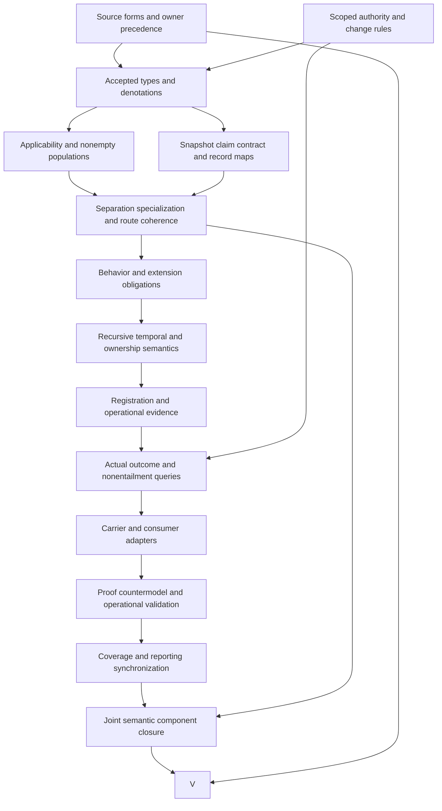

# Parent-Instance Authority Separation: formalization review

Status: verified candidate draft pending fresh replay and delivery audit. Authority effect: none. Source fidelity, whole-definition translation, owner acceptance, consumer alignment, component closure and mechanized proof remain pending. This review explains the candidate types and logic before describing carriers or operational execution. It is a candidate agent self-review, not an owner decision.

## 1. Exact source selection and meaning boundary

The primary source is cal.definition.parent-instance-authority-separation-invariant@1.0.0-candidate.1. Its source SHA256 is abf1ae8f7112b09fd349848b44794b71b89aa77db07d54d3bae12b317832bfc4. C53 supplies the admitted-current selection overlay. The retained document still records historical candidate-unadmitted source postures. These are different observations about different layers; the current admission does not rewrite the historical document or accept this interpretation.

The contextual legacy source is CAV2-D64, Recursive Instance Ownership Invariant. Its exact section is 13,458 bytes with digest 0951e906513059f8ed9b748c1fbc2bafdc1b70583258f028ade2a7da867e96c0. The matching local file is available, but the producer-declared location is absent. Matching local bytes establish the selected content, not the identity or currentness of the original producer repository. The pure source renderer was used without invoking a materialization writer: two projections agree at 8,951 bytes and digest 546207d757e2ee36ebb3882d5b96145f173270cf594a4f2144b25a1c42c99466.

PIAS-FINDING-001 concerns the normalization and accepted legacy split. The prototype's split disposition and normalized classification are real source observations. They do not prove that every legacy recursion obligation survives this reconstruction unchanged. PIAS-FINDING-012 covers the remaining source, live producer and whole-component limitations. The source checks bind admission records, authorization bytes and source-use selectors separately so that later review can distinguish documentary admission from semantic acceptance.

## 2. Definitions, forms and complete source accounting

The formalization accounts for all 22 selected source units through 28 mapped spans. Nine spans carry candidate formulas, nine explain the meaning, and ten remain deferred. Six distinct encoded formula values compose ten primitive theory templates. Counts describe source accounting; they do not count independent proved theorems. A composite formula can occur in multiple source spans, while a single span can contain several independently meaningful guards.

The short formal expression records normalized identity, semantic kind, carrier and owner scope. It is insufficient by itself to formalize authority separation. The longer normative statement and applicability text introduce parent ownership, local instance ownership, exact specialization, registration, inherited behavior and change routes. This packet translates those clauses before proposing consumer adapters. Plain-language and domain-context passages stay explanatory. The four retained testable conditions and the historical claim ceiling stay observation-measurement obligations, not universal axioms about authority or execution.

The correspondence check verifies character coverage rather than silently discarding difficult text. Deferred clauses retain their source selector, start position, excerpt digest and rationale. No assumption has been introduced to turn an external outcome query into a theorem. The whole first boundary paragraph remains a source obligation for three external queries: universal parent requirement, actual Discipline creation and actual Constitution adoption. Each query binds the same complete source excerpt, outside the selected theory. This preserves its exclusions without treating the existence of an invariant declaration as evidence that any enforcement artifact has been created.

## 3. Typed carriers and denotations

The signature contains 20 nonempty sorts, nine constants, 67 total functions, 120 unary predicates and four binary relations: 220 declarations altogether. Sorts keep distinct semantic categories explicit. ParentModel and Instance are different carriers; Subject provides a shared carrier for scoped claim subjects without equating the two owners or artifacts. AuthorityClaim is separate from Principal because one person or organization may hold two differently scoped claims. Lifecycle and Boundary are independent identities whose printed labels can coincide.

Snapshot is an exact reference object, while ReferenceMode distinguishes version and state references. Contract denotes inherited or locally held contract identities. Binding ties the invariant, parent, instance and exact snapshot together. Relation carries the typed specialization reference. Registration records the Project's declared binding information. Behavior supports a nonempty inherited realization example and separately scoped local behavior. Change and Route express necessary declared routing guards without assuming execution or acknowledgment. Token is deliberately weak: it represents declared handles and labels, and cannot resolve itself into an adopted decision, adequate evidence, recomposition or termination proof.

All functions are total on their declared argument carriers. This is a modeling choice, not a statement that an outside-scope artifact possesses an operational registration. Applicable guards constrain function values only where the binding is governed. Nonempty sorts alone do not establish any invariant instance; the required populations supply explicit witnesses. PIAS-FINDING-004 asks owners to accept the common subject, boundary and lifecycle maps. The detailed function inventory below makes each proposed map reviewable.

| Function | Argument types | Result type |
|---|---|---|
| invariantIdentity | Invariant | Token |
| invariantKind | Invariant | Token |
| invariantCarrier | Invariant | Token |
| invariantOwnerScope | Invariant | Token |
| invariantSourceD64 | Invariant | Token |
| bindingInvariant | Binding | Invariant |
| bindingParent | Binding | ParentModel |
| bindingInstance | Binding | Instance |
| bindingSnapshot | Binding | Snapshot |
| bindingParentClaim | Binding | AuthorityClaim |
| bindingInstanceClaim | Binding | AuthorityClaim |
| bindingProject | Binding | Project |
| bindingRegistration | Binding | Registration |
| bindingRelation | Binding | Relation |
| bindingInheritedContract | Binding | Contract |
| bindingExtensionScope | Binding | Scope |
| bindingPackage | Binding | Token |
| snapshotParent | Snapshot | ParentModel |
| snapshotMode | Snapshot | ReferenceMode |
| snapshotHandle | Snapshot | Token |
| snapshotContract | Snapshot | Contract |
| parentLatestSnapshot | ParentModel | Snapshot |
| parentSubject | ParentModel | Subject |
| parentOwner | ParentModel | Principal |
| parentAuthorityScope | ParentModel | Scope |
| parentLifecycle | ParentModel | Lifecycle |
| parentBoundary | ParentModel | Boundary |
| parentOwnerRoute | ParentModel | Route |
| instanceSubject | Instance | Subject |
| instanceOwner | Instance | Principal |
| instanceAuthorityScope | Instance | Scope |
| instanceLocalContract | Instance | Contract |
| instanceLifecycle | Instance | Lifecycle |
| instanceBoundary | Instance | Boundary |
| instanceOwnerRoute | Instance | Route |
| claimSubject | AuthorityClaim | Subject |
| claimScope | AuthorityClaim | Scope |
| claimPrincipal | AuthorityClaim | Principal |
| claimContract | AuthorityClaim | Contract |
| lifecycleSubject | Lifecycle | Subject |
| lifecycleStatus | Lifecycle | Token |
| boundarySubject | Boundary | Subject |
| boundaryLabel | Boundary | Token |
| relationSnapshot | Relation | Snapshot |
| relationInstance | Relation | Instance |
| relationKind | Relation | Token |
| registrationProject | Registration | Project |
| registrationSnapshot | Registration | Snapshot |
| registrationInstance | Registration | Instance |
| registrationParentClaim | Registration | AuthorityClaim |
| registrationInstanceClaim | Registration | AuthorityClaim |
| registrationInheritedContract | Registration | Contract |
| registrationExtensionScope | Registration | Scope |
| registrationPackage | Registration | Token |
| registrationAdoptionDecision | Registration | Token |
| registrationSpecializationRelation | Registration | Relation |
| registrationConformanceEvidence | Registration | Token |
| registrationChallengeRoute | Registration | Route |
| registrationDriftRoute | Registration | Route |
| registrationRecompositionPath | Registration | Token |
| registrationRecursiveStop | Registration | Token |
| registrationGoals | Registration | Token |
| registrationEvidence | Registration | Token |
| registrationParentOwner | Registration | Principal |
| registrationInstanceOwner | Registration | Principal |
| changeBinding | Change | Binding |
| changeRoute | Change | Route |

## 4. Applicability and scoped authority claims

A binding applies exactly when the candidate applicability markers hold: downstream reliance on a parent, a requirement for independently scoped local ownership, and a Project creating or evolving an instance. These markers are interpretations awaiting accepted denotations. Their conjunction prevents the theory from requiring every artifact to have a parent or every capability to be a Project. An explicit outside-scope witness has membership, file-placement, repository-permission and generic-responsibility signals while remaining outside the governed binding population.

For a governed binding, parent and instance claim identities differ and their subject identities differ. Claim subject, principal, scope and contract functions agree with the corresponding parent or instance functions. Parent claim rights cover the shared contract and declared instantiation, specialization and composition conditions. Instance rights cover local meaning, state, evidence and lifecycle. These are declared candidate predicates; no actual permission grant or owner acknowledgment is inferred.

The same principal may own both claims. Forcing different people would confuse authority scope with organizational identity. Scope labels may overlap in a supplied positive model without merging the claims; actual overlap policy still needs owner treatment. The theory does not contain a set-theoretic proof of scope disjointness. PIAS-FINDING-002 concerns applicability; PIAS-FINDING-003 concerns accepted claim subjects, rights, principals and authority denotations. A claim token, familiar folder, repository role or Project membership cannot substitute for this review. The finite witnesses establish that the candidate constraints allow independent scoped claims without imposing an unsupported universal rule about who may own them.

## 5. Exact parent snapshots and specialization references

Every applicable binding selects an exact Snapshot whose parent agrees with the binding parent. An ExactRefDeclared snapshot has a nonempty handle and either VERSION_MODE or STATE_MODE; those constants are distinct. The specialization Relation agrees with the exact snapshot and instance and has the declared specialization kind. The inherited contract is the selected snapshot contract, not automatically the current or latest parent contract.

One required population binds a version snapshot different from the parent's latest snapshot. Another binds an exact state reference. This makes accidental rebinding observable: replacing the inherited contract or relation snapshot with the latest parent violates the selected coherence constraints. The external query ExactBinding-not-LatestParentReference has a supplied countermodel. Its scope is the candidate reference policy; it does not establish that a particular live parent version is authoritative, immutable or current.

PIAS-FINDING-005 covers version/state identity, handle resolution, parent evolution and invalidation of dependent bindings. The model has no temporal transition system for moving from one reference to another. Owners must define which updates require a new binding, when an earlier binding becomes invalid and how state references resolve. A nonempty string passes the reference guard without proving any of those facts. Exact source version selection and exact modeled parent snapshot selection are also different references: preserving the Definition source digest does not authenticate every hypothetical parent version used by the finite model.

## 6. Independent lifecycle and coordination boundaries

Applicable parents and instances have distinct Lifecycle identities and Boundary identities, each coherently mapped to its own Subject. Declared independent lifecycle and coordination markers are required. Those constraints preserve the source's separation requirement at the level of identity and declaration, without inventing operational lifecycle states or a runtime scheduler.

The finite model gives parent and instance boundaries the same printed label and lifecycles the same maturity label while their identities and subjects remain distinct. The positive control checks this deliberate case. Equal display values do not imply equality of concepts. Conversely, different labels would not prove actual independence. A coordination implementation can still couple two objects whose names differ; proving its behavior requires a separate accepted implementation map and evidence.

PIAS-FINDING-004 therefore stays unresolved even when identity inequalities hold in all supplied positive controls. Owners must specify the actual meaning of an independent coordination boundary and independently owned lifecycle, including how shared obligations affect both. The present logic does not prohibit all coordination or require disconnected instances. Connection through an inherited contract remains essential. It also does not assert that local lifecycle changes can ignore shared contract conditions. The theory identifies the separate subject and route, then leaves substantive permission and transition semantics for independent review. This avoids converting declared independence into an unqualified proof of every future operational change.

## 7. Inherited behavior, narrowing and local extensions

For an applicable binding, every InheritedRealization behavior must be realized by the instance, allowed by the exact parent snapshot and permitted within the declared specialization scope. The instance must not silently redefine the parent. The three binary behavior relations make this obligation explicit instead of reducing specialization to a label or record field. They remain candidate denotations, not accepted interpretations of arbitrary implementations.

Required populations prevent a vacuous reading. At least one governed binding has inherited behavior. A proper narrowing example has some parent-allowed behavior outside the inherited realization and at least one behavior inside it. This example demonstrates compatibility with narrowing; it does not require every specialization to be strictly narrower. Another witness realizes local behavior outside both the inherited relation and specialization scope. That behavior is deliberately local and cannot be reclassified as inherited merely because the instance realizes it.

PIAS-FINDING-006 asks for accepted behavior, allowance, realization, specialization and contract maps. Actual conformance remains a distinct predicate and external query. A model satisfying all inherited-behavior guards while ActualConformance is false supplies a countermodel to the unsupported implication. Owners must settle evidence sufficiency, extension conditions and tests before an implementation can claim conformance. In particular, a nonempty contract reference or a shape-valid array of conformance references is not an implementation proof. These are logical obligations that must precede the choice of validators, generators or runtime adapters.

## 8. Project registration and record completeness

The applicable Project registration binds the Project, exact snapshot, instance, both authority claims, inherited contract, extension scope, package and specialization relation. The registered parent and instance owners agree with their respective owner functions. Additional declared markers cover extension scope, challenge route, drift route, recomposition path and recursive stop. Nonempty token fields cover package, adoption decision, conformance evidence, recomposition path, recursive stop, goals and evidence.

The source lists thirteen central bindings when the two claims and two challenge/drift routes are counted independently. The broader normative text also mentions Project goals, owners and evidence; this candidate includes them rather than silently restricting the account to the shorter list. RegistrationDeclared expresses a required declaration. It is not an authenticated record, an adopted decision or an accepted evidence set.

PIAS-FINDING-007 concerns the distinction between field completeness and actual registration meaning. The required population RecordedDecisionWithoutAdoption explicitly has a decision handle while adoption authority remains false. The neighboring schema further demonstrates that unresolved reference strings can be shape-valid. An adapter must map the complete source obligations to actual record fields, resolve references, establish owner routes and carry an accurate claim ceiling. Until then, schema validation and typed candidate registration are separate bounded checks. Even an apparently complete record may point to nonexistent goals, inadequate evidence or an obsolete parent reference; the present packet neither hides that limitation nor converts it into a new authority rule.

## 9. Shared, local and absorption change routes

RelevantChange is equivalent to a requested change whose binding applies. This guards the route rules against extending the invariant to unrelated changes. Relevant shared model changes match the parent owner route. Relevant local instance changes match the instance owner route. Absorption of instance-local meaning additionally requires the instance owner route and a declared applicable promotion or adoption path.

These rules are necessary declared guards, not sufficient permission to execute. The finite model includes shared, local and absorption requests satisfying the routing conditions while every actual outcome flag remains false. A route string does not demonstrate acknowledgment, consent, release of authority or completion of a promotion path. Matching the correct route also does not establish the semantic truth of the proposed change. Parent absorption cannot be justified by rewriting a child's local meaning silently.

PIAS-FINDING-008 covers shared/local change denotations, acknowledgments and grants. PIAS-FINDING-009 covers absorption, applicable path conditions and owner release. The outside-scope requested change remains irrelevant without a governed route requirement. This is an explicit counterexample to deriving applicability from the mere existence of a request. No live mutation was performed. Transition semantics, rollback, notifications and authority effects require a later independently bounded adapter and validation surface after the types and permission logic have been accepted. The current routing check can reject a declared wrong route; it cannot turn a correct declared route into a completed operational event.

## 10. Recursion, recomposition and excluded enforcement claims

The source requires a registered recursive stop and recomposition path, but a nonempty token does not specify an inductive measure, well-founded relation, traversal strategy or stopping algorithm. RecursiveStopWithoutTermination explicitly witnesses an applicable binding with a recorded stop while actual recursive termination remains false. PIAS-FINDING-010 covers the missing recursive, temporal and recomposition semantics.

A later recursive extension must identify the recursive carrier, permissible edges, base case, decreasing measure or bounded traversal policy, and evidence that the chosen rule holds. If cycles are allowed, their meaning must be stated independently. Merely finding a graph strongly connected component does not define a least fixed point or establish termination. This packet declares only first-order logic and equality. It imports no hidden recursion or induction rule and makes no universal temporal safety assertion.

The source boundary also excludes automatically making an instance canonical, requiring a parent for every artifact, creating a Discipline or adopting a Constitution. The three boundary source queries stay outside T. Their countermodels show why a normalized invariant declaration cannot establish those actual outcomes. This does not settle the intended owner policy for future enforcement; it preserves that work as independent obligations. The goal is to make the strongest bounded claim supported by the present source and logic while exposing precisely what a future recursive or enforcement formalization must add.

## 11. Supplied model evidence and actual carrier observations

There are 184 controls: 64 satisfy T, 113 falsify T, and seven are rejected as malformed. All 53 external queries have supplied countermodels satisfying T and the required witness condition while falsifying their target. Positive controls exercise exact version/state bindings, distinct claims with a shared principal, equal boundary/lifecycle labels, inherited narrowing, independently local behavior and qualified change routes. Negative controls alter claim subjects, snapshot coherence, registration fields, behavior allowance, scope permission or change-route requirements. Malformed controls test structural rejection separately from logical falsity.

The authority profile contains 27 qualification cases with 25 expected rejections and 30 finite declared frames with 24 expected rejections. Actual observations include 23 catalog/prototype checks, 30 historical Definition/v1 shape probes with five acceptances, and 35 neighboring ModelInstanceBinding/v1 probes with ten acceptances. ModelInstanceBinding/v1 is admitted-current under C70 for its separate current definition. Its retained artifact body remains candidate-unadmitted with authority effect none. Registry admission and retained body posture are recorded independently.

PIAS-FINDING-011 covers carrier and consumer alignment. The catalog contains 143 rows and 121 admitted-current rows, but no direct binding type for this invariant and no current generic invariant carrier. The neighboring schema requires 22 root fields and closes additional properties. It accepts unresolved references, active-state labels, equal owner/scope labels and overclaimed text as shapes. No neighboring validator, generator, materialization writer or native/live consumer was executed. Source and finite-model checks establish bounded observations; they do not establish owner fidelity, accepted cross-definition meanings or operational proof.

## 12. Detailed completion DAG and proof obligations

The following DAG separates type and logical prerequisites from later adapters and execution claims. These nodes are completion obligations, not a report that owner acceptance or whole proof already exists. The source/dependency graph is different: it contains real semantic cycles and must not be described as an acyclic completion schedule. Each arrow means that the downstream deliverable requires the upstream accepted output.

| Node | Depends on | Required result | Evidence required for completion |
|---|---|---|---|
| S | none | Owner treatment of source forms and twelve findings | Exact source decision and reviewed correspondence |
| A | none | Scoped authority and change contract | Accepted parent/instance rights and route conditions |
| T | S, A | Typed semantic denotations | Reviewed carrier, subject, principal and authority maps |
| P | T | Applicability and population policy | Nonempty accepted witnesses and outside-scope examples |
| I | T | Exact binding maps | Accepted version/state, claim, contract and registration references |
| C | P, I | Separation and coherence rules | Accepted inequalities, inherited behavior and route conditions |
| B | C | Extension and narrowing meaning | Accepted behavior relations and actual conformance obligations |
| H | B | Recursion and temporal meaning | Well-founded/bounded rule or explicit cycle interpretation |
| R | H | Authenticated registration and evidence | Verified references, owner acknowledgments and claim limits |
| E | R, A | Actual outcome obligations | Evidence for grants, adoption, conformance and recomposition |
| Q | E | Explicit adapter design | Mapping to admitted neighboring carrier without semantic shortcut |
| D | Q | Proof and operational validation | Scope-specific proof, countermodels and adapter checks |
| F | D | Synchronized coverage reports | Reviewed distinction between observations and accepted claims |
| J | F, C | Joint component closure | Accepted common denotations and dependency-cycle disposition |
| V | J, S | Whole-definition verdict | Source-owner acceptance plus complete scoped verification |

S and A can be reviewed independently. T is the first shared prerequisite, followed by parallel population and binding-map work. Operational registration cannot bypass behavior and recursive interpretation where the source depends on them. The delivery manifest seals a candidate episode artifact; it cannot satisfy V. Countermodels remain useful both before and after adapter work because each proposed new implication needs an explicit source basis and an appropriate proof or counterexample.

## 13. Preservation, episode status and next definitions

The prior Governance-Axis delivery binds 5,088 files. All are preserved, alongside 201 current source files. The original temporary preflight transcript is unavailable; context.json retains its selected bindings and assertions, and PREEXECUTION-EVIDENCE.md records this limitation explicitly. A reconstructed author summary is labeled as such. The final audit independently checks the context, prior manifest and source references. Fresh replay supplies actual terminal outcomes for the six current read-only checks.

This advances the inventory to 63 partial per-definition drafts, with 120 current identities still missing a draft. Across the current drafts there are 1,437 source units, 1,944 mapped spans, 616 encoded spans, 502 explanatory spans, 826 deferred spans, 686 required populations and 2,736 unresolved populations. Owner-accepted whole translations and whole-definition proofs both remain zero. The full episode denominator remains 183 current identities and 189 admitted source versions.

The local dependency graph has 122 nodes, 1,441 edges and 60 missing or quarantined counterparts. Its unresolved component has 62 members and 973 internal edges. The joint graph has 123 nodes and 1,475 edges; neither graph establishes accepted semantic closure. Independently supplied witnesses are not a common joint model.

The next task is F02-T.cal.definition.policy. Continue with exact current source selection, definitions and roles, types, logical guards, populations and counterexamples. Subsequent definitions follow the existing foundations-first plan, preserving its full scope. Owner-review findings remain pending while independently authorized candidate drafting continues. The next-definition notes identify Policy's source, clauses and dependency questions; consumer adaptation and execution claims remain downstream of those types and logical obligations.
