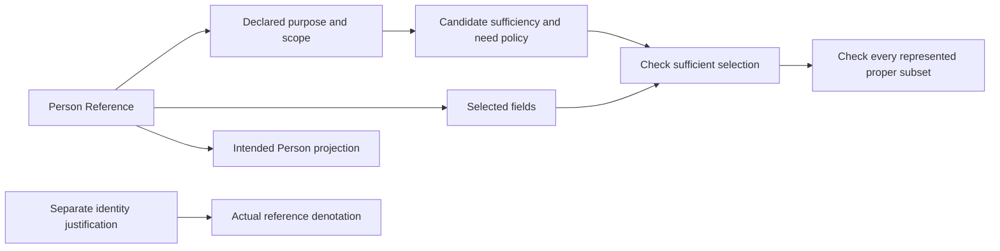

# Person Reference formalization review

This is a source-accounted partial candidate translation. It advances definitions, types and logic without source-owner fidelity approval, actual identity verification, data processing, runtime activation or whole-definition proof.

## Source identity and authority

The exact source is `cal.definition.person-reference@1.0.0-candidate.1`, SHA-256 `752acd8587d2e5ed97d84ee67223e2fe81c2b622c10064cd0a306a2d65c43668`, admitted through decision 0053. Its normalized record combines a Person Reference target paragraph with a normalization scaffold, legacy Person formal/boundary rules and Person aliases. Shared CAV2-D68 lineage does not merge Person Reference, Identity Claim and Person. Target/inherited/scaffold/source precedence remains unresolved.

Twelve read-only source checks bind current Definition schema/renderer/registry, the exact admission record and selected local legacy bytes. Two renders equal the existing 7,642-byte projection, SHA-256 `86267c06c75cfd3718ff5657f4e18c3e91a12d3706475548c6bc09cc932bfb1d`. The D68 section is 3,361 bytes, SHA-256 `4d23e94e91ce2c4d626536b760e8b0cf71174f3b48196585e363d066e543f9b3`, admitted for three distinct Definition targets. The producer-declared legacy file is absent; selected local file/section bytes match the recorded admission, while live repository identity and canonical legacy currentness remain unestablished. Historical embedded candidate wording is preserved separately from the current admission overlay.

Twenty-four nonempty source units are completely accounted by exact character spans: 28 clauses, three encoded, nine explanatory and sixteen deferred. Deferred material includes normalization, much inherited participation/non-implication/privacy language, scope/operation boundaries and whole-source testable-condition obligations. Actual record/schema/source/projection checks are evidence rather than blanket logical axioms.

## Definition and type model

A Person Reference is a minimal, purpose-bounded identifier OR record projection used to refer to a Person in a governed artifact. Six nonempty nominal sorts are Entity, Purpose, Scope, Field, Selection and Token. Seven total functions select intended Person, purpose, identity scope, field selection, identifier token, reference record identity token and Person identity token. Twenty-five predicates/relations express reference/Person/identifier/record roles, purpose/scope declarations, selected projection, field membership, sufficiency/need and independently supported world outcomes. There are 38 declarations.

Reference and selected Person share Entity, enabling meaningful inequality. The reference never equals its selected Person. Separate nominal sorts do not supply that proof. Token equality is a different relation: two identity tokens may lexically overlap without making two Entity objects equal. Multiple different references can point to the same hypothetical Person, and distinct identifiers do not imply distinct People. The meaning of scope-qualified identifiers and mapping into actual carriers needs review.

## Logical conditions and explicit minimum

Three first-order axiomatic clauses are encoded. The target clause requires identifier OR record projection, declared bounded purpose/scope, a selected Person, recorded projection, reference/referent inequality and sufficient inclusion-minimal fields. The inherited Person-to-HumanIndividual implication remains a separately typed condition. The privacy/minimization clause reiterates the selected minimum and prohibits reference-only private-attribute authorization. It does not make private attributes or other world outcomes universally false.

A selected field set must be sufficient for its declared purpose; each included field must be needed for that purpose; and no proper subset may remain sufficient. Proper subset is computed from field membership and a missing member, rather than trusted as a supplied label. A removal-closure condition requires a represented selection after deleting each field. This prevents omitting finite subset witnesses to manufacture minimality. In the supplied finite three-field model, all eight subsets are represented. It does not establish a universal powerset construction for actual data or an unbounded set-theoretic model.

The arrows describe structural selections and checks, not actual execution or proof of identity. In the hypothetical base model, attribution needs identifier plus scope, while coordination needs identifier. These are selected examples, not interpretations already approved for the actual fixture purpose.

“Inclusion minimal” means that no field can be dropped while preserving sufficiency. It does not necessarily mean fewest fields, lowest cost, smallest byte count or globally least identifying information. One bounded profile has a sufficient two-field set and an incomparable sufficient one-field alternative. The two-field set passes inclusion-minimum checks while explicitly failing global cardinality minimality. This difference is retained as an owner question rather than silently substituting a metric.

## Population and non-entailment

Six required populations connect a hypothetical reference to Person, purpose, scope, a nonempty selected field set and two distinct references to one Person. Twenty-two other population questions remain unresolved. These witnesses prevent vacuity and support the selected examples; they do not require every actual Person to have two references or establish actual Person/reference existence. A valid primary-theory model may have only one reference, different People or an empty sufficient selection, while failing this richer witness profile.

`ProjectionOf(r,p)` is the selected intended structural relation. `ActualDenotes(r,p)` remains a separate queried proposition. Eleven world outcomes remain outside the theory: private attributes, roles, membership, authority, ownership, permission, admission, consent, identity verification, runtime activation and external effect. The theory permits independently established facts. Normative reference-only non-inference is distinct from actual consumer compliance.

## Finite logical and profile evidence

Forty-five authored finite controls independently evaluate the typed theory and populations or reject malformed structures. They cover identifier/record alternatives and legitimate overlap, missing declarations/projections, Person/Human typing, actual Entity inequality, wrong selectors, insufficient selections, irrelevant or redundant fields, attempts to hide redundancy behind NeededFor labels, omitted subset witnesses, shared Person and token cases, vacuity and independently supported world facts. Five malformed models fail totality, sorting, membership arity, duplicate tuples or an empty field domain.

Fifteen countermodels satisfy the selected theory and required populations, falsify their queried target and satisfy its explicit witness condition. Besides the eleven world targets, these cover actual denotation, record identity equaling Person identity, distinct identifiers implying distinct People and a universal common field set. None of those targets is assumed in the theory. This is supplied finite evidence, not exhaustive model enumeration, source-owner acceptance or an unbounded whole-definition proof.

Thirty-eight candidate profiles meet authored expectations: four accepted and 34 rejected. The baseline has a four-field candidate universe with all 16 selections enumerated. Each profile enumerates the full powerset of its supplied finite universe and checks missing or unknown fields. Checks reject insufficient, redundant, forbidden or undeclared exposure; purpose/scope mismatch; absent symbolic sufficiency review; contradictory or undeclared uses; inactive references; self-successors; unsupported metadata; and reference-only world conclusions. These profiles describe a hypothetical exposure boundary, not an implemented filter of the actual carrier. Purpose/sufficiency/review markers do not verify their own meanings or actual data minimization.

Fifteen finite history frames include four accepted and eleven rejected examples. The candidate policy preserves reference identity/value/purpose/scope and selected Person hypothesis during functional-label edits, explicitly records retirement/fresh scoped succession, retains old history and separates changes to independent authority facts. Separate authority decisions may coexist. These are selected stronger profile obligations, not source-owner-approved universal mutation rules, privacy compliance, lifecycle implementation, runtime preservation or liveness proofs.

## Actual schema and relation observations

Seventeen read-only carrier checks bind the current Person Reference/v1 Type overlay through admission 0070, Definition 0053, closed schema, root descriptor, shared renderer/validator digests, four hostile fixtures, exact projections, refinement, sibling fixtures and current relation surface. The canonical receipt-writing validator is not executed.

The Identity Claim fixture's reference token equals this Reference fixture's node ID. Its asserted workspace identifier differs from the Reference's opaque reference value. The Reference has no direct Person field; the selected Person fixture's relation references point to another reference node. These may be intentional distinct identifiers. Actual correspondence, evidence, purpose sufficiency and scope mappings remain unverified.

Thirteen actual Reference schema probes preserve observations. Eight shapes pass: an opaque-local label with a synthetic identifiable value; arbitrary unsupported minimization text; different identity scope; overlapping permitted/prohibited uses; self-successor; superseded with no successor; retired while retaining permitted-use declarations; and an unknown successor token. Five fail: extra private-attribute field, extra direct Person field, empty permitted uses, duplicate successor tokens and forbidden authority effect. These observations are bounded shape facts; a retired record retaining use declarations is not itself proof of an executed prohibited use.

Current `relation.asserts-identity-of` has four exact ordered endpoint pairs and closed `assertion_kind`/`claim_scope` qualifiers. It forbids identity merge, authority transfer and private-attribute inference. Seven actual Typed Relation/v3 probes include four accepted and three rejected shapes. Reference-to-Person, Reference-to-the-same-Reference, different scope string and unknown target token pass. Reference-to-Claim, missing scope and an extra private-inference qualifier fail. A schema-accepted reference self-link does not establish a meaningful self-assertion or equate a reference with its Person. No actual relation is created.

## Dependencies and open obligations

Eighteen authored uses bind Person, Identity Claim, Definition, Artifact Type, Schema, policy, evidence, authority, identity carriers/relations, Team membership, Team, responsibility, decision, classification/orthogonality and typed relations/Kinds. Exact graph selection is regenerated: 61 nodes, 233 edges and 39 missing counterpart packets. One unresolved strongly connected component contains 22 authored draft members and 126 internal edges. The complete edge denominator and aligned common-carrier meaning remain unreviewed; cyclic declarations do not prove a joint theory.

Seven owner findings remain: target/inherited/scaffold/source precedence; selected versus actual denotation and resolver; field granularity/universe/sufficiency/minimum metric; meaningful Entity/token/scope identity; normative non-inference and actual authorization/consumer behavior; use/exposure/challenge/correction/succession/retirement/privacy/history/liveness semantics; and complete dependency/live-source closure. Actual data collection, reference records, Person claims, privacy guarantees, admissions, authority and runtime effects are not produced.

## Episode coverage

Twenty-two partial current drafts account for 499 source units and 684 clauses: 195 encoded, 175 explanatory and 314 deferred. They have 169 required populations and 431 unresolved populations. There are 161 current identities without per-definition drafts. Whole source-owner-accepted translations and whole-definition proofs remain zero. The I04 report retains its earlier exact eight-draft selected scope; the full episode remains active. Next: `F05-T.cal.definition.person`.
