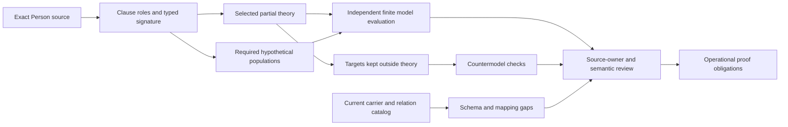

# Person formalization review

This is a source-accounted partial candidate translation, following the definitions, types and logic priority. It provides independently evaluated finite evidence and a detailed remaining-obligation record. Source-owner fidelity, actual Human identity, operational compliance and whole-definition proof remain pending.

## Source meaning and exact accounting

The selected source is `cal.definition.person@1.0.0-candidate.1`, SHA-256 `670c5a04cd9ff403190c868281073a9c21d86b33a6009c3940b1309997c952db`, admitted for source use through decision 0053. The target describes one human individual whose identity remains distinct from associated accounts, references, claims, roles, memberships, permissions, sessions and machine-readable records. The normalized document also includes a scaffold and inherited CAV2-D68 Person language. Target/scaffold/inherited precedence needs owner review; inherited aliases and shared ancestry do not merge Person, Person Reference and Identity Claim.

All 24 nonempty source units are accounted by exact character spans in 34 clauses: six encoded, nine explanatory and nineteen deferred. Accounting means every selected character has a disposition, including unresolved material; it does not mean every clause is translated or proved. Explanations and subtype examples do not silently enter the theory as axioms.

Twelve read-only source checks bind the Definition schema, generator, existing projection, current registry, decision and source admission. Two renders match the existing 7,534-byte projection, SHA-256 `8f4a8d127fcc1fc3ffce9a5992064a208369f0e79722c64cf73d83c741ecfec8`. The selected D68 section is 3,361 bytes, SHA-256 `4d23e94e91ce2c4d626536b760e8b0cf71174f3b48196585e363d066e543f9b3`, admitted for the three distinct Identity Claim, Person Reference and Person targets. Selected local bytes match admission. The producer-declared legacy file is absent; live repository identity and canonical legacy currentness remain unestablished.

## Types, identities and common carriers

Three nonempty nominal sorts are Entity, State and Token. Three total functions select Person identity, carrier identity and a recorded Person identity at a state. Forty-two predicates and relations express Human/Person and record roles, participation, membership witnesses, ownership, authorization, allowed steps, presence and separately queried world outcomes. There are 48 declarations with exact source and scope qualification.

Person and associated records share Entity, allowing meaningful inequality. Accounts, references, claims, roles, membership records, permission records, session records and machine records associated with a selected Person must be distinct entities. Associated Teams also remain distinct from their participating Person. This is a condition on these selected associations, not universal disjointness between every category in every context. Legitimate HumanParticipant, WorkOwner and Reviewer roles may overlap on one Person.

Entity identity and identity-token equality are separate. A carrier token may lexically equal a Person token without making the carrier the human. The current fixture's wrapper node and `stable_identity_ref` differ, but that string difference alone supplies no actual Human denotation. Human-to-Person is not encoded as a converse of Person-to-HumanIndividual; a Human marker by itself does not admit a Person record.

## Logical clauses and operational form

Six clauses use classical many-sorted first-order semantics:

| Source aspect | Candidate condition | Limit |
| --- | --- | --- |
| Target Person definition | Person implies HumanIndividual; typed associated records and membership/Team entities remain distinct | Actual Human, associated record and identity mapping unresolved |
| Participation continuity | An allowed participation-only step has the Person present at both selected states and the recorded identity equal to its selected stable token at both | Allowed steps are selected relations, not evidence that runtime operations implement this policy |
| Stored record | A record about a Person is a typed MachineRecord distinct from the Person | Record content, projection fidelity and privacy enforcement unresolved |
| Reference-only private inference | A projection to a Person does not permit reference-only private-attribute inference in the selected normative policy | Does not make independently established private facts false or verify consumer compliance |
| Inherited Human expression | Person implies HumanIndividual | Necessary typing; no converse or authenticated existence |
| Membership expression | MemberOf requires a separate typed Membership record for the exact Person, Team and State | No automatic converse, role, ownership, permission or universal membership |

The participation clause has both axiomatic and operational forms. Its selected pre/post frame is representable in the first-order core. Reachability, all actual operation cases, correction/retirement semantics, unbounded preservation and liveness require further semantics and evidence. The identity assertion cannot prove its own runtime preservation by being included among allowed-state constraints.

The diagram describes evidence dependencies. It does not imply owner approval or actual execution.

## Populations, scope and non-entailment

Six required populations provide connected hypothetical witnesses: a Person, an associated reference, a membership, a participation change, a Person without a digital account, and overlapping participation-role examples. Forty-one other population obligations remain unresolved. These requirements keep the selected rich model from passing vacuously; they do not impose accounts, membership, references, a participation change or overlapping roles on every actual Person.

The primary theory can be satisfied with no member-of relation, no reference relation, no participation step, a same-state step or no Person while failing the richer witness requirements. Those cases are retained explicitly. Membership records have no automatic member-of converse. Multiple accounts at a state are permitted; account-to-Person global injectivity is not assumed.

Seventeen targets remain outside the theory and receive explicit countermodels. Thirteen concern private attributes, roles, membership, authority, ownership, permission, admission, consent, identity verification, employment, processing right, runtime activation and external effect. Four additional targets cover ownership implying authorization, participation changes requiring a successor Person, every Person requiring a digital account, and a machine-record token equaling a Person token. Each supplied countermodel satisfies the selected theory and all six populations, falsifies its target and satisfies the witness condition. These checks show non-entailment from this candidate theory, not the falsity of independently justified world facts.

## Independent bounded evidence

Fifty-eight authored finite model controls evaluate the typed theory and populations or reject malformed structures. The common Entity domain has eighteen members, the State domain has two members and Token has four. Cases cover Human typing; seven record association roles plus membership; associated Team separation; exact membership state; Person presence/token preservation; richer-population failures; account/role overlap; independent authorization, successor and world facts; and five malformed models concerning totality, sorting, arity, duplicate tuples and empty domains.

Thirty-seven hypothetical profile controls meet expectations: five accepted and 32 rejected. They check a selected Human/carrier mapping and eight associated records, exact Person/Team/state membership witnesses, account-free participation and permitted role overlap. Reference-only world conclusions and invented identity verification or owner approval are rejected. These profiles have synthetic labels and do not process real Person data or authenticate an identity.

Eleven finite history frames include three accepted and eight rejected cases. Selected account/role/membership changes preserve Person identity and presence. A projection wrapper may revise without changing the human. A separate authority decision may coexist, while participation alone cannot grant or revoke authority. Identity correction lies outside this selected participation-only operation profile. These are hypothetical stronger frame checks, not approved mutation policies or unbounded preservation proofs.

## Current carrier and relation design analysis

Fifty-eight read-only carrier/catalog checks bind Person/v1 through the current Type overlay 0070, Definition binding 0053, root descriptor, closed schema, shared generator/validator digests, five hostile fixtures, two deterministic projections, sibling fixtures and all 41 exact current Kind records. The canonical receipt-writing validator is not invoked. Embedded historical candidate wording is preserved separately from current admissions.

The actual fixture's node differs from its stable identity token. Its identity-evidence token does not match the selected Identity Claim fixture node, and its Person Reference link points to a different node from the selected Reference fixture. These may be intentional distinct records; they are unresolved mappings, not proof of bad identity. No actual Human, authentic claim/evidence or authorization resolver is established.

Fifteen Person schema probes retain ten accepted shapes: empty root evidence; stable token equal to wrapper node; account-looking stable token; unresolved identity-evidence token; unsupported privacy label; arbitrary identity-boundary text; different display name; duplicate relation projection; self-successor token; and active lifecycle label with no authority effect. Five fail: extra private field, forbidden authority effect, empty required identity-evidence list, and two current relation roles outside the Person carrier schema. String labels and shape-valid evidence references do not prove truth, identity, privacy/minimization or operational behavior.

The shared validator declares a historical 23-Kind relation model. Its pure role selector yields exactly the descriptor's one Person role: target of `asserts-identity-of` from Person Reference. Independently deriving roles from all 41 current admitted Kinds yields four roles:

| Current Kind | Person direction | Counterpart |
| --- | --- | --- |
| asserts-identity-of | target | Person Reference |
| challenges | target | Challenge Event |
| successor-of | source | Person |
| successor-of | target | Person |

The current challenge and successor roles are rejected by the current Person carrier schema. This is a scope/version alignment gap for review. The candidate does not repair the carrier or claim historical role validation closes the whole current catalog.

Six Typed Relation/v3 shape probes include three accepted and three rejected cases. Reference-to-Person, an unresolved Person target token and a different claim-scope string pass. Person-to-Person under asserts-identity-of, missing claim scope and an extra private-inference qualifier fail. The current identity Kind forbids identity merge, authority transfer and private-attribute inference. No actual relation is created, and accepted relation shape is not evidence that a reference denotes a human.

## Dependencies and required decisions

Twenty-three authored semantic uses include Person Reference, Identity Claim, Definition, Artifact Type, Schema, evidence, policy, authority, role and assignment, membership/Team, responsibility, decision, classification/orthogonality, identity carrier/relation, typed relation/Kind, actor, principal and agent-session. Regenerated declared closure has 66 nodes, 256 edges and 43 missing counterpart packets. One unclassified strongly connected component contains 23 draft members and 139 internal edges. Declared dependencies and separate local models do not establish complete edge coverage, reviewed common meaning or one aligned consistent theory.

Seven owner findings cover source precedence; actual Human/carrier mapping and legitimate role overlap; record/Entity/token separation; membership/state/currentness; allowed participation frame and lifecycle operations; privacy/minimization/consent/rights/non-inference and real consumer behavior; and complete dependency, relation-surface and live-source closure. Deferred clauses and unresolved populations remain visible until those obligations are handled. No real person, reference, claim, membership, grant, relation, admission or runtime activation is created.

## Retained attempts and episode coverage

Three superseded attempts remain under `attempts/`: the initial selector assumed private-inference text was on one line; the first finite evaluation hit the unchanged 100,000-step bound; and the source checker had a misleading inherited Classification Axis label despite comparing the correct three target refs. The corrected selector preserves exact source bytes. Classically equivalent OR/NOT guards and moving Person guards outside inner quantifiers retain the complete Entity/State domains and all constraints/populations; they reduce evaluation work without increasing the verifier budget. The label correction changes the report name only and reruns source checks.

There are 23 partial current drafts accounting for 523 source units and 718 clauses: 201 encoded, 184 explanatory and 333 deferred. They have 175 required and 472 unresolved populations. There are 160 current identities without per-definition drafts. Whole source-owner-accepted translations and whole-definition proofs remain zero. The I04 report retains its exact earlier eight-draft scope. The full 183-current/189-source-version episode remains active. Next: `F05-T.cal.definition.team-membership`.
