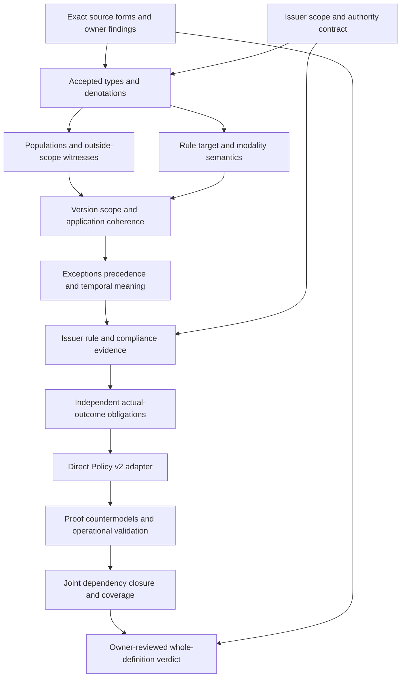

# Policy: complete candidate-delivery review

This is a candidate typed interpretation with bounded model, source and current direct-carrier observations. Fresh replay and the final delivery audit establish the candidate seal; neither accepts whole source fidelity. The original types-and-logic REVIEW.md and its receipt remain unchanged as stage evidence. Source fidelity, owner acceptance, whole-definition proof, direct-carrier adapter acceptance, dependency closure and operational verification remain pending. The previous Parent-Instance packet is independently sealed and preserved. The episode goal remains active.

## 1. Exact selected definition

The source is cal.definition.policy@1.0.0-candidate.1, digest 04460c28fa56271c696786b882bf69e8327e2a22413d796add060f54db3ed660, under authority/definitions/candidates/0013-integrated-lab-definition-model/definitions/policy/v1/definition.json. C65 supplies its current admission. The interpretation selects these exact bytes. The source's historical source_refs still say candidate-unadmitted and carry no source-admission reference; this retained posture is separate from current Definition admission.

The source describes a versioned normative rule set issued within an exact authority scope. It constrains or requires decisions, Actions, lifecycle transitions, evidence or handling. Its boundary says it does not execute itself, grant authority beyond its issuer, prove compliance or replace a Decision. These statements establish a semantic characterization. They do not authenticate any real issuer, effective rule set or policy instance. POL-FINDING-010 retains the source-fidelity and closure gap.

## 2. Forms and source correspondence

The packet inventories 21 source units and maps 24 spans. Seven spans are encoded, six are explanatory, and eleven are deferred. The normative genus and its repeated applicability/boundary statement carry typed rule-set and scope guards. Repeated negative responsibility clauses carry role exclusions. The positive portion of the formal expression requires a governed identity or record and bounded scope.

The formal expression's non-entailment suffix remains a separate source query. Policy(x) =/=> authority_effect(x) means the definition alone cannot establish an authority effect. It is not translated as a universal claim that an independently authorized policy can never have an effect. The exact source excerpt is retained in source-query-obligation.json. The three source testable conditions and historical claim ceiling are observation-measurement clauses. Character accounting is complete; complete accounting does not mean every semantic obligation has been translated or accepted.

## 3. The type model

There are eight nonempty sorts: Entity, RuleSet, Version, Issuer, Scope, Rule, Target and Token. Entity carries candidate Policy subjects and an explicit outside-policy subject. RuleSet, Version and Issuer remain distinct so that a name or owner handle cannot become the whole policy. Scope carries separately declared policy, issuer and governed target scopes. Rule and Target make application and modality relations explicit. Token carries reference handles without resolving them.

The 65 declarations comprise eight sorts, one constant, twelve total functions, 38 unary predicates, five binary relations and one ternary relation. The empty Token is a reference-presence sentinel. Nonempty handles do not demonstrate authenticity. Total functions supply candidate maps even for outside-policy subjects, but governing constraints apply through Policy guards. POL-FINDING-001 concerns the genus maps; POL-FINDING-002 concerns governed identity or record. A same-handle witness keeps two Policy entities distinct, so printed references cannot silently collapse identities.

The function inventory is deliberately small: policyRuleSet, policyVersion, policyIssuer and policyScope connect an Entity to its declared semantic components. issuerAuthorityScope supplies the issuer's declared scope reference. versionHandle, issuerHandle, scopeHandle and policyIdentityHandle carry presence-tested Tokens. ruleSetVersion checks consistency between the selected rule set and version. ruleScope and targetScope support explicit containment guards. These twelve functions are proposed denotation maps. Their types make category errors rejectable but cannot authenticate the values. An ill-sorted function result is different from a well-sorted unsupported permission claim. The malformed-model controls exercise the first distinction, while independent actual-outcome controls exercise the second.

## 4. Versioned rule sets and declared issuance

Policy is characterized by three declaration markers: versioned normative rule set, issuance within an exact authority scope, and constrain-or-require responsibility. Each Policy binds its RuleSet, Version, Issuer and Scope. The bound RuleSet's version agrees with the Policy version. ExactVersionDeclared, DeclaredIssuer, ExactScopeDeclared and ExactIssuanceDeclared are candidate predicates. Required reference handles are nonempty.

This is deliberately a declaration model. EffectiveVersionVerified and IssuanceAuthenticated remain independent external targets. A declared version is not a verified effective period or an accepted successor selection. A declared issuer is not an authenticated principal or a verified grant. POL-FINDING-003 retains effective periods, revocation, successor selection and temporal currentness. The current logic contains first-order formulas and equality, not a temporal transition system.

## 5. Scope containment without automatic authority

ScopeWithinIssuer relates the declared Policy scope to its issuer's authority-scope reference. Its denotation is pending. No inclusion of mathematical sets is silently imported, and no actual issuer grant follows from the relation. ActualIssuerAuthorityVerified is an independent target with a supplied countermodel.

ScopeWithinPolicy separately relates a rule or target scope to the governed Policy scope. This avoids requiring every governed subject to use an identical scope token. Positive controls permit explicitly declared narrower rule and target scopes. Negative controls use an outside scope with no declared containment. Actual authorization still requires accepted scope maps and issuer evidence. POL-FINDING-004 records both containment relations and the missing authority denotation. Scope labels, repository permission, responsibility and owner labels cannot replace it.

## 6. Rules, modalities and target categories

DeclaredRuleApplication relates an Entity, Rule and Target. When the Entity is a Policy, its applied Rule belongs to the selected RuleSet; its rule and target scopes are declared within the Policy scope; the Target has an appropriate source category; and the Rule constrains or requires it. Constrains and Requires are binary declaration relations.

A Rule may both constrain and require. No exclusive modality taxonomy is invented. The five target predicates correspond to decisions, Actions, lifecycle transitions, evidence and handling. They may overlap, and a positive control explicitly allows overlapping categories. Not every Policy is required by T to govern all five categories. The supplied required populations demonstrate that examples are possible for every named category. POL-FINDING-005 retains the absence of executable or complete deontic semantics; POL-FINDING-006 retains category interpretation and overlap questions.

The first-order fragment supplies conjunction, disjunction, negation, equality, universal and existential quantification. It does not supply an obligation operator, defeasible priorities, permissions derived from prohibitions, or a modal accessibility relation. In particular, Constrains(r,t) and Requires(r,t) label declared normative responsibilities rather than evaluating whether a future action is obligatory in every possible world. A later deontic formalization must define conflict treatment, exceptions, precedence and the relation to actual Decisions before importing such inference rules. A policy example requiring admission evidence cannot justify arbitrary enforcement authority. The source's five targets also do not settle an exhaustive taxonomy of every Artifact or a hierarchy among target categories.

## 7. Nonempty populations and vacuity

T alone can characterize declaration markers without proving a real normative application. Twelve required populations therefore include a Policy, a Policy without any actual outcome, an applied normative rule, constrain-without-require and require-without-constrain examples, an outside subject despite authority-like signals, distinct Policy identities with equal handles, and witnesses for all five target categories.

These are supplied nonvacuity and limitation examples. They are not universal rules that every policy must match the same complete example. A control clearing the application relation satisfies T but fails the required populations. Another removes the handling application and exposes the missing category witness. POL-FINDING-007 retains actual applicability, evidence sufficiency, compliance and population acceptance. This separates a logical witness policy from an assertion about real users or an activated Policy instance.

## 8. Role boundaries and actual outcomes

SelfExecutingRole, IssuerUnboundedGrantRole, ComplianceProofRole and DecisionReplacementRole are excluded for a Policy. This interprets the boundary as a restriction on what the definition supplies. Independently authorized actual execution and adoption are not globally prohibited.

T does not establish ActualAuthorityEffect, ActualIssuerAuthorityVerified, ActualIssuanceAuthenticated, ActualEffectiveVersionVerified, ActualExecution, ActualCompliance, ActualDecisionAdoption, ActualPolicyAdoption, ActualRelationAdmission, ActualExternalEffect, ActualOwnerFidelity or ActualConsumerAlignment. All twelve have countermodels. SameHandles-not-PolicyIdentity is the thirteenth query. Positive controls can change an actual-outcome flag without invalidating T, demonstrating that the declaration theory and actual outcomes remain independent. POL-FINDING-008 retains role/outcome meaning and permission questions.

## 9. Independent supplied models

The verifier evaluates 53 controls: 21 satisfy T, 25 falsify T, and seven are rejected as malformed. The base model has three Entities, two RuleSets, two Versions, two Issuers, three Scopes, five Rules, six Targets and three Tokens. Two distinct Policy entities use equal reference handles. A third Entity has responsibility, repository-permission, owner-label and rule-reference signals while remaining outside Policy.

Five applications demonstrate the source target categories with both modalities. The narrower-scope controls, overlapping-category control and dual-modality control are accepted. Missing genus markers, normative rule sets, exact issuance bindings, nonempty handles, scope containment, target categories or modalities produce logical failures. Malformed tests separately cover missing total-function entries, ill-sorted values/constants, wrong relation arity, duplicate tuples and empty domains. All thirteen queries have T/I countermodels; none is assumed in T. These are finite supplied evaluations rather than mechanized whole-definition proofs.

## 10. Actual source and direct carrier observations

Fifteen actual source checks bind the exact C65 selection, registry row, recorded authorization bytes, retained source posture, schema/generator digests, two pure renders, external query excerpt and observation-role disposition. The two Definition projections agree at 4,399 bytes and digest 6943656b4939bdbce1fb5f57aef56953b10cd5cf45dc91ba63dbf4834f714dbc. The renderer did not mutate source or execute a materialization writer.

A direct current carrier exists: cal.artifact-type.policy/v2, admitted under C74A and bound to this current Policy definition. Its artifact digest is b5a898fba8c59e41700cbcf21c6fd1ad03d2b5af15ac6fbfd27b78a28c425e0c; schema digest is acebd41016dcbe7a68fde3603fa3f41e4dd891be6186e4194f8faa53e9ca9fb4. Its retained body remains candidate-unadmitted with authority effect none. The source checker observes this separately from the admitted-current overlay. POL-FINDING-009 covers the missing accepted adapter. Current carrier availability cannot be reported as a gap; actual adapter fidelity remains a gap.

The authority profile independently evaluated 27 qualification envelopes, with 25 expected rejections. Changes to identity, kind, carrier, owner scope, source, rule set, version, issuer, governed scope, rules, targets, exception route, effective period or relations require a new qualified disposition. Eleven additional flags reject unsupported inferences from labels, schema, evidence, relation membership, source admission or non-entailment wording. Twenty-five declared frames include 20 rejections. The positive frames allow constrain-only, require-only, both modalities, overlapping target categories and a declared narrower scope. These are hypothetical declaration checks; they are not actual policy events.

There are 16 actual catalog and role-source observations, 30 Definition/v1 schema probes with five acceptances, and 44 direct Policy/v2 probes with thirteen acceptances. Two shape-accepted probes fail declared role membership. One uses relation.challenges with source direction and an admission-transaction counterpart. The other uses relation.violates with source direction and a Policy counterpart. Each component passes an individual schema enum, but the triple is absent from the carrier's allowed roles. The checker extracts only the pure roles_for function from the digest-bound validator source through AST and compares the exact role surface. It does not execute validate_package, which would write a carrier receipt.

Other accepted shapes contain unresolved issuer, scope, exception, effective-period and rule references; an active lifecycle label; empty evidence references; or overclaimed compliance text. The schema also accepts a whitespace-only effective-period string because its stated condition is a minimum string length. These are actual observations of this schema's claim boundary, not proofs about how an independently reviewed consumer handles those values. Recorded Policy/v2 admission remains current while the retained artifact still contains historical candidate residue; the checker observes both without rewriting either.

## 11. Carrier and operational work still downstream

Policy/v2 closes fourteen root fields and five payload fields, including issuer reference, governed scope, nonempty rule references, exception route and effective period. Its relation surface names challenges, governed-by, successor-of and violates. Shape admission does not authenticate every issuer reference, validate actual effective periods, settle exceptions, execute rules or prove compliance.

The generic Definition/v1 source shape, Policy/v2 instance shape and typed logical interpretation are separate surfaces. A reviewed adapter must map them explicitly, including scope containment, rule modalities, categories, identity, owner and evidence. The source checker binds exact carrier bytes. The independent profile adds direct-carrier schema probes and a pure role observer, without executing a carrier package validator, generator writer, runtime, consumer or governance event. Dependency/joint inventory observations, six-check full replay, finalization and the separate preservation audit are recorded by this delivery's receipts rather than inferred from the earlier stage.

The remaining ten source findings have separate owner routes and are explicitly unresolved. A reviewed adapter needs an issuer identity map, actual issuer scope/grant evidence, a version/effective-period map, rule and target denotations, conflict/exception policy, and exact relation-role treatment. For every proposed actual implication, identify whether the source supplies it and whether the proof needs static, temporal, deontic or operational evidence. A field-presence validator cannot substitute for a missing semantic map. The theory deliberately permits declared policies whose actual authority, compliance and execution flags are false, so later claims must add independent premises rather than reinterpret earlier positive controls.

## 12. Completion DAG with types and logic first

Source and issuer review can proceed independently, but both precede accepted denotations. Types then support parallel population and rule semantics work. Coherence precedes temporal and exception semantics. Evidence and explicit outcome obligations precede the carrier adapter and operational validation. Joint closure requires accepted common meanings rather than a list of individual finite models. The final verdict requires source-owner acceptance; a sealed candidate packet cannot supply that decision.

| Completion node | Input requirement | Deliverable needed to close the node |
|---|---|---|
| S | Exact selected source | Owner treatment of ten findings and full clause precedence |
| A | Issuer and governed scope responsibilities | Accepted authority grant and containment contract |
| T | S and A | Reviewed types and denotation maps |
| P | T | Accepted required and outside-scope witness policy |
| R | T | Rule modality and target category interpretation |
| C | P and R | Consistent version, issuer, scope and application bindings |
| H | C | Exceptions, priority, effective period and revocation semantics |
| E | H and A | Independently verified issuer, rule and compliance evidence |
| Q | E | Explicit actual-outcome obligations and claim ceilings |
| B | Q | Reviewed mapping to the direct Policy/v2 carrier |
| V | B | Appropriate proofs, countermodels and operational checks |
| J | V | Accepted common dependency meanings and coverage |
| F | J and S | Source-owner whole-definition verdict |

The completion schedule has thirteen nodes and fifteen edges and is acyclic. Its edges express prerequisites, not measured implementation progress. The declared semantic dependency graph can contain cycles, unlike this schedule. A cycle review must classify the intended recursive or shared meaning independently. Mere graph reachability cannot establish joint semantic consistency, and independently supplied finite models are not a single common model. Source-owner acceptance remains a distinct final gate even after bounded replay succeeds.

## 13. Preservation and continuation

Preflight verified absence of the new unit, A04/C01/E02 receipts, exact source/currentness, 201 source files and 5,152 preserved Parent-Instance delivery files. Author, builder, model and source producers exited zero, and the profile producer additionally exited zero. The types-and-logic replay reruns the contract, model and source checks independently and records actual terminal outcomes. It is a three-check stage replay, not the pending six-check complete-delivery replay.

The new current inventory independently reevaluates one supplied T/I witness for each of64 partial drafts,leaving119 current identities without a draft. It observes1,458 source units,1,968 mapped spans,623 encoded,508 explanatory,837 deferred,698 required populations and2,780 unresolved populations. The joint graph has123 nodes,1,507 edges,59 missing counterparts and one unresolved63-member component with1,034 internal edges. These observations do not supply a common meaning-aligned model or semantic closure. Owner-accepted whole translations and whole proofs remain zero in the last sealed inventory. All interpretations keep source_fidelity pending and authority effect none. The full episode denominator remains 183 current identities and 189 admitted source versions.

After Policy's fresh checks,finalization and separate delivery audit,proceed to Root-Axis Independence Invariant. Responsibility already has a source-current earlier sealed packet with39 model controls and six passing replay checks. The preflight/types-stage route to Responsibility is preserved as historical evidence and explicitly corrected in ROUTING-CORRECTION.md. Responsibility requires its own obligation type despite a retained Authority Claim tuple. Root-Axis Independence requires explicit governance coupling without importing statistical independence or consistency. The full existing foundations-first task and SWU scope remains in force, with subsequent missing definitions selected from the current snapshot. Continue independent typed drafts while owner and whole-proof obligations remain explicit.

The initial inventory route correction is preserved under attempts/001-next-route-correction with exact input/output hashes. Its model witnesses,counts and graphs are unchanged. Fresh replay must independently confirm the corrected Root-Axis route before finalization.
