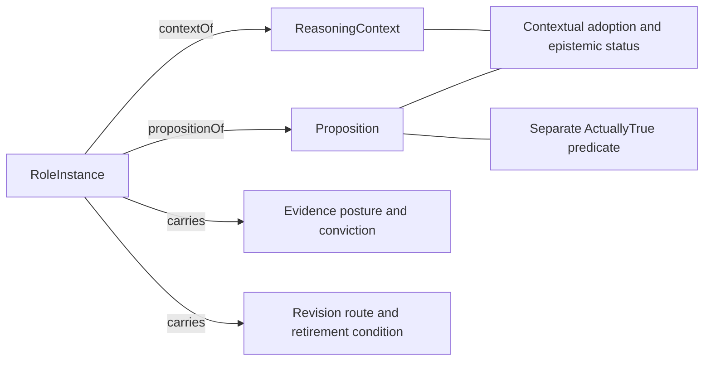

# Premise: formalization review

Candidate progress, 2026-10-08. Authority effect: none. `F01-T.cal.definition.premise` has a verified **partial** contextual working-role interpretation, with required carried metadata and a separate conditional-reasoning illustration. Full translation, fidelity, semantic closure, lifecycle, population policy and actual proposition interpretation remain pending. The episode retains 183 current identities and 189 admitted source versions.

The selected source is `cal.definition.premise@1.0.0-candidate.1`, SHA-256 `e4e87dfa32d8bd264caa3f40c5414e299a0808cbd4d29df0341f5b52d20f57d0`, from the admitted reconstruction pipeline. Its 24 selected string units are accounted through forty exact character spans: nine encoded, nine explanatory and twenty-two deferred. Source coverage and static typing do not certify complete meaning preservation.

## 1. Definition, role, proposition and assumption

The Definition/v1 document defines what a Premise is. A Premise role describes a working proposition deliberately adopted so work can proceed without claiming established truth. The represented proposition and the selected assumptions of a reasoning episode are additional layers. Defining the concept does not assert every represented proposition as a theorem.

The target-specific normative statement and inherited formal conjunction agree on deliberate adoption, unestablished status and defeasibility. Unlike the sibling Hypothesis source, no contrary primary working/adoption meaning is selected here. Nevertheless, the sibling's `FID-HYP-001` precedence finding remains unresolved; translating Premise does not settle that source conflict.

The primary interpretation's selected-assumption list is empty. `AdoptedToProceed(p,c)` describes a contextual working status in the metatheory. It does not evaluate p's content or add that content as a formula to this metatheory. A separate reasoning context must explicitly select the proposition, its exact interpretation and any rules used for conditional inference.

`PRE-ROLE-001` retains carrier and assumption-selection review. A recorded adoption is also distinct from an authenticated project event or an authority promotion. The candidate model supplies no live adoption record or owner decision.

## 2. Typed signature and contextual status

The signature has 26 declarations: seven nonempty sorts, two total functions, eight unary predicates and nine binary relations. RoleInstance, Proposition and ReasoningContext separate the working role, represented content and context. EvidencePosture, ConvictionPosture, RevisionRoute and RetirementCondition are abstract carriers for four source-required metadata fields.

`propositionOf : RoleInstance -> Proposition` and `contextOf : RoleInstance -> ReasoningContext` are total within the selected mathematical structure. Contextual statuses apply to that exact associated proposition/context pair. A status assigned only to another context cannot satisfy this role's adoption or defeasibility condition.

These sorts are candidate mathematical carriers. They do not select Artifact Types, storage paths, numeric scales or executable route languages. A positive model uses the same proposition in different working/investigation role instances and contexts. This demonstrates compatibility of the local partial vocabulary, without proving actual cross-source carrier alignment or canonical role compatibility.

Four malformed controls reject an ill-sorted context accessor, a missing total-function row, a malformed revision-route relation and a duplicate Premise tuple. Totality here is limited to model functions; no serializer, runtime registry or proposition interpreter is proved correct.

## 3. Working conditions and carried metadata

Premise implies `AdoptedToProceed`, absence of `EstablishedTrue`, and `Defeasible` for its associated proposition/context. The target-specific clause additionally requires at least one HasEvidencePosture, HasConviction, HasRevisionRoute and HasRetirementCondition witness attached to that role.

This preserves all four fields explicitly required by the target statement. Nonempty metadata sorts alone are insufficient: a value must actually be related to the Premise role. Controls reject missing fields and fields attached only to an unrelated role, even though appropriate value carriers still exist.

Presence is not metadata correctness. The candidate does not infer the evidence's reliability, a conviction value's scale, a revision route's reachability, or a retirement guard's evaluation. It permits multiple values because source cardinality and uniqueness contracts remain unresolved. No uniqueness requirement is silently supplied by a generic record convention.

`PRE-METADATA-003` retains exact admitted carrier contracts, policy contents, cardinality and behavior. This draft characterizes necessary conditions, rather than asserting a complete membership biconditional or a fully operational constructor.

## 4. Establishment, truth and typicality

EstablishedTrue is contextual epistemic status; ActuallyTrue is a separate predicate on Proposition. The explicit formal source negates the former for a Premise. It does not require actual falsity. A checked positive structure assigns actual truth while retaining unestablished working status.

This model's assigned truth is hypothetical, not an observation. Likewise, a countermodel with ActuallyTrue false demonstrates non-entailment under the candidate theory; it does not establish that any live project proposition is false. Missing or unknown evidence in a real workflow requires its own information-state contract and cannot be interpreted as actual world falsity by default.

The source says characteristically or typically low veracity, and often high conviction. Those qualifiers are retained rather than turned into universal values. Separate controls permit high conviction alone, low veracity alone, both, and neither while preserving the selected working conditions and carried metadata. No frequency distribution or numeric confidence system is fabricated.

The metadata carrier ConvictionPosture does not itself force the relation ConvictionHigh. Mapping a carried value to a quantitative or qualitative status is another contract. `PRE-STATUS-002` preserves this gap and the difference among commitment, epistemic establishment and actual truth.

## 5. Axiom, Invariant and Hypothesis boundaries

The explicit source boundaries exclude AxiomRole and InvariantRole on the same candidate role carrier. They also require LoadBearing and exclude DisposableHypothesis. Negative controls reject each incompatible tag independently.

These private tags are not imported predicates from actual counterpart translations. A common carrier and meaning agreement must be reviewed before claiming source-qualified type exclusion. Neither different nominal sorts nor shared names prove semantic distinction.

DisposableHypothesis is also narrower than every Hypothesis. The model does not universally exclude the private HypothesisRole tag from a working Premise. An investigated proposition may separately receive deliberate working adoption; the required distinctions concern roles and their contracts rather than automatically disjoint proposition contents. Compatibility in this partial structure is not a theorem about the completed actual Hypothesis/Premise theory.

The four metalevel queries ask whether Premise membership entails actual truth, high conviction, low veracity or HypothesisRole membership. A joint T/population model falsifies all four. These are four query outcomes from one independently checked countermodel, with targets outside T. They do not prohibit those properties in other models or settle alias equivalence.

## 6. Conditional reasoning illustration

The auxiliary reasoning interface retains the exact primary clauses and population selection. It extends only the signature with ContentA and ContentB. These are synthetic atoms for an illustration; neither is bound to actual source proposition content or an owner-selected assumption.

The example separately selects A and the candidate rule `A implies B` as a hypothetical conditional premise set, then checks consequence B. The validity target is `(A and (A implies B)) implies B`. It is queried outside primary T, and neither A nor the candidate rule is added to T's selected-assumption list.

| A | B | A implies B | Both conditional premises hold | Validity target |
| --- | --- | --- | --- | --- |
| false | false | true | false | true |
| false | true | true | false | true |
| true | false | false | false | true |
| true | true | true | true | true |

Independent denotation checks all four Boolean assignments for this two-atom method illustration. Every row also satisfies primary Premise metadata and its required populations. Only the final row satisfies both conditional premises. The first row is a countermodel to an unconditional conclusion B, even while the rule holds.

This distinguishes conditional inference from proving the working assumption true. A derivation under selected premises supplies a consequence conditional on those premises; it does not establish that the actual world satisfies them. The source Definition supplies neither an actual A nor an actual implication rule. No project reasoning context, content interpreter, independent rule justification or promotion evidence is fabricated.

The truth table covers the complete Boolean assignment set of these two synthetic atoms. It is not enumeration of the entire many-sorted first-order theory, native-provider search, a Lean theorem, or a whole-definition proof.

## 7. Nonvacuity and semantic closure

Eight required population obligations cover a hypothetical Premise, LoadBearing, the same role's adoption and defeasibility, and its four carried fields. A vacuous empty Premise extension can satisfy the directional theory while failing these obligations. An unrelated role cannot satisfy the metadata witness requirements.

Nine auxiliary populations remain unresolved: role and statement tags, actual truth, establishment and typical veracity/conviction values. No real axiom, invariant, truth instance, owner exemption or mandatory high-conviction state is invented. Required inhabitation is hypothetical logical evidence, not a live-instance audit.

Seven authored direct uses bind Definition, Axiom, Invariant, Hypothesis, Authority Promotion, Evidence and the exact D23 Governance-Axis Independence Invariant source. There is no manufactured separate Conviction or Veracity Definition identity. Use-site links provide provenance rather than automatic theory import or semantic alignment.

Including the available partial Axiom, Definition, Hypothesis and Invariant packets yields nineteen nodes and thirty edges; fourteen counterparts remain missing. The graph retains one component containing Premise, Hypothesis, Axiom and Invariant, with nine internal directed edges and unresolved cycle classification. Contrasts and grounding references require joint review. They do not establish an inductive construction, least fixed point, contradiction or consistency theorem. The edge denominator still requires independent completeness review.

## 8. Lifecycle and provisional grounding

Promotion, revision and retirement are evidence-gated lifecycle obligations. A carried revision route and retirement condition do not supply an executed transition, checked guard, preserved consumer, or owner authorization. Conviction alone never becomes a promotion event.

The source's may-complement and stand-alone alternatives, provisional grounding of invariants/rules, and hedge-marker classifier remain explicit deferred clauses. They need proposition and workflow bindings, selected authority scopes and behavioral checks. A lexical marker in a candidate axiom cannot automatically rewrite the current source registry or every proposition carrying a Hypothesis label.

`PRE-LIFECYCLE-004` and `PRE-GROUNDING-005` retain those operational contracts. The candidate does not assume preservation, live revision or valid retirement merely to obtain a passing static theory.

## 9. Actual source and admission evidence

Thirteen read-only checks pass for the selected identity, schema/generator digests, actual Definition/v1 schema, deterministic rendering, exact projection, selected legacy section, source admission, registry selection and sibling identity distinction. The projection has 7,996 bytes, SHA-256 `1774f3cb50c0aaf0e9d53548ad8ea7b307516440dc8a49fb138f2bde3d79175d`.

The bound extractor selects 4,648 bytes for CAV2-D55, SHA-256 `03beeea979f731ec26bca412cab385eedf9bda012ea7517f827442963204aef6`, using its recorded unique-heading/trailing-whitespace policy. Decision `CAL-DECISION-0053-FULL-DEFINITION-QUEUE-ADMISSION` binds the exact source-admission record admitting that selection for the two distinct Hypothesis and Premise targets. Shared source bytes do not merge their IDs, terms or record digests.

The current registry source is admitted through that separate decision overlay; historical candidate wording is preserved in the artifact. Source acceptance does not approve this interpretation or settle the sibling precedence question.

The checked local Definitions copy under `/home/vlad_/projects/cyberAlchemy-v2` matches the admission-time complete-file digest. The producer's declared Definitions file under `domainspec-core/cyberAlchemy-v2` remains absent. Content matching does not authenticate repository identity or live routing/currentness. The source-digest condition therefore remains PARTIAL for live-source currentness. No producer configuration or external source was changed.

## 10. Verification strength and remaining work

Thirty-two authored model controls, four separate countermodel outcomes, four conditional truth-table rows, thirteen bounded source checks and the dependency graph are reproducibly verified. Fresh replays retain the outcomes. All 201 captured source/provenance files, the selected external file and all 925 predecessor candidate files are rechecked.

Twenty-two source clauses, five findings, nine population policies, fourteen counterpart packets, semantic cycle meaning, metadata contracts, lifecycle, proposition-content interpretation and source-owner fidelity remain unresolved. No exhaustive first-order absence result, actual world truth, native-provider enumeration or unbounded theorem is claimed. The task stays PARTIAL. Schema and Semantic Primitive are the remaining independent drafts in this foundational family; whole-episode completion and its complete final aspect review remain pending.
