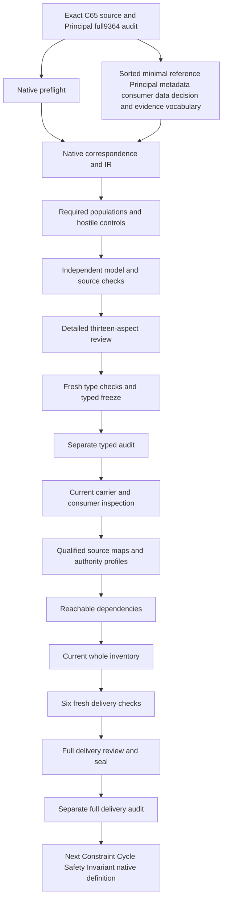

# Principal Reference: complete candidate delivery review

Principal Reference is formalized as a minimal governed reference to one Principal for accountability or authorization linkage. It preserves minimum stable identifier,kind,issuer or registry,resolution route and integrity data needed by a consumer. A reference resolves by declaration to one governed Principal or is explicitly unresolved. The Principal retains identity authority;the reference does not copy,mutate,authenticate or replace it. Authority decisions require separate current grant evidence. No real identity resolution,credential access,authorization or grant is performed.

Native creation followed Principal's full9,364-file seal and separate actual audit0. All prior sealed files and201sourcebytes remain hash verified. Working native drafts now number102among183currentidentities,leaving81withoutT. Last completed whole inventory remains101partialdrafts82missing until this packet's full delivery. Original183identities189versions201sources and121tasks511planningedges797SWUs36frontiers stay fixed. Accepted whole translations and whole-definition proofs remain zero. Source fidelity,shared denotations and semantic readiness remain pending;the full episode and final review stay active.

## 1. Exact source and C65 admission

The selected source is cal.definition.principal-reference@1.0.0-candidate.1,SHA7ca6bd645843a17ac21936da623f7ccff6b011f4d7051ad6e4ffd19121b1a16e. Its current admission is CAL-DECISION-0065-INTEGRATED-LAB-DEFINITION-MODEL-ADMISSION. Exact selection fixes the positive meaning under interpretation. A nearby Principal,Person Reference,carrier schema,issuer protocol or actual credential is not substituted for this source.

Source checking binds C65 decision,authorization,candidate,selected Definition digest and validation receipt. Current183identity189versionsnapshot validation is separate from historical counts in an admission decision. Definition admission does not resolve a Principal,instantiate a reference,access a credential,execute authorization or accept this formal translation. Type and instance effects remain separate.

The retained source body stays review-only under its positive admission overlay. Its actor-model-review remains candidate-unadmitted with exact local bytes,and the integrated consumer remains an observed source path. No operational map or runtime activation follows. Private routing read-first references stay path/hash metadata only;their content and meaning are not imported into primary theory. Canonical meaning remains the exact selected Definition,while source precedence and correspondence need owner review.

## 2. Sorted signature and qualified vocabulary

Sixteen nonempty sorts are proposed:ReferenceRecord,PrincipalReference,StableIdentifierReference,PrincipalKindReference,IssuerReference,RegistryReference,ResolutionRouteReference,IntegrityReference,ScopeReference,ConsumerReference,ReferenceUseReference,DataFieldReference,AuthorityDecisionReference,GrantEvidenceReference,TimeReference and Token. ReferenceRecord is the reference under this Definition;PrincipalReference denotes its independently governed referent nomination. This distinction prevents a reference record from silently becoming the Principal.

Seven constants include EMPTY Token and six minimal data-field class markers. Eighteen selectors and fifteen reference-handle functions give33totalfunctions. There are150predicate/relation signatures and206declarations. Descriptive types and field classes do not create new canonical identities or authenticate real values merely from their names.

Every required selected field has a declared target,nonempty handle and exact BindingDeclared relation matching its selector. Totality supplies a well-sorted finite value without proving the referent exists or is authentic. Symbols are qualified by exact source version and candidate scope. Similar names across other packets do not establish common denotation or import their whole theories. Missing,conflicting,undeclared and empty selected nominations fail independently of real lookup and authority.

## 3. Minimal governed reference genus

ReferenceApplicable is equivalent to ReferenceInScopeDeclared. A selected record is governed,bounded and minimal by declaration. Identity-backed or record-backed criterion is inclusive. Accountability linkage or authorization linkage is also inclusive. A reference may support either purpose or both without becoming a permission or authentication operation.

The source's minimal governed reference genus is represented by necessary declaration structure. A minimal flag alone is insufficient to prove actual purpose,consumer need or data minimization. Those have independently queried outcomes. The formal governed_identity_or_record implication and positive reference genus require source-owner precedence correspondence. No unaccepted physical carrier or global identity registry is inferred.

A selected reference may have no modeled consumer use. Required populations preserve that case without pretending that the finite model enumerates every real consumer. References may share a Principal and may be used by several independently identified consumers. No universal reference uniqueness or one-reference-per-Principal rule is invented. This keeps the source's one nominated referent distinct from a global cardinality assumption or a claim that every reference is already resolved.

## 4. Exact minimum metadata and optional origins

Selected references nominate exact stable identifier,Principal kind,resolution route,integrity data and governance scope. Identifier and kind are separate from the reference record's identity. Route is separate from a running resolver. IntegrityReference is a typed nomination rather than a computed cryptographic digest or authenticated byte binding. Actual fidelity and availability remain independent outcomes.

Issuer or registry presence is inclusive:issuer only,registry only or both may hold. At least one alternative is declared. Exact optional issuer/registry fields are guarded only when present. A reference cannot replace a required origin with an empty token,but an unused total optional selector does not fabricate an issuer or registry.

Positive controls omit an unused issuer binding on a registry-only record and an unused registry binding on an issuer-only record. Empty outside handles are allowed where no selected guard applies. These controls preserve the source's alternative rather than demanding both origins universally. Actual issuer/registry authenticity and their relationship to Principal authority require accepted maps. Governance scope remains separately nominated and is not automatically copied identity data or permission scope.

## 5. Resolved versus explicitly unresolved

Every selected reference has exactly one of two declared states:resolved or explicitly unresolved. Neither state is missing and both cannot hold together. These necessary state declarations preserve the source's test that a reference resolves to exactly one governed Principal or becomes explicitly unresolved. Actual resolver behavior and current state fidelity remain independent.

Only declared resolved scope activates the exact referencePrincipal field. The nominated Principal must be governed and retain declared identity authority. It has exact stable identifier and kind coordinates that agree with the reference metadata. A mismatched identifier or kind fails. Missing,conflicting,undeclared or empty resolved-principal nominations also fail.

Explicitly unresolved references retain minimum metadata while their total Principal selector may remain unused,unbound or have an empty outside handle. This avoids creating an imaginary identity to make a failed lookup appear complete. No global injectivity of identifiers or referents is imposed. Actual Resolution,PrincipalIdentityFidelity,KindFidelity and PrincipalIdentityAuthority queries are conditioned on declared resolved scope,so their countermodels cannot rely only on an unrelated unresolved reference.

## 6. Principal identity authority and independence

The referenced Principal remains the identity authority. A resolved nomination requires PrincipalIdentityAuthorityDeclared as a positive necessary condition. ReferenceIsPrincipal and ReferenceBecomesIdentityAuthority declarations are excluded. The reference therefore cannot replace its referent simply because a stable identifier or kind label is present.

Copying a full Principal identity record,mutating the Principal,authenticating it or replacing it are separately excluded inference/effect declarations. A legitimate minimum identifier/metadata nomination is distinct from copying the identity record. Source-owner maps must explain how that distinction applies to real payloads and governance metadata. The candidate does not inspect or duplicate actual identity contents.

Equal identifier/kind tokens provide declaration coherence rather than authentic identity equivalence. Independently grounded real outcomes remain possible;the boundary does not universally deny them. Actual no-copy,no-mutation,no-authentication,no-replacement and identity-authority outcomes remain independent targets. A supplied record may satisfy all necessary reference declarations while those real outcomes remain unproved. No Principal authority is transferred or executed by the model evaluation.

## 7. Six data classes and bounded minimization

Six constants identify stable identifier,kind,issuer,registry,route and integrity data classes. Selected references embed identifier,kind,route and integrity classes. Issuer/registry embedding agrees exactly with their presence declarations. All embedded classes are declared minimal,declared present and one of the six source-coordinate classes.

Embedded classes declared secret,credential or excess identity data are rejected. Unknown or unsupported classes also fail. A selected stable-ID class newly marked secret or credential fails even if the other fields are coherent. These are safe symbolic controls;no real credential,secret or personal identity record is accessed or constructed.

This whitelist is a proposed correspondence for primary reference data. Scope,privacy posture,owner and lifecycle can be separately governed metadata rather than copied identity contents. Owners must accept the distinction and the real content-classification criteria. A six-class shape does not prove every actual value is necessary,safe or authentic. Actual NoSecrets,NoCredentials,NoExcessIdentityData and consumer minimality remain independent outcomes rather than conclusions from a field label or flag.

## 8. Consumer-needed data and shared references

A selected ReferenceUseReference nominates exact reference and consumer fields. It is recorded,and the consumer is recorded. ConsumerNeedsFieldDeclared agrees exactly with the reference's embedded data classes for each selected use. Missing needed data or embedding a class not needed by that consumer fails. This makes minimum consumer need visible rather than inferred from a general minimal flag.

A shared reference may have multiple selected consumers when their declared needs are compatible. Required populations demonstrate different consumers using one reference. The candidate does not impose globally one consumer per reference. The exact compatible-need interpretation is an explicit proposed operational map;different projections,purposes and retention requirements need source-owner acceptance.

ConsumerNeedFidelity,MinimumDataFidelity and DataClassificationFidelity remain independently queried on selected use scope. Root ConsumerNeedMinimality is conditioned on a reference with an actual selected use. An unused optional reference cannot supply its counterexample. No source-owner minimum-need decision is fabricated from a record shape. The model retains exact declared need/embedding coherence while leaving real necessity,privacy,consumer purpose and data absence unsupported.

## 9. No credential,secret or excess identity content

A Principal Reference is not an authentication credential. It contains no reusable credential and proves no Person identity,Role,Assignment or authority grant by declaration. ReferenceContainsSecret,ReferenceContainsReusableCredential and ReferenceContainsExcessIdentityData are excluded. Source tests that no secret,credential or excess identity data is embedded contribute explicit data guards.

The safe negative models use symbolic data classes such as secretField and credentialField. They do not retrieve real passwords,tokens or identity records. The candidate does not invent a universal secret detector or claim that a string passing a schema is harmless. Real absence requires appropriate classification and accepted consumer/source correspondence.

Reference privacy is therefore separate from identity resolution,integrity and authority. A minimal identifier can be coherent while its actual privacy classification is unresolved. A nonempty integrity token can be recorded without proving a digest or authenticating a Principal. No Principal or Person Reference semantics are borrowed to turn the reference into a credential. These distinctions keep structural checks and safe symbolic examples from being presented as successful authentication or a real data-minimization assessment.

## 10. Authority decision and separate current evidence

Each selected AuthorityDecisionReference nominates exact reference,grant evidence,scope and evaluation-time fields. The decision is recorded. The evidence is separately recorded,resolved and independent of the reference. It nominates a governed Principal retaining identity authority and an exact scope equal to the decision scope. EvidenceCurrentAtDeclared relates it to the decision's evaluation time.

A resolved reference's Principal must agree with the evidence Principal. An unresolved reference does not fabricate resolution merely because independent evidence names a Principal. CurrentAt is a relation rather than an invented chronological order or one-time evidence function. Real validity intervals,revocation,currentness and authorization remain separate outcomes.

Every selected decision requires independent current grant evidence rather than inferring it from reference presence. Denial/unresolved decision interpretations remain explicit owner-review questions. The model does not execute a decision or grant permission from the evidence label. Missing separate resolution,independence,currentness,scope or resolved-Principal agreement fails. Actual grant-evidence resolution,validity,Principal/scope/time fidelity,owner authorization and effects are separately queried on selected decision scope.

## 11. Reference noninference and independent outcomes

Root boundaries exclude treating the reference as Principal,Person Reference,Role assignment,authentication credential or authority proof. They also exclude inferred Person identity,Role,Assignment,authority grant and authority from the reference. Parent meaning and Definition admission cannot grant instance effects or accept this translation.

Use boundaries exclude proving minimization from a consumer-need label,copying identity records,embedding reusable credentials,authenticating Principals and creating permission from reference use. Decision boundaries exclude using a reference as grant evidence or deriving current validity,authority,permission,authentication or external effects from declarations. Selected scope is explicit across all three carriers.

Actual outcomes remain outside primary T and are not universally prohibited. Positive controls supply them independently while preserving necessary theory. Outside objects can carry excluded flags without violating selected-scope obligations. Reference linkage may coexist with independently governed decisions and grants,which require their own evidence. No real Principal is resolved,authenticated,mutated or replaced,no credential is accessed,and no grant,permission or external action is created by this candidate.

## 12. Source account,controls and scoped queries

All24nonempty source units have exact selector and complete-character correspondence. Sixteen clauses are encoded,six explanatory and two deferred. Twelve primitive formulas cover genus,metadata,origin alternatives,resolution,minimal data,use,decision and three boundary scopes. Scientific notation,plain-language intuition and the principal-ref:def-owner example remain explanatory. Authority-scope and retained candidate claim ceiling remain deferred correspondence.

The native suite passes261controls:106T-true,147T-false and eight malformed-input rejections. Twenty-six required populations demonstrate selected/outside,identity-or-record,issuer/registry,linkage,resolved/unresolved,shared use,separate current evidence and independent authority. T and I are evaluated separately. Empty selected scopes or absent demonstrations can preserve theory while failing the episode's required population coverage.

Forty-six queries have supplied T-and-I countermodels. Seven root targets are conditioned on resolved state,issuer/registry presence or selected consumer use. Use and decision targets remain separately scoped. Sixty-six exact source-query obligations bind selectors,spans,hashes and query IDs without actual targets in T. Prepared maximum is41,174steps under unchanged limits. Source checks bind exact C65,local review/consumer and two identical5116-byte pure projections without mutation. Bounded consistency and source accounting do not accept whole-source fidelity,common meanings or whole-definition proof.

## 13. Review,DAG and continuation

All prepared and native definition producers passed. Exact source,A04/C01/E02 prerequisites,work-unit output/write scope,prior full seal and prepared full signature/population/source-clause controls were checked before native creation. No output was treated as present before its producer ran,and no successful receipt was substituted for the current model/source checks.

An illustrative reference names a stable Principal identifier,kind,issuer and route without copying an identity record. A declared resolved state nominates a governed Principal;an explicit unresolved state leaves that field unused. An authority decision uses separate current grant evidence for its exact scope and time. Those declarations can satisfy T without proving actual resolution,privacy absence or permission. A counterexample embeds a credential class or omits current evidence;necessary guards fail despite nonempty reference labels.

The seventeen-node,seventeen-edge work DAG is acyclic and separate from semantic dependency cycles. Three fresh contract/model/source checks passed. Sixteen typed inputs are frozen and separately audited before current carrier/consumer mapping,qualified profiles,reachable dependencies,whole102draftinventory,sixfreshchecks,full review,seal and separate audit. Constraint Cycle Safety Invariant native creation follows that full Principal Reference audit. Working102/81 and last completed whole inventory101/82 remain separate until full refresh.

Twenty-one dependency meanings are separately qualified;their complete theories and authority are not imported. All9,364priorsealedfiles201sources and original183/189/201scope remain preserved. Owner acceptance,source fidelity,shared denotations,whole translation and whole proofs remain pending. Semantic readinessfalse;goalactive. The complete original episode and final aspect-by-aspect review remain required;this bounded typed packet cannot redefine success around a verified subset.
- PREF-FINDING-001: Exact C65 Principal Reference Definition admission does not create references,resolution,identities,credentials,grants or accept this translation. Status: unresolved;owner review and accepted map references pending.

- PREF-FINDING-002: Minimal governed reference genus is necessary declaration structure,not authenticated Principal identity or real consumer need. Status: unresolved;owner review and accepted map references pending.

- PREF-FINDING-003: Reference record and referenced Principal are separate types;identifier,kind,issuer,registry,route,integrity,scope,consumer,use,data field,decision,evidence and time are proposed qualified denotations. Status: unresolved;owner review and accepted map references pending.

- PREF-FINDING-004: Inclusive identity-or-record criterion and accountability/authorization linkage need source-owner precedence correspondence. Status: unresolved;owner review and accepted map references pending.

- PREF-FINDING-005: Stable identifier,kind,route,integrity and scope are exact proposed nominations;scope is separate governance metadata rather than copied identity content. Status: unresolved;owner review and accepted map references pending.

- PREF-FINDING-006: Issuer or registry is inclusive;exact optional fields are guarded only when declared present and unused selectors do not fabricate origins. Status: unresolved;owner review and accepted map references pending.

- PREF-FINDING-007: Resolved and explicitly unresolved states are mutually exclusive necessary declarations;actual resolver outcomes remain independent. Status: unresolved;owner review and accepted map references pending.

- PREF-FINDING-008: Only a resolved record requires exact governed Principal nomination and preserved identity authority;unresolved total selectors do not assert a referent exists. Status: unresolved;owner review and accepted map references pending.

- PREF-FINDING-009: Resolved stable identifier/kind agree with the Principal by declaration;actual identity/kind fidelity and alias equivalence need accepted maps. Status: unresolved;owner review and accepted map references pending.

- PREF-FINDING-010: No universal global uniqueness of references,Principals,identifiers or consumers is invented from one nominated referent. Status: unresolved;owner review and accepted map references pending.

- PREF-FINDING-011: Six minimal data classes are a proposed source-coordinate whitelist;governance metadata,privacy posture and actual data-classification maps remain unresolved. Status: unresolved;owner review and accepted map references pending.

- PREF-FINDING-012: Embedded field classes must be declared minimal and not secret/credential/excess;real content absence requires independent classification evidence. Status: unresolved;owner review and accepted map references pending.

- PREF-FINDING-013: Selected use matches reference data classes exactly to consumer-needed classes;a shared reference can have multiple consumers but this candidate requires compatible declared needs. Status: unresolved;owner review and accepted map references pending.

- PREF-FINDING-014: Actual minimality,necessity,retention,purpose and payload-versus-governance field distinctions are not established by flags. Status: unresolved;owner review and accepted map references pending.

- PREF-FINDING-015: Principal remains declared identity authority while copy,mutation,authentication,replacement and authority-proof inference declarations are excluded. Status: unresolved;owner review and accepted map references pending.

- PREF-FINDING-016: A Principal Reference is not an authentication credential,Person Reference,Role assignment or authority grant;independent actual facts remain possible. Status: unresolved;owner review and accepted map references pending.

- PREF-FINDING-017: Every selected authority decision nominates separate resolved/independent recorded grant evidence,currentAt time and scope;actual grant/evidence validity remains independent. Status: unresolved;owner review and accepted map references pending.

- PREF-FINDING-018: Evidence Principal agrees with a resolved reference;an unresolved reference does not fabricate identity resolution or automatically authorize a consequence. Status: unresolved;owner review and accepted map references pending.

- PREF-FINDING-019: CurrentAt is an evidence/time relation without invented timestamp order,clock validity or globally one-time evidence cardinality. Status: unresolved;owner review and accepted map references pending.

- PREF-FINDING-020: Source authority-decision meaning,including denial or unresolved cases,needs an accepted interpretation of separate current grant evidence. Status: unresolved;owner review and accepted map references pending.

- PREF-FINDING-021: Exact local actor-model-review and integrated consumer stay source evidence;no private routing content/meaning or real identity/credential data is imported. Status: unresolved;owner review and accepted map references pending.

- PREF-FINDING-022: Complete source character accounting and supplied finite T/I controls do not accept shared denotations,source fidelity,whole translation or whole-definition proof. Status: unresolved;owner review and accepted map references pending.

Actual native counts: {"countermodel_queries": 46, "declarations": 206, "deferred_clauses": 2, "direct_semantic_uses": 21, "encoded_clauses": 16, "explanatory_clauses": 6, "mapped_clauses": 24, "required_populations": 26, "source_units": 24, "unresolved_populations": 150}. Source checks: 95. Projection SHA: 01e32c85097fa339e2a91a2b153526e1139428b092839443cb99683ac7284cc6.

The preceding thirteen aspects preserve the frozen definitions/types/logic stage. The completed full delivery checks below add current carrier,consumer,dependency and inventory evidence. Their acceptance ceiling remains independent from the amount of candidate work. A whole source translation is not accepted by adding a consumer report,refreshing a graph or sealing exact bytes. The source owner still needs to review every proposed denotation,each necessary formula,its scope and retained residue. These are candidate delivery records with explicit limits.

For a resolved reference,the necessary path follows exact record metadata to one declared governed Principal. Identifier and kind match by declaration;Principal identity authority is preserved. This is a useful formal coherence test because substitution can be rejected before a real resolver is invoked. It remains an interpretation proposal:equal tokens do not authenticate an issuer or identify a Person. For an unresolved reference,the theory keeps the reference's minimum metadata without requiring a fictitious Principal binding. No modeled authorization success follows from retaining that record.

Current C70 PrincipalReference/v1 has a direct semantic binding to the exact C65 Definition. Its six required payload fields use nonempty-string shape. The bound schema requires issuer_ref;the source also permits registry-only origin. A whole registry-only hypothetical fixture fails shape when issuer is removed. There is no explicit registry_ref field to substitute. This discrepancy is a representation obligation rather than proof that the source forbids registry-only references. Owners may identify another representation or revise the carrier through its governance process;this candidate makes no such authoritative change.

The current carrier has no explicit resolution-state field. A hypothetical added resolution_state is rejected by its closed payload shape. That does not make every accepted fixture resolved. A source-owner mapping could refer to separately governed resolver state,evidence or validation records,but a map must name those carriers and their exact scope. The typed proposal's resolved/unresolved XOR is therefore not silently treated as an implemented resolver. Explicit unresolved references cannot acquire a valid Principal,identity authority or permission because a total selector returns a value.

Minimum-data and consumer-needed-data correspondence has the same boundary. Stable identifier,kind,issuer or registry,route and integrity classes are proposed source coordinates. Actual field values require classification and need evidence. A privacy_posture string is not an absence proof;no actual personal record or secret is inspected here. Symbolic secret/credential classes are hypothetical probes. The carrier accepts safe symbolic strings in those positions even when primary logic rejects the corresponding forbidden declaration. The two surfaces establish different things and require an accepted map before operational conclusions.

A reference shared by several consumers is preserved in the typed theory when the declared needs are compatible. This avoids inventing one-reference-per-consumer cardinality. It also leaves an owner question:should separate consumer projections be represented as distinct records,views or use relations? The current inspection does not install such a projection or determine real retention,purpose and necessity. Exact needs and embedding are declared relations;actual minimality and classification remain separately queried outcomes. A source-owner decision must connect those relations to real consumers before broad privacy assurances.

Separate current grant evidence has exact evidence Principal,scope and time coordinates. Those coordinates are independent of reference identity,issuer,registry and governance scope. The positive model permits evidence current at additional times and distinct reference/decision scopes. The relation currentAt is not a clock or timestamp ordering implementation. AuthorityClaim and Delegation provide separately admitted claim/delegation shapes. Opaque period,scope and revocation strings do not prove currentness or applicability. Evidence resolved independently from a reference still needs accepted meaning and authorization review.

All eight compared carriers keep their own exact current meanings. The fixture set is not a joined identity or authorization instance:PrincipalReference's target differs from Principal's node;Principal's subject differs from PersonReference's node;Delegation's delegator and eligible agent differ from the independent Principal and AgentInstance fixture nodes. A hypothetical joined fixture could be proposed later with owner-reviewed bindings. Equality of labels alone would still not demonstrate recognition,resolution,current grants or authority. Current byte verification never supplies missing operational joins by inference.

The C70 decision's only ordinary artifact instance is its exact integrated Governed Model. Consumer activations,runtime activations and typed-relation-instance admissions remain zero. The exact authorization,bundle and proposal hashes are checked. Reading independently valid fixtures does not admit them as ordinary instances. This also separates Definition meaning admission from Artifact Type contract admission and from acceptance of the candidate formalization. The candidate preserves exact current overlays while retaining candidate-unadmitted carrier bodies and review-only source material.

The qualified profile suite has32cases with31rejections. Its115finite source-map frames have114rejections,and36map obligations retain empty accepted-map references. These are explicit qualification hypotheses:changing source,scope,role,authority effect,denotation facets or acceptance state is rejected. They prevent the proposed map from claiming issuer authenticity,real resolution,privacy absence or current grants solely from labels. They do not create actual owner acceptance. Eight unresolved consumer findings and twenty-two unresolved source findings remain visible and separately identified.

Reachable dependency checks select100existing packets and observe142nodes,2501declared edges,42missing counterpart packets and one unclassified semantic cycle. The work DAG remains17nodes17edges and is acyclic. A semantic dependency cycle does not become a work-order cycle and is not automatically harmless or contradictory. This packet supplies21direct semantic uses without importing their whole theories. The next Constraint Cycle Safety Invariant explicitly distinguishes value constraints,cycle permission,acyclicity and reviewed exceptions;its future interpretation cannot be used now to approve the existing semantic cycle.

The current whole inventory freshly evaluates one supplied qualified T/I model for every102partial drafts. Original183currentidentities189versions201sourcefiles remain fixed,with81identities lacking a native T. That is candidate coverage,not source-owner acceptance. No common-denotation combined model or whole-definition proof is obtained by composing these counts. All prior9,364sealedfiles remain hash verified. Historical I04 and the Principal101/82inventory retain their exact evidence;this packet's new102/81report is a separate current observation.

Fifteen adversarial/differential checks qualify process-local reuse of static snapshot verification. Only exact canonical serialized snapshot equality permits reuse. Live repository verification,source/correspondence/IR evaluation and each supplied T/I model still execute. Shared sealed validators remain unchanged. Six fresh actual checks cover contract,model,source,profile,dependency and inventory,with successful terminal exits and matching native observations. An earlier join was attempted before dependency/inventory captures existed and failed1 with FileNotFoundError;its stdout,stderr and result are retained. It executed no replacement check and created no successful result or seal. The completed join follows actual evidence from all six checks. The fresh current carrier comparison also exits zero. Byte preservation and consistency controls provide review evidence rather than a mechanized theorem of the source.

One technical failure occurred while persisting an already-successful ARE continuation receipt:incorrect quoting caused Python SyntaxError before creating the file. The actual exit1,reason and recovery are retained in prepared evidence. The exact returned request/result was saved through apply_patch;the ARE gate was not rerun and no native,typed,consumer,profile,source or model producer failed. This serialization failure did not grant authority or change source bytes. It remains distinct from the initial and current native producers' actual successful results.

The next source-only packet checks exact current C53 Constraint Cycle Safety Invariant. Seventeen checks preserve22sourceunits and two identical6905-byte projections. Its embedded CAV2-D28 provenance is metadata;upstream byte currentness and source-owner interpretation remain pending. No next native T,model,edge promotion or actual constraint effect is created. Native creation requires this Principal Reference full seal and separate audit0. The complete original episode and final aspect-by-aspect review remain active after this bounded delivery.

# Principal Reference current carrier and consumer review

The exact C65 Principal Reference source is compared with the currently admitted C70 PrincipalReference/v1 contract. Eight separate PrincipalReference,Principal,AuthorityClaim,Delegation,Person,PersonReference,Team and AgentInstance contracts retain their own current meanings. Twenty-two selected Definition meanings are read separately without importing their complete theories. Current143contractrows contain121current entries. The direct PrincipalReference binding differs from Principal identity and from an authority claim or grant. Shape checks use hypothetical copies and three isolated pure Definition projection helpers. No package validator,writer,resolver,credential provider,authorization evaluator or live consumer executes.

The independently captured inspection passes117checks,53Definitionprobes with14acceptances,407wholecarrierprobes with87acceptances,and21separately evaluated T/I comparisons. These controls distinguish schema structural acceptance from source-owner mapping. Definition prose can assert authentication,authority,resolution or privacy absence and still satisfy the carrier schema. The proposed reference selectors are rejected as unsupported root fields,which prevents accidental structural extension but does not establish correct meaning. Exact schema bytes,artifact bytes,fixtures,C70 decision,authorization,bundle,proposal and selected C65/currentness sources are bound.

PrincipalReference/v1 requires six nonempty payload strings:principal_ref,principal_kind,issuer_ref,resolution_route,integrity_digest and privacy_posture. It has no explicit registry_ref,resolution_state,consumer_needed_fields or current_grant_evidence_ref field. Removing issuer fails schema shape,while adding registry-only or explicit-unresolved representations is unsupported. The source permits registry-only origin and explicitly unresolved state. This comparison records an unresolved representation question rather than changing the admitted schema or narrowing the positive Definition. External governance records or accepted maps may represent these meanings;no such map is claimed here.

The carrier accepts an arbitrary nonempty kind token and symbolic identifier,issuer,route,integrity and privacy tokens. A non-hash integrity token does not compute or authenticate a digest. Wrong Principal and kind tokens can preserve shape without real resolution. Safe symbolic secret/credential class labels demonstrate that nonempty-string shape alone does not classify contents;no real credential or identity record is accessed. Privacy posture does not prove no secret,reusable credential or excess identity data. The six proposed source data classes and consumer-needed relation require accepted classification,purpose,minimization and payload-versus-governance metadata correspondence.

Principal,Person,PersonReference,Team and AgentInstance remain independent identity and subject contracts. Principal recognition boundaries may be an empty list. PrincipalReference's Principal target does not match the separate Principal fixture node,Principal stable-subject reference does not match the PersonReference fixture node,and Delegation's delegator and eligible-agent references differ from the independent Principal and AgentInstance fixture nodes. Reading valid fixtures does not join them or nominate a real resolved reference. Principal retains declared identity authority in the candidate theory;an arbitrary principal_ref string is not independent evidence of that authority.

AuthorityClaim records claimant,basis,scope,permissions and limitations. Delegation records delegator,eligible agent,scopes,actions,policies,gates,period,revocation and redelegation. Scope/action/policy/gate lists may be empty;opaque period and revocation labels preserve schema shape. These records have distinct exact meanings but no accepted reference,evidence,Principal,scope,time and currentAt map is installed. Separate current evidence in T is a necessary declared relationship,not an authorization operation or proof of current grant validity. Unresolved references do not acquire permission from naming an evidence token or repeating a Principal identifier.

The21comparisonmodels re-evaluate encoded clauses and required populations independently. Eight satisfy both theory and population coverage,four preserve theory while failing required demonstrations,and nine fail theory while preserving population coverage. Positive cases retain unresolved unused-Principal selectors,registry-only unused-issuer bindings,issuer-only unused-registry bindings,evidence current at another time,distinct reference/decision scopes,inclusive identity-or-record and independently supported authority. Negative cases reject both resolution states,mismatched identifier/kind,forbidden secret/credential classes,unmet consumer need,wrong currentness,wrong scope and wrong resolved Principal. T/I separation prevents populated labels from being confused with coherent necessary logic.

C70's exact effects admit only one ordinary artifact instance,the integrated Governed Model,and have zero consumer activations,runtime activations and typed-relation instances. The bundle explicitly excludes other ordinary Artifact Type instances. C70 type admission does not create a reference fixture,resolve identity or accept this formal translation. Exact local actor-model-review and integrated-model consumer bytes remain source observations. Candidate-unadmitted review posture and source-owner acceptance boundaries remain intact. Private routing read-first references stay path/hash metadata;no private content or meaning enters the public candidate.

These observations occur after sixteen frozen typed inputs and separate actual typed audit0. All9,364priorsealedfiles and201sourcebytes remain verified. Current native count102/81 remains distinct from last completed whole inventory101/82 until the fresh inventory refresh finishes. The original183identities189versions201sources and121tasks511planningedges797SWUs36frontiers stay fixed. Full delivery still requires qualified profiles,reachable dependencies,current whole inventory,sixfreshchecks,complete aspect review,exactseal and separateaudit. Constraint Cycle Safety Invariant follows full PrincipalReference audit.

- PREF-CONSUMER-FINDING-001: Current C70 PrincipalReference/v1 directly binds exact C65 Principal Reference. Seven compared identity/claim/delegation/subject contracts bind their own meanings;type admission does not accept this formalization or create reference fixtures. Status: unresolved;accepted-maprefs empty.

- PREF-CONSUMER-FINDING-002: Definition shape and pure projections accept hypothetical assertions of identity,authentication,privacy absence,minimum consumer need,resolution or authority. These are read-only schema observations,not accepted meaning or actual outcomes. Status: unresolved;accepted-maprefs empty.

- PREF-CONSUMER-FINDING-003: PrincipalReference payload requires principal_ref,kind,issuer,route,integrity and privacy text. The source permits registry-only origin and explicitly unresolved state;the schema has no registry or resolution-state field. Accepted representation of these alternatives is absent. Status: unresolved;accepted-maprefs empty.

- PREF-CONSUMER-FINDING-004: Nonempty identifier,kind,issuer,route and integrity tokens accept wrong Principal/kind,unverified issuer,non-hash integrity and symbolic secret/credential classes. No real secret is used;shape alone does not prove authentic resolution,identity authority or data absence. Status: unresolved;accepted-maprefs empty.

- PREF-CONSUMER-FINDING-005: The six source data classes and exact consumer-needed class relation have no accepted carrier mapping. Privacy posture is not an absence/minimization proof;governance metadata and primary reference contents remain separately mapped. Status: unresolved;accepted-maprefs empty.

- PREF-CONSUMER-FINDING-006: AuthorityClaim and Delegation have separately admitted shapes but no accepted exact reference/evidence/Principal/scope/time/currentAt map. Unresolved references do not acquire identity or authority from opaque period,revocation or grant labels. Status: unresolved;accepted-maprefs empty.

- PREF-CONSUMER-FINDING-007: C70 admits only the exact integrated Governed Model ordinary instance with zero consumer/runtime/typed-relation activation. Principal,PrincipalReference,subject and Delegation fixtures are not joined or admitted as a resolved authorization instance. Local review/consumer bytes remain evidence. Status: unresolved;accepted-maprefs empty.

- PREF-CONSUMER-FINDING-008: Twenty-one independently evaluated PrincipalReference-only models retain unresolved selectors,conditional origins,minimum data and separate current evidence. T/I remain separate;source precedence,real privacy/current grant validity,common meanings and owner maps remain pending. Status: unresolved;accepted-maprefs empty.

Actual current inventory totals: {"deferred_clauses": 1122, "encoded_clauses": 1021, "explanatory_clauses": 835, "mapped_clauses": 2978, "required_populations": 1288, "source_units": 2398, "unresolved_populations": 6092}. Joint graph: {"nodes": 144, "edges": 2556}.
