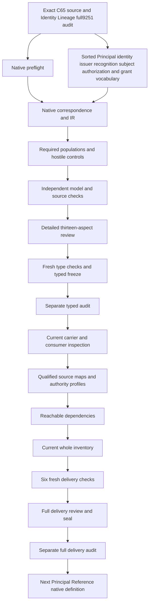

# Principal: complete candidate delivery review

Principal is formalized as a governed identity recognized within an exact authentication,authorization,ownership or accountability boundary. Reference use nominates one exact governed Principal identity and issuer boundary. Represented subjects preserve independent identity and lifecycle. Consequential authorization requires an exact current grant applicable to its Principal and scope. Recognition,reference,representation and authorization remain separate structures before carrier implementation or real identity/permission evaluation.

Native creation followed Identity Lineage's full9,251-file seal and separate actual audit0. Every prior sealed file and201sourcefiles remain hash verified. Working native drafts now number101among183currentidentities,leaving82withoutT. Current whole inventory now records101partialdrafts82missing;the preserved prior Identity Lineage inventory remains100/83. Original183identities189versions201sources and121tasks511planningedges797SWUs36frontiers stay exact. Source-owner accepted whole translations and whole-definition proofs remain zero;source fidelity and shared meaning maps remain pending. The full episode and final review stay active.

## 1. Exact source and C65 admission

The selected source is cal.definition.principal@1.0.0-candidate.1,SHA60180d24ef3e83c517ea8f51f5ab863801c248ac80d19864353b58f70aaad794. Its current admission is CAL-DECISION-0065-INTEGRATED-LAB-DEFINITION-MODEL-ADMISSION. Exact selection fixes the positive meaning under review. It does not replace the Definition with a nearby Principal carrier,authentication protocol,Actor example or runtime configuration.

The source checker binds C65 decision,authorization,exact candidate,selected Definition digest and validation receipt. Current183identity189versionsnapshot verification is separate from historical admission counts. C65 admitted exact Definition bytes while leaving carrier,instance,relation,consumer and runtime effects separate. Its admission does not create a Principal,resolve an issuer,execute authorization,issue a grant or accept this formal translation.

The retained body remains review-only under the positive admission overlay. The embedded actor-model-review remains candidate-unadmitted with exact local bytes. The integrated-model consumer is observed rather than activated. Routing evidence grants no effect authority. Private read-first material is bound only by path/hash metadata;its content and meaning are not imported into primary theory or copied into these public source artifacts. Canonical source meaning remains the exact selected Definition.

## 2. Sorted signature and qualified symbols

Fifteen nonempty sorts are proposed:PrincipalReference,PrincipalIdentityReference,BoundaryReference,IssuerReference,ScopeReference,PrincipalUseReference,RepresentationReference,SubjectReference,SubjectIdentityReference,LifecycleReference,SubjectKindReference,AuthorizationReference,GrantReference,TimeReference and Token. EMPTY is one Token constant. Twenty field selectors and fourteen reference-handle functions give34totalfunctions. There are157predicate/relation signatures and207declarations.

The vocabulary separates Principal meaning from Principal identity,issuer and recognition boundary. Reference use,represented subject and authorization have independent carriers. Principal and represented-subject identity coordinates use separate sorts. Grant and time are also distinct. Descriptive sort names do not create new canonical Definitions or claim that a real identity or grant exists.

Each selected field requires a declared target,nonempty handle and exact BindingDeclared relation matching the selector. Totality provides well-sorted finite values without authenticating their referents. Symbols are qualified by exact source version and candidate scope. Same-looking type names in another packet do not establish shared denotation or import a whole theory. Missing,conflicting,undeclared and empty selected nominations fail independently. Outside and unused optional values remain possible under their own scope ceilings.

## 3. Governed recognized identity genus

PrincipalApplicable is equivalent to PrincipalInScopeDeclared. A selected Principal nominates exact identity,boundary,scope and issuer references. It is declared governed,recognized and bounded. Its nominated identity is declared governed. Identity-backed or record-backed criterion is inclusive:one alternative or both can hold. The source-owner correspondence between the abbreviated formal expression and the positive identity genus remains an explicit finding.

Recognition is represented as necessary declaration structure rather than a successful authentication or authorization operation. A supplied recognized flag does not prove that an issuer accepted a real subject or that a boundary is authentic. Actual RecognizedIdentity,BoundaryRecognition,IssuerAuthenticity and IdentityResolution remain independent targets with supplied countermodel evidence.

An abstract selected Principal may have no modeled reference use,representation or authorization. The required populations demonstrate that case. The finite model does not enumerate every real Principal or impose a universal one-Principal-per-person rule. Principal identity does not become Person identity,Actor classification,Agent capability,Team membership or a Role. Legitimate independently grounded facts remain possible while classification-derived authority and rights are excluded.

## 4. Recognition alternatives and issuer boundary

A selected Principal's nominated boundary is recorded and has exact issuer and scope fields. At least one authentication,authorization,ownership or accountability recognition alternative holds. The alternatives are inclusive. A boundary may serve authorization and ownership together,and another recognition alternative may be added without violating theory. No unsupported disjoint four-kind taxonomy is imposed.

The Principal issuer equals its nominated boundary's issuer by declaration. This keeps the source's issuer-boundary relationship exact instead of allowing a reference to silently select a different recognition context. A mismatched issuer fails. Actual issuer authenticity and boundary resolution remain independent;nonempty tokens and recorded flags do not supply signed issuer evidence or a live resolver.

Principal scope and boundary scope remain separate exact nominations. The source does not require universal equality between identity governance scope and every recognition boundary scope. A positive control changes boundary scope independently. Accepted scope correspondence must still explain the intended governance boundary. Recognition by an authorization boundary also does not issue a grant or establish permission merely from the boundary kind.

## 5. Exact Principal reference use

A selected PrincipalUseReference nominates one Principal,one Principal identity and one issuer boundary. UseApplicable is equivalent to UseInScopeDeclared. Recorded posture and exact-resolution declaration are required. The nominated identity equals the selected Principal's identity,and the use's issuer boundary equals the Principal's nominated boundary. A mismatch in either coordinate fails.

These exact nominations represent the source's test that every Principal reference resolves to one governed identity and issuer boundary. They do not execute a lookup,authenticate a reference or impose global uniqueness of all Principals and boundaries. Multiple reference uses may legitimately nominate one governed identity,while different contexts can preserve independent recognized identities. Accepted maps must establish what resolution and identity equality mean.

UseActualIdentityResolution,IssuerResolution,BoundaryAuthenticity,IdentityFidelity and OneIdentityResolution remain independently queried on selected use scope. An absent optional use cannot serve as their counterexample. Reference completeness does not create Role,capability,ownership,permission or authority. Each invalid-inference declaration is separately excluded. The candidate therefore retains the precise reference-versus-referent distinction without reducing a Principal reference to a free text label or claiming operational authentication.

## 6. Independently represented subjects

RepresentationReference links a selected Principal to exact before and after subject references. Selected representations are recorded and require governed subject records. Each subject separately nominates identity,lifecycle and kind. Principal identity and represented-subject identity are distinct typed coordinates;the representation does not merge them or equate a recognized Principal with the represented Person,Team,service or Agent.

Before and after subject identity and lifecycle coordinates must agree. Changing either coordinate fails even when the Principal and boundary labels remain exact. Subject references may differ when those coordinates are preserved. A positive control also uses the same subject reference before and after. These equalities preserve necessary structure while actual subject independence,identity continuity and lifecycle fidelity remain unresolved.

The model does not invent an owner or authority-transfer rule from a representation. Nor does it globally equate represented subjects that share a Principal or a kind. Actual SubjectIdentityPreservation,LifecyclePreservation,SubjectIndependence and SubjectResolution are separate outcomes. Their countermodels contain selected representations with coherent declarations while leaving real preservation unsupported. Source owners must accept how before/after records and subject identity/lifecycle map to actual governed subjects.

## 7. Subject-kind independence and legitimate overlap

Person,Team,service and Agent kind predicates are separately available. The representation's subject-kind field is exact and nonempty,but the source does not require every possible governed subject to lie in a closed four-kind universe. A different declared kind can retain the same identity and lifecycle. Named kinds preserve their own semantic responsibilities rather than forming an implicit authority hierarchy.

Subject kind may change while identity and lifecycle coordinates agree. A positive control changes an after-subject kind from Person to Agent;another uses a different declared kind. Those model observations do not claim real identity equivalence between a person and a machine. They expose the absence of an unsupported kind-preservation axiom and retain the need for accepted classification maps.

Principal identity does not prove Person identity,Agent capability,Role assignment or unrestricted authority. The source's illustrative human Principal authorizing a Definition admission while a machine Agent performs a file update remains explanatory. It does not admit a Person or Agent instance,issue permission,transfer identity or execute an action. Legitimate independent subtype/classification overlap remains possible without being inferred from recognition or reference labels.

## 8. Authorization and evaluation-time scope

A selected authorization nominates exact Principal,scope and evaluation-time references and is declared recorded. AuthorizationApplicable is equivalent to AuthorizationInScopeDeclared. Consequential status is a separate declaration. The model distinguishes consequential and nonconsequential selected authorizations rather than treating every reference or recognition event as an executed consequence.

Evaluation time is an explicit proposed reference used to express current grant applicability. No timestamp parser,clock ordering,expiry arithmetic or real current instant is invented. A TimeReference can be structurally coherent while real time/currentness remains unsupported. Source-owner interpretation must account for validity intervals,revocation,issuer evidence and the precise scope of the consequential activity.

Authorization scope remains distinct from Principal identity scope and recognition-boundary scope. The source requires exact grant and scope rather than a universal equality between all these nominations. The candidate does not turn a broad recognized identity into permission for every action. A consequential authorization with the wrong scope or evaluation time fails when the nominated grant does not apply. Actual authorization,scope fidelity,permission,authority and external effects remain separate outcomes.

## 9. Exact current grant for consequential authorization

Consequential authorization activates the exact grant guard. The authorizationGrant field must nominate an exact declared nonempty grant. AuthorizationExactCurrentGrantDeclared,GrantRecordedDeclared and an exact grant issuer field must hold. GrantCurrentAtDeclared must relate that grant to the authorization's evaluation time. Applicability relations must also connect it to the authorization's selected Principal and exact scope.

Removing currentness,Principal applicability or scope applicability fails. A grant reference or current label cannot substitute for any missing relation. Ten actual authorization queries are conditioned on selected consequential scope. Their countermodels therefore include consequential authorizations and complete necessary grant declarations while leaving actual grant resolution,currentness,issuer authenticity,applicability,permission and authority unsupported.

Unused nonconsequential grant selectors remain total without fabricating a real grant. A positive control removes an unused grant binding;another leaves the outside grant handle empty. Selected consequential guards remain strict. A recorded current-grant declaration is not an authentic issuer decision or proof of executed authorization. It preserves the source's necessary exactness while leaving actual authority and consumer enforcement to accepted maps and evidence.

## 10. Grant cardinality and issuer independence

Grant applicability to Principal and scope are relations. Currentness is a grant/time relation. A grant can apply to more than one Principal,scope or evaluation time without an unsupported global cardinality restriction. Positive controls add each kind of applicability while preserving theory and required populations. The record's exact nomination does not mean a real grant is universally single-Principal,single-scope or valid at one instant only.

Grant issuer is separately typed from the Principal recognition issuer. No equality between them is required. The baseline demonstrates a different issuer;another positive control permits the same issuer. Delegation and independent issuer authority require accepted scope maps. Forcing identity-recognition issuer and every grant issuer to be identical would add a rule absent from the source and prevent legitimate separately governed grants.

Exact reference and applicability declarations do not prove an actual grant's content,currentness or authority. The model does not authorize anything or claim that a grant crosses every recognition boundary. Nor does added declared applicability supply an unbounded permission. The source's only-through-exact-grants boundary remains visible in consequential authorization structure,while real grant authority and all permission outcomes stay independent.

## 11. Noninference,rights and effect boundaries

Root boundaries exclude proving Person identity,Agent capability or Role assignment from Principal identity. They also exclude identity-derived ownership,permission,authority and unrestricted authority. Principal is not silently equated with Person,Actor,Agent,Team or Role. Parent meaning and Definition admission do not grant instance authority or accept this translation.

Use boundaries exclude identity or issuer authentication from reference presence and rights from a use label. Representation boundaries exclude subject identity merging,lifecycle changes,authority transfer and inferred Person/Agent identity. Authorization boundaries exclude identity-derived authorization,grant-label authenticity/currentness,scope-label applicability,authority beyond selected scope and actual effects from declarations.

These are scoped invalid-inference declarations rather than universal prohibitions on independently supported real outcomes. Positive controls supply each actual outcome independently while preserving T. Outside objects can carry excluded flags without violating selected scope. No actual Principal is recognized,no issuer is authenticated,no authorization is executed,and no grant,Role,permission or ownership is created by this candidate. Scope and effect authority remain separate from the formal model's structural consistency.

## 12. Source account,controls and queries

All24nonempty source units are accounted at exact selectors and complete character spans. Sixteen clauses are encoded,six explanatory and two deferred. Thirteen primitive formulas cover genus,use,representation,preservation,authorization,conditional grant and four boundary scopes. Scientific notation,plain-language intuition and the human Principal/machine Agent example remain explanatory. Authority-scope and retained candidate claim ceiling remain deferred correspondence.

The native suite passes270controls:115T-true,147T-false and eight malformed-input rejections. Twenty-six required populations demonstrate selected/outside scopes,inclusive identity-or-record,recognition alternatives and overlap,exact reference use,represented subject preservation,consequential/nonconsequential authorization,issuer independence and independent authority. T and I are evaluated separately. Empty selected scopes or missing demonstration populations can preserve necessary theory while failing the required coverage.

Forty-eight queries have supplied T-and-I countermodels. Principal,use,representation and consequential authorization have separate relevant scopes. Ten authorization targets require consequential selection. Sixty-three source-query obligations bind exact selectors,spans,clause hashes and query IDs without placing actual targets in T. Prepared checks reached17,964steps under unchanged limits. Native source checking verifies C65,local review/consumer and two identical4698-byte pure projections without mutation. These checks support bounded evidence and cannot accept source fidelity,common meaning alignment or whole-definition proof.

## 13. Review,DAG and continuation

No prepared/native definition producer failure occurred. The initial compressed routing request had no lexical match;the corrected spaced governance request passed route,context and effect gates. The initial request and non-authorizing receipts remain retained. User authorization covers the reversible candidate work;no owner decision,grant or governance enforcement runtime is inferred from routing evidence.

An illustrative Principal reference resolves by declaration to a governed identity and exact issuer boundary. Its represented subject retains independent identity and lifecycle. A consequential authorization nominates a current applicable grant and exact scope,possibly from a different issuer. Those declarations can satisfy T while actual authentication,Person identity,capability,Role,permission and authority remain unsupported. A counterexample removes currentness or changes scope;necessary grant guards fail despite intact identity labels.

The seventeen-node,seventeen-edge work DAG is acyclic and separate from semantic dependency cycles. Three fresh contract/model/source checks passed. The sixteen-input typed freeze and separate actual audit passed. Current carrier/consumer inspection,qualified profiles,reachable dependencies and whole101draftinventory now have actual results. Six fresh delivery checks passed with exit0. Full review is prepared for seal and separate audit,which need their own terminal outcomes. Principal Reference native creation follows that full Principal audit. Prior Identity Lineage inventory100/83 and current Principal inventory101/82 remain separately preserved.

Twenty-four dependency meanings remain separately qualified;their complete theories and authority are not imported. All9,251priorsealedfiles201sources and original183/189/201scope stay preserved. Source fidelity,shared meanings,consumer alignment,whole translation and whole proofs remain pending. The full original episode and its final aspect-by-aspect review remain required. This bounded typed packet cannot redefine completion around a verified subset or turn reference declarations into real authority.
- PRIN-FINDING-001: Exact C65 Principal Definition admission does not create identities,recognition,authorization,grants,carriers or accept this translation. Status: unresolved;owner review and accepted map references pending.

- PRIN-FINDING-002: Governed identity recognized at a boundary is necessary declaration structure,not actual authentication or authorization. Status: unresolved;owner review and accepted map references pending.

- PRIN-FINDING-003: Principal,identity,boundary,issuer,scope,use,representation,subject,subject identity,lifecycle,kind,authorization,grant,time and Token are proposed qualified sorts. Status: unresolved;owner review and accepted map references pending.

- PRIN-FINDING-004: Inclusive governed identity-or-record flags need source-owner precedence correspondence to the positive identity genus. Status: unresolved;owner review and accepted map references pending.

- PRIN-FINDING-005: Four recognition alternatives are inclusive,not a disjoint enum;overlapping authentication/authorization/ownership/accountability boundaries remain possible. Status: unresolved;owner review and accepted map references pending.

- PRIN-FINDING-006: Principal and recognition-boundary scope nominations are separate;no unsupported scope equality is imposed. Status: unresolved;owner review and accepted map references pending.

- PRIN-FINDING-007: Principal issuer agrees with the nominated boundary issuer by declaration;actual issuer authenticity remains independent. Status: unresolved;owner review and accepted map references pending.

- PRIN-FINDING-008: Selected reference use has exact principal,one identity and issuer-boundary nominations;this does not impose global one-Principal-per-person or boundary uniqueness. Status: unresolved;owner review and accepted map references pending.

- PRIN-FINDING-009: Exact reference-resolution declarations do not authenticate the referenced identity or actual lookup result. Status: unresolved;owner review and accepted map references pending.

- PRIN-FINDING-010: Abstract selected Principal roots may have no modeled reference use,representation or authorization;finite scope does not enumerate all real Principals. Status: unresolved;owner review and accepted map references pending.

- PRIN-FINDING-011: Represented subjects retain independent typed identity/lifecycle coordinates;Principal and subject identity carriers are not collapsed. Status: unresolved;owner review and accepted map references pending.

- PRIN-FINDING-012: Before/after subject references may differ when identity/lifecycle agree;actual preservation and continuity need accepted maps. Status: unresolved;owner review and accepted map references pending.

- PRIN-FINDING-013: Subject kind may change independently while identity/lifecycle remain preserved;no unsupported kind-preservation axiom is invented. Status: unresolved;owner review and accepted map references pending.

- PRIN-FINDING-014: Named Person/Team/service/Agent kinds are modeled separately without requiring every possible subject to lie in a closed four-kind taxonomy. Status: unresolved;owner review and accepted map references pending.

- PRIN-FINDING-015: Every selected authorization names Principal,scope and evaluation-time references;time has no invented ordering or timestamp validity. Status: unresolved;owner review and accepted map references pending.

- PRIN-FINDING-016: Only consequential authorization activates exact current grant requirements;unused nonconsequential grant selectors do not fabricate authority. Status: unresolved;owner review and accepted map references pending.

- PRIN-FINDING-017: CurrentAt is a grant/time relation,not a single timestamp function;real validity intervals,revocation and currentness remain separate. Status: unresolved;owner review and accepted map references pending.

- PRIN-FINDING-018: Grant applicability to Principal and scope are relations,not global single-Principal/single-scope grant cardinalities. Status: unresolved;owner review and accepted map references pending.

- PRIN-FINDING-019: Grant issuer may differ from the Principal recognition issuer;delegation and independent grant authority need accepted scope maps. Status: unresolved;owner review and accepted map references pending.

- PRIN-FINDING-020: Identity/reference/recognition/representation/authorization declarations do not prove Person identity,Agent capability,Role,ownership,permission or authority. Status: unresolved;owner review and accepted map references pending.

- PRIN-FINDING-021: Exact local actor-model-review and integrated consumer stay review evidence;no private routing-package meaning or runtime evidence is imported. Status: unresolved;owner review and accepted map references pending.

- PRIN-FINDING-022: Complete character accounting and supplied finite T/I controls do not accept shared denotations,source fidelity,whole translation or whole-definition proof. Status: unresolved;owner review and accepted map references pending.

Actual native counts: {"countermodel_queries": 48, "declarations": 207, "deferred_clauses": 2, "direct_semantic_uses": 24, "encoded_clauses": 16, "explanatory_clauses": 6, "mapped_clauses": 24, "required_populations": 26, "source_units": 24, "unresolved_populations": 157}. Source checks: 92. Projection SHA: 9335bb73065f3141c8b4c55a9446bda246c08b8d7be33672f0e59c0a94aa5b77.

Detailed current carrier and consumer evidence

Current C70 Principal/v1 directly binds the exact C65 Principal Definition. PrincipalReference,AuthorityClaim,Delegation,Person,PersonReference,Team and AgentInstance bind their own exact meanings. Definition and carrier admission remain separate from instance recognition,authorization and formalization-owner source acceptance. The16frozen typed inputs and separate typed audit were checked before this consumer review;9251priorsealedfiles201sourcebytes remain preserved.

Twenty-five current meanings received exact source,Definition/v1-shape and two pure projection checks. The registry has143contracts121currentcontracts. Eight current schema/artifact digests,retained candidate bodies and valid fixtures are bound. The consumer passed124checks. Only three isolated pure Definition helpers were executed;no full package validator,writer,native/live consumer,recognition operation or authorization service was run.

The Principal payload names kind,stable subject,recognition boundaries,registry and status. Its recognition_boundary_refs array has no minimum cardinality. Whole hypothetical records with an empty list or foreign boundary remain shape-valid. Such acceptance does not prove the source's governed identity and exact recognition boundary. Principal identity and issuer/boundary denotations need explicit accepted mappings rather than a conclusion from closed record shape.

PrincipalReference payload names Principal,kind,issuer,resolution route,integrity digest and privacy posture. Issuer and integrity are nonempty string shapes. Whole hypothetical fixtures accept foreign Principal/issuer/route and a non-hash integrity token. The reference's Principal label differs from the selected Principal fixture node;the Principal's stable subject differs from the PersonReference fixture node. Delegation's delegator/eligible-Agent labels also differ from the selected Principal/AgentInstance nodes. These separately valid fixtures are not one joined identity/authorization instance.

AuthorityClaim names claimant,authority basis,decision scope,claimed permissions and limitations. Delegation names delegator Principal,eligible Agent,scope/actions,policies/gates,period,revocation and redelegation. Their independently governed meanings are not actual grants merely because those fields exist. Empty scope/action/policy/gate lists and unassessed period/revocation strings can be shape-valid. Exact currentAt,Principal and scope applicability remain independent semantic obligations.

Person,PersonReference,Team and AgentInstance retain separate identity,lifecycle,privacy,membership and accountability roles. Principal representation preserves subject identity/lifecycle as necessary declarations while real continuity and authority remain unproved. No Principal is equated to Person identity,Agent capability,Role,ownership,permission or unrestricted authority. Before/after fields and kind correspondence need owner-reviewed maps across the separate subject carriers.

Fifty-five Definition-shape probes include14acceptances. Eight hypothetical normative overclaims about identity-derived rights,issuer labels,recognition lists,subject merging,currentness,scope and C70type admission are accepted structurally and rendered reproducibly. This is a shape/meaning distinction,not evidence that an unexecuted full validator admitted an overclaim. Eight carriers received415whole-hypothetical-fixture probes,with83acceptances. Required-field omissions,unsupported native selectors and publication effects fail;opaque reference/currentness/permission labels often remain structurally valid.

C70 decision,authorization,bundle and proposal hashes are exact. Its only ordinary instance is the integrated Governed Model. Consumer/runtime activations and typed relation instances are zero. Reading a directly admitted carrier does not admit Principal fixtures or execute grants. The local actor review and integrated-model consumer retain exact source bytes and identity/permission independence wording without runtime activation or accepted operational correspondence.

Seventeen Principal-only T/I models were freshly independently evaluated. They preserve empty selected/required population distinctions,inclusive recognition,grant issuer independence,subject kind variation,additional applicability and unused nonconsequential grant freedom. Wrong issuer/reference identity,changed lifecycle,stale grant and missing scope applicability fail necessary theory. No complete upstream theory or shared carrier denotation is imported. Actual recognition,current grant authority,permission and source fidelity remain separate targets.

Qualified profiles and38pending source-map obligations follow. Eight consumer findings and22sourcefindings remain unresolved. Current101draftwholeinventory and reachable dependencies are scoped independent evidence;Sixfreshchecks,full13aspectreview,seal and separate audit must supply terminal results. Principal Reference native work follows full Principal audit. Preserve original183/189/201and121/511/797/36scope,prior files/source bytes and unrelated work. Goalactive;source fidelity,whole translation,whole proof and semantic readiness pending.

- PRIN-CONSUMER-FINDING-001: Current C70 Principal/v1 directly binds the C65 Definition. PrincipalReference,AuthorityClaim,Delegation and four subject contracts bind their own exact meanings. Type admission does not accept this formalization or create the candidate Principal fixtures. Status: unresolved;accepted map references empty.

- PRIN-CONSUMER-FINDING-002: Definition/v1 shape and pure projections accept hypothetical prose inferring Person identity/rights from Principal identity,issuer authenticity from labels,current grants from period text and authorization from scope. These are shape observations,not full validator admission or real authority. Status: unresolved;accepted map references empty.

- PRIN-CONSUMER-FINDING-003: Principal/v1 payload has principal kind,stable subject,recognition-boundary list,registry and status,while its boundary list can be empty. Source-governed identity/exact issuer/boundary recognition maps are absent;closed shape alone does not authenticate recognition. Status: unresolved;accepted map references empty.

- PRIN-CONSUMER-FINDING-004: PrincipalReference/v1 has issuer,resolution route and integrity strings. Whole fixtures accept foreign Principal/issuer/route and non-hash integrity tokens without actual resolution. Its Principal reference and the Principal/subject fixtures do not form one joined identity instance. Status: unresolved;accepted map references empty.

- PRIN-CONSUMER-FINDING-005: AuthorityClaim/v1 records claimant,basis,decision scope,permissions and limitations;Delegation records delegator/eligible agent,scope/actions,policies/gates,period,revocation and redelegation. These independently admitted shapes do not prove an exact current grant applicable to a nominated Principal/scope/time. Status: unresolved;accepted map references empty.

- PRIN-CONSUMER-FINDING-006: Person,PersonReference,Team and AgentInstance retain separate identity,lifecycle,privacy,membership and accountability structures. Before/after preservation and no identity/authority merge require accepted subject and Principal representation maps rather than equal reference labels. Status: unresolved;accepted map references empty.

- PRIN-CONSUMER-FINDING-007: C70 exact authorization/bundle/proposal and zero runtime/consumer/typed-relation activation are preserved. Its only ordinary instance is the integrated Governed Model;no Principal fixture or authorization is admitted by reading the current registry. Local review/integrated-model bytes remain source evidence,not runtime activation. Status: unresolved;accepted map references empty.

- PRIN-CONSUMER-FINDING-008: Seventeen independent Principal-only T/I models retain inclusive recognition,issuer independence,subject kind change,optional nonconsequential grants and strict consequential-current/scope guards. Shared meanings,real issuer/grant validity,source precedence and accepted carrier maps remain pending. Status: unresolved;accepted map references empty.

Current full-scope inventory and semantic dependencies

The initial current-inventory producer and fresh replay both recomputed the source/core/IR/correspondence account for all101partialdrafts. Each has one supplied model freshly independently evaluated for its own necessary theory T and required populations I. There is no assembled common-meaning model or inherited owner acceptance. Combined count is2374sourceunits2954mappedclauses1005encoded829explanatory1120deferred1262requiredpopulations5942unresolvedpopulations. Principal contributes24/24/16/6/2and26/157without changing the original183identity189versionscope. All201originalsourcefiles remain current by exact digest.

The joint declared graph has144nodes2535edges43missingcounterpartpackets and one unresolved cycle. It retains all prior Identity Lineage graph sources and edges and adds24direct Principal uses. Missing count falls from44to43because the Principal packet now exists. Reachable Principal closure has142nodes2480edges99selectedexistingpackets43missingcounterparts and one unresolved cycle. Those selected packets do not bring their whole theories into primary Principal T. Edge-denominator and recursive-cycle interpretations remain owner pending. A graph traversal cannot certify semantic closure or common denotations.

Thirty-two qualified profiles include31rejections. One hundred twenty-one finite source-map frames include120rejections across38pendingmappingobligations. The one passing profile/frame is a complete unaccepted hypothesis:owner-review and accepted-map references remain empty. It preserves exact source,scope,role,claim ceiling and distinct sibling meanings. Missing/empty mappings,invented acceptance,discarded findings,changed scope/issuer coordinates and silently collapsed siblings fail. That bounded consistency result does not accept Principal recognition,issuer authenticity,grant authority or all consumer alignment.

Fifteen static-snapshot differential and adversarial checks passed. Reuse applies only to identical canonical static snapshot bytes. Live repository currentness still delegates the unchanged original checker. Result mutation,changed/malformed snapshots,in-place selected snapshot mutation and exception restoration are covered. Source accounting,IR compilation,model evaluation and graph construction remain active. Every101per-definitionwitness is freshly evaluated. Shared sealed validators are unchanged. Limits remain one million input bytes,fifty thousand qualified nodes,one hundred thousand steps and thirty seconds;performance improvements cannot widen an evidence claim.

Recognition,reference and grant interpretation boundaries

Current Principal/v1 directly binds C65 meaning under C70 admission. The separately admitted PrincipalReference carrier does not authenticate that identity merely because its issuer,resolver and integrity fields are present. Its fixture Principal label differs from the Principal fixture node. The Principal fixture's stable subject differs from the selected PersonReference node. Delegation's Principal and Agent labels likewise do not join the selected fixtures. The consumer reports those exact mismatches while preserving each valid record shape and independent source meaning. No reference is rebound and no identity is fabricated to make the examples appear connected.

The shape-valid empty recognition list remains a mapping obligation. A real recognized Principal must meet the positive Definition's exact boundary meaning,which an empty list alone cannot establish. AuthorityClaim and Delegation preserve basis,scope,permission,period,revocation,policy and gate fields as their own record structures. They are not converted into actual current grants by a hypothetical source map. Principal identity scope,recognition-boundary scope and authorization scope remain separately nominated. Grant issuer may differ from recognition issuer when separately governed. Owners still need accepted denotations for these relationships and the source's only-through-exact-grants boundary.

C70 decision,authorization,bundle and proposal are exact. Its broad type/relation admission and integrated Governed Model instance do not admit Principal fixtures,activate consumers or execute authorization. Recorded consumer/runtime/typed-relation activations remain zero. Reading those bytes preserves existing authority boundaries without granting this formalization new effects or source acceptance. The local review/integrated-model files are likewise source observations. Private read-first routing documents remain hash-bound metadata only;no private package content or meaning is copied into primary theory or the current public source artifacts.

Actual terminal evidence and next source

Native author,build,model and source producers passed. The prepared full signature/source-clause contract and every supplied control passed before native creation. All three fresh typed checks and the sixteen-input freeze/separate audit passed. Six full fresh checks now passed independently:contract,model,source,profile,reachable dependencies and current whole inventory. A fresh separate carrier comparison also matches the report. Exact executable arguments,stdout and empty stderr remain bound. There were no failed prepared/native/profile/fresh/next-source/seal or audit producers in this packet.

The initial compressed routing description produced a no-match result. Its exact request and non-authorizing receipts are retained. A corrected spaced governance request passed route,context and effect checks without changing the task,source,theory or checker limits. Routing gates are source/proposal evidence rather than owner effect authority. The user's active goal authorizes reversible candidate artifacts;actual Principal identities,recognition,grants,permissions,canonical changes and publication remain outside the performed work.

Principal Reference is prepared only as the next exact source:cal.definition.principal-reference@1.0.0-candidate.1SHA7ca6bd645843a17ac21936da623f7ccff6b011f4d7051ad6e4ffd19121b1a16e. C65source-onlyinspection passed29checks24sourceunits and two identical5116-byte projections. The local actor-model-review hash and integrated consumer are exact. Its design retains minimal consumer-needed coordinates,one governed Principal or explicit unresolved state,no copied identity record/secret/credential/excess data,and separate current grant evidence for authority decisions. No next-native interpretation or model exists before full Principal audit.

Full delivery and original episode completion

This4,500-plus-word review and its seventeen-node,seventeen-edge acyclic work DAG are prepared for the full seal and separate exact-fileset audit. Both must supply their own terminal outcomes before Principal Reference native creation. The artifact dependencies preserve definitions/types/logic first,then carrier mappings,qualified profiles,reachability,whole inventory,fresh checks,review,seal and audit. The work DAG is separate from the semantic dependency graph's unresolved cycle and cannot decide its recursive meaning.

All9,251priorsealedfiles201sources and sixteen frozen typed inputs remain preserved. Unrelated tracked work is unchanged at30files4833insertions518deletions during inspection. Original121tasks511planningedges797SWUs36frontiers are exact. Source fidelity,shared meanings,whole translation,source-owner acceptance and whole-definition proofs remain pending;semantic readiness remains false. The active goal still requires the remaining82currentidentities and the final episode-wide review/completion audit. A verified101draftcandidate inventory is progress within the original objective and cannot redefine completion around a successful subset.
