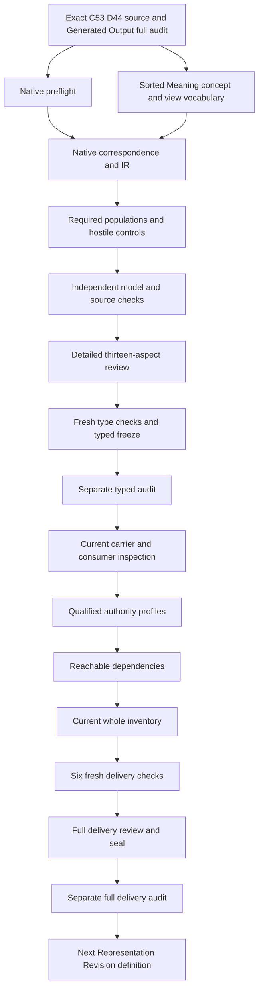

# Projection Specification: full candidate delivery review

This delivery preserves the separately frozen and audited sixteen-input typed stage, and adds current carrier observations, qualified mapping profiles, reachable dependencies, a fresh whole inventory, six terminal checks and full review evidence. Sealing and a separate actual audit follow this review. This candidate interpretation selects cal.definition.projection-specification@1.0.0-candidate.1, admitted-current by C53. Its exact bound source meaning is CAV2-D44 View-Bearing Concept. The normalized name must not substitute a generic renderer configuration for that meaning. The candidate records normalized Meaning classification, five view-bearing condition declarations, governed attached-view obligations, allowed readings, forbidden authority moves, preservation alternatives and ordinary fallback. Actual usefulness, preservation, source fidelity, consumer correspondence and authority remain independent.

Generated Output's 8,358-file full delivery and separate actual audit precede this native unit. Preflight checks all prior recorded file hashes and all 201 original source files. There are now 94 native per-definition candidate interpretations against 183 current identities, leaving 89 without native T files. The refreshed full inventory records 94 partial drafts with an independently evaluated T/I witness for each, leaving 89 identities without native T. Accepted whole translations and whole-definition proofs remain zero; the complete episode and its final review remain active obligations.

## 1. Exact target and source authority

The selected Definition digest is 42cff2435ac4e732bf0ea45a2e0f5d6fcdf2921f17b18bbd1b1adcc4e643eb24. C53 is CAL-DECISION-0053-FULL-DEFINITION-QUEUE-ADMISSION. Source checking binds the current registry row, owner-admitted decision, exact authorization, manifest and selected Definition version. Current admission concerns that source and its admitted source use. It does not accept this interpretation's denotations, field maps, logical precedence or a whole formal proof.

The term is Projection Specification, with stable normalized identity semantic.projection-specification, owner scope scope.shared-authority and carrier type.definition. The source's normative basis then describes a load-bearing concept needing a governed view or tree. The model therefore distinguishes a MeaningReference record for normalized classification from a ConceptReference subject and its ViewReference records. A label cannot merge the normalized target with Context View, Ontology View or a generator configuration. Their separately qualified comparison sources remain outside the primary theory.

The body still describes a candidate reconstructed from normalization and says it is not admitted. This historical claim ceiling remains unchanged beside the current admission overlay. Preserving those bytes is necessary evidence discipline, not acceptance of a contradiction or a license to choose whichever voice supports a stronger claim. Source-owner review must resolve their interpretation. No canonical Definition, admission row, private ontology, live consumer or publication surface is changed by the candidate work.

## 2. D44 source use and normalization scaffold

C53 source-use CAL-SOURCE-FULL-DEFINITION-QUEUE-032 binds the exact section headed CAV2-D44: View-Bearing Concept. Its current selection is 2,951 bytes at b90efb80d4f8a497b49168a3db804626ecf52e3524141c98aa42725c9f52897c. The external whole Definitions book has digest ecfbd64f334954809e83ffd5d4f9adfb759f39716de96c3ac1227d4ee869c6f8. Whole-file and selected-section bindings are checked independently. Coordinate equality is not promoted into accepted semantic equivalence or live producer behavior.

The embedded source reference retains candidate-unadmitted posture and a null source-admission reference. The current source-use row separately records admitted-for-definition-use. Its target is the exact candidate.1 Definition. The normalization scaffold records reclassify for D44, normalized semantic kind definition, carrier type.definition, owner scope scope.shared-authority and target semantic.projection-specification. It remains prototype-scaffold with authority effect none and its own unadmitted-carrier claim ceiling.

These observations retain source identity, reconstruction identity and admission scopes without turning a scaffold into a governed view instance. The native source checker executes only the pure Definition renderer functions, compares two projections and preserves the machine input. Neither reading D44 nor reproducing its Markdown authenticates actual concept evidence, owner routing, reuse behavior or challenge events. The source remains exact while the proposed formal interpretation remains a separately reviewable candidate.

## 3. Sorted signature, denotation and qualification

The theory has 18 nonempty sorts, seven constants, 32 total functions and 115 predicate/relation signatures, totaling 172 declarations. MeaningReference is distinct from ConceptReference and ViewReference. EvidenceReference, LifecycleReference, OwnerRouteReference, ReuseSurfaceReference and ChallengeRouteReference retain the five threshold components. ReadingSetReference and MoveSetReference separate explicit field declarations from ReadingReference and AuthorityMoveReference members. SemanticIdentity, SemanticKind, TypeReference, ScopeReference and SourceReference preserve the normalization axes; Token carries EMPTY, NONE and reference labels.

The constants bind the exact normalized identity, kind, type, owner scope and D44 source. EMPTY and NONE are distinct Token values. A nonempty sort domain is an evaluator convention, not proof that a real governed view or forbidden move exists. Membership extensions may be empty. Every function has an explicit argument/result sort and a total supplied interpretation. A total selector alone does not establish applicability, a complete field declaration or a live reference.

All symbols are qualified by exact source version and candidate scope. Matching printed labels across theories cannot establish equality of denotations. Nominal sort separation protects this representation's type checking but cannot itself prove disjoint real concepts. Descriptive reference sorts do not create new canonical Definitions. The corrected required populations use MeaningReference for the two Meaning-only witnesses and ConceptReference for the concept/view demonstrations, retaining the type role visible in each formula.

## 4. Normalized Meaning and canonical-instance preservation

MeaningApplicable is equivalent to MeaningInScopeDeclared in this candidate. Every selected Meaning has exact identity, kind, type, scope, source and effect bindings. The selectors equal the five normalized constants and NONE effect. Exact bindings require both the nominated field target and the absence of conflicting additional values in the supplied relation. Nonempty typed handles make empty or unsupported references observable in the candidate records.

A selected Meaning cannot declare silent sibling merging. If it declares itself a canonical instance, it additionally declares accepted source relations. This is a necessary preservation condition for the source's canonical-instance wording. A model can classify the Meaning without the canonical flag; canonicalness is not forced by the normalized label. The condition does not perform source admission, authenticate relations or equate type.definition with a concrete current carrier contract through an unreviewed alias.

The baseline includes a selected canonical Meaning with declared source relations, while one of its view-bearing subjects has every actual-outcome target false. Another subject has independently supplied actual authority. Canonical parent classification therefore does not supply instance authority. Changing normalized identity, kind, type, scope, source or effect fails the selected record guards. That failure establishes behavior of the proposed declaration model, not accepted source fidelity for every real instance.

## 5. Five condition declarations and typed fields

For a selected concept c, the classification formula is ViewBearingConceptDeclared(c) iff DistinctEvidenceDeclared(c) and LifecyclePostureNeededDeclared(c) and OwnerRouteAvailableDeclared(c) and ReuseSurfaceAvailableDeclared(c) and ChallengeOrDriftRouteAvailableDeclared(c). This retains the formal source's five-condition equality at a scoped declaration level. Each positive condition requires its corresponding exact typed field, declared target and nonempty reference handle. Conditions that are not declared true do not force those component fields to conform.

Distinct evidence remains a declaration about EvidenceReference rather than a proof of independence or completeness. Lifecycle posture needed does not assign a lifecycle state. Owner-route availability does not resolve a live owner or obtain approval. Reuse-surface availability does not demonstrate actual usefulness. The challenge-or-drift route uses one proposed reference carrier: the source does not require both mechanisms or an executed challenge event. Those meanings need owner-reviewed correspondence before they can denote real conditions.

Removing a condition while retaining view-bearing classification fails the equality. Clearing a condition and classification together, with an ordinary fallback declaration, can preserve the theory. That does not falsify the real-world condition; it changes a supplied declaration model. The owner must still review equality versus admissible-when and only-when wording. The five flags are not assumed to establish actual ViewNeed, evidence distinctness, lifecycle need, routing or reuse in the countermodel queries.

## 6. Genus, ordinary prose and missing-field fallback

ConceptApplicable is equivalent to ConceptInScopeDeclared. Every selected concept has a nonempty subject handle and an exact link to a selected normalized Meaning. A view-bearing subject additionally declares load-bearing posture, ordinary-narrative unsafety and governed-view need. It nominates a declared ViewReference and declares the attached-view link. These guards keep the source's genus and ordinary-prose threshold visible beside the five component conditions.

If the selected concept is not view-bearing, it has a TermFallbackDeclared, CandidateFallbackDeclared or LocalConceptFallbackDeclared label. The disjunction is inclusive: the source does not prescribe exclusive categories. The baseline ordinary subject carries overlapping candidate and local labels. It can also have an independently declared owner route without meeting the other threshold conditions. The model does not assert that every term deserves a new view, or that the mere presence of a view label makes ordinary vocabulary load-bearing.

Absent explicit reading or forbidden-move declarations on the nominated view require non-view-bearing classification and fallback. All five conditions together with absent required fields therefore fail the combined guards; the checker does not silently discard the equality or automatically edit the input. A coordinated fallback control explicitly changes one condition, classification and fallback label. Absence here denotes missing declarations in a complete supplied candidate model. It does not turn epistemic unknown into falsehood or prove that actual historical fields never existed.

## 7. Nominated and additional attached views

A view-bearing concept nominates a view and must declare its attachment. Every declared attached view for that selected subject satisfies the governed-view, field, design and authority-boundary guards. The baseline also attaches an additional complete view to one subject. Negative controls introduce incomplete or outside attached views and observe failure. A hidden additional record cannot escape checking merely because it was not selected by the nominee function.

The theory does not require a unique view. It permits the same complete view to serve two concepts and permits shared reading/move sets across different views. Removing the additional view preserves T but loses the requested additional-view witness in I. These examples distinguish allowed structure from a demonstration population. They are not a universal requirement that every real concept have multiple views, or an accepted proof that all real attached views have been enumerated.

The source says view or tree; the candidate does not force both structures or select a filesystem layout, dashboard technology or vault node type. Actual ViewCreation and TreeCreation remain separate queries. The nomination and attachment relations are proposed carriers. Their reference aliases, endpoint identities and complete universe need source-owner and consumer evidence. No real dashboard, repository tree or ontology node is created by these formula evaluations.

## 8. Explicit allowed readings and forbidden moves

Every attached view of a selected view-bearing concept has exact ReadingSetReference and MoveSetReference bindings and explicit declaration flags for both fields. Their targets are declared and their handles nonempty. The field flags distinguish having an explicit set declaration from a total selector that always returns some value. Every declared allowed-reading member and forbidden-move member of those selected sets has its own declared typed target and nonempty handle.

The sets may be explicitly empty. The source requires declaration of the fields but does not specify nonempty cardinality. Controls remove all allowed-reading members or all forbidden-move members while retaining explicit field declarations. They satisfy T and lose the corresponding requested member population in I. Removing the field declaration itself fails T for a selected view-bearing subject. This distinction prevents an empty but explicit policy from being confused with missing metadata.

The baseline supplies nonempty example members to make membership guards nonvacuous. Additional complete members are allowed; undeclared outside members fail. An allowed-reading label does not execute a reader, and a forbidden-move label does not implement a gate or authenticate its authority semantics. The two reference sorts do not prove that real reading and move meanings are disjoint. Accepted field interpretations, empty-set policy, actual enforcement and consumer alignment remain review obligations.

## 9. Preservation alternatives and bounded inspection

Every relevant attached view declares that it helps preserve at least one of evidence, relations, lifecycle, owner route, reuse or challenge behavior. The six alternatives form an inclusive disjunction. The baseline distributes them across several views and gives one view overlapping evidence and relation roles. A control makes every relevant view declare only one preservation role. T remains true while the requested overlap population becomes false. The source does not demand all six roles simultaneously.

Removing every preservation role from a relevant view fails the necessary helpfulness guard. Removing just one of two roles can preserve T. The declarations are not measures of actual preservation, completeness or quality. A reference to evidence does not demonstrate its retention; a relation-preservation label does not establish semantic equivalence. The actual ViewHelpfulness and six preservation targets remain independently false in a complete satisfying baseline witness.

The applicability voice says a view should make a concept inspectable and usable without loading the whole repository. Relevant views therefore carry inspectable, usable and bounded-context declarations. Actual Inspectability, Usability and RepositoryContextSufficiency remain queries outside T. No repository-loading benchmark, UI flow or live consumer is executed. Owner review must accept a meaningful scope, measure and evidence surface for those claims before the declarations can support actual usage conclusions.

## 10. Role boundaries and independent actual outcomes

Selected view-bearing concepts cannot declare themselves vault node types, ontology branches, lifecycle states or promotion states, or a justification for a new tree for every term. The guards also exclude inference declarations that make five labels, view fields, canonical parent Meaning, schema PASS or Definition admission establish actual threshold, authority, proof or translation acceptance. They exclude generic renderer substitution, silently complete missing fields and sibling merging. These are scope-conditioned interpretation boundaries.

The boundary does not constrain every unrelated ordinary concept or outside record. A control lets the ordinary selected fallback subject also carry an ontology-branch label without making it a view-bearing subject. Outside authority claims are likewise not silently pulled into scope. Actual authority can coexist with a complete view-bearing declaration under independent evidence. The baseline second subject and positive actual-outcome controls retain this possibility; the theory does not universally prohibit legitimate authority or preservation.

Thirty-six actual-outcome predicates remain unassumed. They cover threshold need, field/component fidelity, usefulness, preservation, inspection, view/tree creation, source/owner fidelity, shared consistency, authority, canonical status, promotion, approval, trust, proof, consumer alignment, admission, activation, publication, release, deployment and external effect. Each query is evaluated against a freshly supplied satisfying T/I model with a false target. This bounded nonentailment evidence does not replace a source-owner translation review or a universal mechanized theorem.

## 11. Source correspondence and population obligations

All 22 selected nonempty source-string units have exact character correspondence. Seven clauses are encoded, nine remain explanatory and six remain deferred. The full normative clause includes all eight primitive formula templates. The formal expression carries classification, component-field, view and absence guards; applicability carries threshold/view guards; the boundary and exclusion clauses carry scoped exclusions. Four distinct formula values retain those requirements without unnecessary duplicated expansion.

The explanatory strings preserve plain-language intuition, D44 notation, migration context and examples. The authority-scope string, historical claim ceiling and four source test conditions remain deferred semantic clauses. Their concrete byte/schema/projection observations are checked separately rather than assumed as actual semantic outcomes. Twenty-seven source/query obligations bind exact selectors, offsets, excerpts and digests to unassumed targets. A mapped excerpt is not automatically a complete faithful translation.

T includes no interpretation assumptions, target queries or whole upstream theories. I has twelve independently compiled required populations, including normalized/canonical Meaning, view-bearing without outcomes, ordinary/missing-field fallback, overlapping fallback labels, outside subject, independent authority, additional view, reading/move members and overlapping preservation roles. The 115 signature population maps remain unresolved. Required demonstrations are reported separately from universal source constraints, and source precedence remains pending with twenty-two explicit findings.

## 12. Actual checks, retained correction and limits

The prepared check passes 171 controls: 64 T-true, 99 T-false and eight malformed-model rejections. Actual native author, corrected build, model and source producers terminate zero. The source checker passes 52 concrete checks, including the C53/D44 bindings, current external section, normalization scaffold, unchanged pure projections and 27 source/query obligations. The two pure projections each have 6,293 bytes and match the checked-in human source projection exactly without input mutation.

Type review corrected two required-population carrier labels from ConceptReference to MeaningReference before freezing. The initial successful native packet and preparation evidence are retained in an exact 35-file manifest. The formulas, source bytes, controls and required witness statements did not change. A one-off correction helper encountered an external-path relative-binding exception; that preparation exception and script are retained, and direct recovery rebinds external hashes by absolute path. Its individual subcommand exit was not separately captured, so the failure observation records it as unknown rather than inventing a numeric result. No native Definition producer failed.

The corrected packet reruns affected build/model/source production and preparation controls. Native t.json has 152,502 bytes and qualified IR has 16,127 nodes. Maximum prepared evaluation uses 4,958 steps under the unchanged 100,000-step ceiling; byte, tree and timeout limits are unchanged. Two rejected ARE request-schema attempts also remain beside corrected successful non-authorizing evaluations. Three fresh type checks, the sixteen-input freeze and the separate actual typed audit have completed with exit zero and empty stderr. Current carrier, dependency and inventory evidence is now recorded separately from these frozen inputs.

## 13. Detailed DAG and remaining whole-episode work

The candidate names twenty exact current semantic-use dependencies for definition, artifact, evidence/source/provenance, context and ontology views, challenge, representation, validation shape and authority/separation context. Fourteen comparison Definitions remain separately qualified outside the primary theory. Requested labels ViewBearingConcept, GovernedView, ReadingSet, ForbiddenAuthorityMove, LoadBearingConcept and ChallengeDriftRoute are unavailable canonical identities and are not silently invented. Dependency declarations are review inputs, not proof of common-carrier consistency or source closure.

This seventeen-node, seventeen-edge graph is an execution DAG. It does not certify an acyclic semantic dependency graph. Native Representation Revision creation remains downstream of this unit's full seal and separate actual audit. The original episode retains 183 identities, 189 versions, 201 source files, 121 tasks, 511 planning edges, 797 work units and 36 frontiers. Its refreshed full inventory records 94 partial drafts; the same 94 native T files are observed. A typed-stage freeze and a full inventory remain separate verification surfaces.

Current carrier/consumer field maps, qualification profiles, static-reuse checks, reachable/joint dependency observations, six fresh full-delivery checks, full review, exact seal and separate audit still follow. Source-owner acceptance, shared consistency, semantic-cycle interpretation, whole-definition proofs and the final episode-wide explanation remain downstream. The original goal stays active. This packet is a concrete, tested and traceable partial interpretation of the specific D44 meaning, with every formalization aspect and claim boundary available for review.

### Unresolved source and interpretation findings

- PS-FINDING-001: Exact normalized Projection Specification identity/type.definition/shared-authority scope versus primitive D44 View-Bearing Concept meaning needs an accepted role map.
- PS-FINDING-002: Five-condition equality versus admissible-when/only-when wording and attached-view obligations remains a precedence interpretation.
- PS-FINDING-003: Condition predicates are declarations, not proof of actual evidence distinctness, lifecycle need, owner routing, reuse or challenge behavior.
- PS-FINDING-004: Load-bearing and ordinary-narrative-unsafe judgments have no accepted empirical threshold or operational test.
- PS-FINDING-005: View-or-tree need does not require both structures, a particular file layout or creation of one tree per term.
- PS-FINDING-006: Sorted evidence references do not prove actual evidence independence, completeness or preservation.
- PS-FINDING-007: Lifecycle posture need is distinct from a lifecycle state and does not assign one.
- PS-FINDING-008: A nonempty owner route is not live route resolution, approval or source-owner acceptance.
- PS-FINDING-009: Reuse surface denotation and actual usability remain unaccepted.
- PS-FINDING-010: One challenge-or-drift route does not require both mechanisms or an executed challenge event.
- PS-FINDING-011: Explicit allowed-reading and forbidden-move sets may be empty; nonempty examples are required witnesses, not source-wide policy.
- PS-FINDING-012: Absent declaration predicates denote missing candidate-record declarations, not epistemic unknown or absence of real historical fields.
- PS-FINDING-013: Nominated and additional attached views are checked; reference aliases and actual view-universe completeness remain pending.
- PS-FINDING-014: The six preservation roles form an inclusive disjunction; declared helpfulness does not establish actual preservation.
- PS-FINDING-015: A five-condition record with absent required view fields is inconsistent with the combined declaration guards; no silent source rewrite or automatic fallback is used.
- PS-FINDING-016: Canonical normalized Meaning records preserve declared accepted source relations without authenticating them or granting instance authority.
- PS-FINDING-017: Independent actual authority is permitted; view fields, a dashboard, schema PASS or source admission cannot supply it alone.
- PS-FINDING-018: Inspectability, usability and bounded repository context are declared design conditions rather than actual consumer evidence.
- PS-FINDING-019: Context View, Ontology View and generated/projection carrier labels are separately qualified comparison meanings, not accepted aliases.
- PS-FINDING-020: No whole upstream theory, accepted common-carrier map, shared consistency or semantic-cycle interpretation is imported.
- PS-FINDING-021: Finite model checks and complete character accounting do not establish whole source fidelity or a universal/mechanized proof.
- PS-FINDING-022: C53 admission overlay is separate from candidate-authored body, embedded candidate-unadmitted metadata, normalization scaffold and authority-effects ceiling.

### Full delivery, current inventory and dependency evidence

The reachable dependency graph contains 140 nodes, 2344 edges, 47 missing counterpart packets and 1 unresolved cycle. Its selection binds 93 existing packets. The joint declared graph contains 141 nodes, 2378 edges, 47 missing counterpart packets and 1 unresolved cycle. Projection Specification contributes twenty direct exact-version semantic uses; every prior joint edge remains. Semantic-use cycles are distinct from the seventeen-node/seventeen-edge deliverable DAG. Dependency presence is neither whole upstream theory import nor shared denotation acceptance.

The aggregate correspondence inventory records 1103 deferred clauses, 899 encoded clauses, 773 explanatory clauses, 2775 mapped clauses, 1134 required populations, 2195 source units, 5026 unresolved populations. All 94 qualified partial theories have a freshly evaluated supplied witness satisfying T and I. These are independently checked witnesses, not a single meaning-aligned combined model. Exactly 89 of 183 current identities still lack native T files. Source-owner accepted whole translations and whole-definition proofs remain zero. All 201 original source files and all 8,358 previously sealed candidate/checker files retain their exact recorded bytes. The original 189-version and 121-task/511-edge/797-work-unit/36-frontier scope is preserved.

The six fresh read-only commands complete with exit zero and empty stderr: interpretation contract, native model checks, source checks, qualified profiles, reachable dependency selection and current inventory. Model evidence retains 171 controls: 64 T-true, 99 T-false and eight malformed rejections. Thirty-six actual-outcome targets have supplied nonentailment witnesses, and 52 exact source checks retain 27 source/query obligations. Qualified correspondence evidence has 32 profiles with 31 rejections and 109 frames with 108 rejections across 34 unaccepted mapping obligations. Fifteen differential/adversarial reuse checks preserve fresh live currentness and independent model evaluation; no shared sealed checker is modified and byte/tree/step/timeout limits remain unchanged.

### Projection Specification: exact meaning and consumer correspondence

The separately audited sixteen-input types-and-logic stage is preserved. This inspection passes 41 exact source, catalog and projection checks, 41 Definition shape probes with ten acceptances, 88 whole hypothetical view-carrier shape probes with sixteen acceptances, and five supplied PS-only model comparisons. Eight current meanings are read and projected. No accepted source, carrier or consumer map is created. Source fidelity remains pending, semantic readiness false, whole translation acceptance and whole-definition proof zero.

The current C53 admission binds the normalized Projection Specification Definition to the D44 View-Bearing Concept source selection. The source selection is 2,951 bytes with its exact admitted digest. The normalized identity, type.definition carrier and shared-authority scope are retained beside the source's own semantic subject. A generic renderer configuration cannot replace this subject. The normalization scaffold, candidate-authored Definition body, embedded candidate-unadmitted source metadata and C53 admission overlay occupy different authority roles. Their relationship still needs owner acceptance.

The current catalog has 143 rows and 121 admitted-current entries. None directly references the selected Projection Specification Definition. This is a bounded catalog observation, not proof that no implementation anywhere consumes the concept. The selected Definition lists no primary consumers. ContextView/v1 and OntologyView/v1 are two separately admitted C70 contracts, each binding its own current Definition. Their shared word view supplies no accepted equivalence to D44, and their exact current schema and Artifact Type artifact hashes are checked separately.

Generic Definition/v2 binds Definition meaning. GeneratedOutput/v2 binds Generated Output meaning. Neither is automatically a carrier for View-Bearing Concept instances. The inspection reads eight exact current Definitions: Projection Specification, Context View, Ontology View, Source, Provenance, Generated Output, Definition and Authority. Every selected source passes Definition/v1 shape validation, and two isolated pure projections equal its checked-in DEFINITION.md bytes without input mutation. Only the esc, bullets and render function AST nodes execute. No whole generator module, actual view/tree writer or live consumer runs.

Definition shape validates the formal statement as text. It accepts hypothetical every-term-tree, all-six-preservation, view-authority and missing-field-completeness wording, unresolved nonempty owner/term/identity references, and empty source/consumer lists. It rejects ten proposed instance fields at the closed root. Exact projection repeats accepted text without checking its logical truth. Thus a successful schema or byte comparison supplies neither D44 semantic fidelity nor actual view-bearing admissibility.

ContextView/v1 has twenty required closed root fields. It fixes authority_effect to none and status to candidate-unadmitted, and carries source selections, lineage, limitations, owner/challenge routes, timestamps and a claim ceiling. Missing required fields, eight unsupported D44 fields, promotion effects, asserted admitted status, empty included material and malformed hashes are rejected. Its schema contains no allowed-reading or forbidden-authority-move set and no complete map of the five D44 conditions.

The ContextView probes accept an unresolved owner, syntactically valid but uncomputed source hashes, an overclaim, an impossible calendar date, expiry before generation, duplicate included material and empty exclusions. The timestamp pattern checks character arrangement without a date validator or ordering relation. Included-material uniqueness is not required. Shape acceptance therefore does not authenticate sources, resolve routes, compute hashes, establish distinct evidence, enforce freshness or prove a usable view. These observations describe the selected contract, not a proposed requirement to change it.

OntologyView/v1 has thirteen required closed root fields and fifteen required closed payload fields. It carries ontology/cut/selector/consumer references, selected nodes and edges, exclusions, two digests, freshness/expiry labels, a positive semantic cursor, a governance join policy and replay_source fixed false. Missing root or payload fields, eight unsupported D44 payload fields, replay_source true, cursor zero, promotion and malformed cut hashes are rejected. Its own Definition binding remains distinct from Projection Specification.

OntologyView shape accepts opaque owners, uncomputed cut hashes, non-date freshness and expiry labels, expiry before freshness, empty selections/evidence, an asserted admitted record state and overclaim text. The admitted label is a schema value rather than an admission receipt. Replay_source false limits a structural field rather than proving authentic replay or exact event selection. A valid cut digest pattern is not an executed cut hash computation. D44 reading/move sets, the five-condition threshold, actual helpfulness and bounded-context usability need a reviewed correspondence or explicit residue.

The five comparison models evaluate only the qualified PS theory. The baseline satisfies both T and the required populations I. Explicitly empty allowed-reading memberships or forbidden-move memberships each preserve T while losing demonstration populations I. The source requires explicit declarations and typed members when present; it does not require nonempty membership sets globally. Replacing all preservation flags with Evidence for every selected attached view also preserves T and loses the broader witness populations. The six preservation roles form an inclusive disjunction, not a conjunction.

Removing the nominated view's explicit allowed-reading declaration fails T but leaves I true. The required witness populations are independently evaluated formulas; they do not include all theory guards. I alone cannot certify a consistent model of T. The first full-stage comparison expected both values false and exited 1. Its exact producer and command evidence are retained under retained-attempts/consumer-comparison-001. Only that expected I value was corrected. Frozen native source, T, IR, correspondence, sixteen typed inputs and the separately audited typed receipt remain unchanged.

The five conditions are necessary declaration flags in this candidate interpretation: distinct evidence, lifecycle posture need, owner route, reuse surface and challenge-or-drift route. Their source equality versus admissibility/only-when precedence remains unresolved. Each selected attached view must have the declared reading/move set bindings, inspection/usability/context guards, at least one preservation role and no claim to decide authority. Actual evidence independence, owner routing, preservation, usability and authority remain independent outcomes. An actual authority supplied by separate evidence is permitted; the view cannot derive it merely from its fields or parent meaning.

### PS-CONSUMER-FINDING-001

C53 D44 View-Bearing Concept source meaning and normalized Projection Specification label require an accepted role map. There is no direct current registry Definition binding; C70 ContextView and OntologyView each bind their own separate Definition. Status: unresolved; accepted map references: none.

### PS-CONSUMER-FINDING-002

Definition shape and pure text projection accept unsupported every-term-tree, all-six-preservation, view-authority and missing-field-completeness wording; they do not enforce D44 conditions. Status: unresolved; accepted map references: none.

### PS-CONSUMER-FINDING-003

ContextView shape lacks D44 allowed readings, forbidden authority moves and five-condition semantics. Uncomputed hashes, opaque owners, impossible dates, reversed expiry, repeated included material and overclaim text remain shape-valid. Status: unresolved; accepted map references: none.

### PS-CONSUMER-FINDING-004

OntologyView shape lacks D44 threshold and reading/move sets. Uncomputed cut/event hashes, non-date freshness, reversed expiry, empty selections and asserted admitted record state do not establish preservation, authentic replay or authority. Status: unresolved; accepted map references: none.

### PS-CONSUMER-FINDING-005

PS-only comparison models distinguish explicitly empty sets from absent declarations and six-role inclusive disjunction from all-six requirements. Declaration satisfaction is not actual helpfulness, inspectability or preservation. Status: unresolved; accepted map references: none.

### PS-CONSUMER-FINDING-006

Concept/view universes, external source authenticity, owner routes, sibling field maps, exact consumer selection and shared consistency remain unaccepted. No view/tree writer, consumer effect or whole upstream theory is executed or imported. Status: unresolved; accepted map references: none.

The remaining work requires explicit source/carrier versions, field denotations, scope, record universes, owner routes and claim ceilings for each proposed map. It must address the normalized/D44 role, five-condition precedence, empty versus absent declarations, additional/shared views, preservation disjunction, current ContextView and OntologyView roles, source authenticity and actual consumer selection. Qualified hypothetical maps retain those obligations without inventing accepted references.

The delivery order remains separately audited types and logic → exact source and carrier observations → qualified profile hypotheses → reachable dependency graph → current whole inventory with independently evaluated per-definition witnesses → six fresh read-only checks → full review and candidate seal → separate full audit. Representation Revision native creation stays downstream of the full audit. The 183-identity episode remains active and no whole proof or shared consistency is claimed.

### Explicit interpretation and logical claim boundaries

Let m be a selected MeaningReference, c a selected ConceptReference and v an AttachedViewDeclared(c,v). Meaning selectors fix exact normalized identity, kind, type, owner scope, D44 source and NONE effect. conceptMeaning(c) binds c to m; conceptEvidence, conceptLifecycle, conceptOwnerRoute, conceptReuseSurface and conceptChallengeRoute select typed component records. viewAllowedReadings(v) and viewForbiddenMoves(v) nominate explicitly declared set records with independently typed members. Matching names or equal opaque tokens across sibling records do not prove equal real meanings. Canonical parent classification has no implication to ConceptActualAuthority(c).

The threshold is a scoped declaration equality between ViewBearingConceptDeclared(c) and five necessary flags. A selected view-bearing record also requires declared load-bearing status, ordinary-narrative unsafety, governed-view need and attached-view guards. Every selected attached view, including additional views, must declare both set fields, typed exact bindings, inspectability, usability, bounded-context sufficiency, one or more preservation roles, and no authority-deciding posture. A missing explicit field combined with all five true flags makes the combined candidate theory inconsistent. Coordinating a failed threshold with ordinary fallback instead is permitted by the supplied guards, while the source precedence of equality, admissibility and only-when wording remains an owner review item.

The allowed and forbidden membership sets may explicitly be empty. The Evidence, Relations, Lifecycle, OwnerRoute, Reuse and Challenge preservation conditions form an inclusive disjunction. One declared role can suffice and multiple roles can overlap. Fallback Term, Candidate and LocalConcept predicates can overlap. A shared view or shared set can serve more than one selected concept; no source-wide uniqueness or one-tree-per-term policy is invented. These denotational decisions remain proposed interpretations. Their finite checks do not authenticate empirical thresholds, evidence independence, lifecycle need, route resolution, consumer usefulness or completeness of the attached-view universe.

For each actual-outcome target the candidate supplies a separate countermodel rather than assuming the outcome false in T. Independently supported outcomes are permitted. Nonentailment establishes the inference ceiling of the declaration guards and does not deny a fact established elsewhere. T truth and required witness populations I are evaluated independently: a supplied comparison with absent reading declaration has T false and I true. Consequently a population result alone cannot certify theory consistency. A full semantic proof would additionally require accepted source fidelity, universe/field maps, empirical correspondence and reviewed shared meanings. Twenty-two source findings and six consumer findings remain unresolved.

### Retained preparation and correction evidence

The original successful native stage is retained in a 35-file manifest. Two Meaning-only population carrier labels were corrected from ConceptReference before the sixteen-input typed freeze; source bytes and formula semantics were unchanged. Its one correction helper exception has an observed ValueError but no separately captured subcommand exit, so the receipt records that exit as unknown. Original native Definition producers and corrected native producers are all terminal zero. Two rejected ARE request schemas remain beside the corrected non-authorizing evaluations. These observations preserve the preparation record without claiming authority from an ARE gate.

Two full-stage helper failures are separately retained with actual exit 1. The first consumer comparison expected I false when a missing nominated reading declaration made T false but I true; only that expected result was corrected. The first next-source inspector called an unavailable resolver source_ref helper; recovery selects the exact version row from the captured current/historical snapshot. Both exact failed producers, stdout/stderr and command results are preserved. Corrected consumer write/fresh inspections, profile production and next-source inspection terminate zero. No source, frozen type input, canonical Definition or next native theory was changed by either correction. The final receipt must distinguish these retained failures from successful current checks.

### Exact next source and ordered continuation

Representation Revision source-only preparation passes 25 exact checks, accounts 30 source-string units and compares two unchanged 4,652-byte pure Definition projections. It selects cal.definition.representation-revision@1.0.0-candidate.1 with C28 admission and exact source digest 5bb818e70b0281dc14edcd4dade418335f50df93bc30c607823ecce5b3349850. Its recorded local Definition and Bounded Context/v2 upstream bytes are checked at exact versions. It selects no external legacy section. Native Representation Revision T, models and correspondence remain absent before the current full seal and separate actual audit.

That Definition preserves semantic identity, Semantic Epoch and normative meaning while changing canonical bytes through schema binding, artifact-type representation contract, field layout or encoding. The revision record binds exact predecessor/postimage digests, revision identity, delta, equivalence evidence, validation, owner selection and rollback. The predecessor remains immutable evidence and no semantic-successor or context lineage is emitted for representation-only change. Actual meaning equivalence, storage immutability and rollback behavior must remain separate from declaration predicates in the next theory. Source inspection does not execute a revision or accept equivalence. Schema Evolution Invariant follows in the existing queue.

The candidate seal must bind the exact full current file set, the sixteen frozen typed inputs, source/carrier observations, six fresh terminal captures, current inventory, full review, retained attempts and next-source preparation. A separate actual audit then verifies the seal and exact claim boundary. Audit captures live outside the sealed candidate directory so recording the audit does not change its own subject. The review cannot establish audit completion in advance; only the actual terminal capture supplies that evidence. No next native T is created before that audit passes.

The broader episode remains active. The original 183 identities are the full denominator; 94 independently witnessed partial drafts do not complete it. Owner-reviewed source fidelity, accepted carrier/consumer maps, shared consistency, cycle classification, whole translation acceptance, mechanized proof and the final episode-wide explanation remain downstream. This review explains each of the thirteen formalization aspects and exposes exact pending obligations without substituting candidate preparation for accepted semantics or whole proof.
