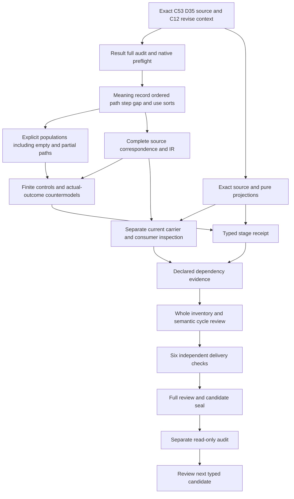

# Provenance: typed candidate review

## 1. Exact target and candidate boundary

This unit selects cal.definition.provenance@1.0.0-candidate.1 with current positive Definition digest514e2c9e19882553cbdfb1f10b94dacb510bf010a9aa0727b1068aff839ca86b. Types and logic come before storage contracts,consumer implementations or claims about actual outcomes. The candidate supplies an interpretation,complete source character accounting,sorted declarations,explicit requested populations and finite authored models. It leaves source-owner fidelity and whole-definition proof pending. No private or live consumer is executed by the typed stage.

Measurement Result's full candidate seal and separate audit precede creation of this native unit. The preflight binds the exact selected source,prerequisite receipts,work-unit scope,prior seal and next-definition preparation. Prior candidate evidence remains immutable. The model and source reports referenced here must exist as actual successful observations before this review is produced. Prepared code or an intended checker result is not substituted for an observed terminal result.

Provenance describes where an object and its transformations came from. It is separate from the tracked object,the sources,the steps and the judgments a consumer might make about them. A record can declare a complete lineage while the tracked claim is false,private,unpromoted or unusable. The review therefore distinguishes typed metadata and necessary guards from authenticated source history,adequate proof,trust,validation,credit and instance authority. These distinctions retain the Parent-Instance Authority Separation boundary throughout the episode.

## 2. C53 source use and C12 normalization

C53 admits the selected positive Definition and binds source-use CAL-SOURCE-FULL-DEFINITION-QUEUE-025. The source selector is the H2 section ## CAV2-D35: Provenance. Its selected local bytes are2,422 atb7855fd81c1ed14fe1bdb097fddfa2b1d32c2f88c8dc2f56dbf131f0164c5439. The whole local book digest matchesecfbd64f334954809e83ffd5d4f9adfb759f39716de96c3ac1227d4ee869c6f8. That exact local observation does not authenticate the configured producer repository or prove current live producer behavior.

The machine record preserves its historical embedded candidate-unadmitted source posture and null source_admission_ref. Current admission is checked as a separate overlay. C12 normalization has revise disposition for D35,with semantic.provenance and the separate relation.originates-from target. The retained prototype is a scaffold with authority_effect none. It is not a second admitted lineage carrier or proof that a transformation actually originated at its named source. C53's selected source-use row has one Definition target;that must not erase C12's separate relation target.

The source checker binds decision,authorization,manifest,source-admission rows,normalization record,normalization validation receipt,prototype,schema,generator and projections. It performs pure rendering and preserves input bytes. Definition shape and reproducible projection are bounded migration observations. They do not establish accepted semantic denotations or live consumers. Source ownership,translation fidelity,source-reference authenticity and actual lineage correctness remain explicit obligations after all local byte checks pass.

## 3. Sorted signature and qualified symbols

The signature separates Meaning,ProvenanceRecord,Object,Path,Step,Position,Source,RelationKind,Operation,Handler,Posture,MissingSegment,Residue,OwnerRoute,Context,AuthorityUse and Token. A Meaning classifies the term. A ProvenanceRecord selects an object,path and context. A Step belongs to a selected path and carries the source's five semantic fields. Missing segments and authority-bearing uses have independent sorts so their declarations cannot be confused with an actual lineage operation or authority grant.

The constants include EMPTY and five normalized context tokens. Eight separately sorted RelationKind constants preserve the named distinctions between source evidence,local adaptation,promotion,demotion,translation,derivation,validation and generated projection. These are proposed denotations,not invented current canonical Definition identities. Their distinctness protects the source's precision obligation without defining an exhaustive taxonomy or a universal strength order.

All functions are total in the supplied model. Totality prevents missing function entries in finite controls but does not make every domain element applicable or authenticate every reference. Nonempty handle guards apply to selected components. Predicates keep membership,declaration,classification and actual outcomes separate. Symbols are qualified by exact source version and candidate scope;matching printed names do not import another unit's theory. Each current dependency uses its exact selected version while descriptive labels with no current Definition remain unresolved.

## 4. Normalized meaning and record genus

ProvenanceMeaning is equivalent to the proposed conjunction of preserved classification,source relations,no silent sibling merge and five exact normalized context projections. The identity is semantic.provenance,the semantic kind definition,the carrier type.definition,the owner scope scope.lineage and the source D35. This preserves the source's normalized classification without treating the normalization scaffold as an instance authority grant. The mapping itself still requires accepted denotations.

ProvenanceRecordApplicable is equivalent to RecordInScopeDeclared. A selected record requires the normalized Meaning,an OriginTransformationChainDeclared assertion,a declared tracked Object,a declared Context and a selected Path. Record and selected component handles must be nonempty. The record does not become the tracked term,artifact,claim,rule,decision,relation,validation result or residue. Those object kinds remain source context rather than an invented exhaustive hierarchy of actual projects.

No record uniqueness theorem is introduced. Two records may describe the same object,or one object may have multiple declared trails,without an unsupported global canonicalization rule. Naming a current object or a source reference does not establish that the relationship is authentic,complete or temporally correct. The candidate's genus and record guard retain the structural origin-chain obligation. Actual provenance adequacy,source authenticity and correspondence to consumer objects are separate targets requiring evidence and owner review.

## 5. Five-field steps and reference precision

Each selected Step belongs to a selected Path and names a Position,Source,RelationKind,Operation,Handler and Posture. Position and path association support sequence representation;the remaining five projections correspond to the source's tuple source_i,relation_i,operation_i,owner_i,posture_i. The selected step has a nonempty handle and a PreciseSourceRelationDeclared assertion. Source references,relation types,operations and postures require declared carriers and nonempty handles.

The Handler guard uses an inclusive owner-or-process disjunction. A handler can satisfy both labels. It does not require a universal owner or force all process activity into a personal ownership identity. A selected step without either declaration fails the necessary guard. Dedicated controls preserve overlapping labels and independently remove the required handling declarations. Real responsibility and authorization remain separate from the finite model's handler classification.

The relation labels make transformations distinguishable to a later reviewer. Pairwise distinct constants do not imply that every real relation fits exactly one label or that those labels completely describe all future operations. A declared custom relation is permitted by T. Operation and relation projections need accepted semantic correspondence;the candidate does not infer successful promotion,translation,derivation or validation from a name. Nonempty references and precision declarations preserve necessary structure while actual historical events and source adequacy remain pending.

## 6. Ordered paths and repeated sources

The candidate represents order by StepBeforeDeclared among distinct selected steps on the same selected path. The relation is irreflexive,asymmetric,total over distinct steps on that path,and transitive. Distinct selected steps on the same path must also have distinct position identities. These declarations make an ordered trail distinguishable from an unordered bag of came-from strings. Negative controls include self-precedence,two-step cycles,shared positions,incomparable steps and pairwise order lacking transitivity.

Order is local to the selected path. The model does not impose acyclicity on the broader source-object dependency graph. Repeated source references remain possible and requested populations include two distinct steps referencing the same source. A document can be adapted,validated and projected repeatedly without inventing a new source identity at every step. Cross-path order metadata does not silently merge paths into one sequence or create a universal causal ordering.

First-order finite controls do not prove arbitrary unbounded list construction,well-foundedness,contiguous position numbering or complete chronological history. Position identities are declared references rather than authenticated wall-clock events. The ordering relation requires an accepted sequence map in a real consumer. The candidate explicitly records those losses. A green finite order check shows that supplied models meet the guard;it does not prove that the actual source history contains every event or that every declared event occurred in the represented order.

## 7. Explicit gaps,residue and owner routes

MissingSegmentApplicable is equivalent to MissingSegmentInScopeDeclared. Each selected gap belongs to a selected Path and references an ExplicitResidueDeclared object and an OwnerRouteDeclared target. Gap,residue and owner-route handles must be nonempty. This is the source's necessary condition for incomplete provenance:the missing segment is made visible as residue with an owner route. The model does not accept an untyped omission as an adequate declaration of incompleteness.

A selected path with IncompleteTrailDeclared must have at least one selected missing segment associated with it. A selected path with CompleteTrailDeclared must have no selected gap. These are declared bookkeeping conditions. They do not establish that every real missing segment was discovered or that a route resolves to a responsible live owner. Negative controls remove residue or routing,omit the selected gap,or label a path complete while a selected gap remains.

Complete and incomplete labels are not inferred for every possible path. Absence of a selected gap does not entail a complete trail. The residue declarations do not execute retention,repair,reconciliation or source recovery. An actual completeness judgment needs independently accepted discovery and consumer evidence. The distinction permits an honest incomplete record while keeping the missing work visible;it avoids treating a model's finite domain or a declared owner route as proof that the real lineage has been closed.

## 8. Empty paths and population obligations

The source's star notation permits a mathematical empty sequence. The candidate therefore includes a selected empty path and deliberately leaves it without a complete or incomplete label. It does not silently treat emptiness as adequate real provenance,a defect,or a license for authority-bearing use. Real empty-trail policy remains an owner decision. The model's empty witness preserves the mathematical possibility while exposing the policy boundary.

Required populations prevent important guards from being checked only vacuously. They include normalized meaning,a record without actual outcomes,an outside record,a complete declared trail without actual truth,an incomplete owner-routed path,an empty selected path,repeated sources,overlapping handler labels,outside steps,gaps and uses,an authority-use declaration without actual authority,and a selected step for every named relation kind. Each requested statement is compiled and evaluated independently.

These populations describe the finite candidate's evidence obligations. They are not universal requirements that every real installation must contain all kinds of provenance activity. Outside-scope carriers remain possible and do not receive selected guards automatically. T and I are reported separately:an otherwise conforming model can lack a requested example population. Unresolved population maps remain explicit for the predicates and relations whose real denotations need acceptance. The supplied witnesses support bounded checking rather than a claim that all actual sources or objects have been enumerated.

## 9. Authority posture and typed use

A step's Posture records declared authority posture at that relevant step. It is metadata distinct from the current record's actual authority. Different selected steps can carry different posture references without a numeric ranking or an automatic transfer of status. A promotion label does not elevate the present object. A parent or source posture does not license an instance. This preserves the already formalized Parent-Instance Authority Separation boundary.

AuthorityUseApplicable is separately scoped. A selected use references a selected ProvenanceRecord and requires TypedPrecisionForUseDeclared plus a nonempty use handle. That is the necessary source guard against untyped came-from language being used for authority-bearing purposes. It does not grant authority,execute a governance decision or prove that every relation and source reference has adequate accepted meaning. The record's typed structure and the use's precision declaration remain distinct obligations.

UseActualAuthority is outside T and is queried by a complete supplied countermodel. A positive control also allows independently authorized use,so the theory does not universally prohibit legitimate authority. It forbids inference from provenance alone rather than denying the possibility of separately grounded authorization. Owners must still accept the relation maps,posture meaning,source references and actual governance evidence. No carrier admission or passing schema can replace those instance-specific requirements.

## 10. Role exclusions and independent outcomes

Provenance Meaning cannot be classified as proof,authority,trust,validation or credit assignment itself. These exclusions preserve the source's explicit boundary. They do not prohibit a separate proof,validation decision,trust judgment or credit assessment from using provenance as one input. A complete declared trail can accompany a false or unusable claim. The theory therefore does not assert actual truth merely because record and path declarations conform.

Fifteen independent RecordActual outcomes cover truth,proof adequacy,authority,trust,validation,credit assignment,source authenticity,completeness,admission,activation,owner fidelity,consumer alignment,global consistency,operation execution and historical posture authenticity. An additional UseActualAuthority query keeps the authority-bearing-use guard separate. Actual targets are not selected axioms,assumptions or aliases of the structural predicates. Every query has an explicit witness condition.

The checker supplies a T-and-I model in which each queried universal implication is false and its witness condition true. These are bounded non-entailment observations in the candidate semantics. They do not constitute accepted source fidelity or mechanized whole-definition proof. Positive controls permit independent actual outcomes instead of turning a non-inference boundary into an absolute prohibition. Stronger truth,trust,proof,completeness,validation,credit or authority claims need their own evidence and accepted correspondence beyond the lineage declaration.

## 11. Source correspondence and finite evidence

The source's normative statement has four actual paragraphs:normalized classification,the Bound source-semantic basis heading,the declared origin/transformation chain,and the precision distinctions. The builder selects exact excerpts and splits every source unit at their true character boundaries. Repeated general and scientific-formal boundaries remain separately mapped. All remaining source text has an explicit encoded,explanatory or deferred disposition. No paragraph-count convention from another Definition replaces inspection of this source.

The four scientific-formal testable conditions are migration observations:identity,digest,Definition schema and regenerated projection. They are deferred in T and checked independently by the source checker. Plain-language intuition,domain explanation,examples and notation are explanatory. Actual-outcome source-query obligations retain exact selectors,offsets,excerpt digests and query references. Complete character accounting makes omissions reviewable without pretending that every mapped statement is already faithfully accepted.

The model checker recomputes source-qualified IR and correspondence. It verifies authored positive and negative controls,malformed model faults,total functions,sorts,tuples and required populations. Fresh contract,model and source subprocesses must complete successfully before freezing the typed-stage receipt. Native reports retain exact checker/runtime/input bindings. Counts below come from actual reports rather than planned outcomes. The review keeps unresolved owner findings visible alongside these observations so a successful finite checker cannot be mistaken for accepted whole semantics.

## 12. Carrier boundary and execution DAG

Current carrier and consumer correspondence is a later independent stage. A generic admitted Definition carrier can validate the Provenance machine record without thereby implementing a typed provenance path. A source-specific carrier may be absent,or another carrier may consume provenance fields indirectly. Exact current catalog lookup,schemas and source bindings must decide those facts. This typed-stage review does not infer a direct current Provenance carrier from the term's name or its admitted Definition identity.

The execution DAG is acyclic even though the semantic dependency graph may contain unresolved cycles. Exact source selection and Result's audit precede typed construction. Required populations and complete correspondence precede finite checking. Exact source/projection observations qualify the frozen typed receipt. Carrier hypotheses,dependency evidence and whole-inventory refresh follow. Six independent delivery checks precede the full review,seal and separate audit. Review is the next manifest Definition only after Provenance's full audit.

Dependencies are exact qualified source references rather than silently imported whole theories. Their missing counterpart packets,denotation maps and semantic cycle classifications remain independent obligations. Every prior seal and selected source byte is preserved. The DAG gates creation of later units on concrete verified evidence,while keeping unresolved semantic work visible. It does not treat an acyclic implementation plan as proof that the combined source theories share one accepted consistent meaning or that real consumers follow the modeled path.

## 13. Owner findings and remaining episode scope

Eighteen findings retain unresolved classification,source and lineage references,sequence mapping,relation labels,handler roles,posture semantics,gap discovery,residue routing,empty-trail policy,typed-use precision,actual outcomes,carrier/consumer maps and source-owner fidelity. Their IDs are listed below for review. No owner principal or decision is fabricated to close them. Candidate checks can finish while those whole-translation acceptance obligations remain pending.

The episode retains183 current identities,189 admitted versions,201 selected sources,121 tasks,511 planning edges,797 SWUs and36 frontiers. This unit follows75 previously sealed partial interpretations and adds a working76th draft. A later whole-inventory refresh must establish the exact incremental count;historical I04 selected-eight reporting stays unchanged. Whole accepted translations and whole Definition proofs remain zero. The formalization episode and its final aspect-by-aspect explanation remain active.

Continue by freezing and separately auditing the typed stage,then inspecting exact current carrier hypotheses and consumer-map gaps,refreshing dependencies and whole inventory,running the six delivery checks,and producing the full review,seal and separate audit. Then proceed with the manifest's Review Definition. Preserve the frozen typed inputs and every previous seal. No canonical authority,private/live state,publication or external effect follows from this candidate. The remaining work includes accepted source fidelity,complete consumer correspondence,semantic cycle treatment,whole proofs and the final complete episode review.

Actual typed-stage counts: {"countermodel_queries": 16, "declarations": 122, "deferred_clauses": 9, "direct_semantic_uses": 27, "encoded_clauses": 8, "explanatory_clauses": 9, "mapped_clauses": 26, "required_populations": 20, "source_units": 22, "unresolved_populations": 55}.

Actual controls: 97; T true 27; T false 63; malformed 7; countermodels 16; source checks 32.

- **PROV-FINDING-001** — Current C53 Definition and D35 source-use admission are independent from C12 revise planning and acceptance of this translation.

- **PROV-FINDING-002** — Normalized semantic.provenance,type.definition and scope.lineage require accepted classification and reference denotations.

- **PROV-FINDING-003** — Meaning,record,tracked object,path and five-field steps remain distinct proposed sorts;none is an invented current Definition identity.

- **PROV-FINDING-004** — Provenance source and prior-object references are opaque qualified carriers;nonempty handles do not prove authenticity or correct dependency lineage.

- **PROV-FINDING-005** — Explicit step position identities and strict per-path ordering preserve declared sequence order without proving finite unbounded lists,contiguity or actual historical chronology.

- **PROV-FINDING-006** — Repeated source/object references remain allowed;ordered trail steps do not impose acyclicity on the broader source-object dependency graph.

- **PROV-FINDING-007** — Eight distinct source relation labels are preserved as proposed denotations without assuming an exhaustive or exclusive classification of real relations.

- **PROV-FINDING-008** — An owner or process may handle a step;inclusive disjunction permits overlap and does not invent one universal owner.

- **PROV-FINDING-009** — Step posture is metadata only and does not confer current authority,inherit parent authority or authenticate historical posture.

- **PROV-FINDING-010** — Operation labels distinguish promotion,demotion,translation,derivation,validation and projection without performing those operations.

- **PROV-FINDING-011** — Every selected missing segment requires explicit residue and an owner route;declarations do not prove real residue retention,adequacy or source completeness.

- **PROV-FINDING-012** — Incomplete declarations require a selected gap;complete declarations forbid selected gaps without proving actual completeness or closing undiscovered gaps.

- **PROV-FINDING-013** — Mathematical star permits an empty path;real empty-trail policy remains ownerpending and no complete/incomplete/authority license is inferred.

- **PROV-FINDING-014** — Authority-bearing-use declarations require typed precision;this necessary guard is not sufficient actual authority.

- **PROV-FINDING-015** — Provenance role exclusions preserve proof,authority,trust,validation and credit independence without prohibiting independently supported outcomes.

- **PROV-FINDING-016** — Conditional sibling assignments need explicit references without silently adopting sibling meanings.

- **PROV-FINDING-017** — Four source testable conditions are migration observations,not semantic truth,authority or provenance adequacy axioms.

- **PROV-FINDING-018** — Exact source accounting,finite controls and selected countermodels do not prove owner fidelity,carrier/consumer correspondence,semantic cycle classification or whole-definition completeness.

