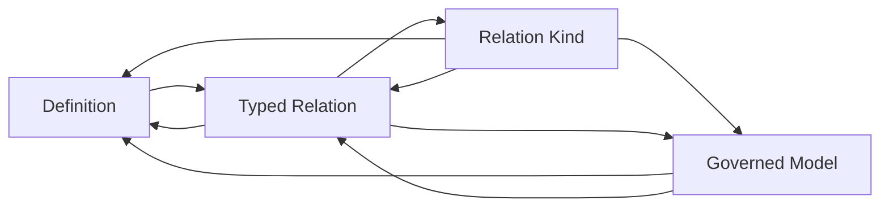

# Relation Kind formalization review

Candidate review, 2026-10-08. Authority effect: none. This partial translation continues the requested priority on definitions, types and logical formalization. Its actual F07-T prerequisites A04, C01 and E02 are verified. No semantic ordering is inferred from editorial family numbers, and no owner fidelity decision or whole-definition proof is supplied by the agent.

## Source, currentness and admission layers

The exact Definition source is `cal.definition.relation-kind@1.0.0-candidate.1`, SHA-256 `f5f1e77b4b2bbbc96a6024d4c46c54b7d183c692724a48873570f610f4b868bb`. CAL0065 selects it as admitted-current in the captured Definition registry. Embedded candidate wording and references to earlier review prose remain historical source content. Admission of the Definition artifact is distinct from admission of a Kind instance, an endpoint carrier, a connection, this interpretation or a proof.

Nine read-only checks validate the actual Definition schema and generator bindings, schema conformance, two selected renders, existing projection parity and unique exact proposed/current registry and index entries. The render is 4,706 bytes, SHA-256 `340ad24df0cd8284f658d532af077608371d1af21607022791f60a21aab10569`. Matching selected renders do not establish universal generator determinism. Source lookup does not certify every consumer's use or every claimed Kind instance.

The broader repository was inspected beyond the selected Definition. The dated gap audit describes 23 candidate axes and missing carriers. Newer selected bytes contain Relation Kind v2 carriers and a 41-entry governance-transaction admission postimage. Decision 0074 records owner admission and identifies the 0074C relation-surface decision. The member-of successor descriptor still has candidate lifecycle and authority-effect wording inside its bytes, while the selected registry gives it admitted-current posture. These observations concern different artifact layers. The agent neither changes the admission nor independently authenticates a human principal.

## Clause accounting and definition form

Twenty-one source units are completely mapped into 43 clause spans: 27 encoded, six explanatory and ten deferred. Splits distinguish the versioned question, closed finite pair declaration, pair-specific rules, each of five excluded roles, and the weaker formal governed-record/bounded-scope expression. Repeated source statements retain separate spans and digests. Complete character accounting establishes an auditable map; it does not prove that the interpretation preserves all source meaning.

The necessary genus and differentia identify a versioned semantic-axis contract asking one unique directional question through a finite closed set of exact ordered endpoint-kind pairs and pair-specific qualifier rules. The source formal expression gives necessary governed-identity-or-record and bounded-scope conditions. Its nonentailment notation for authority is interpreted through a separate target outside T, rather than a universal negation of independently established authority.

The candidate does not select a membership biconditional for RelationKind. A record with particular flags is therefore not automatically a Kind. Source use, successor selection, actual finiteness, semantic question equivalence and live contract/authority behavior remain explicit review obligations. No target theorem is inserted as an assumption.

## Types and one directional question

The 33 declarations comprise six nonempty sorts, three total functions and 24 predicates or relations. Contract, Question, EndpointKind, QualifierRule, QualifierValue and VersionLabel have distinct sorts. The functions select a version label, a question for each contract and a rule for each contract/source-kind/target-kind triple. Totality is a candidate modeling choice; the actual carrier and metadata meaning need review.

For a RelationKind, T requires Versioned and SemanticAxisContract statuses, a selected directional question and an Asks relation to that question. Any additional question asked by that same Kind must equal its selected question. This is uniqueness within a Kind contract. It does not require that every different Kind version have a different question. A successor may retain the same axis and question while changing its allowed pairs or qualifiers.

Question identity in the finite model does not decide natural-language equivalence. Likewise, 41 distinct selected question strings and axis identifiers cannot establish 41 semantically orthogonal axes. Meaning-equivalent questions may have different wording; a repeated question may legitimately belong to different versions. Finding RKI-QUESTION-001 preserves that distinction.

## Closed ordered pairs and finiteness

For a RelationKind, AllowedPair equals DeclaredPair in the candidate's ordered relation. Every declared pair requires exact endpoint-kind statuses. Source and target positions use the same EndpointKind sort, allowing legitimate equal-kind pairs while preserving direction. Declaring source kinds and target kinds independently cannot authorize every cross-combination. Reverse-pair permission also needs its own declaration.

ClosedFinitePairDeclaration is a primitive status required by T. It is not a first-order proof that an arbitrary interpreted pair extension is finite. The bounded inspector proves finiteness only of its selected JSON lists under its stated limits. No unbounded finiteness theorem is inferred from authored finite models, and no owner decision about whether a Kind may have an empty pair set is fabricated.

The actual member-of successor supplies a useful concrete distinction. It declares 24 ordered pairs, while its source/target summaries would yield 207 Cartesian combinations. The 183 additional combinations receive no pair authority. Responsibility->team is one such undeclared cross-pair despite both kinds occurring in the separate summaries. The read-only inspector rejects it, as well as an undeclared reverse pair.

## Pair-specific qualifier rules

Each declared pair has its selected rule. A HasPairRule association must belong to a declared pair and equal the selected rule for that same contract/source/target triple. QualifierAllowed requires both an allowed pair and acceptance by that pair's selected rule. The qualifier condition is necessary, without a converse that grants a connection or authority merely because a payload matches a rule.

Pair-specific association does not require all rule values to be different. Two pairs may explicitly share a rule. A rule accepting a value on one pair does not establish acceptance by another pair's different rule. Total pairRule values on undeclared triples also cannot create rule associations or allowed pairs. No accepted qualifier population is forced automatically by an allowed pair.

The synthetic profile binds separate closed schemas to explicit exact versioned endpoint pairs. The selected actual carriers instead provide a closed Kind-level qualifier contract, which the read-only checker applies to each of that Kind's declared pairs. This shared default is visible in the report. Its embedding into the full Definition, pair-specific value domains, cross-qualifier semantics and any overrides remain unreviewed. In particular, member-of currently checks that membership_role is a nonempty string; shape acceptance does not decide the semantic suitability of every string for every pair.

## Role contrasts and independent outcomes

Five same-local-role contrasts exclude relation-instance, specialized-binding, ontology-edge, wildcard-endpoint-family and inferred-Cartesian-product roles from RelationKind. They do not prohibit reference to such objects or establish global disjointness of every underlying artifact identity. Actual common-carrier mapping requires review. An ontology edge or a connection instance may select a Kind without becoming that Kind.

Kind meaning does not entail authority effect, instance admission, runtime success, identity equivalence or external effect. These are separate outcomes. Controls also permit an independent outcome to coexist with Kind status, preventing nonentailment from being mistaken for a ban. Finding RKI-ROLES-005 and the selected Authority/Typed Relation/Ontology Edge dependencies retain the relevant distinctions.

## Populations and independent model evidence

Eight required population conditions demand a hypothetical Kind with its necessary statuses and selected directional question. Sixteen policies remain unresolved for role/outcome, endpoint, pair, rule, accepted qualifier and related populations. Nonempty sorts do not guarantee inhabited predicates. Empty pair declarations satisfy the selected T because no reviewed nonempty-pair policy has been selected; that is an unresolved policy, not an owner-approved exemption. An empty RelationKind extension may satisfy universal T but fails required I.

Thirty-eight authored controls independently evaluate T and I or reject malformed structures. They cover missing statuses/question, two questions on one Kind, a successor retaining a question, different questions, undeclared Cartesian pairs, lost declared pairs, reversed order, missing exact endpoint status, missing or wrong pair rules, cross-pair qualifier mistakes, shared rules, empty pair/value extensions, role contrasts and independent outcomes. Four malformed controls reject an ill-sorted question function, incomplete pair-rule table, wrong pair arity and duplicate Kind tuple.

Nine separately typed countermodel targets stay outside T. Five concern independent outcomes; the others concern reverse-pair inference, Cartesian expansion, question injectivity across Kind versions and automatic accepted-qualifier inhabitation. Every supplied countermodel satisfies the encoded T and required I while falsifying its target. These are independently evaluated authored finite examples, not exhaustive native search, mechanized whole-source proofs or evidence of impossibility in all actual systems.

## Executed profiles and selected actual catalog

Sixteen synthetic profile controls pass: four accepted cases and twelve rejected inputs. They exercise exact forward and other-pair rules, cross-pair and reverse rejection, wrong/missing/extra/boolean qualifiers, bare and family wildcard endpoints, duplicate pairs, a Cartesian-expansion field, external schema references, open qualifiers, an empty finite pair set and a successor retaining its question. Input is not mutated. Qualifier schemas must be closed objects, and dynamic/external references are rejected without fetching content. The prior unsealed 15-control profile, code and logs are retained; the final inspector explicitly rejects wildcard tokens within endpoint-family spellings as well.

The actual catalog check rehashes all 41 selected Kind descriptors against their registry entries, validates each against the selected v2 carrier schema, checks axis/Kind bindings, exact pair counts, unique ordered pairs, marginal-summary agreement, closed qualifier contracts and selected question strings. It observes 550 explicitly declared pair entries across the catalog. These are scoped per Kind; that count does not merge them into one global relation or prove their meanings.

Seven actual member-of controls accept the selected product-capability->product pair with its required qualifier and reject the reverse, an undeclared Cartesian cross-pair, missing qualifier, extra authority field, boolean qualifier and empty qualifier. No Kind or Typed Relation instance is created, no runtime is activated, and no existing source/registry/admission file is changed. The selected admission bytes are locally rechecked evidence, without external principal authentication or a source-profile embedding decision.

## Dependencies and joint review

Six authored semantic uses select Governed Model, Typed Relation, Artifact Type, Ontology Edge, Authority and Definition. Their completeness denominator requires independent review. The root graph has 17 nodes and 25 edges, with thirteen missing counterpart packets. Definition, Governed Model, Typed Relation and Relation Kind form one unclassified semantic component:

These semantic references require joint review. A planning DAG may schedule review of their component; it cannot remove the semantic cycle or select an inductive/fixed-point interpretation automatically. Private qualified vocabularies can remain independently satisfiable while a real shared-meaning alignment introduces additional constraints or conflicts.

The current ten-draft inventory rechecks source correspondence and regenerated IRs and freshly evaluates one supplied T/I witness for each draft. It accounts for 222 source units and 357 spans: 113 encoded, 81 explanatory and 163 deferred, with 89 required and 123 unresolved populations. The all-ten-root declared graph contains 37 nodes, 71 edges, 27 missing counterparts and three unclassified components. No common-carrier or meaning-aligned combined model is claimed.

## Delivery and outstanding completion

Delivery preserves 1,241 previously sealed candidate files and rechecks 201 captured Definition/source/provenance files, alongside the newly selected actual Kind catalog, schema and admission bytes. The prior I04 report remains valid for its explicit eight-draft manifest selection; its changing-draft-count compatibility limitation remains recorded for a separate scoped update. Current ten-draft counts are bound in this unit's inventory rather than silently substituted into an older report.

Ten of 183 current identities now have per-definition partial T drafts; 173 remain without one. The admitted-source denominator remains 189 versions. Owner-accepted whole translations and whole-definition proofs remain zero. Six findings preserve question semantics, finiteness/populations, exact endpoints, qualifier contracts, role alignment and admission layers. Their owner routes and decisions remain pending.

The next definition priority is Artifact Type, a missing counterpart needed to explain how exact endpoint kinds and carriers are selected. Workflow rehearsal remains independently ready. Completion still requires all remaining definitions, source-owner fidelity and precedence decisions, explicit populations and assumptions, semantic closure/carrier alignment, full proof obligations and provider limits, clean replay and the final explanation of every formalization aspect.
