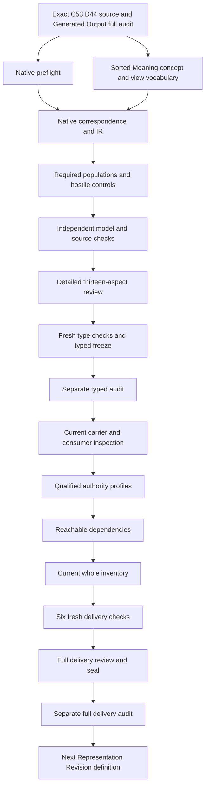

# Representation Revision: types and logic review

This candidate selects cal.definition.representation-revision@1.0.0-candidate.1, admitted-current by C28. It formalizes necessary exact revision, predecessor/postimage, preservation, history, evidence, validation, owner-selection and rollback declarations. Actual meaning equivalence, computed hashes, storage immutability, executable rollback, consumer correspondence and independent authority remain separate. Definition admission and finite declaration checks do not accept a whole translation or mechanized proof.

Projection Specification's 8,509-file full seal and separate actual audit precede this native unit. Native author verifies every prior recorded file hash, all 201 original source files, the exact selected source, A04/C01/E02 receipts and SWU write scope before creation. There are now 95 native per-definition T candidates against 183 current identities, leaving 88 without T. The last completed full inventory still records 94 partial drafts until the current consumer/dependency/inventory delivery. Whole translations accepted and whole-definition proofs remain zero. The complete episode and its final review remain active obligations.

## 1. Exact target and source authority

The source digest is 5bb818e70b0281dc14edcd4dade418335f50df93bc30c607823ecce5b3349850. Current admission is CAL-DECISION-0028-CRAFT-FOUNDATION-V1. Source checks bind the current snapshot row, C28 owner-admitted decision, exact selected Definition, authorization token, manifest and validation-receipt bytes. The source scope is scope:cyberalchemy-lab-semantic-versioning. Its outer Definition classification and embedded candidate-authored lifecycle posture remain preserved beside the current admission overlay.

The candidate body defines representation-versioning semantics without reclassifying, replacing, mutating or admitting any CTX08 artifact. Its retained residues include Definition-owner admission required, an unauthored Representation Revision Artifact Type and CTX08 replacement not authorized. These historical source bytes are not rewritten merely because C28 now admits the Definition. The current registry observation has 143 contract rows and 121 admitted-current rows, with no direct reference to this Definition. That is a bounded selected-catalog observation, not a claim about every repository consumer.

The model can describe a revision without producing one. Reading source documents, checking digest bindings and projecting Markdown are evidence of exact selected bytes. They do not authenticate equivalence evidence, install a canonical postimage, select an owner decision, execute rollback or grant authority to an instance. The source remains normative; all denotation choices and claimed correspondences in this packet remain candidates for independent review.

## 2. Local source use and voice precedence

The embedded local references select cal.definition.definition@1.0.0-candidate.1 and cal.definition.bounded-context@2.0.0-candidate.1. Their captured current or historical exact version rows, recorded SHA values and live local bytes are checked. The source checker selects no external legacy section for Representation Revision. Those qualified byte selections do not establish that the whole upstream theories share this model's meanings, or that the references themselves accept the new translation.

The short formal expression classifies a revision using equal semantic identity, epoch and normative meaning, unequal canonical bytes, and exact predecessor/postimage binding. The normative paragraph additionally names immutable encoding, revision identity, delta, equivalence evidence, validation, owner selection and rollback. Boundaries require preserved predecessor history, exclude changed meaning and forbid context lineage. Testable wording separately requires distinct digests and no semantic-successor lineage. This interpretation composes those clauses as necessary declaration guards rather than treating the short formula as permission to omit support records.

That composition is explicit source precedence for review. The candidate cannot silently decide whether the displayed iff is intended to include every support condition, or whether additional guards govern an already classified record. The loss list retains that decision. Plain-language intuition and CTX08 examples explain the source without adding migration authority or a hidden operational definition. No source voice or admission record is changed to fit the formulas.

## 3. Sorted signature and qualified denotation

The signature has 22 nonempty sorts, one constant, 64 total functions and 130 predicate/relation signatures, totaling 217 declarations. RevisionReference and RevisionIdentity are distinct from RepresentationReference. SemanticIdentity, EpochReference and MeaningReference retain the preservation axes. ByteStateReference and DigestReference retain canonical-state and digest distinctions. SchemaReference, ArtifactTypeReference, FieldLayoutReference and EncodingReference represent four possible representation-change dimensions.

DeltaReference, EquivalenceEvidenceReference, ValidationReference, OwnerSelectionReference and RollbackReference represent support records. OwnerReference and ScopeReference retain the selected owner and scope. ExclusionsReference and OwnedModelReference refine the source's excluded semantic changes. Token contains the EMPTY sentinel and ordinary nonempty handle labels. A nonempty type domain is an evaluator convention rather than evidence that a real revision or support record exists. A total selector supplies a candidate value without proving that a declared field exists.

Every symbol is qualified by exact source version and candidate scope. Equal printed labels in Semantic Epoch, Bounded Context, Derived Refresh or other theories do not identify their denotations. The model imposes no global injectivity on declared RevisionIdentity labels: a supplied control permits duplicate labels while retaining distinct record references. Real identity uniqueness, alias resolution and record completeness require reviewed maps. These proposed reference sorts neither create canonical Definitions nor establish real-world disjointness of their subjects.

## 4. Applicability, revision fields and exact endpoints

RevisionApplicable is equivalent to RevisionInScopeDeclared. Every selected revision declares classification and immutability. Its classification agrees with the source's formal conditions over its nominated before/after representations. Selected revisions require exact identity, predecessor, postimage, preserved semantic identity/epoch/meaning, pre/post digest, delta, evidence, validation, selection, rollback, owner and scope bindings. Each target must have a declared typed nonempty handle. The binding relations admit precisely the nominated target and reject conflicting additional field values.

ExactPrePostDeclared is a ternary relation over the revision and two RepresentationReference values. For each selected revision it holds precisely for the nominated predecessor and postimage. A hidden tuple with a second postimage therefore fails even when the visible pair is correct. Removing the nominated tuple also fails. Total selector values alone cannot rescue either missing or conflicting relation declarations. An outside revision may carry independent tuples without importing them into selected guards.

Both endpoint representations declare exact semantic and representation fields, canonicalness and immutability. The predecessor additionally declares historical posture; the postimage declares candidate-postimage posture. These flags express the intended record roles without proving an actual installation. Multiple revisions can share one predecessor, as the baseline does. The model does not require global tree uniqueness, source-record completeness or one revision per semantic identity. Their full universes and reference/content bindings remain owner-reviewed obligations.

## 5. Preserved identity, epoch and normative meaning

For selected r, let a0 = revisionBefore(r), a1 = revisionAfter(r). The semantic conditions require identity(a0) = identity(a1), epoch(a0) = epoch(a1) and meaning(a0) = meaning(a1). The revision's own preserved identity, epoch and meaning fields equal both endpoint selectors. Its declared scope likewise matches both endpoint scopes. Endpoint exclusions and owned-model references remain equal, reflecting the source's exclusion of changes to meaning, scope, exclusions or owned model.

ExistingEpochDeclared holds for the preserved epoch. That keeps an existing semantic epoch distinct from the new representation record. The baseline includes revisions preserving two independently supplied epochs and semantic identities. Shared predecessor history and different preserved epochs are demonstration populations rather than source-wide obligations. Deleting a demonstration can leave a consistent theory while losing its required example coverage; those two judgments are kept separate.

Changing an endpoint's declared semantic identity, epoch, meaning, scope, exclusions or owned-model selector fails the necessary guards. Matching labels or context IDs cannot make those changes disappear. Conversely, equal opaque references are not proof of actual meaning equivalence. The source explicitly requires evidence and owner selection. This model exposes those necessary records while retaining actual semantic equivalence and authentic owner judgment as independent outcomes.

## 6. Canonical states and digest declarations

The formal conditions require state(a0) != state(a1), representing the source's changed canonical bytes. The revision's pre/post digest selectors equal the endpoint digest selectors, and those digest labels differ. For each endpoint, the declared digest equals stateDigest of its declared ByteStateReference. Byte-state difference and digest-label difference are separately represented rather than collapsed into one opaque reference inequality.

A control with different state labels and equal declared digest labels fails the distinct-digest guard, even when both labels follow the supplied stateDigest function. A changed digest label with unchanged state also cannot satisfy the complete conditions. These controls reveal inconsistencies in candidate declarations. They do not execute a digest algorithm, prove hash injectivity, or establish that the state tokens denote different actual byte strings. A declared state-to-digest function can map unrelated outside states without a global collision-free axiom.

Exact preimage/postimage computation, source-current byte selection, immutable storage and algorithm/version choice need accepted operational correspondence. An endpoint reference may be exact in the supplied table while its real bytes are stale or unauthenticated. The 36 independent actual-outcome targets retain DigestComputation and CanonicalStateFidelity for that reason. The record-level equalities do not certify the physical or runtime facts they are intended to describe.

## 7. Representation delta and change dimensions

The selected revision declares at least one of schema binding, Artifact Type representation contract, canonical field layout or encoding changed. Each change flag is equivalent to inequality of the corresponding endpoint selector values. These four alternatives form an inclusive disjunction. The baseline includes a schema-only revision, an encoding-only revision and a revision with several dimensions changed. An additional control permits all four dimensions simultaneously.

Changed canonical-state tokens without any declared change dimension fail the combined guards. An asserted encoding change while its endpoint encoding selectors remain equal also fails. These choices make the normative change list inspectable as proposed declaration semantics. Their exact relationship to actual byte differences requires source-owner acceptance; no parser, schema migration, encoding transform or canonical rewrite runs here.

The nominated DeltaReference binds the same predecessor and postimage. Exact endpoint matching is necessary to prevent a delta for another change being substituted. It does not establish that the delta is complete, computes the full field difference or correctly represents compatibility. Schema and Artifact Type contracts remain distinct sorts. Accepted type-contract denotation, field layout, encoding aliases and compatibility evidence remain downstream rather than being inferred from labels.

## 8. Equivalence evidence, validation and owner selection

The nominated equivalence record has exact before/after and preserved-meaning bindings plus a recorded equivalence-claim posture. Its endpoints match the revision's pair. The nominated validation record has exact before/after/revision bindings plus recorded validation posture. The nominated owner-selection record binds the revision, the same evidence record, selected owner and selected scope. Removing a record declaration or binding it to another selected revision fails the necessary guards.

These records remain declarations. An evidence reference cannot prove actual equivalence, a validation reference cannot prove execution or adequacy, and an owner-selection reference cannot authenticate a decision. The model deliberately does not invent validation PASS as a normative requirement. The source says validation is bound; it does not supply a complete success, failure, pending or indeterminate posture algebra. Recorded validation is therefore kept distinct from actual successful checking.

Each support role uses a singular nominated selector in this candidate. Real systems may have several evidence records, bulk owner selections, shared validation receipts or additional support links. The source does not define their complete universes, aliases or aggregation rules. Such maps may preserve the model through governed decomposition, or require a revised interpretation. No implicit whole-document proof, accepted source relation or cross-definition common carrier is inserted to close those gaps.

## 9. Historical immutability and rollback

The predecessor remains a declared canonical immutable historical representation. The postimage and revision record likewise declare immutability. An in-place mutation of decision-bound bytes is prohibited for selected revision declarations. These conditions retain the source's historical preservation boundary without deleting older representations or substituting a new semantic epoch. A shared predecessor can remain history for multiple independent candidate revisions.

The nominated RollbackReference binds the revision and the exact before/after representations, and declares a recorded route. A rollback record naming the wrong postimage or another revision fails. This is the minimum inspectable distinction between declaring recovery metadata and demonstrating a recovery action. No actual restore, database write, artifact swap, overwrite or external side effect takes place during formalization.

Actual rollback executability and successful recovery remain separate targets. They require an authentic route, current endpoints, relevant storage guarantees, permissible effects and runtime evidence. The model does not derive those facts from nonempty references. Historical/postimage immutability likewise remains an independent actual target, because a predicate named immutable cannot enforce persistent storage or prove the absence of unauthorized writes.

## 10. Lineage and Parent-Instance Authority Separation

Selected revisions cannot declare themselves Semantic Epochs or Derived Refreshes, cannot claim equivalence from labels/context IDs, and cannot claim that digest labels, schema PASS, validation references or Definition admission prove stronger facts. The selected declaration excludes in-place decision-bound mutation, unchanged-input human projection refresh, source-scope expansion and semantic-successor/context lineage creation. These boundaries distinguish representation change from semantic change and refresh without altering independently admitted source meanings.

Existing semantic epochs are permitted. Independently supported authority is also permitted: the baseline supplies actual Authority for r2 while r0 and r1 have every actual-outcome flag false. Parent epoch or meaning classification does not supply instance authority. Source admission, canonical endpoint posture and a recorded owner selection cannot by themselves produce approval, adoption, publication, deployment or other independent effects.

The absence of declared lineage does not certify that a real runtime emits nothing. Actual NoSemanticSuccessorLineage and NoContextLineage remain independent outcomes. Nor does this candidate erase independent semantic lineage established elsewhere. For each actual-outcome target a supplied model satisfies the necessary theory and required populations while leaving the target false. This establishes a bounded inference ceiling, not a denial of independently evidenced facts.

## 11. Complete source account and unresolved correspondence

All thirty selected nonempty string units are accounted at exact selectors and complete character spans. Seventeen clauses are encoded, eleven explanatory and two deferred. There are ten distinct encoded formula values drawn from twelve primitive guard templates. Plain-language intuition, notation and CTX08 examples remain explanatory. Authority-scope wording and the candidate body's nonexecuting claim ceiling remain deferred for owner correspondence.

The packet binds 23 direct exact-version semantic uses and sixteen separately qualified comparison sources. They identify dependencies for independent review. They do not import whole upstream assumptions into this primary theory, establish shared denotations or classify semantic cycles. All symbols retain source qualification, populations retain pending review refs, and the assumption lists are empty. The correspondence checker accounts characters without treating character coverage as accepted semantic equivalence.

Twenty-two source findings remain unresolved. They expose admission/translation separation, formal/normative precedence, reference/content maps, digest/state semantics, support-record universes, actual immutability, evidence and selection authenticity, rollback behavior, lineage, current carriers, shared consistency and proof limits. There are eleven required demonstration populations and 130 unresolved population/denotation obligations. Source-owner review must accept actual meanings and maps rather than a validator silently inventing them.

## 12. Actual controls, source checks and checker limits

Prepared and native checks pass 266 controls: 59 T-true cases, 199 T-false cases and eight malformed-model rejections. The malformed controls independently exercise empty or missing domains, missing/partial functions, ill-sorted results and arguments, and malformed predicate tuples. Positive models retain outside records, independent outcomes, multiple representation dimensions and shared predecessor history. Negative models expose hidden endpoint tuples, semantic drift, equal state/digest labels, missing support and conflicting exact bindings.

All four native producers terminate zero with empty stderr. The source checker passes 58 concrete checks, including exact C28 admission/authorization/manifest/validation bytes, two exact local upstream selections and 33 source/query obligations. Two pure Definition projections equal the unchanged 4,652-byte human source projection at SHA 07e6cf51fd762e32866970e16fa92ddeff357a96e4f188d4ebe026be17969cd5. Only isolated pure renderer functions execute; no actual revision or consumer writer runs.

Native t.json has 286,979 bytes and qualified IR has 36,860 nodes. Maximum prepared evaluation uses 27,021 steps. These fit unchanged ceilings of one million input bytes, 50,000 tree nodes, 100,000 steps and thirty-second evaluation timeout. No RR preparation or native producer has failed. Three fresh type checks, a sixteen-input freeze and separate actual typed audit must pass to close this stage. Full carrier/dependency/inventory delivery remains later work. Successful finite checks do not establish a universal or mechanized whole proof.

## 13. Detailed DAG and whole-episode continuation

The delivery graph orders exact source selection, type construction, IR, correspondence, examples, actual source observations, consumer maps, qualified profiles, reachable dependencies, current inventory, fresh checks, full review/seal, separate audit and the next unit. Type review precedes consumer adoption. The current typed freeze must preserve its inputs exactly and cannot substitute for the later full delivery. Source-owner fidelity, common-carrier consistency, cycle classification and whole proofs remain separate obligations.

This seventeen-node, seventeen-edge graph is a deliverable DAG, not proof of an acyclic semantic dependency graph. Schema Evolution Invariant native creation remains downstream of this unit’s full seal and separate actual audit. Its normalized invariant label must preserve the C53/D25 schema-amendment-witness source meaning. The original episode retains 183 identities, 189 versions, 201 source files, 121 tasks, 511 planning edges, 797 work units and 36 frontiers. Its latest completed full inventory remains 94 partial drafts; working native count is 95.

An illustrative revision changes the schema binding while preserving exact declared identity, epoch, meaning and other semantic selectors. It supplies immutable historical predecessor, new candidate postimage, distinct state/digest labels and exact delta/evidence/validation/owner-selection/rollback records. It satisfies the proposed guards while actual equivalence, hash computation and rollback success remain false. A counterexample changes the postimage’s meaning reference while retaining matching labels: preservation and classification fail. Missing explicit support or hidden conflicting endpoint tuples likewise fail, even if the visible labels appear correct.

The full delivery still needs exact current Definition/generated/representation/change carriers and source/consumer observations, qualified mapping profiles, dependency graphs, current whole inventory with fresh per-theory witnesses, six full fresh checks, complete review, candidate seal and separate actual audit. The original 183-identity task remains active. No accepted whole translation, whole proof, canonical source mutation, CTX08 replacement or runtime effect is produced by this typed packet.

- RR-FINDING-001: C28 Definition admission and exact local upstream byte selection do not accept this formal translation. Status: unresolved; owner review and accepted map references: pending.

- RR-FINDING-002: The short formal iff and normative support/history/rollback obligations are composed as necessary guards; source precedence remains owner-pending. Status: unresolved; owner review and accepted map references: pending.

- RR-FINDING-003: Semantic identity,epoch and normative meaning reference equalities are declarations rather than accepted actual semantic equivalence. Status: unresolved; owner review and accepted map references: pending.

- RR-FINDING-004: ByteStateReference equality and DigestReference equality are distinct from actual canonical bytes and computed hashes. Status: unresolved; owner review and accepted map references: pending.

- RR-FINDING-005: Distinct declared digest labels are required by testable wording without assuming digest injectivity or collision freedom. Status: unresolved; owner review and accepted map references: pending.

- RR-FINDING-006: The exact pre/post ternary relation binds nominated endpoints and excludes conflicting declared tuples; actual reference/content maps remain pending. Status: unresolved; owner review and accepted map references: pending.

- RR-FINDING-007: Immutable revision/postimage/history flags do not enforce persistent storage,append-only history or write exclusion. Status: unresolved; owner review and accepted map references: pending.

- RR-FINDING-008: New machine-canonical candidate postimage declaration does not establish actual admission,installation or canonical authority. Status: unresolved; owner review and accepted map references: pending.

- RR-FINDING-009: The preserved scope,exclusions and owned-model selectors are a proposed refinement of meaning preservation requiring owner maps. Status: unresolved; owner review and accepted map references: pending.

- RR-FINDING-010: The four representation-change flags are an inclusive disjunction and match declared selector differences,not actual change detection. Status: unresolved; owner review and accepted map references: pending.

- RR-FINDING-011: Schema and Artifact Type representation contract references are distinct; their exact contract denotations and compatibility need review. Status: unresolved; owner review and accepted map references: pending.

- RR-FINDING-012: Singular nominated delta/evidence/validation/selection/rollback records are not proof of complete support-record universes; bulk/shared/multiple evidence needs maps. Status: unresolved; owner review and accepted map references: pending.

- RR-FINDING-013: Exact delta endpoints do not establish a complete or correctly computed representation delta. Status: unresolved; owner review and accepted map references: pending.

- RR-FINDING-014: An equivalence claim record and its selected meaning/endpoints do not authenticate evidence or prove meaning preservation. Status: unresolved; owner review and accepted map references: pending.

- RR-FINDING-015: Validation record binding and recorded posture do not require or invent actual execution,PASS,adequacy or proof. Status: unresolved; owner review and accepted map references: pending.

- RR-FINDING-016: Owner-selection reference,principal and scope declarations do not authenticate a decision or grant separate effect authorization. Status: unresolved; owner review and accepted map references: pending.

- RR-FINDING-017: Explicit rollback endpoints and route posture do not establish executability,successful recovery or effect permission. Status: unresolved; owner review and accepted map references: pending.

- RR-FINDING-018: No declared semantic-successor/context lineage does not certify actual absence of runtime emissions or erase independent lineage. Status: unresolved; owner review and accepted map references: pending.

- RR-FINDING-019: Existing epochs and independently supported actual authority remain allowed;parent meaning or epoch cannot supply instance authority alone. Status: unresolved; owner review and accepted map references: pending.

- RR-FINDING-020: CTX08 examples and retained candidate-body/residue metadata remain nonexecuting context beside C28 current admission. Status: unresolved; owner review and accepted map references: pending.

- RR-FINDING-021: No whole upstream theory,common-carrier acceptance,shared consistency or semantic-cycle interpretation is imported. Status: unresolved; owner review and accepted map references: pending.

- RR-FINDING-022: Complete source-string accounting and finite controls do not establish owner fidelity or universal/mechanized whole proof. Status: unresolved; owner review and accepted map references: pending.

