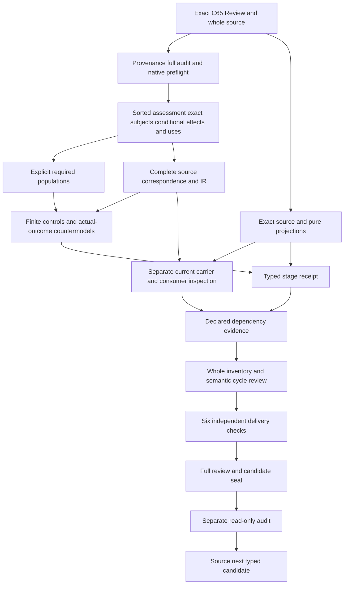

# Review: typed candidate review

## 1. Exact target and candidate claim ceiling

The selected target is cal.definition.review@1.0.0-candidate.1 with digestdb548dded27804654bc978da08c3e509920f814399a295ed59cdcc26589f029d. This unit follows Provenance's full candidate seal and separately successful audit. Its native author, builder, model checker and source checker must have actual successful observations before this review is written. A prepared script or intended outcome cannot substitute for those observations. The candidate preserves every prior seal and all201 selected source files.

The semantic target is an attributable bounded assessment of exact subject versions against declared questions, criteria, evidence, alternatives and a claim ceiling. It remains distinct from any approval, validation, fact, execution or admission effect. Those effects are possible only under a separate Decision in the source. The candidate preserves that conditional boundary as necessary declaration guards rather than banning all legitimate effects or treating assessment as an automatic grant.

Types and logical requirements precede carrier correspondence and live consumer evidence. Complete source character accounting, compiled IR, finite controls and countermodels qualify a partial translation. They do not establish an accepted whole Definition, an adequate real assessment, an authenticated subject revision, a granted Decision effect or actual authority. The full episode remains active with its original scope, source-owner fidelity obligations, whole proof requirements and final complete explanation.

## 2. C65 admission and whole-file lineage

C65 admits the current positive Review Definition through the integrated Lab definition model. The source checker binds its exact current registry row, decision, authorization, candidate and authorized Definition digest. The candidate marks Review as new-lab-id. This is independent of the C53 legacy normalization workflow and C66 specialization resolution. The unit does not import a legacy H2 selector, a C12 prototype or a resolution overlay merely because adjacent definitions used those paths.

The selected source is cal.source.integrated-model-review@2026-10-05 with a whole-file selector. The local source is .arcanum/ontology-vault/2026-10-05-lab-integrated-model.md at1c92c720e176027597db09579276f9ea6e1d13b3d52bda233f9b0c4543dcb5eb. Its embedded candidate-unadmitted posture and null source_admission_ref remain unchanged. Current admission is checked as a separate overlay. C65's historical173 current identities and179 versions do not replace the episode's current183/189denominator.

C65 admitted60 Definitions and zero Artifact Types, relation kinds, endpoint pairs or consumers. Exact byte and admission observations establish the selected source lineage. They do not authenticate real assessment evidence or grant an instance effect. Definition schema and deterministic projection remain separately checked observations. Current carrier contracts, Decision grants, consumer behavior and accepted source fidelity require additional evidence and independent maps.

## 3. Sorted signature and qualified names

The signature separates Review, SubjectVersionSet, QuestionSet, CriterionSet, EvidenceSet, AlternativeSet, ClaimCeiling, OwnerRoute, AssessmentScope, Context, SubjectVersion, ReviewUse, DefinitionVersion, ReviewEffect, Decision, EffectKind, Contract and Token. Review is an assessment carrier. Its subjects, collections, attribution, scope and claim ceiling have distinct types. A ReviewUse binds a Review to a Definition version and scope. A ReviewEffect binds a Review to a separate Decision, effect kind and contract.

EMPTY is a Token constant. CURRENT_VERSION is a DefinitionVersion constant. Five EffectKind constants preserve admission, approval, validation, fact and execution distinctions. No numeric ranking, exclusive real-world role taxonomy or exhaustive list of every possible effect is invented. Total functions cover the declared domains, including outside-scope records. Selected guards require declared targets and nonempty references;totality alone does not make every carrier conforming or authenticate its contents.

Every symbol is qualified by the exact selected source version and candidate scope. Matching printed names do not merge this interpretation with Decision, Evidence, Validation, Finding or Provenance theories. Descriptive sorts do not create missing canonical Definition identities. Dependency sources remain individually qualified. Owner review must accept the actual carriers and denotation maps, including collection contents, exact subject revisions, claim ceiling and conditional effect semantics.

## 4. Assessment genus and required components

ReviewApplicable is equivalent to ReviewInScopeDeclared in this candidate. That is a proposed scope map rather than a sufficient test of assessment adequacy. A selected Review requires AttributableAssessmentDeclared and BoundedAssessmentDeclared. It references a subject-version set, questions, criteria, evidence, alternatives, claim ceiling, attribution route, assessment scope and context. Each selected component has a declared typed carrier and nonempty handle.

This structure retains the source's assessment genus rather than reducing Review to a title, status or passing schema. Questions and criteria remain different from evidence. Alternatives remain different from conclusions. The claim ceiling remains a separate obligation rather than an inferred consequence of a positive outcome label. The formal expression also requires GovernedIdentityOrRecordDeclared. That predicate does not impose an unsupported exclusive choice between an identity and a record.

The declarations do not establish that a reviewer examined the evidence, considered every relevant alternative, used adequate criteria or stayed within a justified ceiling. They preserve necessary record contents in a proposed interpretation. Actual attribution and assessment adequacy remain separate query targets. Outside Review carriers remain possible and receive dedicated controls. A complete structural witness therefore supports bounded checking while leaving the accepted real-world assessment map pending.

## 5. Exact subject versions and multiplicity

A selected Review's subject-version set must have at least one declared member. Each member of that selected set requires ExactSubjectVersionDeclared, a nonempty SubjectVersion handle, a nonempty subject-identity token and a nonempty exact-revision token. This preserves the source's exact subject-version requirement in a proposed collection map. The tokens are references, not authenticated subject or revision evidence.

The model includes two exact revisions of one subject in a single Review. Multiple versions are permitted, and shared subject identity does not collapse their revisions. A second Review can assess one of those versions without being forced to duplicate the first Review's complete subject set. The candidate imposes no latest-version requirement, no version-label arithmetic and no global uniqueness of a Review per subject. Owners must still accept how real subject identities, revisions and membership correspond to these proposed carriers.

Controls remove all subject members, remove an exact-version declaration, empty identity or revision references, and empty the selected handles. They check the necessary guard behavior independently. Those observations do not prove source authenticity or exact reference resolution. The at-least-one subject condition is retained as a proposed assessment population map;actual collection semantics and completeness require source-owner review before whole fidelity is claimed.

## 6. Questions, criteria, evidence and alternatives

QuestionSet, CriterionSet, EvidenceSet and AlternativeSet are distinct declared collection carriers. Their nonempty handles preserve references to the named assessment components. The primary theory does not silently assume how many questions, criteria, evidence items or alternatives every legitimate Review must contain. It does not infer a complete content set from a collection label or force a universal numerical score for criteria.

These cardinality and content-policy questions remain explicit losses. A real carrier might require a nonempty list, a structured empty declaration, or a route explaining why an alternative was not considered. That carrier rule must be checked separately and mapped to the source. The selected subject set receives its own explicit membership guard;the other collection denotations remain proposed without invented universal membership taxonomies. Their actual adequacy and coverage remain independent targets.

Questions define what is assessed, criteria define the basis for judgment, evidence supplies bounded support, and alternatives retain the comparison space. None of those fields becomes an approval or proof merely because it is present. The model separates those responsibilities and tests removal of each declaration. It does not claim to evaluate the real evidence or authenticate every source. Accepted assessment and consumer maps are required beyond these finite structural controls.

## 7. Claim ceiling, attribution and bounded scope

ClaimCeiling is separately sorted and declared. A nonempty ceiling reference does not establish adequate wording, sufficient support or a safe bound on conclusions. The theory invents no entailment ordering over opaque text and no automatic implication from a positive assessment to a broader claim. ClaimCeilingAdequacy remains an actual outcome independent from structural conformity.

Attribution uses a declared OwnerRoute carrier and nonempty handle. That reference does not authenticate a reviewer, demonstrate that the assessment was performed or establish an authorized owner principal. AssessmentScope and Context remain distinct. BoundedAssessmentDeclared retains the source's necessary boundedness condition, while actual conformity to applicability and exclusions requires accepted denotations and evidence.

The candidate does not infer governance authority from these declarations. A governed identity or record may still have inadequate evidence, an unresolved reviewer route or a badly chosen ceiling. Dedicated controls remove required components and selected handles. Countermodels keep the full structure while actual attribution, adequacy, truth and authority are false. Those checks explain the declaration boundary without manufacturing the missing real-world assessment or scope judgments.

## 8. Current-version and successor uses

ReviewUse has a separate domain and is selected by UseInScopeDeclared. Each selected use references a selected Review, a declared DefinitionVersion and an AssessmentScope. Its version must equal CURRENT_VERSION or satisfy AdmittedSuccessorVersionDeclared. The current token denotes this exact selected Review Definition. The successor declaration remains separate from current equality;the theory does not require an implicit latest revision or impose semantic-version ordering.

Use scope must equal the referenced Review's declared scope, and UseWithinApplicabilityAndExclusionsDeclared is required. These are necessary proposed maps for the first two scientific-formal testable conditions. Equality preserves the declared binding but does not prove that a real consumer respected every applicability or exclusion rule. An admitted-successor label likewise does not authenticate a real admission decision. Actual resolution and scope conformity remain independent queries.

The model supplies both current and successor use witnesses without actual outcomes. Controls remove version declarations, remove successor admission declarations, substitute an unresolved version, change scope or bind an outside Review. Outside uses remain possible without selected guards. Passing these checks does not grant admission, authority, success, identity equivalence or an external effect. The source's third testable condition is retained as explicit no-inference countermodel work rather than a prohibition on independently supported legitimate outcomes.

## 9. Conditional effects and separate Decisions

ReviewEffect is distinct from Review and ReviewUse. A selected effect names a selected Review, a separately declared Decision, a declared EffectKind and a separately declared admitted Contract. DecisionGrantsReviewEffectDeclared binds that exact Decision, Review and effect kind. ReviewHasEffectDeclared links the declared effect to the Review. A selected Review with such a declared effect must have a corresponding selected effect record.

These guards preserve the source's unless-a-separate-Decision condition. They do not ban all approval, validation, admission, fact or execution effects unconditionally. The model includes each named effect kind with necessary separate declarations, and another Review without any declared effect. A custom effect kind is also permitted, so the five source labels are not treated as an exhaustive universe. Pairwise distinct constants protect the named distinctions without defining a numerical authority ordering.

Decision and contract declarations are necessary records, not sufficient evidence of actual grants, admission authenticity or executed behavior. Their whole theories are not imported into this primary interpretation. The checker removes grants, contracts, Decision references and effect records, and observes the selected guard failures. Actual granted effect, authority, execution and scope fidelity remain independently queried. Source-owner review must still accept the declared-role/effect correspondence and the real Decision evidence.

## 10. Fact, validation and actual-outcome independence

Fact is an EffectKind label distinct from actual truth. Approval and Validation are likewise declared effect kinds rather than proofs that an assessment is correct or a validation procedure was executed. The source's conditional effect boundary therefore remains separate from the truth, adequacy and real-world consequences of the assessed subject. A Decision reference cannot establish factual correctness by itself.

Twenty-four Review actual outcomes cover attribution, assessment and component adequacy, subject authenticity, truth, validation, approval, admission, execution, authority, success, identity equivalence, external effects, activation, publication, release, deployment, owner fidelity, consumer alignment and global consistency. Five effect outcomes cover grants, contract-admission authenticity, authority, execution and scope fidelity. Eight use outcomes cover resolution, scope conformity and the source's forbidden term-only inferences. None is selected as an axiom or assumption in T.

Each queried universal implication has a supplied T/I countermodel with its target false and witness condition true. Positive controls permit independent actual outcomes rather than treating a no-inference requirement as an absolute ban. These are bounded observations in the candidate semantics. They do not establish accepted source fidelity or a whole Definition proof. Real grants, assessment adequacy, truth, validation and authority need independent evidence and accepted maps.

## 11. Complete source account and actual finite checks

The source's normative statement is one paragraph with an assessment genus followed by the conditional separate-Decision boundary. The builder splits it at the actual sentence boundary and retains exact selectors, character offsets and excerpt digests. Repeated applicability and boundary statements preserve their own provenance. Every nonempty source string in the required inventory receives an encoded, explanatory or deferred disposition. Complete character accounting makes omissions reviewable without claiming that every proposed formula has accepted denotation.

All three scientific-formal testable conditions are semantic requirements. The first two contribute exact-version and applicability declarations. The third supplies no-inference targets for explicit countermodels. It is not substituted with legacy migration-observation tests. Historical claim ceiling and absence of downstream effects remain separate from the current positive admission overlay. Plain-language intuition, domain context, notation and the60candidate assessment example are explanatory.

The checker recompiles source-qualified IR, compares it with the saved core/correspondence, checks exact dependencies and confirms absence of assumptions. Authored controls cover conforming examples, necessary-guard failures and malformed signature, total-function, sort, tuple, duplicate and domain cases. Source-query obligations bind actual targets to exact excerpts. Native counts below come from actual reports. Fresh contract, model and source checks must qualify the frozen typed receipt and separate audit before full delivery proceeds.

## 12. Carrier boundary and execution DAG

The Review Definition supplies meaning. Actual carrier shape, relation availability, runtime behavior and authority effect require separate admitted contracts. Current catalog, carrier schemas, fixtures, projections and consumer-map gaps must be inspected independently after the typed stage. A passing Definition schema does not prove a carrier stores exact revisions, evaluates adequate criteria, retains alternatives or enforces a Decision grant. No live or private consumer is executed by this typed stage.

The execution DAG puts exact C65 source and Provenance's audit before native Review construction. Sorted assessment and conditional effect/use guards precede explicit populations and complete correspondence. Finite checks and exact source/projection observations qualify the typed receipt. Current carrier hypotheses, dependency evidence and whole-inventory refresh follow. Six actual delivery checks precede full review, seal and separate audit. Source is the next manifest Definition only after that audit.

An acyclic work DAG is separate from a semantic graph containing unresolved cycles. Exact qualified dependency links do not import complete Decision, Evidence, Finding, Validation or Provenance theories. Missing counterpart packets and common-carrier consistency remain separate obligations. The plan gates later native units on concrete evidence while retaining unresolved semantic work. It does not use a draft count or green finite check as proof of full semantic closure or accepted consumer behavior.

## 13. Preservation, owner findings and continuation

The original episode scope remains183 current identities, 189 admitted versions, 201 sources, 121 tasks, 511 planning edges, 797 SWUs and36 frontiers. Review follows76 previously sealed partial drafts and creates a working77th. A later whole-inventory refresh must establish its exact incremental accounting. The immutable I04 selected-eight inventory remains separate and needs a scoped reporting update. Source-owner-accepted whole translations and whole Definition proofs remain zero.

Eighteen findings retain unresolved source fidelity, assessment and collection denotations, subject references, empty collection policy, claim-ceiling meaning, attribution, version/scope correspondence, conditional effects, Decision/contract authenticity, actual outcomes and consumer maps. Their IDs remain listed below. No owner principal or accepted decision is fabricated. Native finite checking can pass while those whole-translation obligations remain pending.

Continue by freezing and separately auditing the typed stage, then inspecting actual current carrier hypotheses and map gaps, refreshing dependencies and whole inventory, running six delivery checks, and producing full review, seal and separate audit. Then proceed with Source. Preserve frozen typed inputs and every prior seal. No canonical authority, private/live state, publication or external effect follows from this candidate. The goal remains active through the remaining definitions, accepted correspondence, whole proofs, semantic cycle treatment and final aspect-by-aspect episode explanation.

Actual counts: {"countermodel_queries": 37, "declarations": 125, "deferred_clauses": 4, "direct_semantic_uses": 34, "encoded_clauses": 12, "explanatory_clauses": 6, "mapped_clauses": 22, "required_populations": 15, "source_units": 21, "unresolved_populations": 65}.

Actual controls: 107; T true 44; T false 56; malformed 7; countermodels 37; source checks 33.

- **REV-FINDING-001** — Exact current C65 Review and local whole-file source admission are distinct from source-owner acceptance of this translation.

- **REV-FINDING-002** — Review is a proposed attributable bounded assessment;membership, attribution and governance declarations require accepted denotations.

- **REV-FINDING-003** — Review, subject-version sets and exact subject versions remain distinct carriers;nonempty identity/revision tokens do not authenticate a real subject or revision.

- **REV-FINDING-004** — Selected subject sets require at least one member as a proposed assessment population map;multiple exact versions and shared subject identities remain permitted.

- **REV-FINDING-005** — Questions, criteria, evidence and alternatives are separately declared collections;content cardinality, empty-collection policy and assessment completeness remain ownerpending.

- **REV-FINDING-006** — ClaimCeiling is separately declared without inventing an opaque-string entailment order or proving adequate wording/support bounds.

- **REV-FINDING-007** — Attribution and Scope/Context handles do not authenticate a reviewer, establish a responsible owner or prove actual boundedness.

- **REV-FINDING-008** — Scope equality on a selected use preserves a proposed declared map rather than actual applicability/exclusion conformity.

- **REV-FINDING-009** — A use requires the exact selected Definition version or a declared admitted successor;references do not authenticate successor admission or require a latest version.

- **REV-FINDING-010** — Admission, approval, validation, fact and execution remain distinct proposed effect kinds, not an exhaustive taxonomy of all real effects.

- **REV-FINDING-011** — Declared Review effects require separately declared Decision grants addressed to the exact Review/effect kind;necessary declarations do not prove actual grants.

- **REV-FINDING-012** — AdmittedContractDeclared preserves the separate-contract boundary without authenticating a real carrier, relation, runtime or authority contract.

- **REV-FINDING-013** — A Review can have no declared effect;the theory does not prohibit legitimate separately granted effect declarations.

- **REV-FINDING-014** — Decision and Contract whole theories are not imported;actual grant, scope fidelity, execution and authority remain independent targets.

- **REV-FINDING-015** — Fact as an effect-kind label is distinct from actual truth;neither a Review nor a Decision reference proves factual correctness.

- **REV-FINDING-016** — All three scientific-formal testable conditions contain semantic requirements;the no-inference condition is handled by explicit countermodels rather than forbidding independent legitimate outcomes.

- **REV-FINDING-017** — Historical candidate/null source posture and C65 historical173/179counts remain separate from the current183/189episode denominator.

- **REV-FINDING-018** — All exact source character accounting, finite controls and countermodels leave source fidelity, consumer maps, semantic cycles and whole proof pending.

