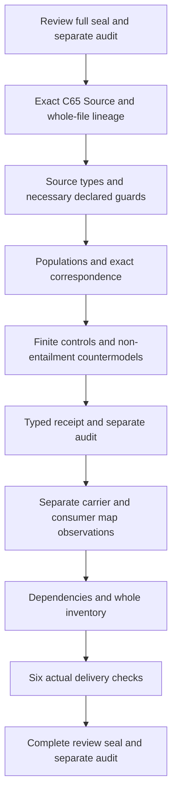

# Source: definitions, types and logic first

The next current Definition is cal.definition.source@1.0.0-candidate.1, selected through C65 and the exact local whole-file integrated-model source. Preserve embedded candidate/null source posture and all previous seals. This preparation creates no native Source unit, interpretation, model, admission or consumer.

Separate Source origin, obtained material, origin reference, integrity boundary, provenance reference, Context, bounded Scope, DefinitionVersion and SourceUse carriers. Content, evidence, data and claim are origin-material role declarations rather than an exhaustive or mutually exclusive ontology. Do not import all Evidence, Provenance or Claim theories into Source's primary interpretation.

A selected Source proposes exact-origin, provenance-bearing, resolvable-reference and integrity-boundary declarations. Nonempty qualified references preserve necessary declared bindings but do not prove actual reference resolution, authenticity, integrity or content truth. A selected SourceUse must bind this exact Definition or a declared admitted successor and remain within its declared applicability and exclusions. No implicit latest-version or unrestricted license policy is inferred.

Retain source boundaries as explicit non-entailment targets. Source alone does not establish truth, currentness, completeness, authority, admissibility or license for every use. Actual outcomes may have independent evidence; do not ban them universally. Similarly retain no term-only inference of admission, success, identity equivalence or external effect.

Explicitly inhabit selected origin/material/reference/boundary declarations and outside scope. Include distinct origin identities, multiple material roles and current/successor use witnesses. Empty material policy, globally unique origin identity, exact revision interpretation, integrity algorithm, temporal currentness, license scope and actual resolution require source-owner acceptance. Add no assumptions to close them.

Inventory all nonempty source strings, assign exact character spans and dispositions, qualify every dependency, compile sorted first-order logic with equality, and construct conforming, guard-failing and malformed models. Bind each source-query target to exact excerpts and supplied T/I countermodels. First run author/build/model/source, then fresh typed replay, frozen receipt and separate typed-stage audit.

Inspect the actual current Source carrier and consumer-map gaps only after that stage. Refresh declared dependencies and the whole current inventory without promoting unresolved cycles or per-definition witnesses into a common-meaning model. Then run six delivery checks, write the complete aspect review, seal and separately audit. Native Source creation requires Review's full delivery seal and separate passing audit first. The original183 identities189 versions201 sources121 tasks511 planning edges797 SWUs36 frontiers remains unchanged; accepted whole translations and whole proofs stay explicit.

