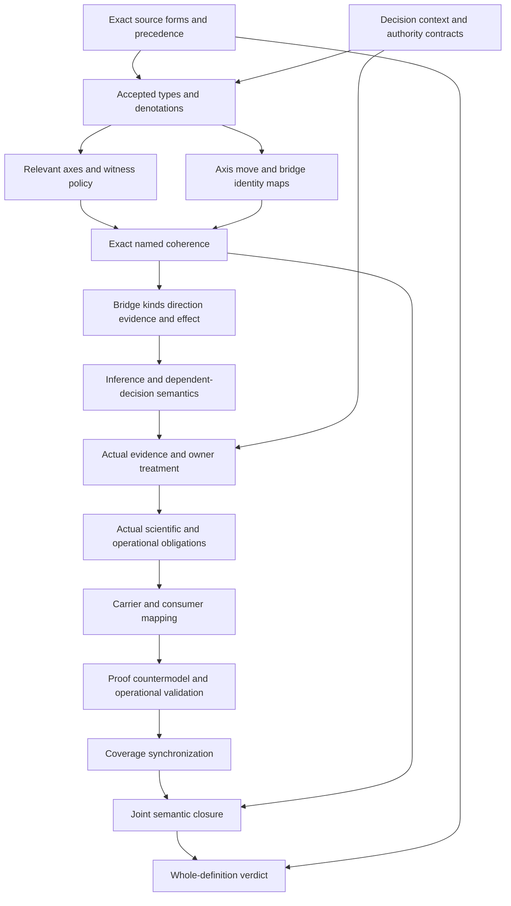

# Root-Axis Independence: typed formalization review

Candidate delivery review. Types-and-logic checks, carrier/profile observations, dependency inventory and six-check replay are recorded in the adjacent reports; finalization and the separate delivery audit determine whether a delivery seal is established. Source fidelity, owner acceptance, actual scientific/operational outcomes and whole-definition proof are not established. Policy is sealed and preserved; Responsibility already has an earlier source-current sealed packet. The complete 183-identity episode remains active.

## 1. Exact source and normalization

The source is cal.definition.root-axis-independence-invariant@1.0.0-candidate.1, digest3a95023cc9372a10a198815e04a94472847be688f8d564db5f1056df2167c308. C53 selects the current admission. The prototype reclassifies CAV2-D29 Axis Orthogonality Invariant; the accepted reclassification is a source observation, not proof that every semantic denotation in this interpretation has been accepted.

The local selected D29 section is3,406 bytes, digest0446997d1a5e8331251ec6b2a4f8971d87650ac083a997e03223e1dc7dd86f5d. Its whole-file hash agrees with the recorded source-use admission. The producer-declared location remains absent and repository identity is not authenticated. RAI-FINDING-001 retains normalization/precedence and legacy identity equivalence as owner questions. RAI-FINDING-010 retains source fidelity, consumer and closure questions.

The selected current registry row, admission manifest, recorded authorization and source-use record are different evidence surfaces. Agreement among their digests establishes which bytes this candidate analyzed. It does not authenticate the absent producer checkout or resolve the semantic relationship between a normalized invariant and every historical use of “orthogonality.” The current admission overlay also leaves the retained body’s historical candidate posture intact. A future fidelity decision must explicitly name its source version, selected excerpts, denotation changes and accepted losses. Neither the normalization decision nor this agent’s review substitutes for that decision.

## 2. Source forms and accounting

Twenty-two source units map to26 spans: six encoded, nine explanatory and eleven deferred. Six distinct encoded formula values compose ten primitive templates. The normalized invariant characterization, decision-qualified governance pairs, explicit bridge rules, necessary non-silent inference, question routes and role exclusions have candidate formulas.

The full outer boundary remains deferred and supplies five exact source query obligations. The repeated scientific boundary supplies role exclusions, without assuming actual scientific outcomes. Source testable conditions and historical claim ceiling remain observation-measurement clauses. The character account covers all selected source strings; complete accounting is not complete translation or owner fidelity. Retained slider/wire intuition and domain references remain explanatory.

The correspondence inventory splits only exact selected character ranges. Encoded clauses retain source selectors, start offsets and excerpt hashes; explanatory and deferred ranges remain visible in the same denominator. This makes omission review possible even when the finite logical fragment is deliberately limited. The ten primitive templates are a construction aid, whereas the six encoded source formula values are the actual clause inputs to the interpretation. Counting templates twice would inflate coverage. The boundary obligations are queried independently because importing their desired conclusions as assumptions would turn a non-entailment check into a circular success.

## 3. Types and signature

The ten sorts are Invariant, Context, Decision, Axis, Pair, Move, Bridge, Scope, Evidence and Token. Invariant holds normalized identity and role restrictions. Context and Decision select the governed situation. Axis and Move are separate: having an axis does not establish a valid move. Pair binds two axes and their moves to one decision-qualified context. Bridge records a proposed reason to relate them. Scope, Evidence and Token remain independently typed carriers.

There are102 declarations: ten sorts, six constants, thirty total functions,54 unary predicates and two binary relations. AxisDeclaredInContext and AxisRelevantForDecision make the selected axis set explicit. Total functions provide declared maps for all supplied objects, including outside-scope objects; applicable guards control where obligations hold. Actual scope, evidence and reference denotations remain pending. RAI-FINDING-002 covers applicability maps; RAI-FINDING-003 covers identity and actual independence.

The maps are many-sorted first-order functions with equality. There is no subtyping, statistical distribution, modal accessibility, temporal execution trace or dependent type hidden behind these declarations. In particular, Context and Decision objects are distinct even when their printed names coincide. A function returning an Evidence object records a candidate binding; it does not assert that the corresponding evidence is admissible. Totality is a model-structure requirement, so placeholder values exist for outside-scope objects. Governed guards keep those placeholders from becoming mandatory live carriers or globally accepted facts.

## 4. Normalized invariant and applicability

RootAxisInvariant is characterized by preserved classification/source relations, no silent sibling merge and exact normalized identity/kind/carrier/owner-scope/source values. These are candidate meaning markers, not an admitted invariant instance. A Pair is governed when governance consideration and relevant-axis selection are declared.

A governed Pair binds this invariant, a governed Context and a Decision whose context agrees. Source and target Axis identities differ, both are declared in that Context, and both are relevant for that Decision. Their named handles may coincide while their Axis identities remain distinct. The baseline includes an outside-governed Pair so the theory cannot force every supplied object into the same applicability population.

Applicability is selected through two declarations rather than inferred from a directory, artifact schema or consumer name. Removing either declaration while retaining PairGoverned falsifies its characterization. Removing both and the governance flag can instead place an object outside the selected population, provided the separate required population policy still has its witnesses. Owner review must decide whether this selection faithfully represents “governed context” and “relevant axes” for each consumer. This packet supplies no exhaustive axis taxonomy and does not claim every classification, lifecycle or scientific object falls under the same governance rule.

## 5. Move bindings and independent movement

Each governed Pair binds a first and second Move. Their Axis, Context and Decision maps agree with the Pair's respective endpoints and decision context. These constraints prevent an unrelated move from being substituted merely because its label resembles the intended move.

The model deliberately permits two separately valid movement declarations without a bridge. That Pair has no claimed cross-axis inference. The source says a move does not imply another axis movement without an explicit bridge; it does not prohibit independently authorized interactions. The required population BothAxesMoveIndependentlyWithoutBridge makes this distinction nonvacuous. No actual execution or authorization follows from ValidMoveDeclared.

The first and second move maps bind positions without requiring temporal precedence or causality. Only a claimed inference requires ValidMoveDeclared on the first move. A supplied control removes validity of the second move while retaining T; it fails the specific two-valid-independent-moves population witness. This separates an obligation imposed by the clauses from an example required by this candidate’s witness policy. The distinction prevents a test fixture from silently strengthening the universal theory. Actual scheduling, authorizing principals, read/write effects and execution histories belong to later accepted contracts.

## 6. Bridge presence and eligible kinds

For a governed Pair, PairHasBridge agrees with BridgeDeclared on the selected Bridge object. An explicit Bridge belongs to at least one declared source kind: typed coupling, gate, schema rule, validator or owner decision. The source alternatives do not establish mutual exclusivity; a positive control permits overlapping kinds.

The source offers explicit bridges as exceptions to unrepresented implication, not as automatic licenses for every co-change. A named bridge can exist while actual bridge admission, evidence adequacy or authorization is false. RAI-FINDING-004 retains bridge presence/kind denotations and admission as independent questions. Each of the five kinds has an explicit supplied witness, without claiming a live artifact of that kind exists or has been adopted.

The carrier catalog currently has 143 rows, including 121 admitted-current rows. Seventeen checks examine the selected catalog, normalized prototype, D29 selector, reclassification disposition and Definition shape. They find no admitted type bound directly to this Root-Axis version and no current generic invariant carrier. The migration prototype remains prototype-scaffold with authority_effect none, an empty admitted-schema reference and an explicit family-specific type gap. The current generic Definition/v2 carrier instead binds the separately selected current Definition meaning. A generic semantic record therefore cannot be treated as an executable bridge adapter.

## 7. Endpoints, direction, evidence and effect

For an explicit Bridge, Context and Decision agree with the Pair. Source and target Axis endpoints agree exactly. Direction or symmetry must be named, with a nonempty direction token. An evidence reference has a nonempty handle, and an effect token is nonempty.

These checks establish declared coherence and presence. They do not interpret arbitrary direction strings, authenticate evidence, demonstrate scope-specific sufficiency or cause an effect. The owner-decision example names symmetry, and another positive control permits both direction and symmetry markers. RAI-FINDING-005 covers these maps and their actual meanings. A later adapter must resolve them rather than treating Token presence as proof.

Twenty-eight qualified binding hypotheses retain identity, classification, source, context, decision, endpoints, moves, bridge, direction, evidence and effect; 26 reject changed bindings or unsupported inferences. Forty-five finite axis/bridge frames exercise the necessary guards; 32 are rejected. Their accepted cases include separately moving axes, five bridge kinds, symmetry, overlapping kinds, a Gate with a separate coupling reference and outside-scope selection. These frames are authored candidate checks and contain no runtime execution evidence. Their flag fields explicitly deny actual bridge authority, universal independence and execution claims.

## 8. Necessary inference and dependent decisions

A claimed cross-axis inference on a governed Pair requires an explicit Bridge, an InferenceNotSilent declaration and a declared valid starting Move. An uncoupled governed Pair instead requires IndependentVariationDeclared and no claimed cross-axis inference. These are necessary declaration guards; they do not establish universal semantic independence.

If a Decision depends on co-change, the Pair also needs a separately declared typed-coupling representation and a nonempty coupling reference. A Gate Bridge can satisfy its own kind and use that separate representation; it does not become identical to Typed Coupling. RAI-FINDING-006 concerns inferred movement and actual authorization. RAI-FINDING-007 concerns the independent coupling obligation and accepted dependency meaning.

Co-change dependence is a declared obligation trigger. It is distinct from an observed correlation, actual coupling admission or demonstrated effect. A Gate can be eligible to justify a declared relation and still fail the additional coupling-reference requirement. Conversely, an object carrying a coupling token cannot bypass the explicit bridge, exact endpoint and non-silent inference guards. The conjunction is intentional: none of its individual labels is a sufficient authorization condition. A future accepted operational adapter needs actual decision ownership, effect scope, evidence treatment and failed-gate behavior before any governing outcome can be reported.

## 9. Question routes and sibling meanings

Classification questions require a declared classification reference; lifecycle-component questions require a declared lifecycle reference; questions about non-independent axes require an explicit typed-coupling representation. These candidate routes account for applicability references to D22, D23 and D16.

Current Classification Orthogonality, Governance-Axis Independence and Typed Coupling definitions remain separately qualified sources. They are compared without being composed into T. RAI-FINDING-008 retains accepted routing and sibling denotations. A shared legacy relationship or similar name cannot merge normalized identities or import a current sibling carrier/schema automatically.

Direct semantic uses are version-qualified references, not imported assertions. The packet records 35 such uses to expose its selected dependency surface. Their dependency-link rationale describes proposed axes, bridge kinds, scope and evidence/effect maps. The comparison packet separately selects twelve sibling sources and keeps comparison_assembled_into_primary_T false. This preserves independent meanings for classification questions, lifecycle components and dependent co-change, while leaving their cross-definition denotation maps unresolved. Transitive graph reachability will reveal missing counterpart packets and cycles; it cannot itself accept those maps or settle which owner’s definition governs a conflict.

## 10. Scientific and operational claim boundaries

Root-Axis governance orthogonality does not supply IsolationRole, StatisticalIndependenceRole, HilbertOrthogonalityRole, ProjectorOrthogonalityRole, ContextualityTheoremRole or ConsistencyGuaranteeRole. Their exclusions are semantic role restrictions. Actual scientific propositions remain external queries, not universal claims that independent evidence could never establish them.

The five scientific boundary obligations retain the same exact whole-source excerpt outside T. Other targets include actual authority, admission, activation, external effect, owner fidelity, consumer alignment, authorization, bridge admission, co-change execution, evidence adequacy, owner approval, decision success, semantic independence, isolation and universal frame preservation. RAI-FINDING-009 retains scientific/data-model interpretation. No statistical model, Hilbert space, contextuality proof or consistency theorem is imported into this first-order fragment.

Actual outcome predicates are intentionally unconstrained by the selected theory. Positive controls can toggle them without manufacturing a scientific theorem, while baseline countermodels leave them false with all candidate clauses and required populations satisfied. The twenty countermodels therefore establish failures of entailment in this chosen fragment, not that the real system can never achieve those outcomes. Isolation is similarly distinct from non-implied movement: separately authorized interaction remains possible. An accepted statistical or consistency result would require its own assumptions, domain, evidence and proof, all outside this governance characterization.

## 11. Model and source evidence

There are82 independently evaluated controls:29 satisfy T,46 falsify T and seven are malformed-model rejections. All20 actual-outcome queries have supplied T/I countermodels. The baseline has one Invariant, two Contexts, two Decisions, three Axes, seven Pairs, three Moves, seven Bridges, two Scopes, two Evidence objects and ten Tokens.

Positive controls exercise independent movement, exact named bridges, five eligible kinds, kind overlap, direction/symmetry overlap, equal labels with distinct identities and a Gate with separate coupling representation. Negative controls change endpoints, context, decision, relevant axes, bridge presence/kind, direction/evidence/effect handles, silent inference or routing/coupling requirements. Malformed controls separately test incomplete functions, sorting, relation arity, duplicates and empty domains.

Twenty-two actual source checks bind C53, recorded authorization, exact selected Definition and D29 source use. Two pure Definition renders agree at7,147 bytes and digestb96068b05481dddbb22c174346f2d8b89de3dc26fcbc56a3327aec40667834f0. The renderer performs no materialization write. Finite model satisfaction and exact bytes remain bounded observations, not owner acceptance or operational proof.

Thirty probes execute the selected Definition/v1 schema against the exact record and authored mutations; five are accepted. Required-field removal and extra governance-pair, move, bridge or coupling fields are rejected. Three unresolved identifiers and overclaimed normative text remain shape-valid, showing that string/schema acceptance cannot resolve semantic authority. The generic current Definition/v2 observation is recorded separately without retroactively invalidating the exact historical source admission. Catalog reads, schema evaluation and pure source rendering have no materialization writer, package-validator execution, consumer activation or registry mutation. Their reproducible outputs are bounded observations only.

## 12. Completion DAG: types and logic first

Source and decision-context review precede accepted types. Population and identity maps then proceed independently into coherence. Bridge interpretation precedes actual evidence/outcome obligations and consumer adaptation. Joint closure needs common accepted meanings, not a set of individual finite witnesses. A candidate seal cannot supply the final source-owner verdict.

Each DAG edge is a prerequisite for the later reviewable work product. Source review supplies exact meaning candidates; decision/context review supplies applicability and authority contracts. Type and population work supplies sorts, declaration meanings, guards and nonempty witnesses. Identity work supplies accepted context, axis, move and bridge maps. Coherence and bridge work supplies independently accepted endpoint, direction, evidence and effect semantics. Inference work supplies necessary conditions and dependent-decision treatment. The remaining nodes require actual evidence/outcomes, consumer correspondence, proof or countermodels, coverage synchronization, shared denotations and a source-owner verdict. Finite candidate checks can proceed early without pretending these downstream prerequisites have been fulfilled.

## 13. Preservation and continuation

Preflight verified output absence, the exact current source, A04/C01/E02 prerequisites, 201 current source files and 5,236 preserved Policy delivery files. Author, builder, model, source, profile, dependency and inventory producers completed successfully. Contract, model, source, profile, dependency and inventory checks each have a fresh terminal-zero result and empty stderr. The earlier types-and-logic receipt, REVIEW.md and CONTINUATION.md remain preserved inputs rather than retroactively rewritten evidence.

The fresh inventory contains 65 partial drafts and 118 current identities without draft packets. Its aggregate correspondence records 1480 source units, 1994 mapped spans, 629 encoded, 517 explanatory and 848 deferred clauses, 714 required and 2836 unresolved populations. Every draft has one independently evaluated supplied T/I witness. The source denominator remains 183 current identities, 189 admitted versions and 201 selected source files.

The Root-Axis reachable graph has 122 nodes and 1508 declared edges, with 58 missing counterpart packets. The joint graph has 123 nodes and 1542 edges, with 58 missing packets and unresolved cycle components of sizes [64]. The joint edge delta adds exactly the 35 declared Root-Axis uses; its source identity set matches Policy's selected graph. No cycle classification, common-carrier consistency or semantic closure has been accepted.

There are zero source-owner-accepted whole translations and zero whole-definition proofs. A seal records preservation and bounded candidate verification; it cannot increase either count. The detailed receipt and separate sealed-file audit remain the exact delivery evidence. No failed author/model/source/profile attempt is hidden in this packet. The successful Policy routing correction remains preserved in the prior manifest and is not repeated here.

Continue F03-T.cal.definition.claim-support-compatibility-invariant, the first missing definition-T output in the foundations-first manifest. Responsibility already has a source-current earlier sealed packet. Keep types and logic first, while preserving all 121 tasks, 511 edges, 797 SWUs and 36 frontiers in the full plan. Family owner-fidelity, common-denotation, proof, replay and whole-review gates remain unsatisfied until their required evidence exists. Independent definitions can continue without manufacturing those gate outcomes.
