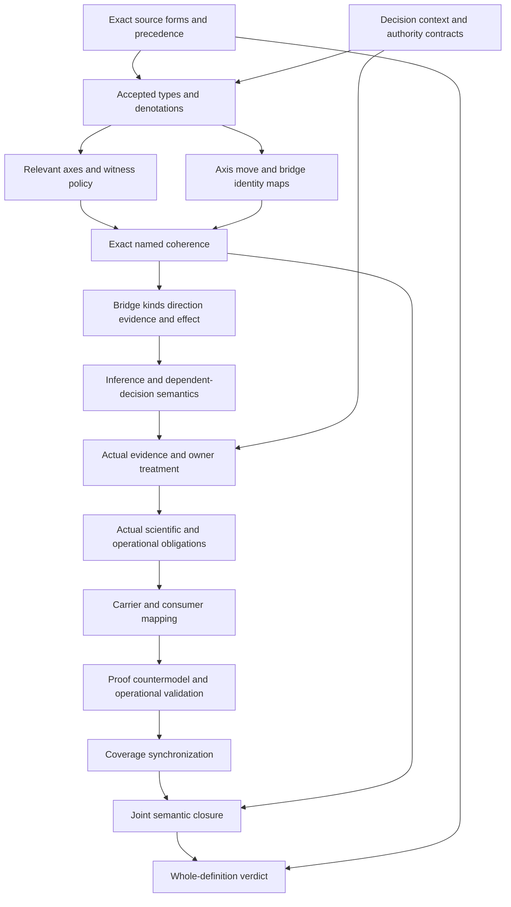

# Root-Axis Independence: typed formalization review

Candidate types-and-logic stage only. Full carrier/profile, dependency inventory and sealed delivery checks remain pending. Source fidelity, owner acceptance, actual scientific/operational outcomes and whole-definition proof are not established. Policy is sealed and preserved; Responsibility already has an earlier source-current sealed packet. The complete 183-identity episode remains active.

## 1. Exact source and normalization

The source is cal.definition.root-axis-independence-invariant@1.0.0-candidate.1, digest3a95023cc9372a10a198815e04a94472847be688f8d564db5f1056df2167c308. C53 selects the current admission. The prototype reclassifies CAV2-D29 Axis Orthogonality Invariant; the accepted reclassification is a source observation, not proof that every semantic denotation in this interpretation has been accepted.

The local selected D29 section is3,406 bytes, digest0446997d1a5e8331251ec6b2a4f8971d87650ac083a997e03223e1dc7dd86f5d. Its whole-file hash agrees with the recorded source-use admission. The producer-declared location remains absent and repository identity is not authenticated. RAI-FINDING-001 retains normalization/precedence and legacy identity equivalence as owner questions. RAI-FINDING-010 retains source fidelity, consumer and closure questions.

## 2. Source forms and accounting

Twenty-two source units map to26 spans: six encoded, nine explanatory and eleven deferred. Six distinct encoded formula values compose ten primitive templates. The normalized invariant characterization, decision-qualified governance pairs, explicit bridge rules, necessary non-silent inference, question routes and role exclusions have candidate formulas.

The full outer boundary remains deferred and supplies five exact source query obligations. The repeated scientific boundary supplies role exclusions, without assuming actual scientific outcomes. Source testable conditions and historical claim ceiling remain observation-measurement clauses. The character account covers all selected source strings; complete accounting is not complete translation or owner fidelity. Retained slider/wire intuition and domain references remain explanatory.

## 3. Types and signature

The ten sorts are Invariant, Context, Decision, Axis, Pair, Move, Bridge, Scope, Evidence and Token. Invariant holds normalized identity and role restrictions. Context and Decision select the governed situation. Axis and Move are separate: having an axis does not establish a valid move. Pair binds two axes and their moves to one decision-qualified context. Bridge records a proposed reason to relate them. Scope, Evidence and Token remain independently typed carriers.

There are102 declarations: ten sorts, six constants, thirty total functions,54 unary predicates and two binary relations. AxisDeclaredInContext and AxisRelevantForDecision make the selected axis set explicit. Total functions provide declared maps for all supplied objects, including outside-scope objects; applicable guards control where obligations hold. Actual scope, evidence and reference denotations remain pending. RAI-FINDING-002 covers applicability maps; RAI-FINDING-003 covers identity and actual independence.

## 4. Normalized invariant and applicability

RootAxisInvariant is characterized by preserved classification/source relations, no silent sibling merge and exact normalized identity/kind/carrier/owner-scope/source values. These are candidate meaning markers, not an admitted invariant instance. A Pair is governed when governance consideration and relevant-axis selection are declared.

A governed Pair binds this invariant, a governed Context and a Decision whose context agrees. Source and target Axis identities differ, both are declared in that Context, and both are relevant for that Decision. Their named handles may coincide while their Axis identities remain distinct. The baseline includes an outside-governed Pair so the theory cannot force every supplied object into the same applicability population.

## 5. Move bindings and independent movement

Each governed Pair binds a first and second Move. Their Axis, Context and Decision maps agree with the Pair's respective endpoints and decision context. These constraints prevent an unrelated move from being substituted merely because its label resembles the intended move.

The model deliberately permits two separately valid movement declarations without a bridge. That Pair has no claimed cross-axis inference. The source says a move does not imply another axis movement without an explicit bridge; it does not prohibit independently authorized interactions. The required population BothAxesMoveIndependentlyWithoutBridge makes this distinction nonvacuous. No actual execution or authorization follows from ValidMoveDeclared.

## 6. Bridge presence and eligible kinds

For a governed Pair, PairHasBridge agrees with BridgeDeclared on the selected Bridge object. An explicit Bridge belongs to at least one declared source kind: typed coupling, gate, schema rule, validator or owner decision. The source alternatives do not establish mutual exclusivity; a positive control permits overlapping kinds.

The source offers explicit bridges as exceptions to unrepresented implication, not as automatic licenses for every co-change. A named bridge can exist while actual bridge admission, evidence adequacy or authorization is false. RAI-FINDING-004 retains bridge presence/kind denotations and admission as independent questions. Each of the five kinds has an explicit supplied witness, without claiming a live artifact of that kind exists or has been adopted.

## 7. Endpoints, direction, evidence and effect

For an explicit Bridge, Context and Decision agree with the Pair. Source and target Axis endpoints agree exactly. Direction or symmetry must be named, with a nonempty direction token. An evidence reference has a nonempty handle, and an effect token is nonempty.

These checks establish declared coherence and presence. They do not interpret arbitrary direction strings, authenticate evidence, demonstrate scope-specific sufficiency or cause an effect. The owner-decision example names symmetry, and another positive control permits both direction and symmetry markers. RAI-FINDING-005 covers these maps and their actual meanings. A later adapter must resolve them rather than treating Token presence as proof.

## 8. Necessary inference and dependent decisions

A claimed cross-axis inference on a governed Pair requires an explicit Bridge, an InferenceNotSilent declaration and a declared valid starting Move. An uncoupled governed Pair instead requires IndependentVariationDeclared and no claimed cross-axis inference. These are necessary declaration guards; they do not establish universal semantic independence.

If a Decision depends on co-change, the Pair also needs a separately declared typed-coupling representation and a nonempty coupling reference. A Gate Bridge can satisfy its own kind and use that separate representation; it does not become identical to Typed Coupling. RAI-FINDING-006 concerns inferred movement and actual authorization. RAI-FINDING-007 concerns the independent coupling obligation and accepted dependency meaning.

## 9. Question routes and sibling meanings

Classification questions require a declared classification reference; lifecycle-component questions require a declared lifecycle reference; questions about non-independent axes require an explicit typed-coupling representation. These candidate routes account for applicability references to D22, D23 and D16.

Current Classification Orthogonality, Governance-Axis Independence and Typed Coupling definitions remain separately qualified sources. They are compared without being composed into T. RAI-FINDING-008 retains accepted routing and sibling denotations. A shared legacy relationship or similar name cannot merge normalized identities or import a current sibling carrier/schema automatically.

## 10. Scientific and operational claim boundaries

Root-Axis governance orthogonality does not supply IsolationRole, StatisticalIndependenceRole, HilbertOrthogonalityRole, ProjectorOrthogonalityRole, ContextualityTheoremRole or ConsistencyGuaranteeRole. Their exclusions are semantic role restrictions. Actual scientific propositions remain external queries, not universal claims that independent evidence could never establish them.

The five scientific boundary obligations retain the same exact whole-source excerpt outside T. Other targets include actual authority, admission, activation, external effect, owner fidelity, consumer alignment, authorization, bridge admission, co-change execution, evidence adequacy, owner approval, decision success, semantic independence, isolation and universal frame preservation. RAI-FINDING-009 retains scientific/data-model interpretation. No statistical model, Hilbert space, contextuality proof or consistency theorem is imported into this first-order fragment.

## 11. Model and source evidence

There are82 independently evaluated controls:29 satisfy T,46 falsify T and seven are malformed-model rejections. All20 actual-outcome queries have supplied T/I countermodels. The baseline has one Invariant, two Contexts, two Decisions, three Axes, seven Pairs, three Moves, seven Bridges, two Scopes, two Evidence objects and ten Tokens.

Positive controls exercise independent movement, exact named bridges, five eligible kinds, kind overlap, direction/symmetry overlap, equal labels with distinct identities and a Gate with separate coupling representation. Negative controls change endpoints, context, decision, relevant axes, bridge presence/kind, direction/evidence/effect handles, silent inference or routing/coupling requirements. Malformed controls separately test incomplete functions, sorting, relation arity, duplicates and empty domains.

Twenty-two actual source checks bind C53, recorded authorization, exact selected Definition and D29 source use. Two pure Definition renders agree at7,147 bytes and digestb96068b05481dddbb22c174346f2d8b89de3dc26fcbc56a3327aec40667834f0. The renderer performs no materialization write. Finite model satisfaction and exact bytes remain bounded observations, not owner acceptance or operational proof.

## 12. Completion DAG: types and logic first

Source and decision-context review precede accepted types. Population and identity maps then proceed independently into coherence. Bridge interpretation precedes actual evidence/outcome obligations and consumer adaptation. Joint closure needs common accepted meanings, not a set of individual finite witnesses. A candidate seal cannot supply the final source-owner verdict.

## 13. Preservation and continuation

Preflight verified output absence, exact current source, A04/C01/E02 prerequisites,201 current source files and5,236 preserved Policy-delivery files. Author, builder, model and source producers exited zero. The types-and-logic replay checks contract, model and source independently. Full profile/carrier observations, reachable dependency and current joint inventory refresh, six-check full delivery replay, finalization and separate sealed-file audit remain pending for this unit.

This adds the65th draft file on disk; the last sealed inventory remains64 partial drafts. A fresh65-draft inventory has not yet been produced. Owner-accepted whole translations and whole proofs remain zero in the last sealed inventory, and this interpretation explicitly remains candidate with source_fidelity pending. The full denominator remains183 current identities and189 admitted source versions.

After Root-Axis delivery, continue F03-T.cal.definition.claim-support-compatibility-invariant, the first remaining definition-T SWU in foundations-first order. Keep the full task/DAG/SWU scope and all source-owner, semantic-closure, proof, replay and final-review obligations intact while continuing independent definitions and logical drafts.
