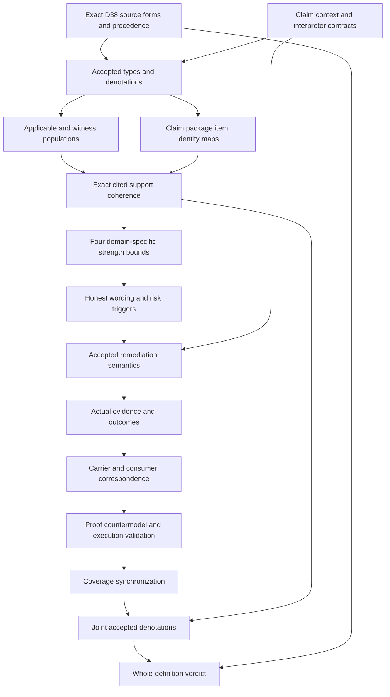

# Claim-Support Compatibility: types and logic review

This is a candidate review template awaiting executed producer results. It grants no authority and supplies no source-owner acceptance, actual truth, governing permission or whole-definition proof.

## 1. Source and normalized identity

The current selected version is cal.definition.claim-support-compatibility-invariant@1.0.0-candidate.1, SHA73e97225d896fa5ba9157ec860b3ef7b9c36da01b3089943f9d2b5f87558f2f1. C53 supplies the current admission overlay. The retained reconstruction body remains historically candidate-unadmitted. D38 Claim-Proof Bound is selected by exact source-use digest de58dbca26577af6e991dca7f30a1b7dc41069c147532289777284d0d8b7d39a. Local bytes can establish this selection while the absent producer checkout and repository identity remain unauthenticated. CSI-FINDING-001 retains source precedence and normalized identity questions; CSI-FINDING-010 retains source-owner fidelity and closure.

## 2. Exact source forms and coverage

The proposed encoded spans characterize normalized invariant identity, applicable claim/type/context/interpreter maps, cited support and included item coherence, four declared strength comparisons, honest wording, weak-support remediation, absent-support defaults and plural support boundaries. Plain language and domain context remain explanatory. Artifact identity/digest/schema/projection tests remain observations. Complete character accounting would document every selected string range; it would not imply that every source meaning has been translated or accepted.

## 3. Types first

Nine sorts keep Invariant, Claim, ClaimType, Context, Interpreter, SupportPackage, SupportItem, Strength and Token separate. A claim is not its citation or support package. A package is not an included item. A strength value is not a truth value, permission, lifecycle state or execution result. The registry lacks current definitions literally named Claim, Claim Ceiling, Witness, Premise Assignment, Proof, Publication or Dependency. Candidate sorts preserve those descriptive mapping obligations without inventing versioned source identities.

## 4. Applicability and interpreter selection

ClaimApplicable is characterized through declared wording-in-scope and claim-type selection. Applicable claims bind a normalized invariant, context and declared interpreter. Interpreter context/type agree exactly with the claim, and its handle is nonempty. Eligible interpreter kinds are domain, validator, research standard, owner decision or constitution. These kinds can overlap. A named interpreter is not automatically accepted or competent for actual governing use. CSI-FINDING-002 and CSI-FINDING-003 retain the population and interpretation maps.

## 5. Four distinct strength dimensions

Asserted strength, authority effect, validation status and publication posture have separately typed Claim-to-Strength and Package-to-Strength maps. AllowedStrength is an Interpreter/ClaimType-indexed four-argument relation. The proposed theory does not impose numerical arithmetic, a total order, transitivity, antisymmetry or one universal certainty scale. It does not equate a validation result with release authority. Owner acceptance must supply the relevant domain relation and each dimension's meaning. CSI-FINDING-004 retains these separate maps.

## 6. Support presence and package coherence

ClaimHasSupport agrees with a citation declaration and declaration of the exact selected package. An applicable supported claim needs matching package context, claim type and interpreter, a nonempty package handle and an included item witness. Presence is distinct from adequate support. Total functions still give absent-support claims placeholder package values, without declaring those placeholders to be cited support. These guards prevent a shared name or wrong-context package from substituting for the selected evidence. CSI-FINDING-005 retains citation, package and adequacy obligations.

## 7. Plural support and included items

Every included item used by an applicable supported claim has matching type/context, a nonempty handle and an eligible support kind. Source citation, validation run, witness, owner decision, accepted premise and formal proof remain eligible alternatives, with overlap allowed. The invariant excludes a formal-proof-only role and a maximal-certainty requirement. Required witnesses exercise each alternative without forcing every actual package to contain all six. CSI-FINDING-006 retains accepted item meanings and evidence treatment. An accepted premise does not become an unrecorded assumption in T.

## 8. Declared comparison and honest wording

WithinDeclaredSupportBound requires cited support and all four domain-interpreted comparisons. CompatibleClaim requires support, the bound and HonestWordingDeclared. These labels do not assert actual truth, adequate evidence, admitted authority, passed validation or authorized publication. Finite countermodels retain all proposed clauses while those actual targets are false. Actual epistemic standards must be accepted separately. A consumer cannot treat a compatible label as a governing clearance merely because a schema accepts it.

## 9. Absent and weak support

Absent support requires candidate or hypothesis wording declarations. Partial, private, indirect, disputed and weaker support remain separate predicates. RiskyClaim also includes supported claims that exceed the declared bound. A risky applicable claim needs at least one explicit downgrade, hypothesis/candidate qualification, residue flag, gate route or governing block, together with a nonempty treatment reference. The alternatives are not mutually exclusive. CSI-FINDING-007 retains defaults; CSI-FINDING-008 retains weak-support treatment. A gate route alone cannot replace the absent-support default wording obligation.

## 10. Actual remediation and outcome boundaries

The proposed guards test declared responsibility. DowngradeDeclared does not demonstrate that wording changed. GateRouteDeclared does not demonstrate gate clearance. GoverningBlockDeclared does not prove that a live consumer blocks work. Actual truth, authority, support adequacy, publication, validation, gate clearance, governing authorization, remediation execution, consumer alignment and global consistency remain external query targets. CSI-FINDING-009 retains these operational maps. No target is imported as an assumption, and no actual premise is silently accepted from its named support kind.

## 11. Verification surface

The planned independent checks evaluate exact supplied positive, negative and malformed models through the existing sorted denotation evaluator. Cases distinguish source/type/context substitution, missing citation or items, per-dimension overclaim, unsupported comparison, missing honesty, absent-support defaults and risk without treatment. Positive cases permit kind overlap, treatment overlap, outside-scope mappings and domain relations that are not numerical total orders. Exact source/render observations and fresh read-only checks must be executed before results are recorded; this template contains no fabricated outcomes.

## 12. Completion DAG

Types, populations and interpretation precede actual truth and execution claims. Individual finite witnesses do not establish common-carrier consistency across the dependency graph. Source-owner acceptance and whole-definition proof remain separate downstream work products.

## 13. Preservation and continuation

Execute this unit only after Root-Axis's separate sealed-file audit passes. Preserve the complete183currentidentities189admittedversions201sourcefiles episode and every earlier sealed candidate file. A04, C01 and E02 remain the selected prerequisites for the definition-T SWU. Carrier/profile, dependency/current inventory, full replay, finalization and delivery audit remain independent work after typed drafting. The next missing definition after this unit is F03-T.cal.definition.conformance. Family proof, owner-fidelity, closure, replay and whole-review gates remain unsatisfied until their required evidence exists.
