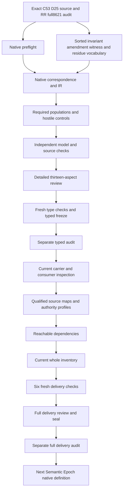

# Schema Evolution Invariant: types and logic review

This candidate selects cal.definition.schema-evolution-invariant@1.0.0-candidate.1 with current C53 admission and the exact CAV2-D25 Schema Amendment Witness basis. It formalizes necessary normalized invariant, authority-affecting shape change, amendment, witness, residue and downstream-path declarations. Actual enforcement, executed checks, authentic owner judgment, compatibility, source fidelity and independent authority remain separate outcomes. The candidate preserves the requested definitions, types and logic priority while leaving implementations and effects for their own evidence.

Representation Revision's full8,621-file seal and separate actual audit pass before creation. The native preflight verifies every recorded prior file hash, all201originalsourcefiles, the exact next source, A04/C01/E02 receipts and the selected SWU write scope. There are now96nativeper-definition T files among183currentidentities, leaving87withoutT. The last completed full inventory has95partialdrafts until this unit's full consumer/dependency/inventory delivery. Whole translations accepted and whole-definition proofs remain zero; the complete episode and its final review stay active.

## 1. Exact Definition, source authority and identity layers

The exact positive Definition digest is e1c996eda39fa109bc0b689570ce1a6cdeb72796e667125a365679ad4da26088. Current admission is CAL-DECISION-0053-FULL-DEFINITION-QUEUE-ADMISSION. The source scope is scope.shared-authority. Its normalized meaning is semantic.schema-evolution-invariant, carried by type.invariant, with CAV2-D25 as the bound external source. The source is explicitly about schema amendment and enforcement witnesses; generic Schema remains the separate CAV2-D56 meaning. A normalized label must not silently acquire another target's meaning.

Definition ID, normalized meaning identity, type and authority scope are separate coordinates. The candidate source header and symbol qualification retain cal.definition.schema-evolution-invariant@1.0.0-candidate.1 exactly. MeaningIdentity tokens describe the normalized invariant within the typed model; they are not aliases for the Definition ID. The identity test combines the fixed current source selection and native source checker with the typed normalization guards. Their accepted semantic correspondence remains source-owner pending, even though the selected header and current bytes are mechanically fixed.

C53 source admission and admitted-for-use D25 selection are observed without rewriting retained reconstruction metadata. The embedded source says candidate-unadmitted and keeps its nonexecuting claim ceiling; the normalization scaffold remains prototype-scaffold. Current admission is an overlay observation rather than permission to mutate historical source bytes. Neither that admission nor a successful finite model check accepts this translation, authenticates a real amendment or grants validation, migration, publication or deployment authority.

## 2. Sorted types, declarations and symbol qualification

The signature has19nonempty sorts, nine constants,44totalfunctions and123predicate/relation signatures, yielding195declarations. Its main object sorts are MeaningReference, ShapeChangeReference, ShapeReference, AmendmentReference, WitnessReference and ResidueReference. MeaningIdentity and TypeReference distinguish normalized identity and classification. OwnerReference, ScopeReference, SourceReference, ReasonReference, DeltaReference, CompatibilityReference, RouteReference, EffectReference and EvidenceReference provide typed record components. WitnessKind distinguishes four selected alternatives; Token carries explicit nonempty-reference handles.

The constants are EMPTY, SEI_ID, SHARED_SCOPE, INVARIANT_TYPE, D25_SOURCE, DETERMINISTIC, HYBRID, REVIEW and ABSENT. They are model denotations, not authenticated external facts. Selected Meaning records bind the normalized identity, shared scope, invariant type and D25 relation labels. Selected change records bind before/after shape references, a nominated amendment and the selected meaning. Every symbol is qualified by exact source version and candidate scope. Equal sort spellings in another definition do not constitute a shared interpretation.

Total functions nominate values; matching BindingDeclared relations expose whether those nominations are explicitly and exactly declared. A selected field requires a declared target, nonempty typed handle and every relation tuple to agree with the nominated selector. Removing a binding or adding a different tuple fails even when a function still has a value. Conditional fields are inspected only for the declared route or witness alternative that uses them. An unused total selector does not assert that an operational field or route exists.

## 3. Authority-affecting change eligibility and shape boundaries

For a ShapeChangeReference c, ChangeApplicable(c) is equivalent to ChangeInScopeDeclared(c) and the inclusive disjunction of ChangeAffectsValidationDeclared(c) and ChangeAffectsAuthorityInterpretationDeclared(c). Either axis can trigger the selected amendment obligations and both can hold together. This models the source's validation-or-authority-interpretation condition without imposing mutual exclusion. Scoped changes with neither declared effect axis cannot remain applicable, and eligible selected records cannot silently avoid the necessary declaration guards.

Declared source scope is not a detector of real impact. The source lists schema, frontmatter, taxonomy, ontology, ledger, event and machine-view changes and names concrete early surfaces such as inventory entries, validation fixtures and constitution-controlled structure. Their accepted denotation and exhaustive real change universe remain pending. The model does not infer actual applicability from directory names, parse a real schema diff or assert that every repository edit is in scope. Other objects may remain outside the selected guards.

Selected changes declare exact before and after ShapeReference fields and distinct values. The nominated amendment's corresponding fields must match those endpoints. Distinct reference values make a declared changed-shape requirement inspectable, but do not prove different real shapes, correct selected bytes or complete compatibility analysis. ShapeDifference, ScopeFidelity and Compatibility are independent actual-outcome predicates. The before/after relation to the declared delta still requires accepted source/content and operational maps.

## 4. Amendment record and the formal seven-position tuple

The source's formal tuple is A=(owner,scope,source,delta,compatibility,witness,residue). Its normative record additionally names reason, changed shape, source evidence and rollout or rollback route. The candidate composes these as necessary declarations rather than choosing the short tuple as a complete substitute for the richer wording. The nominated amendment has ten unconditional fields: owner, scope, reason, before shape, after shape, source, delta, compatibility, witness and residue. Rollout and rollback selectors are separate conditional fields.

AmendmentRecordedDeclared is required, and its before/after selectors equal the selected change's endpoints. The change's MeaningReference points to a selected normalized invariant record. Amendment scopes and source-evidence labels are typed fields; they are not automatically equated to the invariant's shared semantic scope or D25 source label. One is an amendment's operational scope/evidence nomination and the other is the Definition's normalized source classification. Conflating those roles would erase a necessary authority and provenance distinction.

This candidate nominates one amendment and one witness per selected change. It does not impose global amendment uniqueness: a supplied model lets distinct change references share an amendment when their endpoint declarations agree. Such sharing can lose demonstration populations without violating theory. Multiple evidence records, bulk amendments, aggregated witnesses, aliases and additional record membership require explicit universe maps. None is accepted merely because a total function picks one representative or a record is marked recorded.

## 5. Rollout-or-rollback routes and conditional exact fields

The normative route obligation is modeled as RolloutNamedDeclared(a) or RollbackNamedDeclared(a). This is inclusive OR. A rollout-only amendment, rollback-only amendment and an amendment carrying both routes are each supported in the baseline. Every named route has an exact declared selector and nonempty typed RouteReference. Omitting both flags fails. An asserted flag combined with a missing, conflicting, undeclared or empty-handle route field also fails its necessary record condition.

Unused route selectors remain total for model well-formedness but do not carry operational existence or permission. The positive unused-rollback-handle control places an empty handle on an outside route used only by unselected optional fields; it remains theory-consistent. This distinguishes explicit route nomination from incidental total-function table values. The source does not require both rollout and rollback for every amendment, so the model does not invent that stronger obligation.

Named routes do not establish executability, safe compatibility, successful recovery or authorization to execute either action. RolloutExecutable and RollbackExecutable remain independent actual targets. An amendment's owner and scope declarations do not grant effects, and a rollback label cannot authenticate a recovery procedure. Those facts need exact route/content correspondence, current owner decisions, relevant runtime evidence and their own effect boundaries. This stage neither executes routes nor modifies any canonical artifact.

## 6. Witness kinds and early-stage alternatives

A nominated witness is a typed record bound back to the same amendment, with recorded and explanation-recorded declarations. Its kind is one of DETERMINISTIC, HYBRID, REVIEW or ABSENT. Four corresponding flags are equivalent to equality with their discriminator tokens. WitnessPresentDeclared is equivalent to one of the first three flags. A selected unknown kind, extra inconsistent kind flag or missing present flag fails the supplied necessary conditions. Outside witness records are not globally forced into this taxonomy.

A review witness is permitted. The source expressly allows review and typed residue when the artifact is not yet implementation-backed and rejects an always-automatic-validator demand for every early rule. The candidate retains those alternatives without forbidding independently supported implementation or automatic checking. ChangeImplementationBackedDeclared remains an independent supplied posture; it cannot authenticate a validator or turn a review label into an executed review. The positive review/implementation control demonstrates that these declarations are not unnecessarily exclusive.

Hybrid is a source-named alternative, not a defined cardinality formula. The model does not require two named checks or a particular validator/runtime mix merely from the hybrid label. A hybrid witness with one remaining nominated check can satisfy theory while losing the separately requested runtime demonstration. Witness taxonomy, the exact relation between kinds and evidence routes and compound or mixed records remain owner correspondence findings. Finite examples expose these choices without accepting their denotations.

## 7. Present witnesses, named checks and execution separation

A present witness declares one EvidenceReference and at least one of validator, runtime observation, fixture or review-check naming flags. These four naming alternatives are inclusive. The baseline includes a deterministic validator witness, a hybrid runtime/fixture witness and review-check witnesses. A supplied control carries several names together and remains consistent. No requirement invents an exclusive route class, a check count, an automatic validator for review or a verified execution result from a nonempty reference.

WitnessEvidenceBindingDeclared is exact for the nominated value, and the witness must explain its declared route. Removing the sole named route makes the necessary present-witness condition fail. Naming a check does not prove that the check ran, that its output is authentic or that its scope is adequate. ValidatorExecution, RuntimeObservation, FixtureExecution, ReviewExecution and WitnessAdequacy are distinct independent targets. The baseline supplies necessary declarations while leaving those outcomes false.

This separation matters for an early artifact that names a future review or fixture. The record can make the intended witness inspectable without manufacturing an implementation-backed conclusion. Actual enforcement needs correspondence from named routes to effective behavior and evidence. There is no canonical schema writer, runtime observer, fixture runner, owner-review dispatcher or private/live consumer execution in this stage. The Definition generator is executed only through its isolated pure projection functions for byte comparisons.

## 8. Absent witnesses and typed owner/effect residue

ABSENT is an explicit typed absence marker. It is not a successful or executed witness. The marker declares the same nominated ResidueReference as the amendment, and its selected residue has exact owner and effect fields. ResidueTypedDeclared, ResidueOwnerAssignedDeclared and ResidueEffectNamedDeclared must hold, and the change declares a residue path. Removing any of these obligations fails. A marker with a conflicting residue or a present validator naming flag likewise fails this chosen absence encoding.

Gap ownership is separate from amendment ownership. The baseline's absent witness uses a residue owner different from the amendment owner, and a required population exhibits that distinction. The source asks for residue with owner and effect; it does not require those owner labels to be identical. Both are typed nonempty nominations. They do not prove authentic ownership, that the assigned party accepted the gap, that the effect label is accurate or that an authorized action has occurred. ResidueOwnership and ResidueEffectFidelity remain independent.

The formal tuple always nominates a residue field, but open-gap detail requirements apply when absence or a declared residue path uses it. A present witness without a residue path need not assert an open gap merely because its total selector names a residue reference. A positive control removes an unused residue's owner-assigned posture and remains consistent. Present witnesses may also carry an owned residue path. Planned checks, mixed support and exact absence-marker denotation remain explicit source-owner mapping obligations.

## 9. Downstream governing shapes and necessary path completeness

ChangeGovernsDownstreamDeclared(c) implies ChangeEnforcementPathDeclared(c) or ChangeResiduePathDeclared(c). A declared enforcement path requires a present witness. A declared residue path requires the typed owned effect-named residue record. An absent witness must carry that residue path even if the shape is not marked downstream-governing. These conditions preserve the source's explicit incompleteness rule without identifying a path declaration with actual enforcement or accepted overall amendment validity.

The negative downstream control supplies a present review witness but removes both declared paths; theory fails. A separate positive control removes the downstream-governing posture as well and can retain a present review record without a path. This models the formal rule's necessary conditional and exposes a remaining mapping question: the richer normative witness wording may require a stronger universal route interpretation. That issue is recorded for source-owner review rather than hidden by weakening the source or claiming that every such record is fully valid.

Enforcement and residue may both be declared. A typed residue is a visible gap route, not an inference that runtime enforcement was performed. A named validator or successful Definition-shape check cannot repair missing downstream declarations automatically. Conversely, independent real enforcement remains allowed even where the supplied record only describes absence or a gap. The candidate theory constrains declarations; it does not deny separately evidenced behavior, erase historical facts or establish sufficient whole-source semantics.

## 10. Parent-Instance Authority Separation and effect boundaries

Selected changes cannot declare that generic Schema was redefined, sibling identity roles silently merged, source relation fidelity inferred from labels, review or residue witnesses forbidden, unowned absence accepted, or automatic validation always required. These exclusion flags preserve the selected source's conceptual and early-stage boundaries. Exact qualified dependency and comparison references remain separate meanings; a reference to a sibling does not merge identities or import its complete theory into this one.

The selected declaration also excludes grants inferred from parent meaning, invariant type, amendment/witness references, Definition admission and source-excluded admission, activation, publication, release, deployment or external effects. Those are invalid grant declarations, not universal claims that actual outcomes must be false. The baseline has independently supplied actual Authority for one selected change and changes with every actual target false. An independently supported actual outcome can coexist with the necessary declaration theory.

Each actual target is queried outside T with its own countermodel evidence. A parent meaning and a record naming a validator do not entail Proof, Trust, Authority or a particular effect. No actual-outcome query is inserted into the theory as a negative assumption. Nonentailment therefore establishes the supplied declaration system's inference ceiling and does not contradict authority or execution proved by independent evidence. Source fidelity, authentic decisions and accepted operational maps remain downstream obligations.

## 11. Complete source accounting and actual source checks

All22selectednonemptystringunits are mapped at exact JSON selectors and complete character spans. Eight clauses are encoded, nine explanatory and five deferred. There are six unique encoded formula values composed from twelve primitive declaration templates. The normative statement and formal tuple share necessary guards while boundary text is accounted separately even when duplicated. Notation, plain-language intuition and reconstructed domain examples remain explanatory; source metadata is not silently promoted into normative meaning.

The five deferred clauses cover authority-scope wording, the retained candidate claim ceiling and three source-currentness/Definition-shape/generated-projection outcome tests. Their actual current observations are supplied by source checks, rather than outcome axioms in T. The identity test also binds the exact source header through static source selection and the checker; the normalized MeaningIdentity token remains a separate coordinate requiring accepted correspondence. Twenty-two findings keep source precedence, record universes, aliases and denotations visible.

The actual source checker passes55checks. It verifies current C53 admission, authorization, manifest, exact admitted Definition selection, admitted-for-use D25 coordinates, current external whole-file and section digests, unchanged scaffold metadata, Definition/v1 structure and the native source/query account. It compares two unchanged6,512-byte pure Definition projections, both SHA10c5a6986d485b71744be2855bc0c2c4e38a32b137842d033ab7557a545f2b8c. The external D25 section is3,305bytes; its exact digest isc847e55136201777b89c5cdb6ad7e538e033e730538e143535d7edf65283d935. No amendment is executed by these checks.

## 12. Supplied models, hostile controls and proof ceiling

The model checker passes222controls:67T-true,147T-false and eight malformed model rejections. The controls expose missing and conflicting exact bindings, undeclared targets, empty handles, normalized classification errors, mismatched endpoints/witness amendments, missing rollout/rollback, unsupported witness kinds, unowned or effectless absence, and missing downstream paths. Positive controls retain validation-or-authority alternatives, review/residue behavior, multiple names, shared amendments, unused optional fields and independently supported outcomes.

Nineteen required populations demonstrate selected/outside Meaning records and changes, witness kinds and named routes, rollout-only/rollback-only/both routes, a non-governing change, an owned absence with a different gap owner and independent authority. They are witness-coverage requirements, not source-wide policy assertions. The selected Meaning populations have MeaningReference carriers; change demonstrations have ShapeChangeReference carriers. Theory truth and population satisfaction are independently evaluated and never inferred from one another.

Thirty-one nonentailment queries have supplied T-and-I countermodels in which the selected actual target is not universally true. The baseline's necessary declaration theory and required witnesses both hold, while actual enforcement, execution, owner/source fidelity and effects are not supplied by those guards. All-actual-outcomes and no-selected-change controls can satisfy theory while failing the specially requested witness coverage. The prepared maximum25,268steps,243,225inputbytes and30,482qualifiedIRnodes fit unchanged100,000step/one-million-byte/50,000node limits and30second timeout. These are finite supplied checks, not mechanized whole-definition proofs.

## 13. Explanation, delivery DAG and remaining obligations

An illustrative early change carries a reason, selected source evidence, typed compatibility and delta fields, a review witness and a declared downstream enforcement path. The record can satisfy the necessary declaration guards while real review execution and enforcement remain unevidenced. Another change records explicit witness absence with a typed gap owner and effect and a residue path. A counterexample retains the same labels and review nomination but removes both paths for a downstream-governing shape; the necessary theory fails.

This seventeen-node/seventeen-edge plan is an acyclic delivery DAG. It is distinct from the semantic dependency graph and does not classify its cycles or accept shared meanings. Three fresh typed checks have actual exit zero and empty stderr. The sixteen-input typed freeze and its separate actual audit must supply their own terminal evidence. Full carrier/consumer mapping, qualified profiles, reachable dependencies, whole96draftinventory with independent witnesses, six fresh delivery checks, full review, seal and separate actual audit follow. Semantic Epoch native work is gated on that full audit.

Original scope remains183identities,189versions,201sourcefiles,121tasks,511planningedges,797SWUs and36frontiers. Candidate observations preserve every prior file and unrelated tracked dirty work. They do not establish owner source fidelity, accepted whole translation, whole proof, live enforcement or completion of the episode. The final episode-wide review remains required after the original scope is fully handled. Each finding below names a concrete unresolved formalization aspect and keeps its owner correspondence pending.

- SEI-FINDING-001: C53 admits the positive Definition and exact D25 source use without accepting this formal translation. Status: unresolved; owner review and accepted map references pending.

- SEI-FINDING-002: Normalized invariant identity,shared scope,type.invariant and D25 source tokens are declared bindings rather than actual canonical-instance or relation fidelity. Status: unresolved; owner review and accepted map references pending.

- SEI-FINDING-003: Canonical-instance guards scope selected Meaning records; prototype and other record universes require source-owner maps. Status: unresolved; owner review and accepted map references pending.

- SEI-FINDING-004: Schema Amendment Witness governs shape change and does not redefine generic Schema/D56 or silently merge sibling targets. Status: unresolved; owner review and accepted map references pending.

- SEI-FINDING-005: Change applicability composes declared scope with inclusive validation-or-authority-interpretation effect; actual scope and source-surface coverage remain pending. Status: unresolved; owner review and accepted map references pending.

- SEI-FINDING-006: Distinct before/after ShapeReference labels represent changed shape without establishing actual shape differences or exact content selection. Status: unresolved; owner review and accepted map references pending.

- SEI-FINDING-007: One nominated amendment and witness per selected change is not a complete record-universe or multiple-support aggregation map. Status: unresolved; owner review and accepted map references pending.

- SEI-FINDING-008: Exact typed owner,scope,reason,shape,source,delta,compatibility,witness and residue declarations do not authenticate content or decisions. Status: unresolved; owner review and accepted map references pending.

- SEI-FINDING-009: The formal seven-position tuple and the richer normative amendment record are composed as necessary guards; source precedence needs owner review. Status: unresolved; owner review and accepted map references pending.

- SEI-FINDING-010: Rollout and rollback are inclusive alternatives; route references do not prove executability,recovery or effect authorization. Status: unresolved; owner review and accepted map references pending.

- SEI-FINDING-011: Four declared witness-kind alternatives use exact discriminator tokens and exclude other selected kinds; witness taxonomy correspondence remains unaccepted. Status: unresolved; owner review and accepted map references pending.

- SEI-FINDING-012: Present witness routes name validator,runtime observation,fixture or review check inclusively; hybrid composition or automated execution is not inferred. Status: unresolved; owner review and accepted map references pending.

- SEI-FINDING-013: Review witnesses are allowed without imposing an always-automatic-validator requirement or forbidding independently supported implementation. Status: unresolved; owner review and accepted map references pending.

- SEI-FINDING-014: An absent witness is encoded by a typed absence marker and owned effect-named residue,not an executed witness. Status: unresolved; owner review and accepted map references pending.

- SEI-FINDING-015: Absent markers carry no present witness-route declaration; planned checks and mixed evidence need explicit record maps. Status: unresolved; owner review and accepted map references pending.

- SEI-FINDING-016: Residue owner and effect are typed nonempty fields; the gap owner may differ from amendment owner and labels do not authenticate ownership. Status: unresolved; owner review and accepted map references pending.

- SEI-FINDING-017: Every nominated residue tuple field is explicit; open-gap obligations apply only to absent witnesses or declared residue paths. Status: unresolved; owner review and accepted map references pending.

- SEI-FINDING-018: The downstream enforcement-or-residue guard is necessary; declared paths alone do not establish actual enforcement or complete adequacy. Status: unresolved; owner review and accepted map references pending.

- SEI-FINDING-019: Non-governing present records can lack an explicit enforcement/residue path in this candidate; their alignment to the richer normative witness wording needs owner review. Status: unresolved; owner review and accepted map references pending.

- SEI-FINDING-020: Source-currentness,Definition-shape and exact generated-projection tests remain actual source checks and unresolved logical clauses rather than outcome axioms. Status: unresolved; owner review and accepted map references pending.

- SEI-FINDING-021: Parent meaning,invariant classification and amendment/witness records do not grant instance authority or source-excluded effects. Status: unresolved; owner review and accepted map references pending.

- SEI-FINDING-022: Complete source-string accounting and finite witnesses do not establish shared meanings,accepted whole translation or mechanized whole proof. Status: unresolved; owner review and accepted map references pending.

