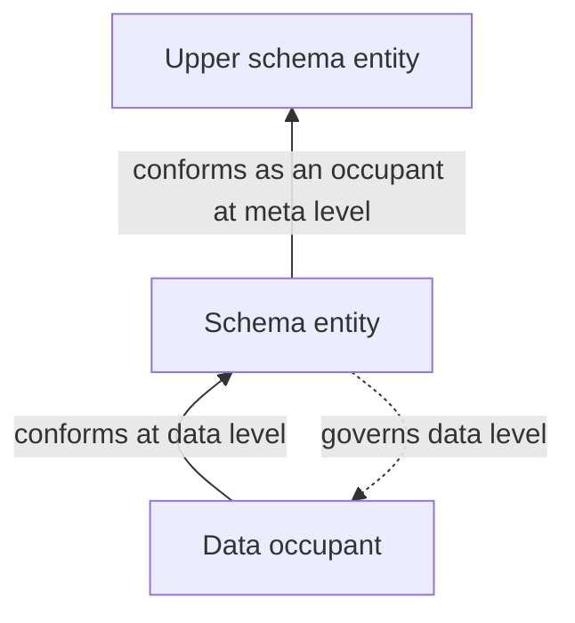

# Schema: formalization review

Candidate progress, 2026-10-08. Authority effect: none. `F01-T.cal.definition.schema` has a verified **partial** interpretation of structural declaration, component typing, relative levels and conformance, plus a separately checked finite inspection profile. Full translation, fidelity, complete C/N independence, hierarchy semantics, profile embedding, amendment and population policy remain pending. The episode retains all 183 current identities and 189 admitted source versions.

The selected source is `cal.definition.schema@1.0.0-candidate.1`, SHA-256 `51112f146abdea8b4ea5cf11f200392ca7e67cc1b77589e185855be33597787d`, from the admitted reconstruction pipeline. Twenty-two selected string units are accounted through 38 exact character spans: sixteen encoded, nine explanatory and thirteen deferred. Complete character accounting does not establish complete semantic preservation.

## 1. Declaration, occupant and shape evidence

Schema describes admissible structure independently of a particular occupant. Its K/C/R/N parts name kinds, constraints on individual occupants, relation signatures and connection rules. Checking whether a supplied structure conforms is different from asserting its meaning, truth, ownership, promotion or execution behavior.

The normalized Definition artifact defines this concept. It is not automatically a particular declared Schema instance or the current contents of every schema repository. The candidate's primary assumptions are empty; satisfaction and authority targets are kept outside theory T.

Schema implies ExplicitDeclaration, InspectionDecidable, OccupantIndependent and at least one declared SchemaUse level. InspectionDecidable is a primitive metadata condition in the static slice. It is not a general proof that every arbitrary constraint or path-equation language terminates or is decidable. `SCH-CONTENT-001` retains those payload and evaluator contracts.

## 2. Typed signature and component membership

The signature contains 43 declarations: six nonempty sorts, three total functions, fourteen unary predicates and twenty relations. Entity is a common carrier for schema declarations and occupants. Level indexes governed/representation contexts. Kind, LocalConstraint, RelationKind and ConnectionRule are abstract carriers for the structural parts.

HasKind, HasConstraint, HasRelation and HasConnectionRule link a Schema to its declared components. Their owners must be Schema entities. A preserved unsealed version omitted the HasKind owner guard while guarding the other component owners; the corrected version adds that guard and a rejecting control before delivery sealing.

`constraintKind : LocalConstraint -> Kind` gives the kind constrained by a local constraint. Such a used constraint must be declared decidable and single-occupant, and its kind must belong to the owning Schema. `relationSourceKind` and `relationTargetKind` give relation endpoint kinds, both of which must belong to that Schema.

Connection rules have at least one candidate EndpointRule, MultiplicityRule or PathEquationRule tag. A referenced relation must be declared by the same Schema. These are typed static memberships and necessary conditions. The rule tags do not interpret actual bounds or path expressions; the separate finite profile demonstrates selected concrete operators.

The membership model does not require a nonempty constraint or connection-rule set for every Schema. A schema may have no particular conforming occupant. Empty component populations, uniqueness, constructors and complete kind semantics remain explicit review questions. Nonempty carrier sorts do not supply populated component relations.

## 3. Local constraints and connection rules

A local constraint checks one occupant's structure. A connection rule checks how occupants participate in typed relations, counts or composite paths. The candidate keeps these parts separate rather than treating an integer field restriction as an edge law or treating connectivity as a value predicate.

The actual finite profile supports integer/string/Boolean field typing, integer lower bounds, relation endpoint typing, multiplicity at source or target, and equality between well-typed composite paths. Its decoder fixes a closed grammar and rejects unknown operators, undeclared kinds/relations, noncomposable paths, mismatched path endpoints and malformed graph references.

Input limits are explicit: at most eight kinds, eight constraints per kind, eight relation declarations, eight connection rules, eight nodes, eight steps per path and 64 edges. All loops inspect these finite declarations and supplied structures. The profile executes its inspection algorithm, without executing the subject's behavior, creating missing occupants or interpreting represented proposition content.

Four controls keep kind declarations and supplied nodes fixed while varying local value validity and edge multiplicity independently:

| Local C | Connection N | Conforms at the declared level |
| --- | --- | --- |
| false | false | false |
| false | true | false |
| true | false | false |
| true | true | true |

Additional controls demonstrate connection rules with no local constraints, and local constraints with no relations or connection rules. These provide concrete independence witnesses for this bounded profile. They do not prove complete canonical orthogonality or nonreduction for all schema languages, kind changes or carrier alignments. `SCH-INDEPENDENCE-002` preserves that broader obligation.

## 4. Endpoint typing, multiplicity and path equations

A two-kind example requires one A-to-B relation per A source. Correct integer fields can pass C while missing or reversed connections fail N. Boolean true does not count as an integer merely because Python's Boolean type subclasses integer; the inspector checks exact value types.

A three-kind diagram has `f : A -> B`, `g : B -> C` and `h : A -> C`. Its equation compares the supplied composite `f;g` with h. One structure contains the matching direct edge and passes; another lacks that edge and fails. The inspector computes finite relation compositions from the supplied edges, without assuming the equation as a premise or adding edges to make it true.

Malformed or unsupported input is reported as rejection, not silently converted to a successful schema. Five controls reject an unsupported local operator, an ill-typed path equation, duplicate kind, dangling edge and duplicate edge. These are boundaries of this candidate profile, not a claim that every other schema language has the same grammar.

An empty supplied graph passes local and connection checks vacuously. The report records zero occupants and zero added occupants. A structural pass cannot become a population proof. An executable-looking string passes a string-field constraint as data; the inspector does not execute that string.

## 5. Relative levels and common carriers

Every SchemaUse declares its governed level. The candidate requires the Schema entity to occupy a distinct upper level related by LevelBelow. A conformance use must refer to a SchemaUse at the same governed level and to an occupant present at that level.

A checked structure uses the same Entity as a Schema for data and as an occupant conforming to an upper Schema. A private MetaTypeUse tag at the other level does not collapse those uses or identify the Entity with every abstract Kind value. The nominal Kind/Entity mapping still requires review.

The source's role contrasts are represented as exclusions on the selected SchemaUse context. Private role tags exclude law, authority, promotion, execution-proof, contract, classification-facet, primitive-type and meta-type uses at that same context. This is a candidate scoped interpretation, not an accepted universal cross-source disjointness theorem. Owners must review governed versus representation levels and the exact breadth of those boundaries.

LevelBelow is not equipped with a global transitive, acyclic or well-founded hierarchy theorem. A control exposes that the static slice does not reject an additional level cycle. This is an explicit limitation, not approval of cyclic metamodels. `SCH-LEVEL-003` retains hierarchy and role/carrier mapping decisions; an arbitrary two-level example cannot prove the general source statement.

## 6. Conformance does not grant truth or authority

The candidate implication for Conforms requires the matching SchemaUse, occupant level and ShapeEvidence tuple. ShapeEvidence is an assigned relation in the static structure. The separately implemented inspector returns an actual structural outcome for its supplied finite inputs; its embedding into source Conforms remains unreviewed.

Five queries ask whether Conforms entails Authoritative, Promoted, ActuallyTrue, Owned or ExecutionProven. A joint T/population model supplies a conformance witness while falsifying each conclusion. Positive controls permit each separate outcome to coexist with conformance. Thus non-entailment does not become a blanket prohibition on valid artifacts also being owned, true or independently promoted.

One additional fixture changes the semantic owner reference of a cloned Schema Definition record to `role:unverified-example-owner`. The actual Definition/v1 schema accepts the altered record's shape. Its bytes differ from the current registered source, and no owner/admission evidence authenticates the fixture. This directly demonstrates a limit of the actual local shape schema, without altering the source registry or making an authority decision.

`SCH-CLAIM-004` preserves the difference among structural correctness, interpreted meaning, authentication, truth and authority. A schema reference to an owner or proof is not itself the referenced evidence.

## 7. Revision acceptance and amendment boundaries

Three actual inspection comparisons preserve old/new profiles and the same supplied subject. Tightening the integer lower bound from zero to one rejects a previously accepted structure. This is a concrete counterexample to preserving that old acceptance in the new profile.

Relaxing the bound to minus one retains the selected valid example and accepts an example the old profile rejected. Retaining one accepted example is not universal backward compatibility. The latter witness also prevents treating the two versions' accepted sets as identical.

These are selected finite acceptance results. They do not authorize revision, prove universal migration compatibility, preserve interpreted semantics or execute a data migration. The source context separates Schema content from Schema Evolution Invariant's amendment witnessing. `SCH-EVOLUTION-005` retains the actual revision, approval, preservation and denominator contracts.

## 8. Nonvacuity and semantic dependencies

Seven required population policies cover a hypothetical Schema, its three necessary attributes, a SchemaUse, upper-level occupancy and LevelBelow. The theory and those obligations are checked jointly. An empty Schema extension can satisfy directional constraints vacuously while failing required populations.

Twenty-seven auxiliary population policies remain unresolved. No actual conforming occupant, complete populated graph, authority instance, every rule kind or owner exemption is invented. Query countermodels supply their own hypothetical conformance witnesses without making such a population mandatory for every source Schema.

Eleven authored direct uses bind Definition, Axiom, Invariant, Authority, Authority Promotion, Contract, Classification Axis, Semantic Primitive, Root-Axis Independence Invariant, Typed Coupling Invariant and Schema Evolution Invariant. Exact D22 and D31 counterparts are used. No current external DS-D1 meta-type identity is manufactured from a textual citation.

The five available partial foundational counterparts extend the graph to 25 nodes and 41 edges. Nineteen counterpart packets remain missing. The existing Axiom/Hypothesis/Invariant/Premise component remains unclassified; adding Schema does not erase the cycle or infer fixed-point semantics. Authored use links are provenance, without automatic formula import, reviewed carrier alignment or independent confirmation of the complete edge denominator.

## 9. Source, admission and projection checks

Twelve read-only checks pass for source identity, schema/generator digests, actual Definition/v1 validation, deterministic rendering, stored projection, selected legacy section and exact admission/registry bindings. The projection has 8,994 bytes, SHA-256 `f08f332e35d6322515cc289856e875921169dbcaba10fc1c129773bf01b3b949`.

The existing bounded extractor selects 5,657 bytes for CAV2-D56, SHA-256 `91f9047e98b7706d11f8baf6e0f919f485f2015f19444a96793da7612451f498`, under its unique-heading and trailing-whitespace normalization policy. Decision `CAL-DECISION-0053-FULL-DEFINITION-QUEUE-ADMISSION` binds the exact source-admission record with the sole Schema target. Current source admission is established through the separate decision overlay, while historical candidate wording remains unchanged.

The checked local Definitions copy under `/home/vlad_/projects/cyberAlchemy-v2` matches the complete admission-time file digest. The producer's declared file under `domainspec-core/cyberAlchemy-v2` is absent. Content equality does not authenticate repository identity or live registered currentness. The source digest condition remains PARTIAL for that live-source claim. No source or producer configuration was changed.

## 10. Verification strength and remaining work

Forty-four authored logical model controls, five separate countermodel outcomes, eighteen structural-profile controls, three revision comparisons, one actual shape-schema fixture and twelve bounded source checks are reproducibly verified. Five structural inputs are explicitly rejected. Fresh model, dependency, source and profile replays retain their outcomes. All 201 captured source/provenance files, one selected external file and 977 predecessor candidate files remain rechecked.

No native-provider enumeration, mechanized theorem, arbitrary-language decidability proof, universal C/N independence or general compatibility proof is claimed. Thirteen source clauses, five findings, twenty-seven population policies, nineteen counterpart packets, level hierarchy, operator/source embedding, hard role alignment, amendments and source-owner fidelity remain unresolved. The task remains PARTIAL. Semantic Primitive is the remaining independent draft in the foundational family. Whole-episode completion and its complete final aspect review are still pending.
