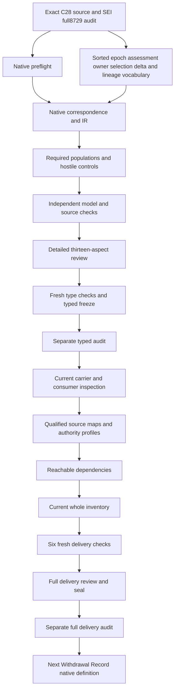

# Semantic Epoch: full partial candidate delivery review

This candidate formalizes the exact current Semantic Epoch Definition. Definitions, types and logic precede consumer implementations and effects. The model preserves the immutable owner-selected meaning genus, owner assessment of material changes, an explicit predecessor and material delta, successor selection and applicable lineage. It also preserves representation-only and generated-refresh exclusions. Material semantic judgments, actual owner decisions, immutable storage and operational lineage remain independent outcomes rather than consequences of reference labels.

Schema Evolution Invariant's full 8,729-file seal and separate actual audit passed before native creation. The preflight preserved every prior file hash and all 201 original source files. It verified exact current C28 source, A04/C01/E02 receipts and the declared work-unit write scope. There are now 97 native interpretation files among 183 current identities, leaving 86 without a native interpretation. The current whole inventory now has 97 partial drafts and 86 missing, with one supplied T/I model independently evaluated for every draft. Accepted whole translations and whole-definition proofs remain zero.

## 1. Exact source, admission and the authority boundary

The selected source is cal.definition.semantic-epoch@1.0.0-candidate.1, SHA e138c57bf7a69f958ca966690428bde166ff9d2137f557a14e153e94028272e3. Current admission is CAL-DECISION-0028-CRAFT-FOUNDATION-V1. The source scope is scope:cyberalchemy-lab-semantic-versioning. Exact source selection fixes which Definition is being interpreted; it does not accept the proposed interpretation or classify any existing artifact's change. Retained candidate-authored metadata and the source's nonexecuting claim ceiling remain intact alongside the current admission overlay.

The checker binds C28's decision, authorization, manifest, validation bytes and selected Definition row. It checks the exact Definition schema and generator digests, two pure human projections and both embedded local upstream sources. Definition@1.0.0-candidate.1 and Bounded Context@2.0.0-candidate.1 remain distinct exact source references. No live producer is authenticated from their bytes, and no operational source-to-consumer map is accepted by those observations.

The source expressly defines semantic versioning meaning without classifying existing artifacts, creating lineage or selecting successors. The candidate therefore supplies declaration guards and finite interpretation witnesses. Its records do not execute a decision. Parent-Instance Authority Separation remains an explicit inference boundary: admitting a meaning, declaring an owner or nominating lineage cannot provide instance authority. Owner decisions and actual effect permission require independent evidence and remain outside the selected theory.

## 2. Sorted vocabulary and qualified references

There are 18 nonempty sorts: AssessmentReference, ArtifactReference, ArtifactIdentity, EpochReference, EpochIdentity, MaterialMeaningReference, NormativeMeaningReference, ScopeReference, ExclusionSetReference, ModelReference, ContractSetReference, RepresentationReference, OwnerReference, SelectionReference, DeltaReference, LineageReference, EvidenceReference and Token. One EMPTY Token constant supports explicit reference-handle guards. Fifty-one total functions and 135 predicate/relation signatures produce 205 declarations. Artifact, epoch, assessment and owner-selection records therefore occupy separate typed domains.

An artifact has eight semantic and representation selectors. An epoch has identity, artifact, aggregate meaning and selection selectors, plus conditionally required predecessor, delta and lineage selectors. An assessment has before/after artifact, predecessor and owner selectors, plus successor-specific fields and optional preservation evidence. Selection, delta and lineage records have their own typed fields. Seventeen typed handle functions distinguish reference presence from semantic denotation. No printed label is treated as a canonical object or an authenticated decision.

Every symbol is qualified by exact Definition version and candidate scope. The same spelling in an upstream definition does not import its interpretation. Total functions provide values for every argument in the finite supplied model; they do not make all values applicable or authentic. Exact BindingDeclared relations must agree with those selector values whenever a selected obligation uses them. Missing, conflicting, undeclared and empty-handle component controls distinguish a nominated value from a complete explicit declaration.

## 3. Epoch genus, immutability and owner selection

EpochApplicable is equivalent to EpochInScopeDeclared. Every selected epoch requires a declared nonempty reference, recorded posture, immutable posture and owner-selected posture. Its exact four base fields nominate an epoch identity, an artifact, aggregate material meaning and one owner-selection record. The artifact must have complete typed component declarations and a versioned semantic posture. Its material meaning selector must equal the epoch's meaning selector. The selection record must point back to that same epoch.

This expresses one immutable owner-selected version of an artifact's normative meaning within the candidate. EpochReference and EpochIdentity remain separate coordinates. A successor reference must differ from its predecessor reference, but global injectivity of epoch identity labels is not invented. A positive model changes one epoch identity label to match another while preserving all necessary reference-based guards. Actual uniqueness, aliases, canonical identity and aggregation policy need accepted owner maps rather than a guess from version strings.

Immutable and owner-selected predicates are declarations. They do not prove a write-protected store, a signed owner decision or successful execution of selection. The selected epoch's reference may be complete while real storage or authority is unproven. Dedicated independent outcome predicates expose this ceiling. Outside epochs remain possible without receiving selected genus obligations. The theory neither classifies every real artifact nor assumes that its finite epoch universe contains every historical or future meaning version.

## 4. Assessment scope and identity preservation

AssessmentApplicable is equivalent to AssessmentInScopeDeclared. A selected assessment declares a before artifact, an after artifact, a predecessor epoch and an owner. Both artifacts are versioned semantic records with all eight exact component fields. The assessment must be recorded and must explicitly separate semantic from representation dimensions. Its before and after ArtifactIdentity references must agree. That retains the source's identity-preserving successor condition without asserting authenticated real-world identity from a token.

ArtifactReference can differ while ArtifactIdentity remains equal. Conversely, a no-change assessment may use the same artifact reference before and after. The positive same-reference control preserves such a no-change case rather than forcing every assessment to create two objects. Identity-changing migrations require their own interpretation and source correspondence; the selected theory does not silently classify them as ordinary identity-preserving semantic successors. Scope selection remains an explicit candidate map.

The owner selector is a declared reference, separate from selection execution and authentication. A model can name an owner and record a material assessment without demonstrating that the named party reviewed it. Assessment universes, the relationship between proposals and actual revisions, evidence adequate for owner judgment and the meaning of identity-preserving change remain findings. These uncertainties are visible in the correspondence packet. They do not prevent expressing necessary guards, and they do not justify claiming sufficient source fidelity or a completed operational change assessment.

## 5. Material meaning, the short iff and owner judgment

MaterialMeaningReference is an aggregate semantic coordinate distinct from raw NormativeMeaningReference. AssessmentMaterialMeaningChangedDeclared is equivalent to unequal before/after aggregate material-meaning references. AssessmentMeaningEqualDeclared is equivalent to equal aggregate references. AssessmentNewEpochDeclared is equivalent to the material-change declaration. This preserves the formal expression's short iff. It is declaration coherence within a supplied interpretation, not a content comparison algorithm or an independent test of the real artifact's meaning.

The richer normative statement adds the owner's determination. AssessmentOwnerDeterminesMaterialChangeDeclared is equivalent to an inclusive disjunction of five material-dimension flags. The aggregate material-change declaration is equivalent to that owner-determination flag. Both source rules remain selected, so their proposed interpretation must agree. This does not hide the distinction between a mathematical inequality shorthand and the owner-assessment criterion. Precedence and the semantic map joining the two remain explicit owner-review obligations.

An assessed dimension is one of normative meaning, scope, exclusions, owned model or semantic contracts. Multiple material flags may hold together. Nothing infers a successful owner process from the presence of any flag. Materiality, normative fidelity, owner determination and identity preservation each have independent actual targets. A selected record can satisfy all necessary declared coherence while those targets remain unevidenced. A source owner must still accept what aggregate meaning and each material dimension denote in a concrete consumer.

## 6. Five coordinates and reference differences

Each material-dimension flag requires unequal references for its corresponding artifact coordinate. Normative meaning compares artifactNormativeMeaning; scope compares artifactScope; exclusions compare artifactExclusions; owned model compares artifactOwnedModel; contracts compare artifactContracts. These are necessary evidence nominations within the finite model. The criterion is inclusive OR, with separate witnesses for all five dimensions. No ordering, priority ranking or exhaustive semantic decomposition beyond those source-named dimensions is introduced.

The converse is deliberately absent: a raw coordinate-reference difference does not automatically mean material change. A positive control changes an otherwise nonmaterial assessment's scope reference while keeping aggregate meaning equal and the scope materiality flag false. Theory and requested populations still hold. The reference may represent aliasing, a different encoding or an unaccepted content map. An opaque reference inequality is inadequate to settle materiality, just as byte inequality is inadequate to establish semantic change.

These declarations require an accepted reference-to-content correspondence before a consumer can infer actual differences. Aggregate meaning equality likewise does not authenticate real equivalence. Different records could nominate the same aggregate reference incorrectly. The model rejects incoherent selected declarations but cannot discover an incorrect semantic nomination merely from a token. Required owner review covers content identity, materiality thresholds, exclusions, model ownership and semantic contracts. Those obligations remain separate from the local theorem-like coherence of the proposed records.

## 7. Representation, bytes and nonsemantic classifications

AssessmentRepresentationChangedDeclared is equivalent to unequal before/after RepresentationReference selectors. It is independent of aggregate material meaning. The baseline includes material changes without a representation-reference change, as well as representation changes without material meaning changes. AssessmentByteChangedDeclared is a separate flag and supplies neither a necessary nor a sufficient successor criterion. Positive controls permit a byte change in a no-change assessment and a material successor without a byte-change flag.

Representation-only, schema-only, encoding-only and derived-refresh classifications each require declared aggregate meaning equality and no new epoch. The baseline supplies a distinct assessment for each alternative. A representation-only assessment marked as a successor fails the formal iff and the selected exclusion. A material successor simultaneously classified as a derived refresh also fails. The model does not require every real representation change to receive one of these labels, or treat the labels as an exhaustive operational taxonomy.

The source separates Semantic Epoch from Representation Revision, generator version and schema revision. Filesystem labels cannot establish succession. Those invalid inference declarations are excluded for selected assessments and remain unconstrained outside scope. The candidate creates no arithmetic rule from v1, v2 or directory names. Actual representation and byte comparisons need their own source maps and observations. Re-encoding the same context is explanatory evidence of the distinction, rather than a universal proof about every Bounded Context migration.

## 8. Explicit predecessor and successor bindings

Every selected assessment identifies an applicable predecessor epoch whose artifact selector equals the before artifact. This obligation also applies to a no-change assessment: it has a selected semantic baseline even when no successor is declared. The predecessor reference and the baseline artifact remain distinct records with exact links. Authentic historical origin, continuity, timestamp order and whether the selected predecessor is current are independent obligations. No latest-version rule is inferred from an opaque reference.

When a new epoch is declared, the assessment must have exact successor epoch, delta, lineage and selection fields. The successor must be applicable and have a reference distinct from the predecessor. Its artifact selector must equal the after artifact. Its conditional predecessor, delta and lineage fields must match the assessment. Its selection must equal the assessment's nominated selection record. These requirements make a claimed successor inspectable without executing creation or accepting historical truth.

Negative controls replace each of these bindings, remove applicability, reuse the predecessor as the successor or point the successor to the wrong artifact. A typed field with a nonempty handle can still be inconsistent with the declared change. Exact equalities expose that mismatch. The theory does not impose an arbitrary total epoch order or prove acyclicity of all semantic dependencies. Global lineage validity and source-history completeness need accepted operational maps and independent evidence beyond these local successor records.

## 9. Owner-selection, material delta and applicable lineage

A new epoch requires a recorded owner-selection record with exact owner, selected epoch, predecessor, delta and lineage fields. The selection owner must match the assessment owner; its epoch must match the nominated successor. The remaining fields must match the assessment's predecessor, delta and lineage. The genus independently ensures that the epoch's selection points back to the epoch. This retains explicit owner selection as a necessary declaration without equating a reference with authenticated consent.

The selected delta is a recorded material delta whose before and after aggregate meaning references equal those of the assessed artifacts. A lineage record is recorded and applicable, and its before epoch, after epoch and delta match the same predecessor, successor and delta. These records keep owner selection, semantic change and lineage separate while requiring exact local coherence. Removing recorded/material/applicable posture or changing any endpoint fails the selected necessary guards.

The delta selectors do not prove that a real semantic delta faithfully represents the change. Applicable lineage posture does not create lineage, repair missing historical segments or authorize a successor. The candidate has independent targets for owner authentication, owner-selection execution, predecessor authenticity, delta fidelity, epoch creation, lineage applicability and lineage creation. Complete record declarations may coexist with all those outcomes false. A legitimate independently supported outcome is allowed; the model does not prohibit authority or real succession grounded in separate evidence.

## 10. Reviewable preservation and optional fields

A preservation claim requires exact EvidenceReference binding and EvidenceReviewableDeclared. It does not imply aggregate meaning equality. The baseline includes a claim alongside a nonmaterial representation-only change and a contested claim alongside a material successor assessment. A positive control adds a preservation claim to another material successor without making theory inconsistent. Reviewability preserves an evidence obligation; automatic equivalence from the claim is an excluded inference declaration.

The source leaves actual preservation review to evidence and judgment. The candidate therefore separates MeaningEquivalence and PreservationReview actual targets from the evidence selector and reviewable flag. Removing reviewable posture fails the necessary claim guard. Naming evidence does not authenticate it, prove adequacy or settle a dispute between a preservation claim and an owner's material assessment. The model can represent that dispute explicitly, while accepted source precedence and the real review outcome remain unresolved.

Successor-specific fields are exact only when a successor is declared; preservation evidence is exact only when a preservation claim is declared. Total selectors outside those conditions provide well-formed table values without asserting optional operational records. An unused outside delta handle can be empty without violating selected guards. Required fields and their optionality therefore remain distinct. Consumers need accepted maps for absence, proposals and contested evidence instead of treating every total-function nomination as a populated physical record.

## 11. Source correspondence and bounded source observations

All 26 nonempty source string units are mapped with exact JSON selectors and full character spans. Fifteen clauses are encoded, nine explanatory and two deferred. The explanatory units retain notation, plain-language intuition and contextual examples. The two deferred units retain authority-scope correspondence and the source's candidate claim ceiling. The entire normative clause contains all fourteen primitive theory formulas. Supporting clauses express their specific necessary requirements rather than repeating unrelated quantified obligations.

The first prepared precheck failed at the fixed verifier-step limit because extensive source-support duplication repeated the same quantified guards. The exact producer, prepared scripts, captures and failed terminal result are retained in attempt 001. The refinement preserved the complete primary theory and all fourteen primitive formulas, left every checker limit unchanged and improved selector-level correspondence. A new actual precheck passed 257 controls with a maximum of 40,834 steps. No failed native producer is substituted with that preparation evidence. The first native builder also failed before outputs because ten required demonstration populations shared identities with unresolved mapping populations. Its producer and terminal capture are retained in native attempt 001. Disjoint unresolved-population identities corrected the contract without changing theory, required demonstrations, source scope or checker limits. The corrected native producer supplies its own successful terminal evidence.

Actual native source checks verify the C28 bindings, shape, source statements, two exact 4,125-byte pure projections, both local upstream digests and source-query correspondence. Thirty-one obligations bind exact source excerpts to thirty-two independent outcome queries without selecting those targets in T. Successful bytes, shape and projection checks do not accept source denotations or real consumer behavior. Twenty-two findings retain the interpretation losses, reference maps and authority ceiling for owner review.

## 12. Finite models, hostile controls and proof limits

The native model suite contains 257 controls: 66 theory-true, 183 theory-false and eight malformed-model rejections. Positive cases retain nonmaterial raw coordinate changes, no-change assessments, independent actual outcomes, contested preservation, optional fields and epoch identity labels without unsupported injectivity. Negative cases remove or conflict with all selected field bindings, empty required handles, break owner/epoch/delta/lineage equalities, confuse semantic and representation flags or claim excluded effects from declarations.

Twenty required populations demonstrate selected and outside epochs and assessments, two selected assessments, all five material dimensions, successor and four nonsemantic alternatives, byte-only and representation-independent cases, a contested preservation successor and a no-change case. They are demonstration obligations for the finite packet. They do not require every real installation to contain all examples. Theory T and population coverage I are evaluated independently; vacuous selected guards can satisfy T while failing requested populations.

Thirty-two non-entailment queries have complete supplied T-and-I countermodels. Actual materiality, ownership, storage, lineage, authority, trust, proof and effects are not inserted into T as positive or negative assumptions. Independently supported actual outcomes remain allowed. These checks establish a bounded inference ceiling for the authored model, not a mechanized whole-definition proof or an accepted shared carrier interpretation. Runtime limits remain one million input bytes, 50,000 IR nodes, 100,000 evaluation steps and a thirty-second timeout. The produced interpretation is 214,197 bytes and its qualified IR contains 22,710 nodes, within the unchanged limits.

## 13. Detailed work DAG and remaining delivery

One illustrative material assessment changes the artifact's declared owned-model coordinate and aggregate meaning, records the owner's material determination, and nominates a distinct immutable successor with an explicit predecessor, material delta, selection and applicable lineage. Those records can satisfy the necessary theory without proving that the actual owner selected the epoch. A counterexample retains the lineage labels but points the selection at a different successor; the exact equality guard rejects it.

Another illustration changes representation while preserving aggregate meaning and declares a representation-only classification. No new epoch follows. A preservation claim may provide reviewable evidence without proving equivalence. Marking that same assessment as a new epoch fails the iff and exclusion. These examples show how types keep the artifact, epoch, owner judgment and lineage distinct, while logic checks their declared relationships. Real change classification and consumer behavior still require accepted source maps and evidence.

The exact current C28 Semantic Epoch Definition describes one immutable owner-selected meaning version and material change assessed across normative meaning,scope,exclusions,owned model or semantic contracts. Its source ceiling does not classify an existing artifact,create lineage or select a successor. The sixteen typed inputs and separate actual typed audit precede these observations. The current registry contains143contractrows and121currentcontracts,with no contract directly bound to the exact Semantic Epoch Definition. Definition/v2 binds Definition;its shape is separate from an epoch instance.

Twenty current meanings from the comparison selection are bound by exact source version and digest,validated as Definition/v1 and rendered identically twice through isolated pure projection functions. Matching names do not import their complete theories. This includes Artifact,Representation Revision,Derived Refresh,Source,Provenance,Schema,Schema Evolution Invariant,Artifact Type,Bounded Context,Context,Context Lineage Record,Identity Lineage,Role,Decision,Contract,Governed Model,Authority,Validation and Parent-Instance Authority Separation. Admitting those meanings does not authenticate epoch records or accept shared carrier interpretations.

Four comparison contracts have distinct current semantics:ContextLineageRecord/v2,BoundedContext/v3,IdentityLineage/v1 and Context/v1. Their exact registry schema and artifact hashes are verified. Retained artifact bodies remain candidate-unadmitted with authority effect none under their current overlays. The current ContextLineage and BoundedContext contract package versions retain earlier classification carrier labels in their fixtures. That version-coordinate distinction is observed as part of the actual schemas;it does not classify a material meaning change or prove an operational defect.

ContextLineage/v2 closes a record with explicit predecessor and successor context references,lineage-kind labels,source/destination versions,preserved/changed prose,decision and owner references,effective boundary and inference-denial flags. It lacks an explicit Semantic Epoch identity,aggregate meaning,material assessment,semantic delta,owner selection and immutable epoch tuple. Whole hypothetical fixtures can pass with equal endpoint references,null predecessor,contradictory preserved/changed prose,opaque decisions or owners,empty evidence and unrecognized destination-version labels. They reject the extra epoch fields and true equivalence/admission inference flags. These are schema observations,not a demonstration that any real lineage is adequate or selected.

BoundedContext/v3 binds BoundedContext@2.0.0-candidate.1 and retains classification/v2. Its current shape requires context identity,model,language,scope,owner,contracts and challenge route. It rejects canonical Context Map backreferences,while a valid version-label change,empty contract references or a changed model/scope under the same ID can remain shape-valid. Whether a change is material depends on accepted content maps and owner assessment. Neither the carrier's version suffix nor a negative backreference probe settles the source's semantic criterion.

IdentityLineage/v1 describes a specialized same-product-renamed case with identity assertions,changed attributes,evidence and an owner route. Context/v1 describes a durable boundary of relevance,uses and lifecycle. Opaque references and identical identity-lineage endpoints can remain shape-valid. A Context labeled superseded must name a successor,but that successor may be unresolved. Their meanings must not be silently merged with the Semantic Epoch genus or its owner-selected successor condition. A lineage or lifecycle label is insufficient real epoch evidence.

Two unchanged candidate ContextLineage/v1 records under contexts/lineage name Governance and Ontology Lifecycle v2-to-v3 successors. Both deny inferred admission and equivalence,describe preserved identity/model/scope and removal of canonical map backreferences,and expressly require a separate exact context-owner decision admitting the v3 epoch. They retain the older v1 record discriminator and fail the separately compared current v2 shape. Their exact candidate source posture is preserved. The evidence does not automatically classify them as semantic successors or representation-only changes:canonical map ownership and contract meaning need explicit correspondence and owner judgment.

The Semantic Epoch source's three primary-consumer labels identify authority/definitions,contexts/lineage and tooling/validators directories. Directory presence is recorded,but no directory becomes an accepted operational validator map. An older Definition artifact-type candidate uses the phrase candidate epoch for any admission-bound byte change. Its byte-preservation/version policy is separate wording;it is not automatically the Semantic Epoch genus or an instance effect grant. Both distinctions keep reconstruction and candidate management from redefining normative semantic succession.

Definition/v1 probes reject missing required fields or inserted epoch-instance fields. They accept hypothetical normative text inferring succession from bytes,schema or directories,owner selection from a reference,meaning equivalence from preservation,lineage from a label,storage from an immutable flag and effect authority from Definition admission. Pure projections remain repeatable for those valid hypothetical objects. Structural shape and repeatable rendering do not enforce the positive semantic meaning. No hypothetical record is saved as a real carrier or admitted instance.

Twelve independent SemanticEpoch-only models evaluate all encoded clauses and required populations. Baseline,nonmaterial raw coordinate change,contested preservation,duplicate epoch identity labels and independently supported lineage can satisfy T and I. No selected assessments,one selected assessment,absent independent authority or all independently supplied outcomes can satisfy T while failing requested demonstrations. Representation-only marked new,inexact selection owner and inexact lineage endpoints fail T while I still holds. Population evidence never certifies theory,and the declaration system does not deny independently evidenced real outcomes.

The inspection executes only schema validation,pure Definition projections and finite model evaluation. It does not run any bound package validator,canonical or candidate carrier writer,live consumer,owner selection,epoch creation or lineage mutation. Shared meaning maps,reference resolution,materiality,actual preservation review,immutable storage,applicable historical lineage and instance authority remain unaccepted. The eight findings below preserve those exact gaps. Definitions,types and logic remain first;whole source translation and proof stay pending.

Observed denominators: 94checks; 47Definitionprobes with 14acceptances; 177wholecarrierprobes with 39acceptances; 12independentT/Icomparisons.

## SEP-CONSUMER-FINDING-001

Exact current C28 Definition has no directly bound current Semantic Epoch contract. The four selected comparison contracts bind Context Lineage Record,Bounded Context,Identity Lineage and Context meanings separately;Definition/v2 binds its own Definition meaning.

## SEP-CONSUMER-FINDING-002

Definition/v1 shape and pure projections accept normative prose inferring semantic succession from bytes/schema/directories,owner execution from a reference,equivalence from preservation,storage from an immutable flag,lineage from a label and effect authority from admission.

## SEP-CONSUMER-FINDING-003

ContextLineage/v2 declares context predecessor/successor references and preserved/changed prose but no explicit epoch identity,aggregate meaning,material assessment,delta,owner selection or immutable epoch tuple. Whole hypothetical fixtures accept equal endpoint references,null predecessor,contradictory prose,opaque decision/owner and empty evidence.

## SEP-CONSUMER-FINDING-004

BoundedContext/v3 binds the existing BoundedContext@2.0 meaning and retains classification/v2. Valid version-label changes or same-ID model/scope changes do not classify actual materiality or select semantic successors. Canonical map backreferences are rejected by shape without accepting a meaning-preservation map.

## SEP-CONSUMER-FINDING-005

IdentityLineage/v1 is a specialized same-product-renamed carrier;Context/v1 is a durable relevance boundary with lifecycle labels. Their references and allowed superseded/successor combinations do not prove material semantic change,owner selection or applicable epoch lineage.

## SEP-CONSUMER-FINDING-006

The two exact candidate v1 context-lineage examples name v2-to-v3 successors and require separate exact owner admission while describing preserved identity/model/scope and removal of canonical map backreferences. Accepted correspondence of representation,ownership and semantic contracts is absent;no actual semantic successor is classified here.

## SEP-CONSUMER-FINDING-007

The source primary-consumer labels identify three existing directories,not an accepted validator or operational mapping. The historical Definition candidate byte-change policy calls for a candidate epoch;that wording is not automatically the Semantic Epoch genus or a real instance authority grant.

## SEP-CONSUMER-FINDING-008

Twelve independently evaluated SemanticEpoch-only models preserve raw coordinate/materiality,contested preservation,epoch identity-label and T/I distinctions. Shared owner/reference/meaning/lineage denotations,source precedence,actual selection and storage need owner-reviewed maps;no upstream whole theories or maps are accepted.

The seventeen-node, seventeen-edge work DAG is acyclic and separate from the semantic dependency graph. The sixteen-input typed freeze and separate actual audit passed. Current consumer/profile, dependency and whole97-draft inventory producers have actual terminal zero results, as do all six fresh delivery checks. This review is authored before the candidate seal and its separate full audit; those final two gates must still provide actual terminal evidence before Withdrawal Record native creation.

Original scope remains 183 identities, 189 versions, 201 source files, 121 tasks, 511 planning edges, 797 SWUs and 36 frontiers. No candidate result grants canonical, private, live, publication or external authority. Source-owner acceptance, consumer correspondence, semantic cycle treatment, whole proofs and the final episode-wide aspect review remain pending. The broader goal stays active and is not redefined around this packet or the measurements already completed.

- SEP-FINDING-001: C28 admits the exact positive Definition without accepting this formal translation or selecting any existing successor. Status: unresolved; accepted owner maps and review pending.

- SEP-FINDING-002: Selected epoch and assessment universes are candidate scopes; complete canonical artifact/epoch/change universes need owner maps. Status: unresolved; accepted owner maps and review pending.

- SEP-FINDING-003: Exact typed identities and reference selectors are nominations rather than authenticated semantic identity or selected content. Status: unresolved; accepted owner maps and review pending.

- SEP-FINDING-004: Epoch immutability and owner-selected posture are declarations, not storage enforcement or executed owner selection. Status: unresolved; accepted owner maps and review pending.

- SEP-FINDING-005: One nominated owner selection per epoch and one successor per assessment do not settle aggregation, uniqueness or alias universes. Status: unresolved; accepted owner maps and review pending.

- SEP-FINDING-006: Identity-preserving successor assessments use equal artifact identity references; identity-changing cases need explicit source correspondence. Status: unresolved; accepted owner maps and review pending.

- SEP-FINDING-007: MaterialNormativeMeaning is represented by a separate aggregate meaning reference alongside five semantic coordinates, not equated only to raw normative prose. Status: unresolved; accepted owner maps and review pending.

- SEP-FINDING-008: The short material-meaning iff and richer owner determination criterion are composed as necessary declaration coherence; source precedence remains owner pending. Status: unresolved; accepted owner maps and review pending.

- SEP-FINDING-009: Material judgement is the inclusive OR of five assessed dimensions, without forcing every reference difference to be material. Status: unresolved; accepted owner maps and review pending.

- SEP-FINDING-010: A material dimension nominates unequal coordinate references; actual difference and materiality are independent source/content judgements. Status: unresolved; accepted owner maps and review pending.

- SEP-FINDING-011: Representation difference is independent of material meaning and includes abstract schema/encoding/projection correspondence still pending. Status: unresolved; accepted owner maps and review pending.

- SEP-FINDING-012: Byte-change declarations are neither sufficient nor necessary axioms for a successor; actual byte/content maps remain unaccepted. Status: unresolved; accepted owner maps and review pending.

- SEP-FINDING-013: Representation-only,schema-only,encoding-only and derived-refresh classifications retain equal declared aggregate meaning and no new epoch. Status: unresolved; accepted owner maps and review pending.

- SEP-FINDING-014: Before-epoch and before-artifact correspondence identifies an explicit predecessor but does not authenticate its history. Status: unresolved; accepted owner maps and review pending.

- SEP-FINDING-015: New epoch references differ from predecessors and bind after artifacts; global epoch identity injectivity is not inferred. Status: unresolved; accepted owner maps and review pending.

- SEP-FINDING-016: Successor owner selection,predecessor,material delta and lineage references are exact records, not executed decisions or lineage creation. Status: unresolved; accepted owner maps and review pending.

- SEP-FINDING-017: Material delta before/after selectors match aggregate meanings while real semantic delta fidelity remains independent. Status: unresolved; accepted owner maps and review pending.

- SEP-FINDING-018: Lineage recorded/applicable posture cannot prove actual applicable lineage or authorize creation. Status: unresolved; accepted owner maps and review pending.

- SEP-FINDING-019: A preservation claim carries reviewable evidence; the claim does not force meaning equality and can coexist with a contested material-change assessment. Status: unresolved; accepted owner maps and review pending.

- SEP-FINDING-020: Unused successor and evidence selectors remain total without asserting optional record existence or obligations. Status: unresolved; accepted owner maps and review pending.

- SEP-FINDING-021: Source scope,claim ceiling,examples and notation are accounted without turning filesystem labels or reconstruction metadata into succession. Status: unresolved; accepted owner maps and review pending.

- SEP-FINDING-022: Finite T/I witnesses and exact source string accounting do not accept shared meanings,source fidelity,whole translation or whole proof. Status: unresolved; accepted owner maps and review pending.

Actual source-bound counts: {"countermodel_queries": 32, "declarations": 205, "deferred_clauses": 2, "direct_semantic_uses": 24, "encoded_clauses": 15, "explanatory_clauses": 9, "mapped_clauses": 26, "required_populations": 20, "source_units": 26, "unresolved_populations": 135}.

Actual native evidence: {"controls": 257, "queries": 32, "source_checks": 56, "source_query_obligations": 31}.

Actual full-delivery inventory: {"admitted_source_versions": 189, "counts": {"deferred_clauses": 1112, "encoded_clauses": 939, "explanatory_clauses": 802, "mapped_clauses": 2853, "required_populations": 1184, "source_units": 2273, "unresolved_populations": 5414}, "current_definitions": 183, "joint_graph_edges": 2446, "joint_graph_nodes": 141, "joint_missing_counterparts": 44, "missing_current_drafts": 86, "partial_drafts": 97, "reachable_edges": 2412, "reachable_missing": 44, "reachable_nodes": 140, "unresolved_cycles": 1}.

Thirty-two qualified profiles have31rejections and163finite map frames have162rejections. All52source-map obligations remain proposed maps or explicit residue with no accepted references. Static reuse passes15differential checks and reuses only exact static snapshot bytes;live currentness and per-definition model/source/account/IR/graph checks remain delegated or independently evaluated. No shared sealed validator is changed. Semantic cycles retain unresolved classification rather than being confused with the acyclic work DAG.

Withdrawal Record source-only preparation passed25checks over24sourceunits with a5,042byte pure projection and one exact local normalization observation. Its current C66 positive Definition admission does not withdraw any identifier. The design keeps identifier reservation,conditional digest availability,optional successor authority,owner Decision,evidence,challenge route,history resolution and explicit higher-order recovery distinct. No Withdrawal Record interpretation or model exists yet;the Semantic Epoch full separate audit gates that next native work.

Both historical failures remain retained:the prepared step-limit attempt and native duplicate-population identity build attempt. The complete primary theory survived source-support refinement;disjoint unresolved-population identifiers repaired the contract without changing required witnesses or semantic scope. Current successful producer captures provide actual evidence independently of those failed attempts. Frozen typed inputs and all8,729priorsealedfiles remain unchanged. Source-owner fidelity,consumer maps,shared consistency,whole translation and whole proofs remain pending;the episode goal remains active.
