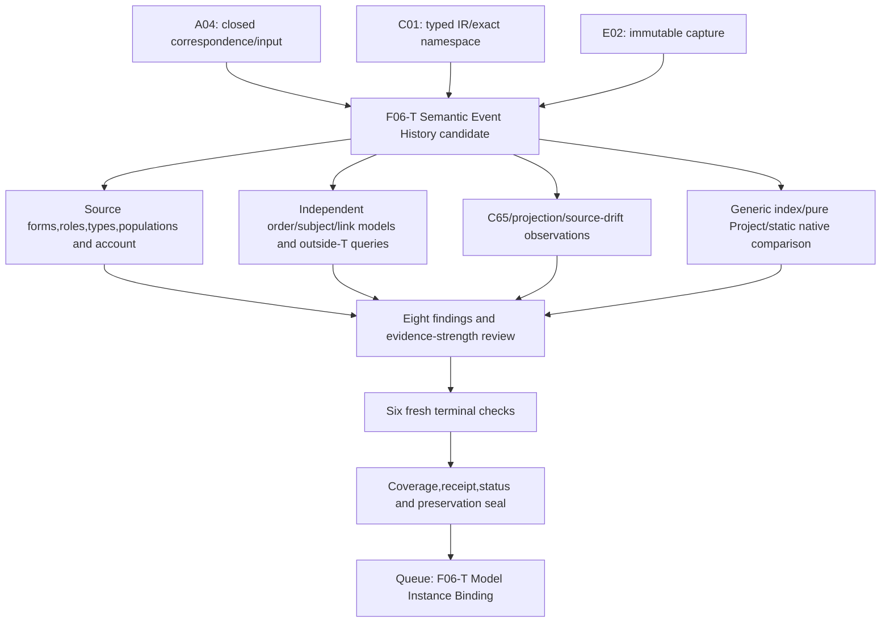

# Semantic Event History — bounded formalization candidate

This is a partial candidate for `cal.definition.semantic-event-history@1.0.0-candidate.1`, SWU `F06-T.cal.definition.semantic-event-history`. It prioritizes definition forms, statement roles, types, logical semantics and evidence requirements before implementation. It supplies inspectable semantic constraints and independent finite witnesses. Source-owner fidelity, whole-definition translation/proof, actual append-only replay and shared meaning closure remain pending. Authority effect is none.

The source defines a canonical append-only replay history of complete resulting semantic states for one Ontology subject under exact ordering and integrity rules. It does not own Governance decisions; calculated snapshots and views do not become competing replay sources. This candidate makes the one-subject, order, declared digest-link, retention and derived-surface responsibilities explicit without claiming a particular concrete runtime is already a faithful implementation.

## Source, correspondence and roles

[Source-bound interpretation](t.json), [correspondence](correspondence.json), [checked account](correspondence-check.json), [typed IR](static-ir.json) and [denominator](denominator.json) bind the exact source SHA-256 `5eee07c5ba67a00b79bc331fa6d5443ab1fd7c741ff7e484a6baca3337fe6959`. Twenty-one nonempty source units have twenty-five exact spans: thirteen encoded, six explanatory and six deferred. Every character in the inventory policy is accounted for. This coverage does not establish that deferred text has been translated or that encoded meaning has source-owner approval.

The normative positive definition, applicability and repeated boundary statements retain separate source spans. Plain-language/domain explanations, example and notation remain explanatory. Separate identity/lifecycle/evidence/authority contracts and the exact-version/admitted-successor consumer condition remain unresolved. No selected assumptions, fabricated exemptions, owner principals or owner approval refs are added. Each encoded clause has the candidate statement role `definition`.

The generic positive formal expression requires governed-identity-or-record and bounded-scope markers. That statement is weaker than the target-specific normative definition. Its presence does not justify dropping complete-state, one-subject, order or integrity requirements. The exact source negative formal statement is retained as a query obligation:

```text
SemanticEventHistory(x) =/=> authority_effect(x).
```

[Source query](source-query-obligation.json) binds its selector, character interval, digest and deferred clause. [Query policy](query-policy.json) keeps the candidate authority target outside T. An independently evaluated T/I model makes history-to-actual-authority false. This demonstrates nonentailment for the selected candidate theory; it does not assume the target, prove complete source equivalence or forbid independently justified authority elsewhere.

## Definition forms and mathematical meaning

Thirteen encoded occurrences comprise nine axiomatic/implicit occurrences, three genus–differentia plus axiomatic/implicit plus operational occurrences, and one axiomatic/implicit plus operational occurrence. They contain six unique formula values assembled from ten primitive templates. Repeated text increases correspondence coverage, not independent axiom count. Operational form here expresses selected record/transition requirements; the candidate does not claim a temporal logic or actual storage execution.

| Primitive | Candidate statement | Exact remaining obligation |
| --- | --- | --- |
| Genus | Semantic Event History iff six canonical/append-only/complete-state/one-subject/order/integrity qualifiers. | Owner review of biconditional strength, canonical selection and qualifier denotations. |
| Entries | History has one typed subject; each contained entry has an entry role, complete state role, matching event/state subject, replay-source marker and nonempty digest/cursor tokens. | Resolve actual subjects/states/records, authenticate bytes and accept token/value maps. |
| Strict order | Before relates contained distinct entries, orders every distinct pair in exactly one direction and is transitive. | Accept strict total order as the source's intended scope; map global versus per-stream cursors, contiguity and actual order. |
| Declared integrity | A declared predecessor link has contained ordered endpoints and equal previous/event digest tokens. | Establish adjacency, predecessor completeness/uniqueness, genesis/null behavior, hash algorithm and authentic event bytes. |
| Retention | Successors are histories of the same subject and require retention of each prior entry. | Verify actual prefix, frozen state/order, persistence and successful replay across transitions. |
| Derived boundary | History owns no Governance decisions; calculated snapshots/views have roles and are not competing replay sources. | Accept actual derived-surface/authority maps, replay-source selection and discard safety. |
| Bounded record | Histories have governed-identity-or-record and bounded-scope markers. | Supply accepted identity/scope denotation; this fragment alone is insufficient. |
| No inferred effects | History alone does not infer admission, authority, success, identity equivalence, carrier/instance/relation/Policy/Decision/runtime/publication/release/deployment or external effect. | Independently justify actual effects and universal consumer behavior. |
| Sibling separation | Histories do not become Governance Event History, Policy, an authority decision, calculated snapshot or calculated view. | Accept cross-layer correspondence; shared printed names do not unify identities. |
| Consumer scope | Declared consumers have a consumer role and a scope-use relation. | Prove actual scope/exclusion and exact-version resolution behavior at the required scope. |

The strict order is a selected candidate interpretation of “exact ordering rules.” It is not a silently accepted numeric cursor algorithm. The digest-link constraint is deliberately conditional on a declared link. This theory does not require every noninitial entry to declare one, require an immediate predecessor or restrict head previous-digest tokens. Those gaps stay explicit rather than being covered by an unsupported integrity label.

## Types, populations and logic

There are 75 declarations: two nonempty sorts (`Entity`, `Token`), one constant (`EMPTY`), seven total functions, 56 unary predicates and nine relations. Seven relations are binary; `Before(history, earlier, later)` and `PredecessorLink(history, entry, predecessor)` are ternary. Functions map histories/events/states to subjects, entries to resulting states, and entries to digest/previous-digest/cursor tokens. Exact source/version/scope namespaces bind every symbol.

The supported fragment is classical many-sorted first-order logic with equality. Total function tables are complete in each finite structure; empty domains, ill-sorted outputs, missing entries, duplicate tuples and wrong arity are rejected. Types alone do not prove semantic role separation inside Entity. The theory supplies specific sibling constraints. Tokens are opaque domain elements: an equality test is neither integer arithmetic nor SHA-256 computation.

Eleven required populations make consistency evidence non-vacuous: history, nonempty history, empty history, ordered two-entry history, successor retention without actual storage, history without actual outcomes, raw index without history, current history without state truth, noncompeting calculated surface without actual use, replay-source marker without execution, and qualified consumer use. Sixty-four other population obligations remain unresolved. No owner-approved exemption or shared carrier is invented.

The base model has eleven Entity elements and seven Token elements. Three histories share a subject, including an empty history. Two entries have complete-state-role elements with matching subject functions; the two-entry history has a strict order and one declared matching predecessor-digest link. One calculated object has both snapshot and view roles without competing replay status. That overlap is permitted by this candidate; the source does not supply a disjointness axiom for those two calculated roles.

[Model controls](model-controls.json) evaluate 92 authored structures: 30 satisfy T, 55 violate T and seven malformed structures are rejected. Negative controls include subject mismatches, empty digest/cursor tokens, missing order, self-loop, both directions, ordering outside containment, a three-entry nontransitive cycle, backwards/out-of-history predecessor links, wrong previous digest, successor subject change, missing retention, Governance ownership, competing calculated replay source, inferred effects, sibling collapse and consumer scope failures. A three-entry strict transitive order passes. The finite engine's original 100000-step and 30-second limits are unchanged.

Twenty independently checked targets stay outside T: sixteen actual outcomes; raw index/history; current history/state truth; and actual replay use of derived snapshots and views. Each has a supplied T/I countermodel. Model checking establishes these exact finite truths and countermodels, not whole-definition proof, authenticated state truth, unbounded liveness or universal storage preservation.

Permissive controls expose limits rather than hide them: empty history; multiple canonical markers for one subject; absent or non-immediate predecessor links; ordered events sharing a cursor token; nonnumeric cursor tokens; opaque matching digest tokens; unconstrained head previous digest; snapshot/view overlap; independently marked actual use of a noncompeting surface; and a retention requirement without successor membership. The candidate constraint says “not competing”; it does not make every possible use of a calculated surface an automatically prohibited operation.

## Actual source and historical traceability

[Source observations](source-checks.json) perform fourteen checks of the selected identity, Definition/v1 schema/generator, two exact pure renders, source preservation, current registry, exact C65 admission row, recorded authorization bytes, candidate manifest/contract, historical source posture, documentary drift, source-query placement, deferred exact-version condition and unimported comparisons/no assumptions. The generated projection is 4624 bytes, SHA-256 `e7a527ffcf908918ee92badb82ab40dcefb8cc6ad5bc38f4ee6211919504809e`.

C65 admits the selected Definition. The embedded interaction-source ref retains historical candidate posture. Its whole-file SHA-256 is `3c6e2afff90d07c7ea30f40bf7f3e2df8a05a7ff3e9da38c8ffdfd1d717b2c0f`; the current selected local interaction document is 40774 bytes with SHA-256 `abbfc5ee963e329e732c8330651f602a04f92e1f4e9cfbcf90af86fb6e61f384`. Those differ. Historical bytes are not recovered, the source is not rewritten and the current document is not admitted into T.

All three universal source testable conditions remain partial. The selected source/version/admission is checked, and candidate scope/no-inference controls are supplied. Every consumer's version/successor resolution, every claimed instance's applicability/exclusions and universal consumer inference behavior remain unproven. C65's source admission does not supply owner fidelity for this mathematical interpretation.

## Current carrier, schema and projections

[Carrier and profile evidence](authority-profile-checks.json) selects the sole current direct binding `cal.artifact-type.semantic-event-history/v1`, among 143 registry rows and 121 admitted-current rows. The carrier's registry admission is C70; its retained descriptor is `1.0.0-candidate.1`, `candidate-unadmitted`, using `cal.schema.semantic-event-history/v1`. The fixture is `candidate`. Source, descriptor, type admission and instance posture remain separate axes.

Sixteen catalog observations check exact selected bindings/schema/root, fixture shape, two identical pure fixture renders, preserved render input, exact artifact-template projection, closed top/payload/event shapes, external record-index responsibility, four hostile fixtures, generic package-validator scope, native semantic structures/append/noncanonical-source code, historical Definition shape and the captured Project baseline. Only the generator's bound pure `render_record` function is executed. Its materialization writer and receipt-writing package validator are not executed.

The schema indexes `event_id`, `event_digest`, `cursor`, `previous_event_digest` and `record_ref`. It does not require or admit an inline complete semantic state or per-entry subject reference. One history names a subject kind (`ontology-node` or `ontology-edge`) and subject ref. The fixture contains a synthetic event at cursor 842 with repeated-digit hashes and an unresolved external record locator. It establishes a shape example, not replay from event 1 or verified complete state at cursor 842.

Thirty-six schema mutations produce sixteen acceptances and twenty rejections. Unresolved record refs, zero-filled hashes, duplicate events, noncontiguous/out-of-order cursors, watermark mismatch, unmatched predecessor digest, subject-kind/reference mismatch, same history identity with changed state locator, whitespace identifiers, huge positive cursors, admitted record-state text and permission-sounding claims with no authority effect all pass shape validation. These do not establish truth, identity, order or authorization.

The schema rejects empty events, false append/replay/index flags, invalid cursor range/type, malformed digests, missing record ref, inline full state, per-event subject additions, unknown subject kind, forbidden extra fields and an admitted authority effect. Empty generic histories are permitted by T but forbidden by this carrier profile. An accepted map must reconcile that difference. The historical Definition/v1 record fails four current Definition/v2 shape constraints; no migration or admission invalidation occurs.

## Project and native runtime evidence

Captured Project semantic and governance histories each contain four events. The existing pure `validate_histories` function and its exact bound helpers are extracted through AST and executed on in-memory copies. Sixteen controls give nine acceptances and seven rejections. The baseline passes. Semantic cursor, previous chain, unsealed summary, chain digest, watermark, event order and a resealed semantic change without the updated Governance join fail.

Additional resealed/isolated cases pass this specific function: duplicate semantic event IDs, unauthenticated resulting-state digest, unresolved resulting-state ref, unsupported truth claims in a summary, history-subject mismatch, false append-only flag, wrong predecessor-state digest and calculated source-kind text. These are limits of this function in isolation; the whole application has other validation surfaces. Resealing hypothetical records does not authenticate their state claims, accept mutation of prior stored history or prove source-owner authorization.

Native Rust source defines a distinct `SemanticEvent` containing subject identity and `complete_resulting_semantic_state: OntologySemanticState`. Static inspection finds global semantic cursor continuity, event family/ID/state/hash checks, duplicate event rejection, subject/stream equality, resulting-state subject equality, per-stream chain and lifecycle transition checks. Append code checks expected stream versions, validates proposed semantic history and global IDs, then invokes persistence. Its replay input boundary rejects noncanonical source kinds with `NONCANONICAL_REPLAY_SOURCE`.

This scope inspects those native paths; it does not execute native replay/append, certify storage atomicity or prove every trace. Generic index, Project history and native events have different schemas and validation rules, including per-subject versus global cursor scope. Their common-carrier/value maps remain unaccepted. In particular, static source presence does not establish current activation or a correct adapter.

Thirty-three hypothetical qualification profiles cover twelve exact axes and eleven support hypotheses: thirty reject, one permits use under all stated hypotheses and two deny stale/changed-binding reuse. Fifteen finite frames cover unchanged prefix, separately authorized next state, deletion or alteration of prior state/order/digest/record locator, decision authorship, prior-state overwrite and actual-compliance claims; twelve reject. These examples are guarded obligations, not an unbounded temporal proof or actual persisted append.

## Dependencies, findings and detailed DAG

Twenty-five semantic uses bind exact current versions. There is no exact `Governance` Definition in the snapshot; that missing label remains explicit instead of being replaced by an invented definition. Governance Event History, policy/decision/authority and model meanings are independently qualified. [Comparison selection](comparison-selection.json) imports neither predecessor theory nor current interaction/runtime prose into T.

[Dependency graph](dependency-graph.json) and [current inventory](current-inventory.json) contain 110 nodes, 952 edges, 62 missing counterpart packets and one unresolved 48-member component with 614 internal edges. Root/input bindings differ between local and whole-inventory selections, while declared structure agrees. Each of 48 partial drafts has one independently reevaluated supplied T/I witness; that does not prove a common meaning-aligned model. Aggregate accounting is 1097 source units, 1488 spans (392 encoded, 392 explanatory, 704 deferred), 437 required populations and 1577 unresolved populations.

Eight pending owner findings cover canonical/genus/cardinality; actual complete states and subject/record maps; strict-order/global-cursor meaning; incomplete predecessor/hash semantics; append-only prefix/retention; noncompeting derived surfaces and Governance separation; weaker formal expression and universal consumer conditions; and documentary drift/common runtime/dependency closure. Agent self-review supplies no owner decision.



The final queue arrow describes selected episode order, not an invented native prerequisite. Native dependencies remain A04, C01 and E02 with bounded PASS receipts. Family/theory/proof/implementation gates retain their whole-scope criteria.

| Work | Concrete exit evidence | Remaining gate |
| --- | --- | --- |
| Source and scope | Exact source/snapshot/SWU/receipts and 3915 prior candidate files | Historical document recovery and source-owner fidelity. |
| Formalization | 21 units/25 spans, 75 declarations, 11 required populations, eight findings | Complete accepted meaning and dependencies. |
| Logic | 92 controls, seven malformed rejections and 20 countermodels | Whole-definition proof, actual hashes/order and universal temporal properties. |
| Carrier/runtime comparison | 14 source checks, 16 catalog observations, 36 schema probes/four hostile fixtures, 16 pure Project controls | State/reference/source-kind/common-carrier maps and qualified native execution. |
| Temporal qualification | 33 profiles and 15 finite frames | Actual prefix preservation, storage/replay and unbounded traces. |
| Delivery | Six fresh terminal checks, receipt/coverage/status and exhaustive seal/read-only audit | Owner decisions, joint cycle classification and final episode review. |
| Continue complete scope | Model Instance Binding F06-T | Remaining 135 current identities and joint/historical-version obligations. |

## Preserved failure, delivery and full episode

A temporary closeout-authoring helper had one syntax error before it wrote its output. [The failed attempt](attempts/0001-closeout-authoring-helper/attempt.json), [helper bytes](attempts/0001-closeout-authoring-helper/author.py) and [terminal output](attempts/0001-closeout-authoring-helper/terminal-output.txt) are retained. Its evidence pins verify that the theory, IR, model/source/profile reports and denominator were unchanged. The helper was corrected. This was an authoring failure, not a failed formal model or substituted theory; all actual producer checks have empty stderr and terminal success.

[Fresh command results](fresh-command-results.json) record contract, model, source, profile, dependencies and inventory. [Receipt](receipt.json), [coverage row](coverage-row.json), [episode status](episode-status.json) and [delivery manifest](delivery-manifest.json) are produced after six successful fresh checks. The final read-only audit verifies preserved sources, prior/current candidate files, the failed helper archive and the partial claim boundary. Writes remain inside this candidate directory; unrelated Git work, canonical sources, prior evidence and private/live runtime state are preserved.

Coverage advances to **48 partial drafts out of 183 current identities**, with **135 lacking a per-definition draft** and **189 admitted versions** still in scope. Source-owner-accepted whole translations and whole-definition proofs remain **zero**. I04's exact historical eight-draft report is preserved; updating its selected reporting scope is separate work. Next priority is **F06-T.cal.definition.model-instance-binding**. The full formalization episode and final review explaining each aspect remain active.
