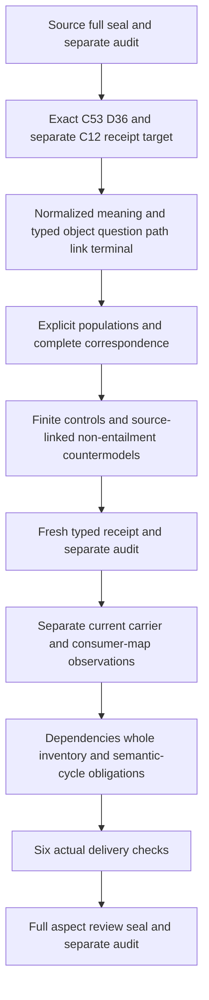

# Traceability: definitions, types and logic first

Select cal.definition.traceability@1.0.0-candidate.1 at exact digest3e2ec77affb54a73a7b6156112cad1e69dc298a92dd82ed7dc0e231dd0672c91 through C53. Its admitted local D36 selector has digestb26a51020545d55d5636e1bff0fd7ecf5ad32c9299ab116a31a28c3a6baf8af7 and2387bytes;the local whole book matchesecfbd64f334954809e83ffd5d4f9adfb759f39716de96c3ac1227d4ee869c6f8. Current meaning/source-use admission,retained candidate/null source posture and C12 planning remain separate. The configured producer path is absent and its identity is not authenticated.

C12's revise decision has two targets:semantic.traceability and type.receipt. Preserve that separation. A traceability case or receipt reference does not automatically become the Receipt Artifact Type,admit an instance or grant authority. Exact normalization identity,kind,carrier,scope and D36 source relations remain necessary proposed classification maps. Do not silently merge meaning with another target.

Use separate sorts for normalized Meaning,TraceCase,WorkObject,ReviewQuestion,DeclaredPath,Link,Position,TargetReference,RelationKind,AuthorityPosture,Context,Terminal,AnswerReference,TypedResidue,NamedGap,OwnerRoute or NextRoute where justified,and Token. Descriptive sorts are not invented canonical Definition identities. Selected cases bind a work object,a question and a declared path;actual question adequacy,identity precision and relation resolution need accepted maps.

Every selected link must retain its path,position,target,relation type and authority posture,with declared typed reference precision. The local path order may use strict irreflexive/asymmetric/transitive/total-on-selected-distinct-links constraints and distinct selected positions. Those declarations do not prove actual graph traversal,well-foundedness over unbounded links,global source-object acyclicity or real chronology. Repeated target references and differing recorded postures need not create identical links or inherited authority.

A case needs a declared terminal answer or explicit residue/gap representation. If a path is declared broken,its break must be named as a gap or typed residue. Source language does not justify silently replacing the inclusive residue-or-gap alternative with mandatory exclusive tags. Partial answers and unresolved residue may coexist until owner policy chooses sharper outcome cardinality. A residue marker records a limit rather than proving the question answered or the path complete.

Retain the no-hidden-conversation-context requirement as a proposed necessary navigability declaration with explicit work/question/link/context references. Do not identify that declaration with actual navigation or adequate context. Actual traceability,question relevance,target resolution,answer adequacy,hidden-context independence,proof,completeness,approval,authority and consumer alignment stay outside the primary theory. Positive controls may independently support those outcomes;non-entailment is not a categorical ban on legitimate proof or approval.

The twelve topic areas in the genus and four human questions describe relevant navigation purposes. Do not require every case to visit every topic or force an exhaustive question taxonomy without an accepted map. Complete source accounting must retain those words as explicit translated requirements or owner-pending spans rather than discard them. The four scientific-formal testable conditions are migration observations:identity,selected source digest,Definition/v1 schema,and generated projection. They do not establish universal navigation behavior.

Explicit populations must inhabit selected case/object/question/path/link bindings,outside scope,repeated targets,recorded posture distinctions,answer and residue/gap outcomes,and a declared break that retains its marker. Add guard-failing,scope-failing and malformed models,plus countermodels for actual outcomes. Bound each source-query target to exact selectors,character offsets and excerpt digests. Do not assume query targets or source-owner fidelity to pass a model.

Run native author/build/model/source only after Source's full delivery seal and separate audit. Then fresh typed replays,frozen receipt and separate typed audit. Current carrier or C12 prototype/C13 profile observations remain independent. Compile reachable dependencies and the entire current inventory without promoting unresolved semantic cycles or isolated witnesses into a common-meaning model. Six actual delivery checks precede the full aspect review,seal and separate audit. The next Definition is selected from the existing manifest only after that audit.

Preserve the original183currentidentities189versions201sources121tasks511planningedges797SWUs36frontiers. Accepted whole translations and whole Definition proofs remain explicit. No canonical/private/live writer,publication,external message or delegated owner acceptance follows from this preparation.

