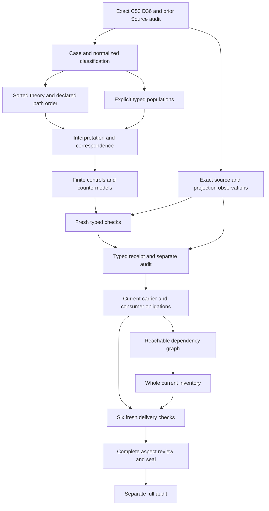

# Traceability: full partial candidate delivery review

## 1. Selected Definition and authority boundary

The selected meaning is cal.definition.traceability@1.0.0-candidate.1, admitted through C53 at the exact digest recorded in the context and interpretation. The selected local legacy source is CAV2-D36. Its admitted section digest is b26a51020545d55d5636e1bff0fd7ecf5ad32c9299ab116a31a28c3a6baf8af7;the local whole book matches the recorded admission digest. Those bindings support a reproducible selection of meaning and source bytes. They do not accept this proposed translation or prove actual navigation behavior.

The retained Definition body still records a candidate/null source posture. The current C53 admission overlay is separate and the historical body is preserved. C12 selected a revise plan with two targets: semantic.traceability and type.receipt. The second target is a separate Artifact Type planning target. A Traceability case, terminal or receipt reference does not silently become that type or acquire its meaning. The normalized classification needs its own accepted map.

The configured historical producer path is absent. A local copy that matches the section and whole-book digests does not authenticate that producer repository or establish current live source behavior. This review reports the bounded local observation. Admission,activation,publication,release,deployment and external effects remain separately governed. This candidate creates no canonical or private/live state.

## 2. Definitions and explanatory voices

The normalized statement identifies semantic.traceability, type.definition and scope.lineage, and requires classification and accepted source relations to be preserved without a silent sibling merge. That statement addresses identity and classification. The bound source genus addresses the ability to follow explicit typed links so that a later human or agent can ask why an object exists, what it depends on, what it affects, and where to continue. The formal expression introduces a work object, review question, declared path and terminal answer or residue. These are distinct layers of meaning.

The plain-language thread from purpose through changes to continuation supplies useful intuition. The migration-context voice explains repository navigation and retained prototype status. Neither explanation is treated as a universal theorem or proof of a live repository's navigability. Source accounting retains the entire selected wording and identifies each explanatory or deferred span explicitly.

The theory preserves necessary declared structure while leaving actual question relevance, target resolution, answer adequacy and context independence outside T. The twelve topic areas and four questions describe the purpose and reach of navigation. An owner must decide which areas and questions are relevant to a particular case. This candidate does not require every case to traverse every topic, and it does not invent an exhaustive question taxonomy.

## 3. Sorts and identity distinctions

Meaning, TraceCase, WorkObject, ReviewQuestion, DeclaredPath, Link, Position, TargetReference, RelationKind, AuthorityPosture, Context, Terminal, AnswerReference, TypedResidue, NamedGap and Token are separate proposed sorts. Each sort has an explicit nonempty domain in the supplied finite interpretation. These are descriptive logical sorts;they do not create new canonical Definition identities. In particular, ReviewQuestion has no current standalone canonical Definition identity in the selected catalog. The context records that limit rather than manufacturing a dependency.

A Meaning carries normalized identity,kind,carrier,owner scope and selected source projections. A TraceCase carries its meaning,work object,question,path and context. A Link carries its path,position,target,relation type and posture. A Terminal carries its path and separately typed answer,residue and gap projections. These projections keep the classification object distinct from the navigation case and keep references distinct from resolved objects or events.

Equality is local to a declared sort. Repeated target references do not identify two links, and matching posture labels do not establish a common authority grant. Nonempty handle guards exclude selected empty references without authenticating them. Total functions give every domain member a logical projection, including outside members;applicability guards determine which members must satisfy the source-inspired declarations. No global uniqueness or real identity-equivalence policy is inferred.

## 4. Signature and reference precision

The typed signature declares every sort,constant,total function and predicate or relation explicitly. The EMPTY token and five normalized classification tokens support the selected classification map. Handle functions make selected reference requirements observable. The normalized constants preserve proposed identity values through typed projections;their meaning still needs owner acceptance. The logic does not infer that an arbitrary text handle is a resolvable reference or that a recorded classification is authentic.

Case,Path,Link and Terminal applicability each agree with their declared scope predicate. A selected case requires its normalized Meaning,explicit WorkObject and ReviewQuestion declarations,a selected path and an explicit Context reference. RelevantChainDeclared and NoHiddenConversationContextRequiredDeclared retain necessary source conditions as declarations. They are not sufficient observations of actual relevance or context independence.

Every selected link retains a selected path,a nonempty position,target,relation type and authority posture. Separate precision declarations keep the three link fields from becoming untyped prose. Their declared presence does not resolve a real target,validate a real relation or authenticate a historical posture. Outside links may remain unselected and incomplete. This scope distinction preserves a useful logical test without claiming every object in the world is a complete Traceability link.

## 5. Theory and local path order

The primary theory is a first-order candidate with equality. It has no assumed actual outcomes or source-owner fidelity. Its clauses encode normalized classification,selected case structure,selected paths and links,local order,terminal alternatives,explicit break markers,role separation and conditional sibling-reference precision. The theory concerns declared structure. Actual navigation and answer quality are separately queried targets.

Selected paths require at least one selected link and one selected terminal. This is a proposed explicit path population policy motivated by the displayed link sequence. Real zero-hop or empty paths need independent owner review. The candidate records that choice as an unresolved finding rather than presenting the formal notation as an accepted cardinality policy. Multiple selected links and terminals remain permitted.

Within a selected path, distinct selected links have distinct position identities and a strict total declared order. The order is irreflexive,asymmetric and transitive on selected same-path links. It does not constrain unrelated links into one global sequence. A cross-path order cycle can remain outside those local requirements. The finite checks do not prove contiguity,actual chronology,unbounded well-foundedness or acyclicity of the broader source-object graph. The order map itself remains ownerpending.

## 6. Answers, residue and named gaps

A selected terminal declares an answer,typed residue or named gap. The alternatives use inclusive disjunction. An answer can coexist with residue, and residue can coexist with a named gap. The source wording does not justify replacing those alternatives with exclusive tags or rejecting a useful partial answer merely because it records unresolved work. Positive controls preserve overlapping alternatives explicitly.

An answer declaration requires a nonempty AnswerReference and its declaration. A residue declaration requires a nonempty TypedResidue and its declaration. A named-gap declaration requires a nonempty NamedGap and a name declaration. A selected terminal keeps its selected path. These guards preserve typed outcome references without proving that the referenced answer is correct or that a residue marker adequately explains a break.

If a selected path is declared broken,that path must retain a selected terminal with typed residue or a named gap. An answer-only terminal cannot conceal a declared break. The requirement records the boundary and supports continuation;it does not repair the path,prove the question answered or establish that all undiscovered breaks have been found. No absence-of-declared-break inference supplies actual completeness.

## 7. Populations and supplied witnesses

Required populations are independent from the primary theory. They supply explicit normalized Meaning,selected cases without actual outcomes,outside Case/Path/Link/Terminal members,repeated targets,different postures on a shared target,answer terminals,partial answers with residue,overlapping residue/gap markers,declared breaks with markers,and an unbroken selected path. The finite base model inhabits those requirements. Their actual observed counts are recorded from native outputs below.

Keeping these populations explicit prevents a theory from passing only because every applicability predicate is empty. It also distinguishes universal structural guards from the scenarios used to exercise them. A required overlap witness does not force every real terminal to overlap, and a required repeated-target witness does not force every path to repeat a target. The theory remains open to independently accepted sharper policies.

Unresolved populations retain the declared predicate and relation denominator,including actual-outcome targets. They are not silently marked accepted. Scope guards permit outside members to lack selected precision and terminal tags. Populations and source correspondence require owner review before they can support a whole translation. The supplied finite model is a local witness,not a single common-meaning model for all current definitions.

## 8. Controls and malformed-model rejection

The model checker reconstructs the exact compiled interpretation and correspondence account before evaluating the supplied controls. It verifies qualified symbol names,complete total-function tables,domain membership,argument sorts and tuple arity. Missing symbols,partial total functions,ill-sorted constants,wrong relation arity,duplicate tuples and empty domains are explicitly rejected as malformed models. Those failures are different from a well-formed model that falsifies a theory clause.

Guard-failing controls remove normalized classification components,scope membership,case references,context declarations,link precision,position distinctions,terminal alternatives or required marker declarations. Local-order controls exercise reflexivity,asymmetry,totality and transitivity failures. A declared broken path with an answer-only terminal fails its marker guard. The expected result is checked against the independently evaluated model,including required-population truth where specified.

Positive controls preserve outside members,repeated references,cross-path order freedom,multiple selected terminals and inclusive outcomes. Other positive controls add independently supported actual outcomes to a case. T allows those outcomes while leaving them unjustified by recorded structure alone. Control counts and T-true/T-false/malformed denominators come from actual native terminal results. Preparation or intended execution is not substituted for that evidence.

## 9. Non-entailment and authority separation

Each actual-outcome query asks whether every selected case must have an outcome merely because it meets T. A supplied T/I model keeps a selected case while making the queried outcome false. The checker also verifies the explicit witness condition. This is a bounded countermodel to that particular entailment,not a universal proof of the entire Definition or a categorical prohibition on independently justified outcomes.

Targets include actual navigability,question relevance,target resolution,answer adequacy,hidden-context independence,link typing,relation precision,posture authenticity,residue adequacy,provenance,proof,completeness,approval,truth,authority,admission,activation,publication,release,deployment,external effects,owner fidelity,consumer alignment and global consistency. None is inserted into the primary theory as an assumption to make a result pass. Exact source-linked obligations preserve the negative boundaries and necessary-declaration limits.

Meaning-role exclusions keep Traceability from collapsing into Provenance,Proof,Completeness or Approval. Actual proof,approval or authority may coexist with a selected case when separate evidence and governing contracts justify them. Recorded authority posture is metadata;it does not inherit parent authority or authorize an instance. Conditional sibling assignments require explicit references and never silently import the separate C12 Receipt type.

## 10. Source correspondence and currentness observations

Every nonempty selected source string in voices,boundaries,scope and claim ceiling is inventoried. Clauses retain selectors,character offsets,excerpt digests,dispositions and corresponding links. The account checks complete character coverage. Encoded portions map to proposed formulas;explanatory portions retain intuition;deferred portions retain unresolved actual denotations and boundary obligations. Complete accounting is stronger than a loose paraphrase but does not itself prove semantic fidelity.

The source checker independently observes the current C53 registry row,exact Definition selection,authorization and manifest bytes,source-use admission,local D36 section and whole-book bytes,Definition/v1 schema and two pure generated projections. The renderer must preserve its input and reproduce the selected projection exactly. C12's normalized classification,revise disposition,prototype scaffold and separate Receipt target are checked independently from C53 meaning/source-use admission.

The four scientific-formal testable conditions remain bounded migration observations:identity,selected local digest,record schema and generated projection. They do not become universal navigation or answer adequacy axioms. No configured live producer identity is authenticated. The source-query obligations bind exact excerpts to targets outside T and report whether the corresponding necessary declaration is encoded or deferred. Eighteen owner findings remain unresolved.

## 11. Dependencies and whole-definition obligations

The declared dependencies select exact current canonical versions for definitions,artifacts,sources,provenance,evidence,review,methods,results,validation,decisions,authority,residue,relations,identities,contexts,policy and event history. Selecting those sources records semantic uses and does not import their whole theories. Descriptive sorts without canonical identities remain explicit limits. The next priority from the existing manifest is Validation.

The full scope remains 183 current identities,189 admitted versions and 201 selected source files. Source is the previously sealed78th partial draft. The actual whole-inventory refresh verifies79partial drafts and104current identities without T files,including exact incremental accounting. Required populations and isolated per-definition witnesses do not establish one joint model or consistent common meanings across all definitions.

Reachable dependency compilation and the whole inventory remain full-delivery obligations after the typed stage. Missing counterpart packets and semantic cycles require independent classification. An acyclic execution DAG is distinct from a possibly cyclic semantic dependency graph. Accepted whole translations and whole Definition proofs remain separately reported and cannot be inferred from the number of drafted packets or passing controls.

## 12. Current carrier observations and execution DAG

The actual catalog contains143admitted-contract rows and121current types. None directly binds the selected current Traceability Definition. The generic current Definition/v2 carries its own Definition meaning. Its admission is separate from a Traceability case,path,link or terminal contract. No dedicated current Traceability carrier or accepted consumer correspondence was inferred from the absence or presence of a catalog row.

C12's semantic.traceability prototype remains a semantic scaffold with authority_effect none and revise disposition. Its normalized five-axis contract preserves identity,semantic kind,Definition carrier,scope.lineage and term. The D36 revise selection keeps semantic.traceability and type.receipt separate. The selected C53 meaning and source-use admission remain distinct from that C12 planning selection and acceptance of this proposed translation. The prototype's generated artifact projection was rendered twice without changing the input and matched the selected bytes.

C13's admitted evaluation profile is CAL-EVALUATION-DEFINITION-V1. It evaluates Definition/v1 records in collect-all mode with seven checks and PASS,FAIL or NOT_EVALUABLE outcomes. Its carrier selector has thirteen required root fields. The retained profile body remains candidate/none;its exact admission overlay is independent. This profile concerns Definition record validation. It does not become a dedicated Traceability question/path/link profile or grant real navigation,answer adequacy,context independence,Conformance,Admission or authority to an instance.

Seventeen actual catalog,binding,schema and pure projection checks passed. Thirty-seven Definition schema probes include five acceptances. Thirty C13 profile schema probes include ten acceptances. Removing required fields or required check fields is rejected. Whitespace and unresolved record IDs,owner references,claim ceilings and admission-rule strings can be accepted by shape. Overclaimed prose that asserts completeness,proof or authority can also be shape-valid. The checker records those acceptances without promoting them to semantic truth,executed validation or accepted consumer behavior.

Thirty-five qualified hypotheses include thirty-three rejected cases. Seventy-three proposed-map frames include sixty-eight rejected cases. Twenty-two correspondence obligations retain normalized classification,D36 lineage,case/object/question/context bindings,declared paths,cardinality,positions,local order,repeated targets,target and relation precision,authority posture,inclusive terminals,answers,typed residue,named gaps,break markers,hidden-context requirements,question relevance,topic scope and consumers. Each remains a proposed map or explicit residue. Hypothetical map references and owner labels do not supply accepted denotations or an actual owner Decision. The accepted source-to-carrier/consumer map list remains empty.

The first passing profile transcript retained a copied display label referring to originates-from while its actual code correctly checked the two Traceability and Receipt-type targets. The original checker,report,actual exit0,stdout and stderr are preserved. The local display label was corrected to Receipt type and the profile checker passed again with actual exit0. This was a reporting correction;the exact target check,canonical inputs,frozen typed evidence and prior Source seal were preserved. The earlier source-only preparation failure on an unavailable canonical ReviewQuestion identity also remains in the prior sealed Source history;ReviewQuestion is a proposed descriptive sort here.

No bound package validator,canonical/candidate carrier writer,native/live consumer or real owner correspondence acceptance was executed. No new authority or Typed Relation was created. Absence of a dedicated carrier does not prove that Traceability cannot be represented through external records;it identifies the correspondence and contract work still required. A generic Definition profile and a navigable-looking scaffold cannot substitute for actual question relevance,resolution,answer quality or context independence.

The reachable dependency graph and the79-draft whole inventory are freshly compiled. One supplied T/I witness per draft was independently evaluated. Missing counterpart packets,common-meaning consistency and semantic cycle classification remain unresolved. Six fresh delivery checks completed with actual exit0 and empty stderr. The execution DAG puts exact source and prior audit before typed classification,logic,populations,correspondence,finite controls and source observations;those precede the frozen typed receipt and separate audit. Actual carrier observations,dependencies and inventory then precede full review,seal and separate audit. The native Validation unit follows that separate audit.

## 13. Owner decisions and continuation

Owner review must accept or revise the normalized classification,case/object/question bindings,reference precision,local ordering,path cardinality,terminal alternatives,break-marker adequacy,context independence and actual navigation denotations. It must decide relevant topics/questions and establish any current carrier or consumer maps. No preparatory label,hypothetical owner reference or finite model substitutes for that Decision.

The full delivery remains a reproducible partial candidate. Source fidelity remains pending;semantic readiness and mechanized whole proof are false. The separate typed audit checks frozen evidence and actual results while leaving full delivery open. Historical preparation transcripts and earlier seals remain preserved. Any failed native or preparation attempts must retain their actual exits and original bytes before repair;passing evidence cannot erase that history.

The typed stage was freshly replayed,frozen and separately audited. Actual carrier observations,reachable dependencies,the whole inventory and six final delivery checks passed. Complete this candidate seal and its separate audit before creating Validation's native unit. The whole episode remains active until every authorized definition and its required review obligations are handled. The unresolved findings below state the translation's practical limits.

Actual native typed evidence: {"T_false": 67, "T_true": 41, "controls": 115, "counts": {"countermodel_queries": 24, "declarations": 120, "deferred_clauses": 9, "direct_semantic_uses": 29, "encoded_clauses": 8, "explanatory_clauses": 9, "mapped_clauses": 26, "required_populations": 14, "source_units": 22, "unresolved_populations": 64}, "malformed": 7, "projection_bytes": 5871, "projection_sha256": "d9297024014e2dde54c499666935620286daaa8ab8a9c2c187633559cfcf02ce", "source": {"definition_id": "cal.definition.traceability", "path": "evidence/migrations/cyberalchemy-v2-to-lab/candidates/0004-artifact-reconstruction-pipeline/layers/l1-semantic-repeatability/definitions/traceability/v1/definition.json", "sha256": "3e2ec77affb54a73a7b6156112cad1e69dc298a92dd82ed7dc0e231dd0672c91", "version_ref": "cal.definition.traceability@1.0.0-candidate.1"}, "source_checks": 44, "source_query_obligations": 21}.

- TRACE-FINDING-001: Current C53/D36 Definition and source-use admission are distinct from C12 revise planning and owner acceptance of this translation.
- TRACE-FINDING-002: C12 retains separate semantic.traceability and type.receipt targets;neither receipt class nor sibling whole meaning is silently imported.
- TRACE-FINDING-003: Normalized identity,kind,carrier,scope and selected source relations are proposed exact classification maps with owner-pending denotations.
- TRACE-FINDING-004: Meaning,TraceCase,work object,question,path,link and terminal remain distinct descriptive sorts without invented canonical identities.
- TRACE-FINDING-005: Case/object/question/path bindings and explicit Context references do not prove relevant questions or adequate context.
- TRACE-FINDING-006: Selected paths require at least one selected link and terminal as proposed population policy;real empty or zero-hop paths need separate owner review.
- TRACE-FINDING-007: Every selected link retains target,relation type and authority posture with necessary declared precision;actual link resolution and typing stay separate.
- TRACE-FINDING-008: Distinct local positions and strict total per-path order do not prove chronology,contiguity,unbounded well-foundedness or global graph acyclicity.
- TRACE-FINDING-009: Repeated target references and different postures remain allowed;target equality does not identify links or authenticate posture.
- TRACE-FINDING-010: Answer,typed residue and named gap are inclusive alternatives;partial answers and overlapping markers remain allowed.
- TRACE-FINDING-011: Declared broken paths need a selected residue or named gap;recording a marker does not establish adequate residue or a complete answer.
- TRACE-FINDING-012: NoHiddenConversationContextRequiredDeclared is a necessary declaration,not actual hidden-context independence or navigability.
- TRACE-FINDING-013: The twelve topic areas and four questions remain source-purpose descriptions;they do not impose every-topic/every-question universality or exhaustive taxonomies.
- TRACE-FINDING-014: Traceability meaning does not collapse into provenance,proof,completeness or approval;independently justified actual outcomes remain allowed.
- TRACE-FINDING-015: Sibling meaning assignments require explicit references without silently importing separate Receipt or other whole meanings.
- TRACE-FINDING-016: Four scientific-formal testable conditions are migration observations rather than actual navigation or answer adequacy axioms.
- TRACE-FINDING-017: Admission,activation,publication,release,deployment,external effects and authority are separately governed and remain outside the primary theory.
- TRACE-FINDING-018: Exact source accounting,finite controls and countermodels do not establish owner fidelity,current carrier/consumer correspondence,common-meaning consistency or whole Definition proof.

Actual full-delivery evidence: {"admitted_versions": 189, "counts": {"deferred_clauses": 981, "encoded_clauses": 759, "explanatory_clauses": 636, "mapped_clauses": 2376, "required_populations": 941, "source_units": 1811, "unresolved_populations": 3712}, "current_definitions": 183, "frozen_typed_inputs": 16, "joint_graph_edges": 1977, "joint_graph_nodes": 136, "joint_missing_counterparts": 57, "local_graph_edges": 1943, "local_graph_nodes": 135, "missing_current_drafts": 104, "native_definition_or_profile_failures": 0, "partial_drafts": 79, "prior_seal_files": 6709, "retained_successful_profile_before_display_correction": 1, "source_files_current": 201}.
