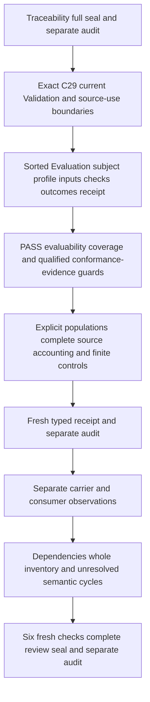

# Validation: definitions, types and logic first

The next selected current Definition is cal.definition.validation@1.0.0-candidate.1 through C29, at digest f21ca27867379eb3389588313208a5db37cf0449b79bb5c7f644c3b9a89a2af8. Its source is candidate0007 CML-07 semantic closure. Do not substitute C53 legacy reconstruction or C65 integrated-model selection. The current admission overlay and retained candidate lifecycle body are separate.

The genus is specialized Evaluation: an exact subject, exact criteria profile and exact bound inputs produce check outcomes and a Validation Receipt. Use separately sorted Validation, EvaluationReference, SubjectReference, CriteriaProfile, InputReference, EvaluationEnvironment, ValidatorIdentity, DeclaredCheck, Outcome, OutcomeTag, ReceiptReference, CoverageScope, ConformanceProfile, ConformanceEvidenceUse, Context and Token where justified. Descriptive sorts are not new canonical identities. Exact references and digest declarations are necessary proposed maps;they do not prove authentication,actual execution,complete capture,truth or identity equivalence.

Selected profiles declare coverage and evaluation mode. Selected Validation records exact subject/profile/inputs/environment/validator/outcome and receipt bindings. Every declared check has a PASS, FAIL or NOT_EVALUABLE outcome. Keep check membership,reported outcomes,evaluability and omitted coverage distinct. Outcome labels need accepted denotations. Logical distinctness of the three named tags must not silently impose an exclusive or exhaustive classification of all real-world outcome objects without a mapped policy.

The normative statement says PASS establishes that every evaluable criterion declared by P passed for the bound inputs. A boundary separately says a PASS cannot cover omitted or NOT_EVALUABLE checks. Preserve both statements. Do not silently turn every profile PASS into complete coverage,or assume that the mere absence of an evaluable FAIL closes omissions. Whether a particular evaluation mode permits a partial overall status with NOT_EVALUABLE results needs an explicit owner-pending status map. Positive populations should expose partial and complete declared coverage rather than erase that question.

Keep reported PASS,all-declared-evaluable-checks-PASS,complete declared outcomes,recorded receipt and actual execution separately represented. The complete set O is the profile-bound outcome set,not a declaration that all relevant semantic,implementation or runtime criteria have been discovered. Named profile scope and exact inputs must remain bound. A shape-valid digest string or validator label does not prove actual reference precision or executed checks.

PASS does not entail actual Conformance or Admission. A Validation PASS may serve as conformance evidence only if an applicable Conformance Profile declares those checks sufficient for an exact scope. That is a necessary evidence-use guard;it does not itself prove actual Conformance,consumer alignment,Admission or accepted source fidelity. Permit independently supported conformance and authority outcomes so that non-entailment does not become a categorical prohibition.

Specialized Evaluation does not silently import Evaluation's whole theory. Reference canonical dependencies only after checking current catalog identities;logical sorts like DeclaredCheck and Outcome are descriptive proposed carriers. Validation Receipt is a separate meaning and carrier map. A receipt may record successful and unsuccessful outcomes and does not grant Admission,Acceptance,Implementation,Publication or Deployment authority. Keep runtime evidence and truth beyond the declared checks outside the primary theory.

The selected Definition carries three source references:an admitted Definition JSON,an admitted Definition evaluation profile,and a retained candidate/null D56 legacy range. C29 separately selected exact D56 source use within a scoped CML-07 request. Preserve that historical source-use overlay without rewriting the candidate body. The configured producer is absent;recorded historical byte selections do not establish present external currentness. Do not substitute a newer local book's line numbers or claim an unverified historical digest was reproduced. The exact current Validation JSON remains the selected positive meaning.

Build explicit selected and outside populations,exact-bound PASS cases without actual authority or conformance,FAIL and NOT_EVALUABLE outcomes,complete declared outcome sets,partial/uncovered scope,receipts,scope-qualified conformance-evidence use and independent supported outcomes. Guard-failing and malformed controls need the same declared denominator. Source-query obligations must retain exact selectors,character offsets and excerpt digests. Keep actual execution,truth,Conformance,Admission,Acceptance,implementation/runtime evidence,publication,deployment,owner fidelity and consumers outside T unless separately justified by an accepted map.

Create the native Validation unit only after Traceability's full delivery seal and separate audit. Run author/build/model/source,fresh typed replay,frozen receipt and separate typed audit before current carrier/profile observations,reachable dependencies and whole-inventory checks. Six actual fresh delivery checks then precede complete aspect review,seal and separate audit. Preserve183currentidentities189versions201sources121tasks511planningedges797SWUs36frontiers and every prior seal. Preparation alone creates no native unit,model,proof,publication or live effect.

