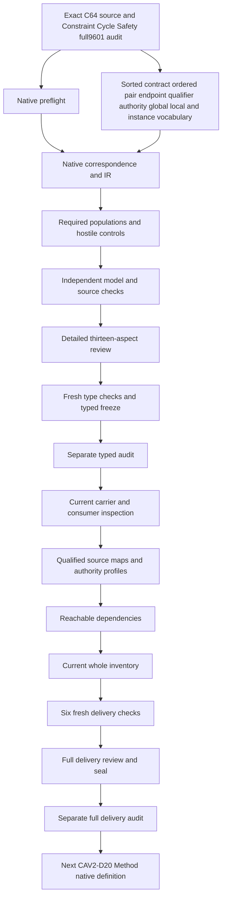

# Typed Connection Extension Rule: definitions,types and logic review

The candidate formalizes closed ordered endpoint-kind pairs under exact Relation Kind contracts. It separates declared pair sets from admitted/effective global availability,generated discovery indexes from authorization,global extension proposals from exact Ontology-local connections,and kind-pair connections from identified-object relation instances. A reuse proposal preserves kind/question and the predecessor's pair set while adding one exact new pair. A changed-question proposal can remain rejected or use a distinct Kind. Endpoint,qualifier,canonical-authority,contestability and effect bindings stay typed and independently mapped.

Native creation follows Constraint Cycle Safety's full9,601-file seal and separate actual audit0. All prior files and201sourcebytes remain verified. Working native drafts now number104among183currentidentities,leaving79withoutT. Last completed whole inventory remains103partialdrafts80missing until this packet's full delivery. Original183identities189versions201sources and121tasks511planningedges797SWUs36frontiers stay fixed. Accepted whole translations and whole-definition proofs remain zero. Source fidelity and semantic readiness stay pending;the full original episode and final aspect review remain active.

## 1. Exact source,C64 and evidence boundaries

The selected positive source is cal.definition.typed-connection-extension-rule@1.0.0-candidate.1,SHA9ceb0da5a4a71c375d3191ad6b05077182e1dbaea8e618cabc60127a5fb9c962. Its current admission is CAL-DECISION-0064-TYPED-CONNECTION-EXTENSION-RULE-ADMISSION. Source checking binds the exact decision,authorization,candidate and validation receipt. C64 admits this Definition with zero endpoint-pair,Relation Kind or consumer activation effects. It does not make the candidate formal translation authoritative.

Four upstream references identify Definition,Typed Coupling Invariant,Classification Orthogonality Invariant and Identity Relation. Each exact version and content digest matches the current local Definition. Their admitted source postures remain separate from this interpretation's proposed denotations. Whole upstream theories are not imported. Symbolic consumers CAL-AXIS-ORTHOGONAL-RELATION-MODEL-0002 and cal.artifact-type.relation-kind/successor are retained as routes rather than executed or accepted operational maps.

Historical admission counts do not replace the current183identity189versionsnapshot. The source's candidate ceiling stays visible under C64's positive overlay. Exact currentness and reproducible projection provide traceability;they do not resolve every endpoint,admit a schema,validate a relation instance or authorize a global connection. Private routing references remain path/hash metadata without content or meaning copied into primary theory. Source precedence and owner-reviewed correspondence still need explicit evidence.

## 2. Sorted vocabulary and exact nominations

Twenty-four nonempty sorts distinguish ContractReference,RelationKindReference,QuestionReference,EndpointKindReference,EndpointContractReference,PairReference,DirectionReference,QualifierSchemaReference,ValueDomainReference,CrossConstraintReference,AuthorityReference,ContestabilityReference,OwnerReference,EvidenceReference,LifecycleEffectReference,ValidationEffectReference,AuthorityEffectRuleReference,ProposalReference,ScopeReference,OntologyContractReference,InstanceReference,ObjectReference,QualifierValuesReference and Token. EMPTY is the sole constant. These descriptive references do not create canonical identities simply because their names resemble source terms.

Thirty-seven semantic selectors and twenty-three handle functions make60totalfunctions. There are189predicate/relation signatures and274declarations. Every selected required field has declared membership,a nonempty handle and an exact BindingDeclared relation agreeing with the nominated selector. These requirements reject missing,conflicting or empty nominations. Total functions remain defined outside selected scope without proving a real object exists there.

Contract,Pair,Proposal and Instance are separate carriers. Endpoint kind is separate from endpoint contract and from an identified endpoint object. A question reference is separate from a natural-language semantic question;schema,value domain and cross-constraint references are separate from actual validation. All symbols are qualified by exact source and candidate scope. Equal names across other packets do not import common denotation,accepted authority or a whole upstream theorem. Owners must accept those maps before structural nominations support operational claims.

## 3. Contract scope,versions and effectiveness

ContractApplicable agrees with ContractInScopeDeclared. A selected contract is declared global,finite and closed,and nominates exact Relation Kind,unique question and scope. ContractReference represents one exact proposed version rather than an unversioned kind label. The candidate therefore keeps predecessor and successor contracts distinct from the RelationKindReference they may share.

ContractEffectiveDeclared requires ContractAdmittedDeclared. Admission is necessary for effectiveness without being sufficient:an admitted contract may remain ineffective. Candidate pair sets can still be described without becoming available. This preserves the source's separation between a proposed closed successor contract and its exact admission/effectiveness. No current-version resolver,decision overlay or succession algorithm is executed by a boolean declaration.

Exact source/test checking separately validates C64 bytes and the current snapshot. Those observations are not an accepted map from a modeled contract token to an admitted runtime contract version. ActualEffectiveVersionResolution and QuestionFidelity remain independent targets. Source owners must identify predecessor resolution through decision/succession overlays,the effective contract identity and how its question is preserved. The theory does not infer an effective version from directory naming,an artifact type's existence,shared labels or a candidate validation result.

## 4. Closed ordered pair catalogue

ConnDeclared(c,s,t) holds exactly when a selected PairReference row nominates contract c,source kind s and target kind t. Every selected row retains ordered source and target fields. Adding a reverse pair or a Cartesian cross pair without a row fails the catalogue equality. The candidate does not impose undirected symmetry or infer that registering both endpoint kinds creates their connection.

ContractFiniteDeclared and ContractClosedDeclared retain necessary source requirements. The selected-row interpretation supplies a bounded finite catalogue in the supplied finite models. First-order flags and finite denotation domains do not prove finiteness for arbitrary external universes. That limitation is an explicit source-owner finding rather than a hidden assumption of whole-source fidelity. An accepted operational map must connect exact row enumeration to the real contract's closed pair set.

Rows for candidate successor contracts remain declared catalogue entries while global availability stays false. The catalogue is a proposed contract representation;it is not an automatically admitted registry. Multiple rows or different contracts can nominate the same ordered kinds without a globally unique endpoint-pair rule being invented. Kind-pair identity stays separate from identified-object edge identity. A source,subject or local graph use cannot silently become an extra global row because its labels match a listed pair.

## 5. Discovery projections and registration independence

SourceIndexDeclared(c,s) agrees with existence of a target t in ConnDeclared(c,s,t). TargetIndexDeclared(c,t) similarly projects the source coordinate. These are discovery views of the exact catalogue. They preserve the source's generated-projection meaning without turning SourceKinds times TargetKinds into an authorized pair set.

The supplied model has predecessor pairs A-to-B and B-to-C. Its source index includes A and B,and its target index includes B and C. A-to-C is not in that predecessor merely because A and C occur in the projections. A candidate successor may explicitly add A-to-C;that addition has an exact row and remains unavailable until admission/effectiveness. A reverse B-to-A pair also requires its own row rather than being inferred from A-to-B.

KindRegisteredDeclared is independent from pair membership. One registered kind remains unconnected in the required populations,and another registered kind participates in independently declared pairs. Adding a registration flag changes no catalogue row. This means registration alone supplies no connection without universally denying connections that have separate exact support. ActualIndexProjectionFidelity and PairSetFidelity remain independent. The candidate does not execute an endpoint registry or claim that real generated views are current simply because its finite projection relations are coherent.

## 6. Endpoint contracts,admission and wildcard exclusion

Every selected pair nominates separate source and target EndpointContractReferences. Their endpointKind selectors match the pair's exact ordered kind coordinates. Each endpoint is declared resolved and is either an admitted carrier or a governed internal record explicitly permitted by the selected Relation Kind contract. These alternatives are inclusive;the source does not impose global disjointness of carrier and internal-record classifications.

The permitted internal route uses EndpointPermittedByContractDeclared(c,endpoint). Permission under another contract is insufficient. Missing resolution,carrier admission or the governed/permitted internal conjunction fails the pair structure. Wrong endpoint-kind nomination fails even when the handle remains nonempty. The candidate therefore checks necessary contract coherence without using shared endpoint labels as proof of resolution.

Selected pair kinds cannot carry wildcard or catch-all declarations. A registered unused kind is not forced into every global pair,and local scope does not automatically acquire the selected global endpoint requirements. ActualEndpointResolution,EndpointAdmission and OrderedPairFidelity remain independent targets. These declarations do not contact a registry,admit an endpoint carrier or resolve a real kind. Accepted maps must distinguish kind identity,carrier contract version,governed internal record permission and the evidence of exact endpoint resolution.

## 7. Qualifier schema,values and cross-constraints

Each pair nominates exact QualifierSchemaReference,ValueDomainReference and CrossConstraintReference fields. The schema is declared closed. PairValueDomainBoundDeclared and PairCrossConstraintBoundDeclared agree with the selected row's exact nominations. PairQualifierNoCollapseDeclared and PairQuestionFitsDeclared preserve the source's semantic-question and qualifier-compatibility obligations.

PairStructureDeclared is a definitional abbreviation. Its full exact field,endpoint,schema,value-domain,cross-constraint,contestability and question guards remain in primary theory through an iff definition. Repeated source clauses can reference the compact predicate without discarding those guards. A missing field cannot be repaired by leaving the abbreviation true. Removing the required structure flag also fails the selected pair requirement.

The candidate does not interpret a schema language,enumerate real qualifier values or execute cross-qualifier validation. ActualQualifierSchemaValidity,ValueDomainValidity and CrossConstraintValidity remain separately queried. An open string or a nonempty schema handle is not a closed qualifier contract. Owners must accept how pair-specific schemas,value domains and constraints bind exact versions. The prototype preserves their distinct coordinates without pretending a generic payload shape proves every qualifier rule,semantic compatibility or no-collapse outcome.

## 8. Canonical authority and one writable record

Each selected pair chooses exactly one declared canonical alternative:generic Typed Relation or specialized carrier authority. The exact AuthorityReference nomination agrees with those flags. Both alternatives together fail. Specialized canonical authority requires specialized presence and a projects-as mapping. Generic canonical authority with specialized presence requires represented-by. Generic authority without specialized presence does not fabricate an unused specialized carrier.

Declared TypedRelationWritable agrees with generic canonical selection,and SpecializedWritable agrees with specialized canonical selection. These are candidate writer-mapping declarations rather than actual write permissions. Adding a second writable specialized projection to a generic-canonical pair fails. Reversing projects-as and represented-by also fails. The source's single canonical lifecycle record cannot become two independent writable authorities merely because both shapes or references exist.

ActualCanonicalAuthorityFidelity and actual authority remain independent targets. A specialized carrier may project a digest-bound Typed Relation,but the source's illustrative projection is explanatory and does not instantiate a binding here. An accepted map must identify canonical storage,lifecycle,projection direction,digest/evidence binding and which consumer enforces the writer boundary. The theory does not deploy a runtime writer,publish a projection or infer permission from authority labels. Independently grounded legitimate authority remains possible without becoming a consequence of the connection definition.

## 9. Contestability,owner,evidence and effect rules

Each selected row nominates an exact ContestabilityReference,OwnerReference,EvidenceReference,LifecycleEffectReference,ValidationEffectReference and AuthorityEffectRuleReference. Contestability declares coverage of Relation Kind,pair,qualifiers,endpoints and relation instance. ContestOwnerRouteDeclared links the selected contestability contract to the pair's exact owner nomination.

These coordinates keep challenge and owner routes visible rather than being inferred from generic conformance. Missing any coverage axis or the exact owner-route relation fails the pair structure. The source requires contestability of all listed surfaces;covering only the Relation Kind label is insufficient. Evidence,lifecycle,validation and authority-effect rules remain separately typed rather than compressed into one unexplained status string.

ActualContestability,OwnerValidity,EvidenceAdequacy,LifecycleValidity and ValidationAdequacy remain independent. The candidate does not confirm access to a challenge route or issue a real owner decision. A declared lifecycle-effect handle does not activate a contract. An authority-effect-rule handle does not grant rights. Accepted correspondence must identify each governed artifact or operational consumer,its exact scope and how effects remain bounded. Connection admission is independently excluded from admitting endpoints,qualifier schemas or relation instances and from validating,activating or proving an object relation.

## 10. Global reuse,distinct Kind and rejection

A global proposal nominates exact effective predecessor,successor and new PairReference,alongside source/target kinds,direction,scope,owner and evidence. The new row agrees with those proposal coordinates and belongs to the nominated successor. The predecessor is declared admitted and effective. ProposalGlobalStructureDeclared is a definitional abbreviation with its full exact requirements retained in primary theory.

Exactly one reuse,distinct or rejected mode applies. Reuse requires equal nominated Kind and question,question fit and no-collapse qualifier compatibility. Its new pair is absent from the predecessor,and its successor catalogue equals the predecessor pair set plus that one ordered pair. This exact union is a proposed preservation interpretation of one additional connection;owners must accept it rather than treat it as a silently admitted source theorem.

Distinct mode requires a different nominated Kind identity. The source does not invent globally unique question-to-kind cardinality. A changed-question same-Kind proposal can remain rejected without becoming available. A positive control retains that rejection alternative;negative controls reject availability on a rejected proposal,dropped old pairs,unproposed extra pairs and changed-question reuse. ActualSameQuestion,NoCollapse,QualifierCompatibility,PredecessorResolution and SuccessorBinding remain independent. The model does not execute proposal routing or change an existing Relation Kind's meaning.

## 11. Local scope and exact admission before availability

Every selected proposal is global or ontology-local,with exclusive scope flags. Local proposals nominate one exact OntologyContractReference and an OntologyExactScopedDeclared relation to their scope. They cannot declare global availability or successor admission merely from local use. Their unused global predecessor/successor/pair selectors may remain unbound;total functions do not fabricate those records.

A local proposal can use endpoint kinds that also occur in an independently declared global pair. The model preserves that coexistence without attributing the global row to the local proposal. Local-to-global inference remains excluded. A local drawing,shared name,historical observation or directory convention supplies no global connection. ActualLocalScopeFidelity is queried on local scope so a global proposal cannot provide its counterexample by being inapplicable.

AvailableConnDeclared requires a declared catalogue pair and an admitted/effective contract. ProposalGlobalAvailableDeclared further requires its exact successor admission binding,admission record and available new row,and rejected mode is excluded. CandidateValidatedDeclared alone supplies none of those outcomes. Admitted contracts can remain ineffective. ActualGlobalAdmission and GlobalEffectiveness are separate targets on global-proposal scope. The candidate does not perform admission,register endpoints or authorize a pair by validating its draft structure.

## 12. Object relation instances and independent conformance

InstanceReference is separate from the endpoint-kind pair. A selected instance nominates exact contract,source object,target object,direction and qualifier values. Source and target objects have their own kind nominations. An instance declared conforming additionally nominates an exact selected pair whose contract,kinds and direction agree with those instance coordinates.

Declared conformance requires admitted/effective contract,available ordered pair and three separate qualifier guards:PairSchemaValidatedDeclared,PairValuesAcceptedDeclared and PairCrossConstraintsSatisfiedDeclared. Wrong direction,target kind,pair,contract or missing qualifier guard fails. An instance bound to an unadmitted candidate successor cannot become conforming merely because the endpoints exist. A nonconforming instance need not fabricate an unused exact pair binding.

The implication is necessary rather than sufficient:coherent fields do not force every instance to be declared conforming. ActualEndpointObjectResolution,EndpointKindFidelity,DirectionFidelity,QualifierValidation,PairMembership,ContractAdmission and Conformance remain independent. Conformance targets are conditioned on declared-conforming scope where appropriate. Actual activation,authority and proof also stay independent. Connection admission creates no instance and proves none. Accepted operational maps must bind real objects,their exact revisions,contract versions,direction and qualifier validation rather than equate nonempty reference labels with conformance.

## 13. Complete source account,controls and continuation

All61nonempty source units have full character correspondence across61spans. Forty-three clauses are encoded,sixteen explanatory and two deferred. Thirteen primitive formulas include exact catalogue,index,pair structure,canonical authority,global/local proposal and conditional instance rules. Scientific notation,plug-and-wire intuition and domain examples stay explanatory. The authority-scope and candidate ceiling retain explicit unresolved correspondence.

The native suite passes277controls:88T-true,181T-false and eight malformed-input rejections. Twenty-eight required populations independently cover selected/outside contracts,rows,proposals and instances;candidate/admitted availability;canonical-authority alternatives;global reuse/distinct/local cases;registered unconnected kinds;Cartesian and reverse gaps;and independent authority. T and I remain separately evaluated. A changed-question rejected control preserves T while losing the base reuse demonstration,and is not falsely reported as complete coverage of every required population.

Forty-two queries have supplied T/I countermodels. Fourteen are source-conditioned by available-pair,global/reuse/local proposal or declared-conforming instance scope. One hundred thirty-eight obligations bind exact source selectors,spans,hashes and query IDs without actual outcomes in primary T. Prepared maximum45,181steps stays within unchanged100,000steps,30seconds,1,000,000inputbytes and50,000nodes limits. Native T occupies323,787bytes. Source checking passes166checks and two identical12,129byte projections.

Before native creation,the full serialized prepared correspondence,contract and IR were checked. The initial successful273controlprecheck is retained before four added rejection/preservation controls. A metadata manifest assertion expected12prepared files rather than the actual10;its actual exit1 is retained and corrected without changing theory or models. After the first successful native build,copied watch/exception descriptions were corrected in report metadata. The original fifteen build/context/artifact/capture files and stage record are retained;T and IR bytes remain unchanged. Four native producers and three fresh checks have actual exit0.

The seventeen-node,seventeen-edge work DAG is acyclic and separate from semantic dependency cycles. Sixteen typed inputs are frozen and separately audited before current carrier/consumer mapping,profiles,reachable dependencies,current whole inventory,sixfreshchecks,full review,seal and separate audit. CAV2-D20 Method native creation follows full Typed Connection Extension audit. Working104/79 and last completed whole inventory103/80 stay distinct until the full refresh.

Twenty-eight direct meanings remain separately qualified;whole upstream theories and authority are not imported. All9,601priorsealedfiles201sources and original183/189/201plus121/511/797/36scope stay preserved. Source-owner acceptance,shared denotations,operational maps,source fidelity,whole translations and whole proofs remain pending. Semantic readinessfalse;goalactive. The complete original episode and final aspect-by-aspect review remain required;this bounded typed packet does not redefine success around a verified subset.
- TCX-FINDING-001: Exact C64 Definition admission does not admit RelationKind contracts,endpoints,pairs,qualifier schemas,instances or this formal translation. Status: unresolved;owner review and accepted map references pending.

- TCX-FINDING-002: Contract,pair row,proposal and object relation instance are separate sorted carriers;ordered kind pairs are not instance edges. Status: unresolved;owner review and accepted map references pending.

- TCX-FINDING-003: Finite closed catalogue is proposed as exact selected-row membership plus a finite declaration;finite model domains do not prove unbounded-source finiteness. Status: unresolved;owner review and accepted map references pending.

- TCX-FINDING-004: Source/target indexes are existential discovery projections and cannot authorize their Cartesian product. Status: unresolved;owner review and accepted map references pending.

- TCX-FINDING-005: Endpoint kinds/contracts,direction,schemas,value domains,cross-constraints,authority,contestability,owner,evidence,lifecycle,validation,effect rules and question references need accepted denotations. Status: unresolved;owner review and accepted map references pending.

- TCX-FINDING-006: Endpoint eligibility permits admitted carrier or explicitly permitted governed internal record alternatives;actual resolution/admission remains independent. Status: unresolved;owner review and accepted map references pending.

- TCX-FINDING-007: Wildcard/catch-all endpoint flags are excluded on selected pair kinds;real naming and classifier maps remain unresolved. Status: unresolved;owner review and accepted map references pending.

- TCX-FINDING-008: PairStructure and ProposalGlobalStructure are definitional abbreviations whose full exact guards remain in primary theory;they are not authenticated semantic facts. Status: unresolved;owner review and accepted map references pending.

- TCX-FINDING-009: Closed schema,pair-specific value domain and cross-constraint bindings are necessary declarations,not executed qualifier validation. Status: unresolved;owner review and accepted map references pending.

- TCX-FINDING-010: Canonical TypedRelation versus specialized authority is exclusive;projects-as/represented-by and writable flags are proposed exact mappings,not actual write grants. Status: unresolved;owner review and accepted map references pending.

- TCX-FINDING-011: Generic authority without a specialized carrier does not fabricate specialized presence or represented-by mappings. Status: unresolved;owner review and accepted map references pending.

- TCX-FINDING-012: Contestability covers relation kind,pair,qualifiers,endpoints and instance with exact owner route;actual contest access and owner authority remain independent. Status: unresolved;owner review and accepted map references pending.

- TCX-FINDING-013: Global and ontology-local proposal scopes are exclusive;local ontology nomination does not add a global row or grant global availability. Status: unresolved;owner review and accepted map references pending.

- TCX-FINDING-014: Global proposals bind exact effective predecessor,successor,new row and source/target/direction/owner/evidence/scope coordinates. Status: unresolved;owner review and accepted map references pending.

- TCX-FINDING-015: Reuse requires same kind/question and noncollapsing qualifier compatibility;successor exact old-pairs-plus-one-new-pair is an explicit proposed preservation interpretation. Status: unresolved;owner review and accepted map references pending.

- TCX-FINDING-016: Distinct kind proposals require different nominated kind;the source does not invent globally unique question-to-kind cardinality. Status: unresolved;owner review and accepted map references pending.

- TCX-FINDING-017: Changed-question same-kind proposals can remain rejected;rejected proposals acquire no global availability and need an accepted rejection/runtime map. Status: unresolved;owner review and accepted map references pending.

- TCX-FINDING-018: Candidate validation is independent of exact successor admission;available proposals require exact admission binding and admitted/effective successor. Status: unresolved;owner review and accepted map references pending.

- TCX-FINDING-019: Admitted contracts may remain ineffective;admission is necessary for effectiveness without invented automatic activation. Status: unresolved;owner review and accepted map references pending.

- TCX-FINDING-020: Conforming-instance declarations require actual-kind nominations,available exact ordered pair,direction and three qualifier guards;actual conformance/validation independent. Status: unresolved;owner review and accepted map references pending.

- TCX-FINDING-021: Nonconforming-instance unused pair fields and local unused global fields do not fabricate carriers,contracts or relations. Status: unresolved;owner review and accepted map references pending.

- TCX-FINDING-022: Exact local upstream Definitions and symbolic consumer routes stay separate evidence;no whole upstream theories or private routing meaning imported. Status: unresolved;owner review and accepted map references pending.

- TCX-FINDING-023: Complete character accounting and supplied finite T/I controls do not prove whole translation,shared denotations,source fidelity or whole-definition proof. Status: unresolved;owner review and accepted map references pending.

Actual native counts: {"countermodel_queries": 42, "declarations": 274, "deferred_clauses": 2, "direct_semantic_uses": 28, "encoded_clauses": 43, "explanatory_clauses": 16, "mapped_clauses": 61, "required_populations": 28, "source_units": 61, "unresolved_populations": 189}. Source checks: 166. Projection SHA: 5db35a20f44c7981dae214b6ae9bd2081e7d4ef68cb47421958bee5b64b163b0.
