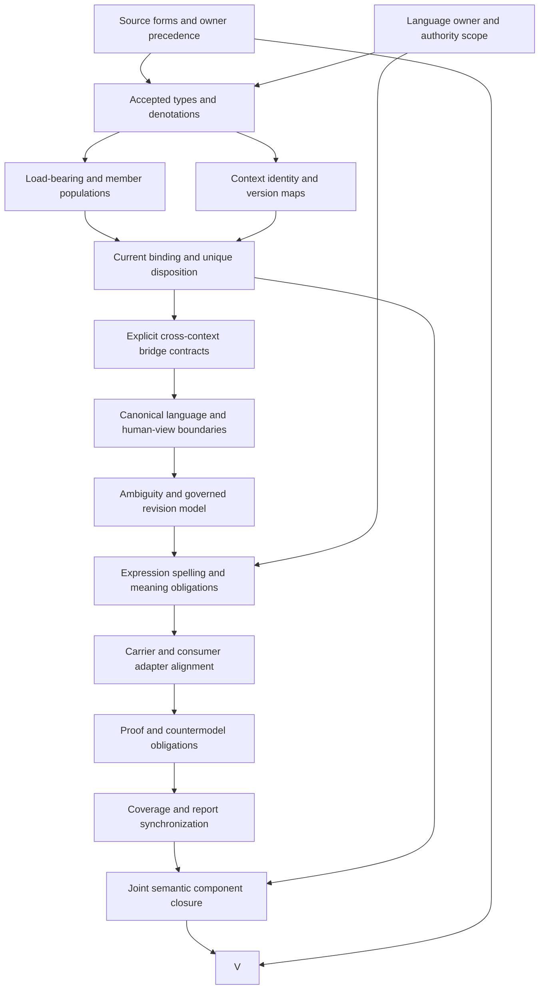

# Ubiquitous Language: definitions-first formalization review and completion DAG

Ubiquitous Language now has a checked **partial** interpretation for an owner-governed expression system belonging to one Bounded Context. The candidate makes context identity, current concept dispositions, explicitly unresolved expressions, ambiguity records, cross-context maps and spelling/meaning separation explicit. Its central result is that a coherent local expression system does not establish actual concept resolution, owner authority, consumer conformance or common understanding.

This is `F06-T.cal.definition.ubiquitous-language`, following the sealed Ontology View draft. The episode retains 183 current identities, 189 admitted source versions and 201 captured source files. The new inventory contains 56 partial drafts and 127 current identities without a per-definition draft. Source-owner-accepted whole translations and whole-definition proofs remain zero. This review expands the pending meaning and verification work for one definition while preserving the original foundations-first plan and its whole-family gates.

## 1. Exact source identity, admission and evidence authority

The source is `cal.definition.ubiquitous-language@1.0.0-candidate.1`, admitted by C18, at SHA256 `17ac271d5e741ce65645bfcdb280ca047abdb2f5460c7fad94064770f37349a7`. The [source checks](source-checks.json) bind the current Definition registry row, original Definition v1 schema and generator, candidate manifest, exact decision and recorded owner selection. Two pure renders reproduce the 3,900-byte Markdown projection at SHA256 `0f01174ea13535222cb7b6589804d66b37aead8942de7db843d081a616eb8ecd`, with source input unchanged.

C18 records `ADMIT-DEFINITION-AND-CTX00-V1` and the definition-owner role against exact owner-registry bytes. That is historical evidence for the selected Definition admission. It does not authorize a new language instance, interpretation acceptance, concept map, context owner transfer or live consumer behavior. The selected immutable source keeps its candidate version label because authority comes from the recorded admission overlay rather than rewriting the candidate document.

The Definition cites two C17 admitted whole-JSON source selections: language concepts at digest `e8cc7d26fffb69bc9b94eb8ecd70259c04b45f3683f52941084b7a07f37d436d` and the source Governance language at digest `253530491c2555c75ce9fa6e5a90cb40ecbd6ca5b3e55e557c28360e6df02c13`. Their selectors, hashes and non-effects match the retained C17 admission and decision records. Private external source bodies are neither read nor recovered. **ULG-FINDING-012** preserves that limit and the distinction between recorded source selection and whole interpretation fidelity. Fourteen selected source checks pass; they do not supply missing private historical content or owner acceptance of this translation.

## 2. Definition forms, source roles and complete correspondence

The [correspondence packet](correspondence.json) inventories twenty nonempty textual source units and accounts for every character across 26 mapped spans. Fifteen spans are encoded, six explanatory and five deferred. Eleven unique encoded formula values combine thirteen primitive theory templates. Source spans, combined values and primitive templates are separate denominators: repeated or combined text does not become an additional independent theorem merely because it has another source location.

The first normative sentence gives an owner-governed set of expressions, concepts, relations, rules, usage surfaces, ambiguities and revision routes for one context model. The second adds the current-disposition-or-unresolved requirement for load-bearing expressions. The tuple expression supplies an axiomatic structure, the CurrentBinding implication adds a context guard and the shared-spelling statement is a nonentailment obligation. Genus-differentia, axiomatic-implicit and operational forms therefore coexist; none can replace the others without losing part of the source.

Operational classification means the candidate has checkable resolution and mapping guards. It does not mean a production algorithm or language maintenance discipline has been implemented or proven equivalent. Plain-language descriptions, the Governance/Ontology Lifecycle example and CurrentBinding notation remain explanatory. **ULG-FINDING-001** requires owner review of genus sufficiency and the meanings of the expression-system markers. The candidate has no assumptions or assumption links, and no source precedent review is silently converted into an accepted decision.

## 3. Types, functions, relations and exact namespaces

The [interpretation](t.json) and [compiled IR](static-ir.json) contain 97 declarations: two nonempty sorts, one constant, nineteen total functions, 59 unary predicates, fifteen binary relations and one ternary relation. Entity carries languages, contexts, models, expressions, bindings, dispositions, owners, maps and generated views. Token carries language identifiers, revision and context-version labels, expression spellings and disposition-state values. EMPTY distinguishes empty tokens from required nonempty metadata.

Thirteen functions return Entity values; six return Token values. A current binding has separate language, context, expression and disposition links. A disposition separately names its context and concept. Language context and context version are separate coordinates, as are a spelling token and the entity representing the expression. MappedPair is ternary because it connects a map record to a source expression and target expression. This structure makes accidental identification of language, context, record, concept and label easier to detect.

Functions are total over their sorts. Irrelevant entities still have function values, but guarded theory clauses restrict them only in relevant roles. No global identifier injectivity, numeric revision ordering, label normalization or actual resolver is imported. All declarations are qualified by exact source revision and candidate scope. **ULG-FINDING-002** requires accepted identity/version/model denotations; **ULG-FINDING-009** requires spelling, alias and semantic-equivalence maps. Shared strings across namespaces cannot substitute for these maps.

## 4. Genus, ownership and one exact context identity

The genus biconditional equates UbiquitousLanguage membership with four candidate markers: OwnerGoverned, ContextBoundExpressionSystem, ExpressesContextModel and RevisionRouted. The reverse implication is explicit and remains subject to source-owner review. A marker does not prove that owners actually govern a language or that its expressions articulate a faithful model. That limitation is recorded as a meaning obligation rather than disguised as a property of every schema-valid instance.

Metadata guards require a BoundedContextRole entity, a ContextModelRole entity whose modelContext equals the language's context, nonempty language identifier, revision and context-version tokens, and an OwnerRole linked by OwnsLanguage. The BelongsToContext relation is exactly the single context returned by languageContext. A checked negative control attempts two context memberships and fails; another removes the required exact membership and fails.

**ULG-FINDING-006** covers actual ownership and set cardinalities, while the exact context map remains under **ULG-FINDING-002**. Different language objects may have different context identities; the supplied model witnesses that difference. The theory does not require distinct human principals for those owners or authorize a role binding from a marker. Context identity must also be distinguished from context version: a revision label changing meaning needs a governed interpretation and accepted continuity map, not a convenient string rewrite. These semantics stay outside the current two-sort representation.

## 5. Current expression bindings and concept dispositions

Every CurrentBinding must name a UbiquitousLanguage, a context equal to that language's context and a context-version token equal to the language's version coordinate. Its expression must belong to the language. Its disposition must have ConceptDispositionRole, resolve to a ConceptRole entity, belong to the same context and carry a nonempty state token. This encodes context-local naming and coherent references without assuming that a concept resolver has actually found the named concept.

**ULG-FINDING-003** requires an accepted meaning for currentness, concept disposition and their source-version relationship. Current is a predicate in this candidate, not a timestamp comparison, admission status or proof that a persisted revision is still current. A positive control replaces revision, version and disposition-state tokens with an opaque nonempty marker and still satisfies T. That exposes precisely what token typing and equality can establish.

**ULG-FINDING-005** separates one concept disposition from one binding record. The uniqueness guard makes any two current bindings for the same language and expression have the same disposition. Two records sharing that disposition satisfy the theory. Different dispositions for the same current expression fail. This does not yet decide whether two identical binding records are acceptable storage, whether aliases are separate expressions, or whether concept-disposition equality implies any wider semantic equivalence. The historical CTX01 uniqueness function uses a stricter spelling-record rule, which is observed separately below.

## 6. Load-bearing expressions, unresolved states and populations

For each declared load-bearing expression belonging to a language, ExplicitUnresolved holds exactly when no current binding exists for that language and expression. This prevents two candidate failures: neither a current binding nor an unresolved marker, and a current binding together with an unresolved marker. Combined with unique disposition and binding guards, this provides the chosen one-current-disposition-or-explicit-unresolved reading.

**ULG-FINDING-004** requires source-owner acceptance of the exclusive reading and an actual method for selecting load-bearing expressions. The term cannot be reduced to all strings, every glossary entry or every English phrase merely because that is easy to enumerate. Without an accepted coverage criterion, an implementation could omit an important expression from the declared population while satisfying these guards. Declared coherence and actual load-bearing coverage therefore have separate outcome predicates.

Fifteen required populations keep the supplied checks nonvacuous. They include resolved and unresolved load-bearing expressions, current bindings, recorded ambiguity, mapped reuse, cross-context same spelling with distinct meaning, a generated human view and five language-member kinds. Sixty-nine populations remain unresolved. The empty-expression-set and absent-load-bearing controls satisfy universal T but fail the required population conjunction I. These controls reveal vacuity without imposing production cardinalities that the owner has not approved. No unresolved population is relabeled as exempt or accepted.

## 7. Concepts, relations, rules, surfaces and ambiguity records

The candidate represents language concepts, relations, interpretation rules, usage surfaces, revision routes and ambiguity records as separate membership relations with separate roles. Membership guards establish that declared members have the corresponding type. They do not execute a rule, prove a relation's domain meaning, establish a usage surface's conformance or authorize a revision route. Actual sets and their adequacy remain part of **ULG-FINDING-006**.

An AmbiguousExpression requires language-expression membership and a language ambiguity record pointing to that expression. It does not require every recorded ambiguity to remain explicitly unresolved forever. A positive model control records ambiguity for an expression that already has a coherent current binding. The source says ambiguity is recorded and not silently collapsed; it does not say that a recorded ambiguity prevents an owner from resolving it.

**ULG-FINDING-007** requires a real reconciliation and revision model. The current guard ensures a record exists when ambiguity is declared, but cannot detect an unreported ambiguity, prove that a narrative disposition resolves competing meanings or validate past revisions. Historical records, present dispositions and owner-authorized resolutions need distinct denotations. A carrier with an ambiguity array can preserve useful explanatory material while still lacking those semantics. This is also why a maintenance discipline is excluded as a synonym for the language artifact itself.

## 8. Cross-context maps and spelling-to-meaning nonentailment

CrossContextReuse requires a foreign-context expression, a local target expression in the receiving language and an ExplicitBridgeRole record with a MappedPair and exact source and target context endpoints. Declared MeaningEquivalent between expressions in different contexts also requires such a map. The direction is preserved: a source-to-target map is not automatically reversible, and an endpoint mismatch fails a supplied control.

**ULG-FINDING-008** covers actual map acceptance, semantic scope and authority. Having a map record is a prerequisite in this candidate; it does not make every mapped pair equivalent in actual meaning or transfer context ownership. A positive control adds MeaningEquivalent for a mapped pair, while another keeps the explicit map and leaves meaning equivalence false. The same-context equivalence control does not require an invented cross-context bridge. These choices preserve distinct obligations for explicit reuse, declared equivalence and authentic semantic interpretation.

Despite its name, MeaningEquivalent has no adopted reflexivity, symmetry or transitivity axioms in this candidate. The current role records a declared reading under explicit map guards; accepting it as a mathematical equivalence relation or a resolved same-meaning relation requires additional denotations and reviewed axioms. Directional reuse must not silently become a reversible equivalence map.

SharedSpelling is defined by expression roles and equal label tokens. The [source query](source-query-obligation.json) preserves `SharedSpelling does not imply SharedMeaning.` as deferred and outside T. A supplied countermodel has equal labels in different contexts while MeaningEquivalent remains false. This establishes nonentailment for the candidate's predicates. **ULG-FINDING-009** keeps normalization, aliases, synonyms, translation rules and actual meaning equivalence pending. Logical equality of spelling tokens cannot authenticate any of those meanings.

## 9. Artifact boundaries, generated views and outcome queries

The boundary excludes repository-wide dictionaries, canonical Definition registries, glossary files, ontologies, programming languages, maintenance disciplines, proofs of common understanding, unowned glossaries and universal-understanding claims as the language artifact's role. A generated human view must be a separate HumanViewRole entity and cannot be an IndependentMeaningSource. This follows the source direction while keeping the canonical JSON and its human projection distinct.

A human projection can be useful and byte-faithful without independently governing a concept's meaning. The pure renderer checks verify selected output bytes and preserved inputs. They do not prove that every reader uses those expressions consistently or that a generated explanation resolves all ambiguities. Common understanding is an actual outcome predicate outside the theory, and a proof-of-common-understanding role is prohibited as a substitute for the language artifact.

Eight inference flags prohibit claims derived from this candidate for language admission, cross-context shared meaning, authority, runtime, publication, release, deployment and external effects. Twenty-one actual-outcome queries and the shared-spelling query have supplied T-and-I countermodels in the [model evidence](model-controls.json). The outcome targets include context/version resolution, owner authority, concept resolution, load-bearing coverage, ambiguity reconciliation, bridge acceptance, human-view fidelity, revision authorization and consumer conformance. These finite checks do not supply an accepted whole-definition theorem or universal runtime proof.

## 10. Model, profile and finite-frame validation

The evaluator checks 110 authored controls on sixteen Entity values and nine Token values. Thirty-three satisfy T, seventy fail T and seven are rejected for malformed model structure. Structural rejections include a nontotal function, wrong function-result sort, malformed constant, wrong MappedPair arity, duplicate predicate tuple, empty sort domain and duplicate function tuple. Such failures are separated from well-formed models that contradict theory clauses.

Negative controls cover genus markers, metadata, model/context mismatch, double context membership, current-binding references, resolution gaps, two competing current dispositions, absent membership roles, missing ambiguity records, map endpoint errors, unmapped equivalence, false spelling declarations and independent human-view meaning. Positive controls cover independently supplied actual outcomes, two records with the same disposition, explicit mapping without inferred equivalence, resolved recorded ambiguity and opaque currentness tokens. Thus a green result is tied to specific obligations rather than a generic count of examples.

Twenty-seven qualification profiles reject 25 incomplete, mismatched or prohibited hypothetical requests. Sixteen finite language frames reject thirteen source-envelope changes, missing or wrong maps, silent unresolved collapse, spelling-to-meaning promotion and ownership or authority transfers. Their support records are hypothetical; actual source fidelity and consumer verification remain false. The [profile report](authority-profile-checks.json) separately records real carrier observations and these declared frames so an accepted hypothetical use cannot be reported as an actual language-owner or consumer decision.

## 11. Current carriers, historical languages and observed rule gaps

The type catalog contains 143 rows and 121 admitted-current rows. Its direct binding for this Definition selects `cal.artifact-type.ubiquitous-language/v2` under C70; v1 remains admitted-historical under C21. The retained v2 descriptor and fixture remain candidate-unadmitted. Its schema uses a v2 schema discriminator while retaining v1 in classification.artifact_type_ref. **ULG-FINDING-010** keeps current registry selection, retained candidate labels and this intentional inherited classification shape distinct, rather than rewriting a carrier to fit a guessed meaning.

Twenty-three selected catalog, schema, projection, pure-checker and context/map observations pass. Forty-two schema probes yield fourteen acceptances and 28 rejections; both supplied hostile fixtures are rejected. The language schema requires eleven language fields plus base metadata, nonempty concept/owner/rule/surface sets and at least one expression binding. Relation and ambiguity arrays may be empty. Binding entries contain expression, concept_ref and disposition, with no per-entry context/version fields. Duplicate bindings, conflicting current concepts, unlisted concept refs, unresolved placeholder concepts, unrelated revision labels and unsupported rule or claim text can pass shape validation.

The AST-extracted CTX01 semantic_invariants function is executed on ten preserved inputs. It accepts seven and rejects three duplicate spelling cases, including identical duplicate records and a deprecated second record. It accepts an unlisted concept, unresolved context, case-distinct labels and distinct-label synonyms; even an empty binding list passes that pure function while failing the schema. This is narrower than a full package validator and stricter than the candidate's one-disposition rule for duplicate records. The successor package source lacks that expression-uniqueness function; no package validator or materialization writer is run.

**ULG-FINDING-011** concerns actual context use. Exact C23 records admit the selected Governance and Ontology Lifecycle v1 language/context bytes despite retained candidate labels. Their v2 language records are later candidates not selected by that C23 decision. Governance has seventeen concepts and bindings, fifteen relations and four ambiguity records; Ontology Lifecycle has 24 concepts and bindings, 24 relations and five ambiguity records. The selected v1/v2 binding lists have no exact expression-label overlap between these contexts. That bounded literal observation does not prove absence of related meanings, shared words in prose, aliases or ambiguity.

C24 binds the selected v1 Context Map bytes. The selected v1 and v2 maps have explicit distinct endpoints and retain translation references and authority-boundary text. Governance publishes decision evidence; Ontology Lifecycle records and projects it while preserving upstream decision authority. No anti-corruption adapter or actual consumer enforcement is executed. The predecessor schema is resolved against exact local shared-schema bytes through an offline registry after a failed URL retrieval attempt. Four old Definition metadata constants also fail the current Definition v2 schema, without invalidating C18 or migrating anything.

## 12. Dependency closure and the detailed completion DAG

The [local dependency graph](dependency-graph.json) contains 118 nodes, 1,224 declared edges, 62 missing or quarantined counterpart packets and one unclassified strongly connected component of 56 members and 802 internal edges. Twenty-seven direct semantic uses are declared. Concept, Concept Disposition, Expression, Meaning Equivalence and Language Owner have no separately selected primitive Definition labels in this packet; a predicate name cannot supply the missing meaning contract.

The [current inventory](current-inventory.json) freshly checks one supplied T-and-I model for each of 56 partial drafts. Aggregate counts are 1,275 source units, 1,722 mapped spans, 519 encoded spans, 443 explanatory spans, 760 deferred spans, 539 required populations and 2,148 unresolved populations. The joint declared graph contains 118 nodes, 1,224 edges and 62 missing or quarantined counterpart packets, with the same unresolved 56-member, 802-internal-edge component. Independent qualified witnesses do not establish one common-carrier, meaning-aligned joint model. Missing counterpart packets and the semantic component remain completion obligations. The original 121-task, 511-edge, 797-SWU foundations-first plan and older reporting denominators are preserved.

The following fifteen-node, eighteen-edge DAG orders definition completion evidence. It is a plan, not recorded completion. Semantic dependency cycles remain in the meaning graph; the DAG orders how their evidence and joint review can be produced without erasing them.

| Node | Required deliverable and exit criterion | Current evidence and pending work |
|---|---|---|
| S | Owner-reviewed forms, textual spans and source precedence | Exact C18/C17 records and character account; twelve findings pending |
| A | Actual owner governance and authority boundaries | Historical owner selection and local owner refs; operational meaning maps pending |
| T | Accepted expression, concept, disposition and version types | Typed IR compiles; real denotations and primitives unresolved |
| P | Reviewed load-bearing coverage and member cardinalities | Fifteen nonvacuous populations checked; production scope unresolved |
| I | Context identity/version/model reference resolution | Declared one-context coherence; actual referent and continuity maps pending |
| C | Accepted currentness and one-disposition semantics | Supplied coherent bindings; record cardinality and source-currentness maps pending |
| B | Directional mapping scope and equivalence contracts | Exact endpoints and recorded Context Maps; actual semantic maps pending |
| H | Canonical source and faithful nonauthoritative projections | Selected pure render checks; whole human-view meaning contract pending |
| R | Owner-authorized ambiguity reconciliation and revisions | Record guard and hypothetical frames; actual history/resolution evidence pending |
| E | Accepted spelling, normalization and meaning query semantics | Nonentailment countermodel; aliases and actual equivalence maps pending |
| Q | Explicit carrier, CTX01 and real consumer alignment | Distinct schema/pure-function observations; complete adapters pending |
| D | Accepted theorem targets, assumptions and proof evidence | Twenty-two supplied countermodels; whole-definition proof pending |
| F | Approved coverage and synchronized report denominator | Separate new inventory; immutable older I04 report retained |
| J | Meaning-aligned joint model and cycle classification | Declared component graph; missing counterpart packets and joint semantics pending |
| V | Complete whole-definition review meeting every gate | Candidate self-review; owner acceptance and whole proof remain pending |

Each node requires an accepted evidence artifact at the scope of its criterion. A schema pass cannot stand in for concept resolution; a source admission cannot stand in for consumer conformance; a finite countermodel cannot stand in for a complete accepted translation. Owner decisions can be prepared independently where dependencies permit, while this candidate remains explicitly partial.

## 13. Reproducibility, preservation and remaining episode work

The unit preserves 4,445 prior candidate files and all 201 captured sources by exact hash. Writes remain in the Ubiquitous Language candidate directory. Three failures are retained: [the author entry-point mismatch](attempts/001-author-entry-point/NOTE.txt), [the C17 record-field correction](attempts/002-C17-record-field/NOTE.txt) and [the offline schema-resolution correction](attempts/003-local-schema-resolution/NOTE.txt). Their exact failed scripts and available stdout/stderr remain reviewable. No failed attempt is relabeled as a successful producer or removed from the final seal.

[Replay](replay.py) runs six independent read-only commands for contract, model, source, profile, dependency and current inventory, retaining actual terminal exit codes and output. [Finalization](finalize.py) requires those checks to pass and audits source correspondence, model controls, hypothetical scope, actual selected records, all thirteen review aspects and the completion DAG. It then emits the [coverage row](coverage-row.json), [receipt](receipt.json), [episode status](episode-status.json) and [delivery manifest](delivery-manifest.json). The separate [delivery audit](check_delivery.py) rehashes the sealed set and receipt bindings without writing new evidence.

The next missing definition priority is Bounded Context, an earlier F06 translation gap that is directly coupled to this language definition. Moving into F06 outcome tasks before its T draft would bypass the user's definitions-first priority, so the next step returns to that gap. Overall scope remains 183 identities and every required completion gate. Actual concept and owner semantics, language currentness, cross-context meaning, private historical-source fidelity where needed, consumer adapters, joint closure and complete final review remain pending. The overall formalization goal stays active.
