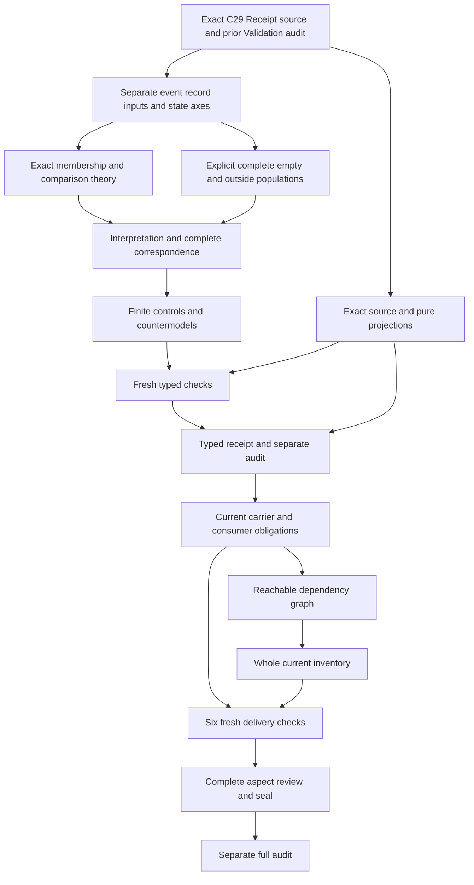

# Validation Receipt: typed candidate review

## 1. Exact meaning and admission boundaries

The positive meaning is cal.definition.validation-receipt@1.0.0-candidate.1, selected at exact digest 7df65f1254c26f05ad7f030f0616085d7842cbd746751d52bddb8fe72da9fd5e. It belongs to candidate0007 semantic closure and the current C29 admission. Its retained lifecycle is candidate-authored. The candidate set retains authority_effect none and candidate-authored-dependencies-open posture. The admission overlay is observed independently; historical bodies were not rewritten to look newly authored or fully accepted.

C29 selected source-use and Definition requests separately. The exact D38 source-use record covers the stated semantic-closure uses. Its external selector, selected digest and historical whole-file digest are retained, but the external historical bytes and configured producer identity are not reproduced here. Two local admitted origins are byte-bound. Neither source-use admission nor the current Definition admission accepts this mathematical translation or admits a concrete receipt format.

The prior Validation delivery was sealed and separately audited before the native Receipt unit was created. That seal and every earlier packet remain preserved. Its source fidelity and whole proof were pending then and remain pending. Creating this candidate adds local mathematical records and evidence; it does not create an owner admission, alter a canonical Definition, execute a live validator, or confer subject authority.

## 2. Genus, voices and event separation

The genus is an immutable record of one Validation event. The scientific-formal voice binds exact subject, profile, validator, inputs, environment, outcomes, evidence, causal blockers, emission time and claim ceiling. Its expression fixes authority effect none and denies automatic Conformance or Admission from receipt existence. Its tests require changed-input binding behavior, dependent-check preservation and consumer non-inference from existence or PASS.

The plain-language and domain-context voices explain a detailed checking record and give semantic-closure examples. They remain explanatory source spans. Examples of existing receipts do not become universal storage guarantees or accepted consumer contracts. The candidate retains all selected source characters, including requirements whose real denotations are unresolved. It does not use a convenient example as evidence that every receipt obeys the proposed logical fragment.

Receipt and ValidationEventReference are distinct sorts. A receipt's total event projection has one declared, nonempty value. This retains one-event binding without authenticating real event identity or requiring one globally unique receipt per event. Multiple records can share an event reference or identity label. Embedding whole Evaluation and Validation theories, their execution modes, evaluability rules and status aggregation requires separately accepted bridges. Those whole theories are not silently imported here.

## 3. Sorts and axis separation

The signature has twenty-four sorts: Receipt, ReceiptIdentity, ValidationEventReference, SubjectReference, CriteriaProfile, ValidatorReference, EnvironmentReference, EmissionTime, ClaimCeiling, Context, InputOccurrence, InputReference, DeclaredCheck, OutcomeReference, EvidenceReference, CausalBlockerReference, AuthorityEffect, Observation, InputComparison, RecordOnlyComparison, AuthorityState, LifecycleState, Digest and Token. Each is a proposed mathematical carrier with a nonempty finite domain. Descriptive sorts do not invent current canonical Definition identities.

AuthorityEffect describes the receipt's local no-effect field. AuthorityState and LifecycleState describe distinct before/after comparison axes. They are separately sorted so a lifecycle-state value cannot accidentally satisfy an authority-state function's range in the supplied model. Token supports reference-handle guards; it does not substitute for those state sorts. The earlier successful token-state stage is retained as history rather than silently replaced.

InputOccurrence and InputReference also differ. Two occurrences can retain the same exact input reference and digest while remaining distinct collection members. This preserves multiplicity without imposing a collection order. Observation identifies a selected view of a receipt's content binding. InputComparison handles changed-input applicability, while RecordOnlyComparison handles recording without a separately authorized state-changing operation. These local comparison carriers do not provide a shared real-world model across prior definitions.

## 4. Signature, references and exact digests

There are 164 declarations: twenty-four sorts, two constants, sixty-two total functions and seventy-six predicates or relations. The EMPTY Token and NONE AuthorityEffect constants have distinct result sorts. Nine scalar receipt projections retain identity, event, subject, profile, validator, environment, emission time, ceiling and context. Selected receipts require declared, nonempty references, a complete-record declaration and the exact NONE effect value.

Subject, profile and validator each have a digest projection. The receipt's corresponding recorded digest equals the digest of its bound reference. Event subject, profile, validator and environment projections agree with the receipt's scalar references. These are necessary exact declarations. Equality does not select a digest algorithm, authenticate source bytes, guarantee collision freedom, prove currentness or establish that a validator actually executed.

Functions are total over their entire sorted domains, including outside members. Scope guards decide where source-inspired requirements apply. Reference handles and declarations express presence without proving resolution or global uniqueness. EmissionTime and ClaimCeiling remain separate recorded references. A time label does not prove chronological accuracy; a ceiling handle does not prove truthful claims or accepted scope. Concrete representations and their denotations need owner and consumer maps.

## 5. Input collections and occurrence bindings

For a selected receipt, recorded input membership is exactly the event's declared input-occurrence membership. An omitted declared occurrence or an added unrelated occurrence fails the guard. Each recorded occurrence has a declared, nonempty InputOccurrence and InputReference, a declared nonempty Digest, and a recorded digest equal to its occurrence digest. That occurrence digest also equals the digest of its exact input reference.

The supplied witness retains two distinct occurrences with the same reference and digest. This distinguishes multiplicity from global reference identity. The theory does not infer order, canonical collection serialization, a whole collection digest or discovery of all relevant evaluated inputs. Empty declared collections remain possible for an explicitly empty event. Such a witness exposes an adequacy-policy gap; it does not endorse empty validation or establish actual completeness.

A changed-input comparison retains a selected original receipt and an old occurrence recorded by it. Its proposed new occurrence and reference are declared and nonempty, and its new occurrence digest agrees with its exact reference. The model requires a declared digest change for selected changed-input comparisons. Actual byte-change detection, collisions, reference authenticity and correct operational applicability remain independent targets. The native controls reject inconsistent old and new reference/digest bindings.

## 6. Outcomes, checks and declared dependencies

Recorded outcome membership exactly matches the event's declared outcome membership for selected receipts. Every recorded outcome is declared and nonempty, points to the same event, and names an event-declared, nonempty check. Each event-declared check has at least one recorded matching outcome. Omitting an intermediate dependent-check outcome therefore fails even if a receipt still contains another successful result or a reported PASS label.

Multiple outcomes for one check are permitted. The Receipt source does not choose a unique final outcome, retry aggregation rule or the three-tag semantics used in Validation's earlier partial theory. ReportedPASSDeclared is a recorded label here. Its presence cannot silently supply evaluability, full PASS coverage, Conformance sufficiency or authority. Those semantics need an accepted bridge to the relevant evaluation mode and consumer.

Declared dependency relations require both endpoints to be event-declared checks. Together with the outcome rule this preserves records at every endpoint of a declared finite path. The required witness includes a two-edge chain with three distinct checks. Cycles and self-dependencies remain permitted by this fragment because the source does not establish acyclicity. Missing dependency discovery, causal interpretation and transitive completeness beyond declared endpoints remain open. A well-formed cycle is not classified as a malformed model.

## 7. Evidence and causal blockers

For selected receipts, evidence-reference membership and causal-blocker-reference membership each exactly match their event declarations. Missing a declared member or adding an unrelated recorded member fails. Recorded evidence references and blocker references are declared and nonempty. A recorded blocker retains a proposed check reference that must be event-declared. The source owner must accept or revise that blocker-to-check denotation, including environment-wide causes or alternative causal structures.

The nonempty blocker/evidence witness prevents the supplied model from satisfying preservation solely through empty collections. An empty event can still have no blockers or evidence when the selected declarations say so. This is a mathematical possibility, not evidence that an actual event was unblocked or sufficiently evidenced. Real cause discovery, blockage applicability, causal adequacy and preservation in storage remain independent questions.

The candidate does not import the complete prior Evidence, Evidence Set or Evaluation theory through a reference string. A recorded evidence reference does not prove support quality, and a blocker label does not prove why a check could not execute. Exact declared membership is narrower than actual event completeness. Source correspondence records this distinction and keeps source fidelity pending rather than using passing reference guards as a substitute for real evidential adequacy.

## 8. Observation-based immutability

Selected observations require a nonempty observation handle, a selected receipt reference and a declared nonempty content digest. Two selected observations that refer to the same receipt must have equal content digests. The required witness uses two distinct selected observations of one receipt, so the invariant is exercised through an actual comparison rather than only an observation compared with itself.

This is a scoped necessary immutability guard. It does not prove that every future storage state is immutable, every possible observation is included, a digest authenticates content, or a storage system is append-only. Outside observations can differ because the selected comparison guard does not apply to them. Extending the domain or scope to all relevant temporal observations requires an accepted population and temporal model; no universal storage guarantee is inferred from the finite witness.

The cross-sort malformed control rejects a lifecycle-state value assigned to an authority-state result. Stable content, typed state comparison and real storage integrity remain separate aspects. Model controls also change a selected same-receipt observation's content digest and correctly fail the guard. Positive controls allow independently supported temporal immutability or storage integrity while preserving the declaration theory. They do not claim that the example strings are real observations from a live store.

## 9. Changed inputs and record-only comparisons

Each selected InputComparison binds a selected original receipt, an old recorded input occurrence, a declared new occurrence with exact reference/digest agreement, and a declared changed digest. It requires BindingChangedDeclared or OldBindingInvalidatedDeclared. The alternatives are inclusive: either strategy or both can satisfy the necessary guard. The model includes witnesses for both individual strategies and a comparison declaring both.

This retains the source's change-or-invalidation requirement without rewriting the original immutable record to make it appear current. The declarations do not prove actual detection, effective invalidation, accepted operational behavior or consumer alignment. The real event, input-version and applicability maps remain owner-pending. A changed declaration cannot by itself ensure that a stale receipt will be rejected by a concrete consumer.

A selected RecordOnlyComparison binds a selected receipt and the same exact subject before and after recording. Its before/after AuthorityState values agree, and its before/after LifecycleState values agree. The state declarations and handles are required independently. These comparisons describe recording alone, not a separately justified admission or lifecycle-changing decision. Actual preservation, observation authenticity and absence of external effects remain query targets. Independently authorized decisions can coexist without being effects of receipt existence.

## 10. Populations, controls and countermodels

Fourteen required populations cover a selected receipt without actual outcomes, an outside receipt, repeated input occurrences, a complete dependency chain, nonempty blockers and evidence, reported PASS without actual authority, an empty declared event, repeated stable observations, outside observations, changed and invalidated input comparisons, outside input comparisons, record-only comparison without actual preservation claims, and outside record-only comparisons.

The current controls include 43 satisfying theory cases, 95 well-formed guard violations and nine malformed-model rejections. Positive cases retain repeated outcomes, shared identity labels, cycles, self-dependencies, outside records and independently supported actual outcomes. Negative cases remove bindings, memberships, declarations or strategies, change selected observation digests, mismatch event/check references, and change record-only subject or state values. Malformed cases test signature coverage, totality, sorts, tuple arity, duplicate entries and empty domains.

Thirty queries have separately checked finite T/I countermodels. Twenty-two Receipt targets include real immutability, event authenticity, byte resolution, production, storage, coverage discovery, outcome authenticity, evidence and causal adequacy, time accuracy, traceability, Conformance, Admission, Acceptance, authority, Publication, Deployment, Runtime Evidence, external effects, owner fidelity, consumers and global consistency. Observation has two targets, input comparison three and record-only comparison three. A false target with an explicit true witness disproves that particular entailment within this candidate; it is not a whole Definition proof or a universal prohibition on supported outcomes.

## 11. Exact source accounting and retained history

Twenty-four source units are represented by twenty-six spans: twelve encoded, seven explanatory and seven deferred. Nine unique encoded formula values compose twenty primitive theory formulas. Correspondence retains exact selectors, offsets, excerpt digests and links across the complete selected source characters. The normative statement and expression are split to retain structure and unsupported implications separately. The third scientific-formal test remains deferred while its consumer non-inference targets stay outside T.

Forty-three source checks observe exact current C29 selection, registry, authorization, manifest, candidate and scoped source-use bindings. Two pure renders preserve the selected input and reproduce the 4205-byte projection at digest ced25e557c5ba1a2b05e025445c826ddc0e0773ae620fe1184ea01ae5be3278f. Twenty-six source-query obligations retain exact excerpts and whether their necessary declaration was encoded. Historical D38 bytes and producer identity remain unestablished.

The successful initial 142-control stage is preserved with its shared-token state representation. The current 147-control stage strengthens that representation through separate state sorts. The first successful source output also remains preserved before its copied Validation display label was corrected to Receipt. Both histories have actual exit zero and correct selected Receipt bytes. Neither is recorded as a native failure. The first typed-freeze audit separately failed because the token-stage history manifest included its own empty pre-write hash. The exact original manifest and audit observation are retained; its self-reference was removed and the source/model evidence stayed unchanged. The failed audit created no typed receipt. No frozen typed receipt existed before these corrections, and the prior Validation seal was unchanged.

## 12. Dependencies, delivery obligations and DAG

Thirty-four canonical semantic uses are separately qualified. They retain the current Definition, Artifact, Artifact Type, Contract, Evaluation, Validation, evidence, review, measurements, Source, Provenance, Conformance, authority, decisions, policy, roles, contexts, identities, invariants, event histories and typed relations. Descriptive event, occurrence, comparison, digest and state sorts do not create unavailable canonical identities. Comparison sources remain separate and their whole theories are not composed into the primary T.

Validation is the last sealed eightieth partial draft. Receipt creates a working eighty-first draft; its whole-inventory refresh has not yet been executed. The authorized scope remains 183 current identities, 189 admitted versions and 201 source files. Current carrier/profile observations, accepted consumer maps, reachable dependency compilation and fresh whole-inventory accounting are later delivery obligations. A stored schema or named generic receipt profile cannot substitute for an accepted map of this proposed event, record and comparison theory.

The typed stage requires fresh contract, model and source checks, a frozen receipt and a separate audit. Current carrier and consumer observations then precede dependency and inventory refresh. Six fresh final checks support the complete delivery review, seal and separate audit. Only after that audit does native Artifact work begin. This execution DAG is acyclic; semantic dependency cycles remain independently classified rather than being erased to make the execution plan look closed.

## 13. Owner decisions and continuation

Owner review must accept or revise exact event and scalar denotations, occurrence identity and multiplicity, reference/digest interpretation, declared membership completeness, outcome aggregation, dependency discovery and cycle policy, blocker-check maps, evidence adequacy, observation scope, temporal immutability, input-change applicability and record-only state interpretation. It must also establish actual receipt and consumer correspondence rather than treating a reference string or inherited profile as accepted meaning.

The candidate remains partial. Source fidelity, whole translation acceptance and whole Definition proof are pending. The finite countermodels show that selected declaration structure does not force actual implementation or governance outcomes. They do not deny outcomes supported by independent evidence and responsible owners. No source-owner principal, acceptance Decision, live storage result or executed consumer is fabricated to close a finding.

Continue with fresh typed replay and an independently audited frozen receipt before carrier/profile and whole-inventory work. Preserve both successful earlier stages and the corrected current evidence. Complete the six final delivery checks, full review, seal and separate audit before creating Artifact's native unit. The full episode remains active across all its authorized definitions and later assurance obligations; passing this candidate does not redefine the requested end state around the work already completed.

Actual native evidence: {"T_false": 95, "T_true": 43, "controls": 147, "counts": {"countermodel_queries": 30, "declarations": 164, "deferred_clauses": 7, "direct_semantic_uses": 34, "encoded_clauses": 12, "explanatory_clauses": 7, "mapped_clauses": 26, "required_populations": 14, "source_units": 24, "unresolved_populations": 76}, "malformed": 9, "prior_seal_files": 6920, "source": {"definition_id": "cal.definition.validation-receipt", "path": "authority/definitions/candidates/0007-cml07-semantic-closure/definitions/validation-receipt/v1/definition.json", "sha256": "7df65f1254c26f05ad7f030f0616085d7842cbd746751d52bddb8fe72da9fd5e", "version_ref": "cal.definition.validation-receipt@1.0.0-candidate.1"}, "source_checks": 43, "source_query_obligations": 26}.

- VREC-FINDING-001: Exact C29 current Receipt meaning and scoped source-use admission are separate from retained candidate bodies and owner acceptance of this translation.
- VREC-FINDING-002: Historical external D38 bytes and configured producer identity are not reproduced;two local admitted origins remain exact.
- VREC-FINDING-003: Receipt,one event reference,identity,subject,profile,validator,environment,time,ceiling and context are separately sorted descriptive carriers.
- VREC-FINDING-004: Whole Evaluation and Validation theories,status policies and real event/receipt correspondence require separately accepted bridges.
- VREC-FINDING-005: Exact scalar and per-input digest declarations do not authenticate bytes,currentness,execution or a selected hash algorithm.
- VREC-FINDING-006: Input occurrences retain repeated-reference multiplicity;collection order and concrete occurrence identity remain owner-pending maps.
- VREC-FINDING-007: Exact declared event/receipt membership retains inputs,outcomes,evidence and blockers without proving discovery completeness or real storage.
- VREC-FINDING-008: All event-declared checks need outcomes;multiple outcomes and retry aggregation remain open policies.
- VREC-FINDING-009: Declared dependency endpoints require complete check records;transitive discovery,dependency adequacy and acyclicity are not inferred.
- VREC-FINDING-010: Blocker-check references and evidence membership do not establish causal explanation or Evidence adequacy.
- VREC-FINDING-011: Selected repeated observations preserve one receipt content digest;universal temporal immutability and append-only storage remain actual targets.
- VREC-FINDING-012: Changed declared inputs require changed or invalidated binding;either or both strategies are allowed without operational acceptance.
- VREC-FINDING-013: Record-only comparisons preserve exact subject and separately sorted AuthorityState/LifecycleState labels;actual preservation requires independently accepted observations.
- VREC-FINDING-014: Receipt effect is locally NONE and its meaning is separate from procedure,Conformance,Decision and Authority;none of this prohibits independently supported outcomes.
- VREC-FINDING-015: Emission time and claim ceiling are recorded references without proof of chronology,truth or accepted scope.
- VREC-FINDING-016: Reported PASS is a declared receipt label without silently imported triad,evaluability,aggregation or conformance semantics.
- VREC-FINDING-017: Empty declared events and outside comparison populations expose vacuity and applicability policy;they do not establish adequate validation.
- VREC-FINDING-018: Finite controls,countermodels and complete character accounting do not establish owner fidelity,accepted carrier/consumer alignment,common-meaning consistency or whole proof.
