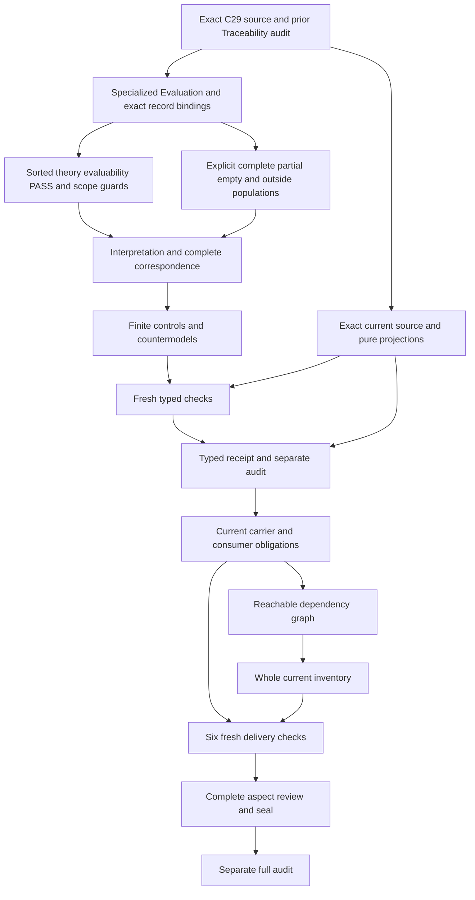

# Validation: full partial candidate delivery review

## 1. Exact current meaning and admission boundaries

The selected current meaning is cal.definition.validation@1.0.0-candidate.1 at exact digest f21ca27867379eb3389588313208a5db37cf0449b79bb5c7f644c3b9a89a2af8. It comes from candidate0007 CML-07 semantic closure and is admitted through C29. This is the selected positive Definition. C53 legacy reconstruction and C65 integrated-model admission are separate sources and are not substituted for it. Registry,authorization,manifest,candidate and exact generated projection bindings are observed independently.

The retained Definition lifecycle remains candidate-authored,and the retained candidate set has authority_effect none. C29 supplies the admission overlay without rewriting those historical bodies. It selected separately owned source-use and Definition requests. Its recorded result made S2 evaluable without executing S2,admitting identity carriers or accepting implementation bindings. That admission does not accept the present mathematical translation or establish actual runtime Conformance.

Three source references accompany the Definition:the admitted Definition JSON,the admitted Definition evaluation profile,and a retained candidate/null external D56 range. The two local origins are byte-bound. The historical external range and producer identity are not reproduced or authenticated here. Its recorded source-use selector and scoped C29 admission remain evidence of selection,not a claim that a present external producer was verified. This candidate grants no new authority or live effect.

## 2. Genus, voices and specialized Evaluation

The genus is an Evaluation of an exact subject against an exact criteria profile. It produces check outcomes and a receipt. The formal expression binds profile,subject and inputs by digest and separately denies automatic Conformance and Admission. The applicability statement adds an exact evaluation environment. Scientific-formal test conditions retain subject,profile,inputs,validator identity,outcomes and the three named result labels.

The plain-language and domain-context voices supply intuition about checking a record or implementation against an explicit profile. They do not become universal axioms of correctness,coverage,execution or authority. Complete source accounting retains those explanations and examples alongside the encoded and deferred scientific-formal statements. The candidate does not discard historical candidate wording merely because a later admission overlay exists.

Specialized Evaluation is represented through a separately sorted declared EvaluationReference. This records the necessary relationship without silently importing Evaluation's whole prior theory,its causal blockers,collect-all uniqueness policy or current carrier semantics. A meaning-aligned bridge is required to compose those theories over a shared real evaluation. That bridge remains ownerpending. The selected fragment therefore supports a partial formalization rather than a whole semantic embedding claim.

## 3. Sorts and reference distinctions

Validation,EvaluationReference,SubjectReference,CriteriaProfile,InputReference,EvaluationEnvironment,ValidatorIdentity,ReceiptReference,Context,DeclaredCheck,Outcome,OutcomeTag,Digest,CoverageScope,EvaluationMode,ConformanceProfile,ConformanceEvidenceUse and Token are separate proposed sorts. Nonempty domains are explicit in the finite interpretation. These descriptive sorts do not invent current canonical Definition identities for checks,outcome tags,digests,profiles or validators.

A Validation selects its Evaluation reference,subject,criteria profile,inputs,environment,validator,receipt and context. An Outcome selects its Validation,declared check and outcome tag. A CriteriaProfile has its own digest,coverage scope and evaluation mode. A ConformanceEvidenceUse selects a Validation,a separately declared ConformanceProfile and an exact coverage scope. These projections keep evaluation records,criteria,results,receipts and evidence-use qualifications distinct.

Equality is interpreted within a sort. Shared subjects do not identify evaluations with different inputs. Shared receipt references do not identify their evaluation records or grant authority. Total functions give outside domain members projections as well;applicability guards decide which members carry necessary source-inspired requirements. Nonempty handles establish declared reference presence without proving resolution,authenticity,global uniqueness or actual identity equivalence.

## 4. Signature and exact digest bindings

The signature explicitly declares each sort,constant,total function,predicate and relation. The EMPTY token supports selected-reference guards. PASS,FAIL and NOT_EVALUABLE are distinct local OutcomeTag constants. The broader tag domain can contain outside values;only selected included outcomes must use the named triad. Handle functions retain separately typed references rather than treating all fields as unstructured text.

Selected Validations require declared and nonempty references for all eight record projections. Their own profile,subject and input digests agree with the digests of the corresponding references. Those Digest values have declarations and nonempty handles. A different declared digest falsifies the exact binding guard. The theory does not prescribe one hash algorithm,authenticate a digest string,require implicit latest-version selection or prove present source currentness.

Each selected profile declares coverage and evaluation mode and retains a declared nonempty CoverageScope and EvaluationMode. These declarations are necessary structure,not a proof of a real mode's execution semantics or complete discovery of relevant criteria. Validator identity and evaluation environment remain explicitly recorded inputs. A validator label does not prove that code ran,and exact recorded inputs do not establish actual correctness of its checks.

## 5. Declared checks,outcomes and receipt records

Every check declared by a selected profile has at least one included outcome in its selected Validation. Included outcomes retain their own Validation and check binding,one of the three local tags,a declared nonempty check,and a nonempty outcome handle. The selected receipt records each included outcome. These guards retain the complete declared outcome record without asserting real receipt production,storage or authenticity.

Multiple outcomes for one check remain permitted. The source requires outcomes for all declared checks but does not by itself select one unique outcome per check or an aggregation policy for repeated attempts. A positive control adds another PASS outcome for a check and preserves T/I. A separate owner decision is needed for retry histories,conflicting attempts and one-final-result conventions. Evaluation's previously proposed uniqueness map is not silently inherited.

Declared evaluability is linked to the selected outcome tag:NOT_EVALUABLE corresponds to a check declared not evaluable for that Validation;PASS and FAIL correspond to a check declared evaluable. This is a proposed local denotation map. It does not prove the real check could run or that a blocker explains its failure to run. The selected Validation source does not add Evaluation's causal-blocker requirement automatically. Real evaluation and receipt correspondence remain separate obligations.

## 6. Reported PASS and limited coverage

A reported PASS requires every included outcome for every evaluable check declared by its exact profile to be PASS. A FAIL for an evaluable declared check falsifies that guard. The source also says a PASS cannot cover omitted or NOT_EVALUABLE checks. The theory therefore keeps reported PASS,per-check PASS coverage and complete PASS coverage separate. It does not promote the absence of an evaluable FAIL into whole-scope completeness.

The derived per-check coverage relation includes only declared,evaluable checks with a recorded PASS under a reported PASS. A NOT_EVALUABLE check cannot be added to that coverage relation. An undeclared check cannot be covered by that profile's PASS either. Every declared check still needs a recorded outcome,including explicit NOT_EVALUABLE results. Omitting an outcome fails the record guard rather than being hidden behind a positive overall label.

The finite fragment permits an owner-pending partial reported PASS with an uncovered NOT_EVALUABLE check. Such a record cannot declare complete PASS coverage. Whether a real evaluation mode allows that reported partial status needs accepted status and mode maps. The candidate does not claim the partial policy has been admitted. A complete PASS coverage declaration requires every declared check covered,but still does not prove that all relevant semantic,implementation or runtime checks were discovered.

## 7. Scope-qualified conformance evidence

A selected ConformanceEvidenceUse requires a selected Validation with reported PASS,an explicit context/scope-use declaration,a separately declared ConformanceProfile and a nonempty exact CoverageScope. That ConformanceProfile must be declared applicable to the bound subject and scope and must declare the exact criteria profile sufficient for that scope. Each check required by the ConformanceProfile must be covered by the Validation PASS.

This permits a proposed partial-profile record to support only a narrower explicitly qualified evidence-use map whose required checks are covered. The unrelated NOT_EVALUABLE check is not thereby covered,and the entire Validation profile is not silently equated with the Conformance scope. Subject,profile,required-check and scope mappings need owner acceptance. A changed use scope or a required uncovered check fails the necessary guard.

Those conditions are necessary declarations for a selected evidence use. They do not prove actual evidence adequacy,Conformance,Admission,Acceptance or authority. A separate governing owner may establish actual Conformance with accepted complete scope and sufficient evidence. The theory allows independently supported outcomes while denying that a reported PASS or a qualified-looking map is sufficient by itself. Receipt and consumer contracts remain independent from this logical use record.

## 8. Populations and nonvacuous witnesses

Required populations include a reported PASS without actual outcomes,outside Validation scope,complete declared PASS coverage,partial PASS with uncovered NOT_EVALUABLE,a FAIL without reported PASS,an empty declared profile without actual outcomes,shared subject with different inputs,qualified evidence use without actual outcomes,a partial-profile scoped evidence use,outside use scope,and witnesses for PASS,FAIL and NOT_EVALUABLE. Their exact native denominator is recorded below.

These requirements stop the supplied model from passing only because every selected scope is empty. They also expose limits directly. A partial-status witness does not force every evaluation to be partial. A multiple-outcome control does not force repeated results everywhere. An explicit empty-profile witness records a mathematical policy gap;its vacuous reported PASS does not establish adequacy,complete real coverage or authority. The real minimum-criteria policy remains ownerpending.

Unresolved populations preserve the full predicate and relation denominator,including actual outcomes. They do not substitute assumed outcomes for open denotations. Outside records may have empty or unresolved references and outside outcome tags because the selected scope guards do not apply to them. One finite T/I witness is evidence about this qualified partial theory,not a common-carrier model or a semantic consistency proof across all current definitions.

## 9. Positive,negative and malformed controls

The model checker reconstructs the exact interpretation,compiled IR and complete correspondence account before evaluating the supplied controls. It qualifies every symbol and validates domains,sorts,total functions,tuple arities and duplicate tuples. Missing symbols,partial functions,ill-sorted constants,malformed outcome inclusion,duplicate predicates,empty domains and duplicated function entries are rejected as malformed models. The repeated required-check tuple is another explicit malformed duplicate control.

Guard-failing controls remove record components,digests,coverage/mode declarations,check outcomes,receipt membership or exact scope qualification. They collapse local tags,bind an outcome to the wrong Validation,mislabel evaluability,report PASS over FAIL,cover a NOT_EVALUABLE or undeclared check,claim complete coverage for a partial record,and omit applicability or sufficiency declarations. These are well-formed counterexamples to particular required clauses rather than malformed input failures.

Positive controls preserve outside records,partial and empty declared profiles,repeated PASS outcomes and shared receipt references. Other controls add independently justified actual outcomes while leaving declared structure valid. The checker verifies expected T and required-population results against actual evaluation. Counts come from the native terminal report. A prepared script,intended run or convenient diagram is not substituted for successful model evidence.

## 10. Countermodels and authority independence

Each actual-outcome query asks whether selected Validation or evidence-use structure forces an actual result. The supplied T/I model keeps a relevant selected witness while making the query target false. Its explicit witness condition is separately checked. This is a countermodel to that particular entailment within the candidate signature. It is not a mechanized whole Definition proof or a categorical prohibition on legitimate outcomes.

Validation targets include actual execution,check correctness,outcome authenticity,receipt production and storage,reference resolution,currentness,semantic truth beyond checks,coverage completeness,conformance-evidence adequacy,Conformance,Admission,Acceptance,Implementation,Publication,Deployment,authority,Runtime Evidence,external effects,owner fidelity,consumer alignment and global consistency. Evidence-use targets separately include adequacy,Conformance,Admission,Acceptance,authority,Runtime Evidence,owner fidelity and consumer alignment.

Admission,Acceptance,Publication and Runtime Evidence role exclusions preserve the source's meaning separation. Actual supported outcomes may coexist when distinct contracts,evidence and governing owners justify them. No profile PASS,receipt string,current type admission or parent authority supplies instance authority by implication. Exact source-linked obligations retain the relevant negative boundaries and declaration-versus-outcome limits. No target is assumed inside T merely to make a test pass.

## 11. Source accounting and observation ceiling

All nonempty selected strings in voices,boundaries,scope and claim ceiling are inventoried. Correspondence retains exact selectors,character offsets,excerpt digests,dispositions and links. The normative statement and formal expression are split where needed to preserve the boundary between declared checking structure and unsupported actual implications. Encoded,explanatory and deferred spans cover the complete selected source characters.

The source checker observes exact current C29 selection,registry admission,authorization and manifest bytes,candidate0007's eight-definition admission and retained candidate lifecycle. It binds the source-admission table as a C29 manifest input and preserves the distinction between the source-use and Definition requests. The recorded D56 selector and target scope remain explicit. The two admitted local source origins match their exact bytes. The external historical range and whole file are not claimed reproduced or current.

Definition/v1 schema and generator bindings are checked independently. Two pure renders preserve the selected input and reproduce its projection exactly. The three scientific-formal tests contain semantic guards and non-inference requirements;they are not substituted with C53's migration-only tests. Source-query obligations bind exact excerpts to targets outside T and record whether their necessary declaration was encoded or deferred. Complete accounting and source-byte observation do not establish owner fidelity.

## 12. Current catalog, carrier observations and execution DAG

The actual catalog has 143 admitted-contract rows and 121 current types. Exactly one current type metadata row binds the selected Validation meaning: Repository Migration Manifest/v1. Its C70 current admission overlay is observed separately from its retained candidate-unadmitted body and authority_effect none. The exact semantic binding points to C29 Validation at the selected source path and digest. This is a migration envelope using Validation meaning. It is not an accepted map of Validation's full evaluation record, status, coverage, outcome or evidence-use semantics.

The migration schema has nineteen required root fields and forbids additional root fields. It retains source and target repositories, byte-envelope references, mapping, exclusions, allowlist, expected postimage, rollback, copy semantics, execution authority, validation obligation names and semantic references. Its constants keep the fixture candidate-unapproved, authority effect none and execution authority false. Additive-only copy semantics separately prohibit overwrite, source mutation and authority inherited through import. The four documented orthogonality rules separate copy selection, semantic admission and authorization, require total source accounting, prohibit divergent overwrites and separate rollback description from rollback authority. Those rules are observed as contract text here, not proved by running a migration.

The fixture names complete accounting, hash currency, collision freedom, dry run, isolated rehearsal and rollback closure as six obligations. It contains format-valid repeated-digit digest strings and unresolved path-shaped references. Shape acceptance cannot establish digest currency, actual referenced bytes, complete inventories, unique mappings, rehearsal results, baseline correspondence or rollback closure. The fixture semantic-reference array contains its Repository Migration Manifest meaning but does not itself include Validation. Metadata's Validation binding therefore does not silently require every migration instance to carry that reference or instantiate this proposed theory.

Thirteen dedicated Validation evaluation-record fields are absent from this migration schema: evaluation, subject, criteria profile, input, environment, validator, receipt, outcomes, reported PASS, PASS coverage, conformance profile, applicability and sufficiency. External references could still carry related structures. Field absence does not prove representational impossibility. It identifies the correspondence work needed before claiming an accepted evaluation-record or consumer map. All twenty-five proposed source-map obligations remain explicit; accepted source-to-carrier or consumer map references are empty.

Twenty-five actual catalog, byte-binding, schema and pure projection checks passed. Thirty-nine Definition schema probes include five acceptances. Thirty C13 profile probes include ten acceptances. Sixty-nine migration schema probes include twenty acceptances. Removing any required migration root fails. The bound negative fixtures reject execution authority, overwrite and missing rollback. Unsupported evaluation fields and the contract's forbidden approval, admission-effect and execution-token roots fail closed representation. Empty identifiers and obligation/reference arrays fail their minimum shapes. Whitespace identifiers, unresolved paths, opaque format-valid digests, duplicate obligation or reference names and overclaimed claim-ceiling prose can pass. These accepted cases remain observations of shape limits rather than successful migrations, truthful claims or granted authority.

C13's admitted CAL-EVALUATION-DEFINITION-V1 profile evaluates Definition/v1 records with seven checks in collect-all mode and the PASS, FAIL and NOT_EVALUABLE tags. Its retained body remains candidate-unadmitted with authority effect none. Its exact profile admission and thirteen-required-field carrier schema are separately observed. This generic Definition validation profile does not become every Validation profile or supply the accepted status, partial-coverage, check-evaluability or conformance-sufficiency denotations used here. The current Definition/v2 type separately carries Definition meaning. Two pure C13 profile renders and two pure renders of each migration type and fixture projection preserve their inputs and match selected bytes.

Forty-four qualified hypotheses include forty-two rejected cases. Eighty-eight finite proposed-map frames include eighty-three rejections. Changed exact bindings and forbidden inferences fail. Missing map obligations, claimed full fidelity without accepted maps or owner/scope records, collapsed Evaluation specialization, PASS treated as sufficient Conformance and NOT_EVALUABLE counted as PASS coverage fail. Hypothetical map references can describe a proposed complete map; they do not establish an actual accepted owner decision. No package validator, migration operation, canonical/candidate carrier writer or native/live consumer was executed by this profile check. No new authority or Typed Relation was created.

The exact canonical dependencies retain Definition, Artifact, Artifact Type, Contract, Evaluation, evidence, review, measurement methods and results, Source, Provenance, Validation Receipt, Conformance, authority, decisions, policy, roles, contexts, identities, invariants, event histories and typed relations. Descriptive profile, check, outcome, digest and scope sorts do not create missing canonical identities. Comparison sources stay separately qualified; their whole theories are not imported into T. A bridge to prior Evaluation, Validation Receipt or Conformance remains independently reviewable.

Traceability is the previously sealed seventy-ninth partial draft. The actual whole-inventory refresh verifies eighty partial drafts and 103 current identities without a T file. The complete authorized scope remains 183 current identities, 189 admitted versions and 201 source files. Every supplied per-definition T/I witness was freshly evaluated. Incremental source-span and population totals are checked against the prior sealed inventory. Declared dependency edges are retained, while missing counterpart packets and semantic cycle classification remain unresolved. Isolated witnesses do not prove common-meaning consistency across a shared carrier.

The typed stage was replayed, frozen and separately audited before these profile observations. Its sixteen frozen inputs are unchanged. Static-only verification reuse passed fifteen adversarial differential checks and does not reuse live repository currentness or skip model evaluation or correspondence. The dependency and inventory producers completed, then six fresh delivery checks finished with actual exit zero and empty stderr. The DAG places full review and seal after those checks and a separate full audit before native Validation Receipt creation. The next source inspection binds its exact C29 source and historical D38 use record without claiming historical external bytes, actual immutable storage or an accepted receipt format. A separately byte-bound logical proposal makes scalar and per-input digest bindings, complete event/receipt membership, dependent-check endpoints, blocker/evidence preservation and comparison-based immutability explicit. It remains a proposed design without a native interpretation, models or owner acceptance. Four native author, builder, model and source-check scripts were parsed and retained without execution; the earlier five-file source-only preparation remains preserved as historical evidence.

## 13. Owner decisions and continuation

Owner review must accept or revise specialized Evaluation bridges,exact reference/digest denotations,profile coverage and mode semantics,outcome evaluability and repeated-attempt aggregation,partial reported PASS,empty-profile policy,complete declared coverage,receipt records and applicable scope/sufficiency maps. It must establish any carrier and consumer correspondence and distinguish necessary evidence-use declarations from actual Conformance and authority. Hypothetical owner labels do not provide that Decision.

The full delivery is a reproducible partial candidate. Source fidelity remains pending;semantic readiness and mechanized whole proof are false. Actual check execution,coverage discovery and external historical producer currentness remain separately bounded. The separate typed audit freezes the actual successful evidence without claiming full delivery or whole episode completion. Prior Source and Traceability seals and all earlier definition packets are preserved.

The frozen typed stage, current catalog and carrier observations, reachable dependency graph, whole inventory and six fresh delivery checks passed. Complete the full candidate seal and separate audit before creating Validation Receipt's native unit. The full episode remains active until its entire authorized scope and required final review are achieved. The eighteen findings below retain the unresolved denotation and policy decisions instead of hiding them behind passing structure.

Actual native typed evidence: {"T_false": 65, "T_true": 39, "controls": 112, "counts": {"countermodel_queries": 30, "declarations": 126, "deferred_clauses": 9, "direct_semantic_uses": 34, "encoded_clauses": 10, "explanatory_clauses": 11, "mapped_clauses": 30, "required_populations": 13, "source_units": 28, "unresolved_populations": 65}, "malformed": 8, "projection_bytes": 3966, "projection_sha256": "cb66f352d7bd498e775a6a04b53cd29f624e427d8b956e073de2686dd04ca7be", "source": {"definition_id": "cal.definition.validation", "path": "authority/definitions/candidates/0007-cml07-semantic-closure/definitions/validation/v1/definition.json", "sha256": "f21ca27867379eb3389588313208a5db37cf0449b79bb5c7f644c3b9a89a2af8", "version_ref": "cal.definition.validation@1.0.0-candidate.1"}, "source_checks": 39, "source_query_obligations": 22}.

- VALID-FINDING-001: Exact current C29 Validation and its source-use admission are distinct from retained candidate bodies and source-owner acceptance of this translation.
- VALID-FINDING-002: Two admitted local origins are byte-bound;historical external D56 range/currentness and configured producer identity are not reproduced or authenticated.
- VALID-FINDING-003: Specialized Evaluation uses a qualified declared EvaluationReference;embedding the whole Evaluation theory and its blockers/carrier needs an independently accepted bridge.
- VALID-FINDING-004: Validation,exact Subject/Profile/Input,Environment,ValidatorIdentity,Outcome,Receipt,Digest and Scope are separately sorted descriptive carriers,not invented canonical identities.
- VALID-FINDING-005: Exact profile/subject/input digest equality and nonempty handles are necessary declarations without a fixed digest algorithm,actual authenticity,currentness or global reference uniqueness.
- VALID-FINDING-006: Profile coverage and evaluation-mode declarations do not establish discovered coverage completeness or an executable mode semantics.
- VALID-FINDING-007: All declared checks have included typed outcomes;multiple outcomes per check remain allowed and repeated-attempt aggregation policy is ownerpending.
- VALID-FINDING-008: Three local outcome tags are distinct and exhaustive for selected included outcomes;the whole OutcomeTag universe remains open to outside values.
- VALID-FINDING-009: Selected outcome evaluability is a proposed declared map,not proof that a real check could execute or that a NOT_EVALUABLE cause is adequately captured.
- VALID-FINDING-010: Reported PASS requires every included outcome for an evaluable declared check to be PASS;actual check correctness,execution and semantic truth remain independent.
- VALID-FINDING-011: PASS coverage excludes undeclared and NOT_EVALUABLE checks;partial reported PASS is permitted as an owner-pending fragment and cannot be called complete PASS coverage.
- VALID-FINDING-012: A complete PASS coverage declaration requires every declared check covered without proving all relevant semantic or runtime criteria were discovered.
- VALID-FINDING-013: Empty declared profile/check populations remain an explicit owner-pending policy;vacuous reported PASS cannot establish adequacy,actual coverage,Conformance or authority.
- VALID-FINDING-014: Recorded receipt references and outcome membership do not establish real receipt production,storage,authenticity or authority.
- VALID-FINDING-015: Scope-qualified conformance-evidence use requires applicable profile,sufficiency declarations and covered required checks;partial profile coverage can support only its explicitly qualified scope map.
- VALID-FINDING-016: Necessary conformance-evidence guards do not entail actual evidence adequacy,Conformance,Admission,Acceptance,Implementation,Publication,Deployment,authority or Runtime Evidence.
- VALID-FINDING-017: Admission/Acceptance/Publication/Runtime Evidence role exclusions preserve meaning separation while independently justified actual outcomes remain permitted.
- VALID-FINDING-018: Source-query countermodels,complete character accounting and finite controls do not prove accepted status/coverage/consumer maps,owner fidelity,common-meaning consistency or whole Definition proof.

Actual full-delivery evidence: {"admitted_versions": 189, "counts": {"deferred_clauses": 990, "encoded_clauses": 769, "explanatory_clauses": 647, "mapped_clauses": 2406, "required_populations": 954, "source_units": 1839, "unresolved_populations": 3777}, "current_definitions": 183, "frozen_typed_inputs": 16, "joint_graph_edges": 2011, "joint_graph_nodes": 136, "joint_missing_counterparts": 56, "local_graph_edges": 1977, "local_graph_nodes": 135, "missing_current_drafts": 103, "native_definition_or_profile_failures": 0, "partial_drafts": 80, "prior_seal_files": 6817, "source_files_current": 201}.
