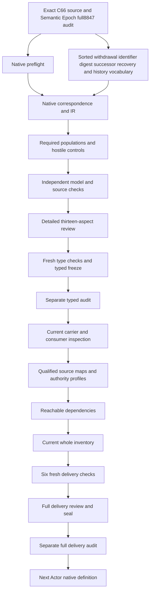

# Withdrawal Record: types and logic review

This candidate selects the exact current positive Withdrawal Record Definition. Definitions,types and logic precede carrier implementations and governance effects. The record's necessary declarations retain permanent identifier reservation,an exact subject and digest when available,reason and effective time,withdrawal posture,owner Decision,evidence and challenge route. An optional successor has independent resolution,identity and admission declarations. Explicit higher-order recovery and historical lookup remain separate record structures. No actual identifier is withdrawn,restored,reused or deleted by the formalization.

Semantic Epoch's complete8,847-file candidate seal and separate actual audit passed before native creation. The preflight preserved every prior file hash and all201originalsourcefiles,verified the exact source,A04/C01/E02 receipts,the selected work-unit output and write scope,and the prepared contract/model results. Native interpretation count is now98among183currentidentities,leaving85withoutT. The last completed full inventory remains97partialdrafts86missing until this packet's full delivery. Source fidelity and whole translation are pending;accepted whole translations and whole-definition proofs remain zero. The complete episode and its final review stay active.

## 1. Exact positive source and C66 admission

The selected source is cal.definition.withdrawal-record@1.0.0-candidate.1, SHA f929f75cda1bf96791c2756b481ae55cb58559fdc98d105871c5b6d8b3906571. Current admission is CAL-DECISION-0066-DEFINITION-SPECIALIZATION-RESOLUTION-ADMISSION. The source's positive meaning gives Withdrawal Record its own semantic identity. It is distinct from a broader Definition that a carrier might previously have borrowed. Exact source selection fixes which meaning is interpreted;it does not accept the proposed translation or perform an identifier withdrawal.

C66 admitted seven exact positive Definitions and an exact specialization resolution overlay. Its exclusion explicitly says no Ledger carrier is created and no identifier is withdrawn. The native source checker binds decision,authorization,candidate,resolution,validation bytes and the selected Definition row. Historic registry counts in the decision remain historical;the current183identity189versionsnapshot is checked separately. No historical decision count is rewritten or mistaken for the current project denominator.

The Definition retains candidate-authored body metadata and its Step3review claim ceiling under the current admission overlay. Its normalization source reference remains candidate-unadmitted with null source-admission reference. The exact local normalization bytes are observed rather than silently treated as admitted semantic correspondence. Definition admission,source bytes,carrier admission,instance authority and downstream activation have separate roles. Parent-Instance Authority Separation therefore remains an explicit boundary throughout this candidate.

## 2. Sorted signature and qualified symbols

The signature has16nonempty sorts:WithdrawalRecordReference,IdentifierReference,SubjectReference,DigestReference,PostureReference,ReasonReference,TimeReference,DecisionReference,OwnerReference,EvidenceReference,ChallengeReference,SuccessorReference,AdmissionStateReference,RecoveryRuleReference,HistoricalResolutionReference and Token. One EMPTY Token constant supports reference-presence guards. Thirty-five total functions and121predicate/relation signatures yield173declarations. These descriptive sorts are proposed denotations,not new canonical Definition identities inferred from their names.

Nine base record selectors nominate identifier,subject,posture,reason,effective time,owner Decision,evidence,challenge and historical resolution. Three optional selectors nominate digest,successor and recovery rule. A subject has identifier and conditionally used last-known-digest selectors. Decision,successor and history records have distinct typed fields. Fifteen reference-handle functions keep explicit nonempty nomination separate from actual resolution. Each selector has an exact BindingDeclared relation,so a total function value alone cannot substitute for an explicit record declaration.

All symbols are qualified by exact source version and candidate scope. Matching sort names in another definition do not import its theory or prove a shared carrier map. Totality gives every finite-domain argument a result of the declared sort. Selected obligations require declared targets,nonempty handles and exact relation/function agreement. Missing,conflicting,undeclared or empty references fail where required. Outside and unused optional values remain possible without automatically receiving selected obligations.

## 3. Permanent governance and lineage genus

RecordApplicable is equivalent to RecordInScopeDeclared. A selected record has a nonempty reference and all nine exact base fields. RecordPermanentDeclared,RecordGovernedDeclared,RecordBoundedDeclared and RecordGovernanceLineageDeclared must hold. These preserve the positive genus and the formal governed/bounded implication as necessary declarations. They do not establish permanent storage,real governance authority or a sufficiently bounded operational consumer merely from the supplied flag values.

The identifier is declared retired or rejected through an inclusive disjunction. Either posture is allowed and both may hold together. This differs from classifying the Withdrawal Record itself as ordinary rejection or deprecation. The record's own withdrawal posture is a separately typed field. A positive overlap control keeps the source's inclusive reading visible,while a selected record without either identifier posture fails. No universal taxonomy of actual identifiers or governance states is invented.

One identifier and one subject are nominated per record. The theory does not impose global uniqueness of records,exhaust every alias or determine whether several historical records describe one identifier. Aggregation,canonical identifier identity and record membership need accepted maps. A finite supplied domain is not a complete registry. Permanent declarations remain separate from unbounded temporal retention proofs and from the current effectiveness of the withdrawal disposition. Those distinctions keep a historical record meaningful even where its operational posture changes.

## 4. Exact identifier,subject and digest binding

Every selected record's subject has an exact subjectIdentifier field equal to recordIdentifier. This ties two distinct typed references without authenticating actual identity. A record with a different subject identifier fails even if both references are nonempty. The record retains exact subject nomination rather than erasing the subject into a mere identifier string. Real resolution,alias equivalence and the relationship between the named subject and a withdrawn artifact still require source-owner and consumer evidence.

RecordDigestAvailableDeclared is equivalent to the nominated subject's SubjectDigestAvailableDeclared. When available,the record's digest and the subject's last-known digest both have exact declared nonempty fields and must be equal. The source expressly makes digest binding conditional on availability. This candidate therefore does not force a fabricated hash for every record or claim that an opaque DigestReference is a computed cryptographic digest. Digest availability and fidelity are independent actual query targets.

Unavailable digest selectors remain total for model well-formedness but do not assert an available digest. Positive controls permit an empty outside digest handle or a missing optional recordDigest binding on an unavailable record. A changed available digest or disagreement between record and subject availability fails. A consumer must still accept how last-known subject state,digest content,availability and exact withdrawn bytes correspond. Reference equality provides declaration coherence,not a successful physical hash calculation or a preservation certificate.

## 5. Posture,time,reason and current effectiveness

Each selected record names withdrawal posture,reason and effective time through separate typed nonempty fields. These references preserve the source's requirement that a reviewer can identify why and when the disposition applies. Posture is not inferred from the record's directory or identifier suffix. Reason is not reduced to a validity enum. EffectiveTime is distinct from a current-effectiveness flag,so a retained historical record can preserve its recorded time without being declared currently effective.

No timestamp parser,calendar rule,clock ordering or arithmetic timeline is introduced. A TimeReference can be coherent in the supplied model without proving the real instant when a disposition became effective. The same distinction applies to reasons and withdrawal posture. Exact bindings and declarations are necessary structure;actual time correctness,reason adequacy and posture fidelity remain source-specific outcomes with countermodel evidence. Accepted chronology requires a richer model and current evidence.

RecordEffectiveDeclared activates the necessary identifier-reuse rejection guard. Its value is a proposed scope/state declaration rather than a successful temporal lookup. The source owners must accept how effectiveness is determined and how it interacts with restoration,retention and historical consumers. Those questions remain findings. The theory neither deletes the record when effectiveness ends nor assumes that every permanent record is always currently effective. This separates durable lineage information from a current operational governance state.

## 6. Owner Decision,evidence and challenge references

The record preserves one exact OwnerDecision reference. The nominated Decision is recorded and has an exact declared nonempty owner field. OwnerReference and DecisionReference remain separate sorts. This keeps an owner decision visible without treating an owner label as a signed decision or actual authorization. Removing the Decision's recorded posture,owner declaration or handle fails the necessary guard. Authenticity,scope and real owner authority remain independent outcomes.

No single-subject Decision cardinality is imposed. A real decision may cover several subjects;the source does not require a global function equating every Decision to one identifier. The record's exact link is a proposed reference map,not a proof that the decision authorizes the particular withdrawal. Owners must accept that correspondence and provide the relevant evidence. The candidate therefore avoids inventing an operational approval process or granting effects from the existence of a Decision carrier.

Evidence and challenge route are typed preserved references with exact bindings. They do not establish that evidence is sufficient,current or authentic,that a challenge route resolves to a live owner,or that a challenge was executed. Dedicated targets cover EvidenceAdequacy and ChallengeResolution. The positive record can retain those obligations while the actual outcomes remain false in a supplied countermodel. A record's governance meaning and reference completeness cannot replace instance-specific accountability and review.

## 7. Reservation and effective reuse rejection

RecordIdentifierReservedDeclared is equivalent to the absence of a declared reservation exception. RecordReservationExceptionDeclared is equivalent to selection of an explicit higher-order recovery rule. This preserves the boundary that the identifier remains permanently reserved unless an explicit higher-order rule permits restoration. The proposed coherence is stated openly;real reservation,permanence and exception precedence need owner-approved interpretation and enforcement evidence rather than an implicit rule from a label.

RecordEffectiveDeclared implies RecordIdentifierReuseRejectedDeclared. A selected effective record lacking that rejection fails. The source's testable condition therefore contributes a semantic declaration guard instead of being treated as a mere migration observation. A historical or inactive record can independently retain a rejection declaration without becoming currently effective. Absence of effectiveness does not by itself grant reuse,deletion or automatic lifecycle closure.

Restoration of the original subject is distinct from arbitrary reuse of the identifier. The model includes an effective record selecting a recovery exception while still rejecting identifier reuse. This makes the distinction expressible without inventing recovery authority. A restoration exception changes declared reservation posture but does not authenticate a rule or perform restoration. Actual NoIdentifierReuse is queried on effective records,so its counterexample cannot rely only on an unrelated ineffective record. Real enforcement still needs its own evidence.

## 8. Explicit higher-order recovery rules

A selected recovery exception requires an exact nonempty RecoveryRule reference. The rule must be recorded,explicit,higher-order and restoration-permitting by declaration. RecoveryRuleAppliesToIdentifierDeclared must hold for the exact reserved identifier. Removing any required posture or the applicability tuple fails. Applicability is a relation rather than a single-identifier function,so one rule may apply to several identifiers without an unsupported global cardinality restriction.

The candidate does not invent a taxonomy of higher-order authority,rank rules numerically or accept a recovery rule merely because it is named. It leaves actual rule validity,authentic authorization,scope,precedence and executed restoration independent. The source's exception is preserved as an explicit necessary record structure. It is not interpreted as ordinary deletion,archival,identifier reuse or an automatic reversal of every withdrawal. No real subject is restored by model evaluation.

Unused recovery selectors remain total without forcing every record to have a rule. A positive control removes a recovery binding from a record that selects no exception;another leaves the unused outside rule handle empty. These do not weaken the requirements on selected recovery. RecoveryRuleAuthority and Restoration queries are conditioned on explicit recovery selection. Their supplied counterexamples include an actual selected rule declaration while leaving the real outcome unsupported,which is stronger evidence than choosing a record with no recovery claim.

## 9. Optional successor and independent identity

RecordSuccessorClaimedDeclared is optional. When true,it requires an exact declared nonempty SuccessorReference with exact identity and admission-state fields. The successor must be recorded,independently resolved and declared to preserve its own identity and admission state. This retains the source's claim-specific obligation while allowing a Withdrawal Record without any successor. A record does not imply a successor exists merely because a total optional selector has a value.

SuccessorReference is separate from the withdrawn subject and reserved identifier. The source says a successor reference states lineage or replacement routing and does not merge identities. The candidate excludes a declaration that the record performs identity merging or automatically supersedes another subject. It does not invent a universally different successor identifier from that wording. A positive same-label control exposes the unresolved alias/version/identity correspondence instead of claiming global injectivity or treating equality as automatic merge.

Independent declared resolution does not authenticate a lookup result or an admitted successor authority. A typed AdmissionState reference preserves a nominated state without proving it is the successor's actual current state. Existence,resolution,identity and admission outcomes are queried only when a successor is claimed. Missing optional claims cannot supply trivial counterexamples to these queries. Source owners still need accepted maps for lineage,replacement routing,identity,lookup and independent admission.

## 10. Historical lookup without loading the subject

Each selected record nominates an exact HistoricalResolutionReference. Its exact fields point back to the same record,identifier and withdrawal posture. HistoryRecordedDeclared and HistoryWithoutLoadingSubjectDeclared must hold. If the selected subject is declared inactive,HistoryResolvableDeclared must also hold. This preserves historical disposition lookup after inactivity and the requirement that resolving history does not require loading a deleted subject.

The proposed one-resolution nomination per record does not define every real resolver or restrict aggregation and multiple historical views. Actual lookup implementation,retention,availability and temporal persistence remain independent. The model does not simulate deletion,load subject contents or erase references. An exact resolver reference and a no-load declaration can be complete while actual history remains unavailable. Accepted consumer behavior requires evidence beyond this structural witness.

Negative controls mismatch history record,identifier or posture,remove the recorded/no-load flag or remove resolvability for an inactive subject. Positive controls allow additional resolvability for an active subject. Actual HistoricalAvailability is queried under declared inactivity,so the countermodel addresses the source's relevant condition. PermanentRetention,HistoricalResolution and NoHistoryDeletion remain separately visible targets. These distinctions keep a successful finite declaration check from being reported as a guarantee of indefinite historical access.

## 11. Role exclusions,scope and effect independence

The record cannot declare that it deletes history,erases prior references,grants identifier reuse,implies a successor exists,automatically supersedes another subject or merges successor identities. It also remains distinct from deprecation,rejection,suspension,deletion,archival and ordinary lifecycle closure. These exclusions classify the record's meaning and invalid inference declarations. They do not prevent a retired or rejected subject posture from being recorded in the positive genus.

Parent meaning,Definition admission and a recovery reference do not grant instance authority. Admission,activation,relation,runtime,consumer,publication,deployment and external-effect grant declarations are excluded. Actual outcomes remain outside T as independently supplied targets. Positive controls permit separately supported Authority,Restoration or other outcomes,so a non-inference boundary is not turned into a universal prohibition of legitimate independent governance activity.

The model's scope,record universes,reference denotations and source precedence remain owner pending. Twenty-one current dependency meanings are separately qualified;their whole theories and authority are not imported. No identifier is physically withdrawn,restored,reused or deleted,and no canonical/private/live/publication effect follows. The source claim ceiling and authority-scope text are accounted as deferred correspondence. Owner acceptance and operational enforcement cannot be supplied by a schema discriminator,reference token or successful projection.

## 12. Source account,conditional queries and actual evidence

All24nonemptysourceunits are accounted at exact JSON selectors and complete character spans. Sixteen clauses are encoded,six explanatory and two deferred. Nine primitive theory formulas preserve the genus,digest,reservation,effective reuse,recovery,successor,history and role boundaries. Notation,intuition and the illustrative withdrawal:CAV2-D70 example remain explanatory. The example is not treated as a real withdrawal decision or independently admitted successor.

The native model suite passes209controls:72T-true,129T-false and eight malformed-input rejections. Seventeen required populations demonstrate selected/outside records,independent authority,retired/rejected overlap,available/unavailable digests,optional successors,effective reuse rejection,inactive history and explicit recovery. T and I are evaluated independently. No selected records or missing independent authority can satisfy theory while failing the episode's requested demonstrations. Population coverage does not certify source fidelity.

Thirty-four queries have supplied T-and-I countermodels. Ten targets and witnesses are conditioned on declared digest availability,claimed successor,explicit recovery,effective record or inactive subject. Broad successful earlier query evidence is retained rather than substituted as the stronger result. The current checker supplies successful evidence for the corrected conditions. No actual target is an assumption in T. These bounded countermodels remain separate from accepted semantic correspondence and mechanized whole-definition proof.

Actual source checking passes63checks and38source/queryobligations. It verifies current C66 source,authorization,candidate,resolution,validation,exact local normalization and two unchanged5,042-byte pure projections,SHA89162de7c65af480d3159ada490858ee105661f677883995cdb4dbe1a8ce68f6. The prepared full contract also checked all unresolved population identities for uniqueness and passed209controls at a maximum25,787steps. Checker limits remain unchanged. None of these observations authenticates an actual identifier disposition or owner decision.

## 13. Retained stages,delivery DAG and remaining work

The first prepared contract check failed because the genus formula reused the repository helper's BASE name. Its exact producer and terminal captures are retained. Alpha-renaming the formula to GENUS preserved the formulas while restoring the repository path helper. Native producers subsequently passed. Two successful prior query stages are also retained:the original broad targets and the conditioned targets before the query-emission layout correction. Primary theory,source coverage and required populations remained unchanged.

An illustrative effective record reserves a retired identifier,names its exact subject,reason,time,owner Decision,evidence and challenge,has no claimed successor and retains historical disposition lookup. Its declarations can satisfy T without proving an actual withdrawal or owner authorization. Another record selects an explicit applicable higher-order restoration rule but still rejects arbitrary identifier reuse while effective. A counterexample removes that rejection or names a recovery rule lacking applicability;necessary guards fail despite complete labels.

This seventeen-node,seventeen-edge work DAG is acyclic and separate from the semantic dependency graph. Three fresh typed checks have actual exit zero. The sixteen-input freeze and separate audit must supply their own terminal results. Current carrier/consumer/source maps,qualified profiles,reachable dependencies,the whole98draftinventory,sixfreshdeliverychecks,full review,seal and separate full audit follow. Actor native work is gated on that full audit rather than started from a typed-only packet.

Original scope remains183identities189versions201sourcefiles,121tasks511planningedges797SWUs36frontiers. All8,847previoussealedfiles and source bytes remain preserved. The last completed full inventory is97/86 while native files now number98/85. Source fidelity,shared meanings,consumer alignment,whole translation and whole proofs remain pending. The final episode-wide review remains required after the original scope is handled;this packet does not redefine goal completion around a bounded subset.

- WR-FINDING-001: Exact C66 positive Definition admission and resolution do not withdraw identifiers,admit carrier/instances or accept this formal translation. Status: unresolved;owner review and accepted map references pending.

- WR-FINDING-002: Permanent governance/lineage record genus is represented by selected declarations;real retention and unbounded permanence remain unproved. Status: unresolved;owner review and accepted map references pending.

- WR-FINDING-003: Record,identifier,subject,digest,posture,time,Decision,evidence,challenge,successor,recovery and history types are proposed qualified maps,not new canonical identities. Status: unresolved;owner review and accepted map references pending.

- WR-FINDING-004: One exact identifier and subject per record does not impose global record uniqueness or exhaust aliases and historical identifier universes. Status: unresolved;owner review and accepted map references pending.

- WR-FINDING-005: Retired-or-rejected identifier flags are inclusive and differ from classifying the record itself as rejection or deprecation. Status: unresolved;owner review and accepted map references pending.

- WR-FINDING-006: Exact subject-to-identifier binding does not authenticate actual subject identity or current withdrawal posture. Status: unresolved;owner review and accepted map references pending.

- WR-FINDING-007: Digest availability is conditional declaration coherence with the selected subject;actual availability,hash content and last-known fidelity remain independent. Status: unresolved;owner review and accepted map references pending.

- WR-FINDING-008: Unavailable digest selectors remain total without asserting a digest exists or forcing fabricated hash evidence. Status: unresolved;owner review and accepted map references pending.

- WR-FINDING-009: Effective time is a typed reference,not a clock order,correct timestamp or proof of actual current effectiveness. Status: unresolved;owner review and accepted map references pending.

- WR-FINDING-010: Owner Decision and its nominated owner need accepted reference and authority maps;no single-subject Decision cardinality is invented. Status: unresolved;owner review and accepted map references pending.

- WR-FINDING-011: Evidence and challenge routes are typed preserved references,not adequate evidence,executed challenge or authenticated ownership. Status: unresolved;owner review and accepted map references pending.

- WR-FINDING-012: Declared reservation holds unless the selected explicit higher-order recovery exception is nominated;the meaning and precedence of reservation/restoration remain owner pending. Status: unresolved;owner review and accepted map references pending.

- WR-FINDING-013: Identifier reuse rejection while effective is distinct from restoration of the original subject and does not infer actual enforcement or recovery authority. Status: unresolved;owner review and accepted map references pending.

- WR-FINDING-014: Recovery rules are explicit,higher-order,recorded,restoration-permitting and applicable to the identifier by declaration;their actual validity,scope and effects need independent evidence. Status: unresolved;owner review and accepted map references pending.

- WR-FINDING-015: A claimed successor is optional and has separate declared identity and admission state;withdrawal does not universally require a successor. Status: unresolved;owner review and accepted map references pending.

- WR-FINDING-016: Independent successor resolution and preserved own identity/admission are necessary declarations without authenticated lookup or admitted successor authority. Status: unresolved;owner review and accepted map references pending.

- WR-FINDING-017: No distinct successor identifier axiom is invented from nonmerge wording;aliases,versions and replacement identity relationships need owner correspondence. Status: unresolved;owner review and accepted map references pending.

- WR-FINDING-018: One historical resolution nomination per record is a proposed lookup map,not a restriction on actual resolver aggregation or historical consumers. Status: unresolved;owner review and accepted map references pending.

- WR-FINDING-019: Inactive subject history remains declared resolvable without loading the subject;real availability,retention,deleted-subject independence and temporal persistence remain separate. Status: unresolved;owner review and accepted map references pending.

- WR-FINDING-020: Record role exclusions deny inferred history deletion,identifier reuse,automatic supersession,identity merge and effects without prohibiting independently grounded actual outcomes. Status: unresolved;owner review and accepted map references pending.

- WR-FINDING-021: Scope and candidate-body claim ceiling remain accounted with no canonical/private/live/publication or actual identifier withdrawal/restoration/reuse/deletion. Status: unresolved;owner review and accepted map references pending.

- WR-FINDING-022: Complete source character accounting and supplied finite T/I controls cannot accept source fidelity,shared meanings,whole translation or whole-definition proof. Status: unresolved;owner review and accepted map references pending.

Actual native counts: {"countermodel_queries": 34, "declarations": 173, "deferred_clauses": 2, "direct_semantic_uses": 21, "encoded_clauses": 16, "explanatory_clauses": 6, "mapped_clauses": 24, "required_populations": 17, "source_units": 24, "unresolved_populations": 121}.
