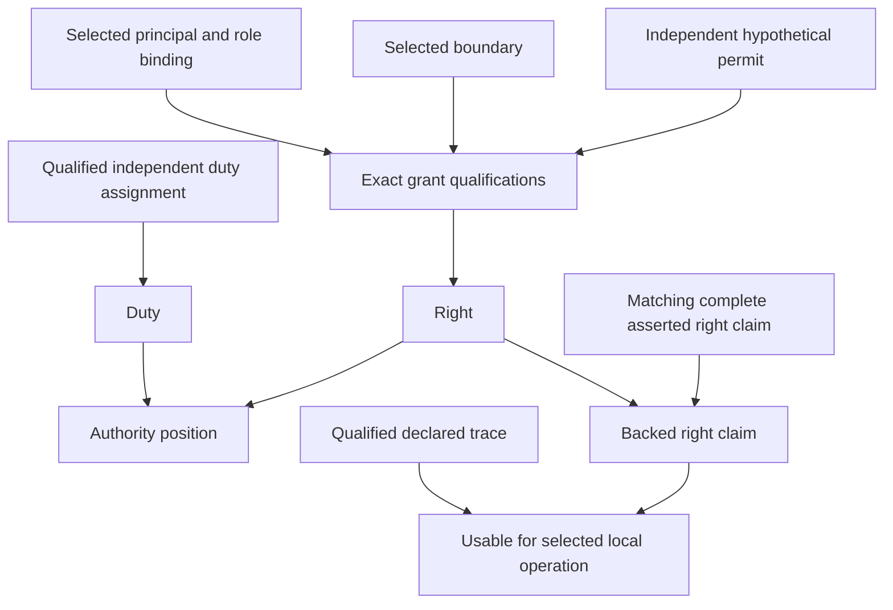

# Exact correspondence review for the partial governance model

The partial model distinguishes permission, assigned duty, asserted claims, provenance and governance posture. It has independently checked finite evidence for the declared scope. This packet asks the semantic owner to evaluate whether its selected meanings correspond faithfully to the source, with each omission and assumption explicit.

Review subject SHA-256: `c92afdf1fc5b11fa1d9fc03d36f12ec48efabc7f753c8a60741ed56d1bd80cb0`.

The review is pending. No reviewer principal or owner decision has been attributed. The source declares `role:definition-owner`; its principal binding and authority for these exact review scopes still need evidence. Candidate recommendations remain recommendations.

The machine-readable [review packet](../../pilot-v2/fidelity-review.json) binds the exact interpretation, source versions, mathematical denotation, independent evidence and upstream receipts. [The source-clause appendix](SOURCE-CLAUSES.md) presents all 166 inventoried source-text units. [The independent model review](../A09/REVIEW.md) explains the types, static logic, frame, queries and budget scope in detail.

## The reviewed model and its evidence

The model's permission root is a hypothetical independently supplied grant. Its legitimacy and principal-role bindings are selected conditional premises. Duty is an independent assignment with intended outcome and answering route. Supported claims match an assignment; incomplete or unbacked assertions remain expressible. The selected local-use policy additionally requires declared trace evidence for using a supported right claim at that operation. Its exact scope, surface, operation and effect are bound in the interpretation.

A09 independently reconstructs every declared finite record configuration, evaluates the record and transition meaning, derives the static projection, and checks the required classical queries. There are 8640 configurations, 5760 satisfying T and the frame, and 1296 satisfying all five populations together. Eleven required existential targets have actual checked model witnesses. A fresh replay also checked all retained bounded stress intervals, totaling 9210 configurations across 77 ranges.

These are finite conditional results. They do not authenticate actual grants or lineage, prove duty fulfillment, establish full temporal or deontic semantics, or supply source-owner fidelity. All eleven administrative/semantic gates remain pending separate adjudication. Whole-definition accepted translations and whole-definition proofs remain zero.

## Seven partial definition reviews

| Source target | Selected partial meaning | Exact review question and remaining loss |
|---|---|---|
| Authority | Qualified right or independently assigned duty, preserving their tags | Does this capture the target's right-or-responsibility reading? Root legitimacy, delegation, revocation, challenges and whole-source normalization remain outside the partial rule. |
| AuthorityClaim | Assertion with source tuple fields, augmented by principal, position kind and assignment reference | Are those extra fields and representable incomplete assertions acceptable in this bounded profile? No signature equivalence or actual governing admission is established. |
| Responsibility | Duty assignment with responsible role/principal, scope, object, operation, intended outcome, basis and owner route | Does the normative duty reading govern the partial meaning? The inherited claim tuple remains a source conflict; outcome fulfillment and complete deontic meaning are omitted. |
| Provenance | Known empty, complete, routed incomplete, unknown, deferred and source-local trail states | Is the empty representation faithful to the source star, with the local-use condition separately reviewed? Historical authenticity and arbitrary lineage graphs are omitted. |
| GovernanceAxisIndependenceInvariant | Seven separate posture components, exact subject/state-bound move, explicit additional changes and assignment deltas | Does this capture the selected no-silent-axis-change condition? Reachability, atomicity, liveness and arbitrary implementation correctness are omitted. |
| AuthorityBoundary | Qualified role/principal, scope and finite target/effect membership, with exclusion priority | Is the finite membership representation faithful for these hypothetical cases? Full Governance Decision semantics, authenticated root acts and boundary mutation are omitted. |
| AuthoritySurface | Exact surface context and independently qualified grant matching | Does this preserve the partial scope without treating a token as legitimate real surface authority? Whole classification and actual promotions/external effects are omitted. |

Each machine-readable definition card contains the exact source identity and scope, source spans, candidate rule and digest, full-source clause keys, explicit losses and a pending per-definition fidelity record. Source identity and lexical classification remain preserved; the model does not lower every source statement into axioms.

The source-owner scope is `scope.shared-authority` for five of these sources, `scope.lineage` for Provenance, and `scope:cyberalchemy-lab-shared-governance` for AuthorityBoundary. Those source scopes remain distinct from the hypothetical candidate operation scope `scope:pilot-local-use`. A shared owner-role label does not establish a principal's authority across all these scopes.

## Three source and interpretation choices

R1 — Responsibility, finding FID-RESP-001. The target-specific normative statement describes an obligation without automatically granting permission. The inherited formal expression uses the Authority Claim tuple. The current candidate selects the duty reading for its partial semantics and keeps the tuple as structural source evidence. Alternatives are to make the inherited tuple control the meaning, which requires a new interpretation and an explanation of the duty boundary, or to defer precedence. This choice does not silently merge Responsibility with AuthorityClaim.

R2 — Provenance, finding FID-PROV-EMPTY-001. The formal path notation uses a zero-or-more sequence. Useful origin and chain precision may demand additional context for a zero-step case. The current candidate makes known empty expressible and requires a nonempty trace only in its selected local-use profile. Alternatives are to specify a zero-step origin-context extension or defer the empty-path and use-policy questions. Unknown and deferred steps remain unavailable, and cannot be converted into known empty.

R3 — Authority root, finding FID-AUTH-ROOT-001. The current candidate requires an independent role/boundary-qualified permit rather than deriving permission from the assertion record. Alternatives are to treat a complete assertion as sufficient permission at this scope, with a new source-supported iteration and analysis of self-asserted authority, or to defer the root interpretation. This is a model-meaning decision. Actual grant legitimacy remains an external premise even if the partial rule is accepted.

The packet records the candidate alternatives and consequences, an agent recommendation for each, and a null owner selection. It does not convert the recommended option, lack of response or passing tests into a human decision.

## Coupling, assumptions and omitted clauses

The local-use coupling applies precisely to scope `scope:pilot-local-use`, surface `surface:pilot-rules`, operation `count-as-local-rule` and effect `permitted-local-use`. A supported right claim is usable in that selected profile only with a qualified nonempty known or correctly scoped local trail; recorded gaps must have residue and owner route. This policy does not become a global implication from every right to known provenance. A grant can exist with unknown origin; recording trace alone neither creates nor removes it.

The coupling requires its own fidelity decision. Acceptance of known empty as a representable trail does not automatically accept the local-use restriction. Similarly, accepting a duty interpretation does not establish that any actual duty was discharged.

The three selected premise groups are hypothetical owner acts, principal-role bindings and declared trace records. Trace tokens carry declarations rather than authenticated source occurrence or historical truth. Shared structural typing, source-currentness, static compilation, obligation generation and independent executable AST denotation remain explicit code/trust assumptions; no generic kernel correctness proof has been supplied.

Every whole-source clause in the 166-unit appendix remains unresolved for whole-definition translation. A partial rule's consideration of a source selector is marked explicitly, without claiming its entire meaning has been encoded. The appendix retains normative and formal voices, boundaries, source identifiers, scope descriptions and explanatory source text. Character accounting is evidence of what was retained for review; it does not accept a meaning.

The pending dependency-closure record states that the selected seven current definition identities do not constitute complete operational semantic closure. All-183 joint consistency and universal non-collapse remain larger episode obligations.

## How decisions are recorded

A review decision must bind the packet's exact subject digest and specify the source, clause, partial rule, interpretation alternative or coupling that it addresses. The accountable reviewer principal, source-declared owner role and scope, actual review evidence, and role-binding evidence are separate required attribution fields. An unattributed preference can be kept as a human proposal without being promoted to owner authority.

Partial-rule dispositions are accept-at-partial-scope, reject-at-partial-scope, request-revision or defer. Whole-clause fidelity dispositions are faithful-at-reviewed-scope, not-faithful or unresolved. A decision on one partial rule does not decide every other clause or alternative. Accepting seven partial rules does not establish seven owner-accepted whole-definition translations.

Semantic admission is a separate decision with its own scope and authority. This fidelity packet requests no canonical source mutation or operational grant. It does not promote a definition, change a registry entry or authorize an external effect.

A rejected or revised meaning routes to a new absent candidate iteration. The original packet and evidence remain preserved. Any changed source interpretation, role, signature, assumption, scope, relation, coupling or target must be rebound, and affected checks must be rerun before replacement evidence is claimed. An accepted old candidate cannot be reused to support changed bytes.

## Episode status

This packet satisfies A10's explicit pending-review alternative. Its preparation and exact source/evidence binding are complete; owner correspondence decisions remain pending. The complete formalization episode retains all 183 current definitions and 189 admitted source versions. Candidate framework work, remaining family translations, semantic closure, extensions, global theory checks and final comprehensive review continue from their ready dependencies. No whole-project completion is claimed.
