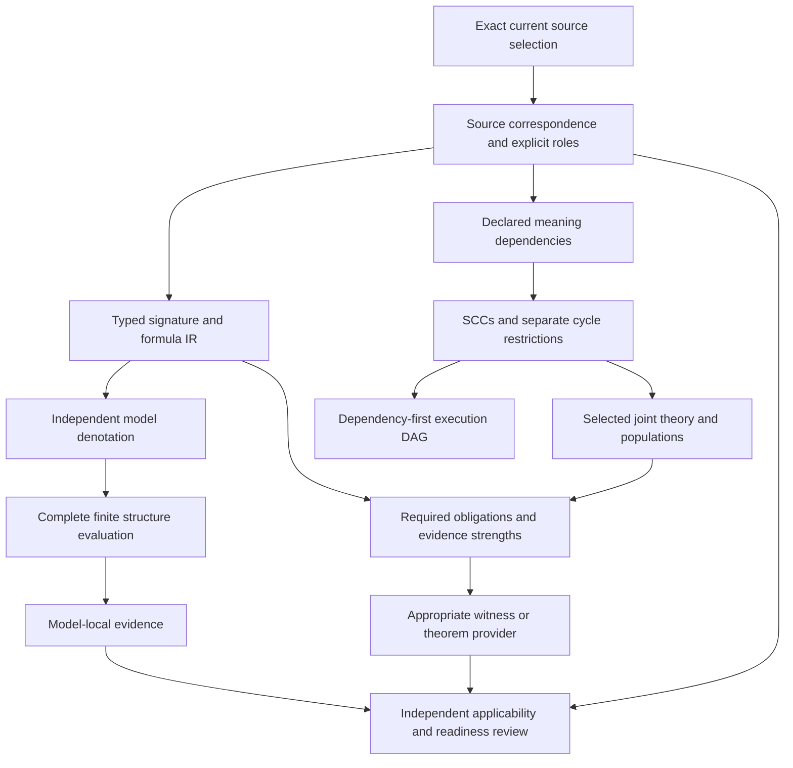

# Formalization review: meaning, satisfaction and dependency order

This review explains the candidate model after C02 and C03. The foundations-first plan still covers all 183 current definitions. These units complete bounded framework criteria; they do not complete the project, accept source translations or change canonical definitions. The earlier M09 review explains the foundation contracts, and the A04 and C01 reviews explain correspondence and typing in more detail.

The model keeps an exact source selection, a meaning interpretation, a logical signature, selected premises, required populations, queried obligations, and their evidence distinct. This distinction determines what a passing check can establish. The interpretation of a definition is not its registry label, and an executable representation is not a proof of its source meaning.

| Aspect | Formalization element | Current evidence and limit |
| --- | --- | --- |
| Source identity | Definition ID, exact version, path and byte digest | A02 captures 183 current identities and six historical versions; currentness is checked separately from meaning. |
| Definition form | Primitive, explicit, recursive, axiomatic, constraint and other selected forms | M01–M07 candidate classification contracts; eight selected source-clause annotations are not complete translations. |
| Statement role | Definition expansion, selected axiom/premise, constraint, hypothesis, target or explanation | Role checks prevent an investigation or target from silently entering the premises. |
| Source fidelity | Exact source-unit and clause correspondence, losses, alternatives and attributable review | A04 accounts for text and spans. No source-owner accepted whole-definition translation is established. |
| Logical signature | Nonempty sorts, constants, ordered predicates/relations and total functions | C01 verifies scope, identity, binding, arity and sorts for the supported static fragment. |
| Typed syntax | Closed many-sorted formulas and explicit term ASTs | Canonical symbols preserve source/version/scope/local identity. Unsupported constructs remain explicit. |
| Denotation | Mathematical structures, term interpretation and satisfaction | C02 specifies this independently of the evaluator returning a Boolean. |
| Finite representation | Complete domains, constants, function tables and predicate extensions | C02 rejects missing interpretations, empty domains, ill-sorted tuples and incomplete functions. |
| Premise context | Explicit selected theory T and assumption context | A06 generates obligations; C02 evaluates T separately from target Q. |
| Population context | Required existential statements I in the same model as T | Empty predicates are allowed structurally; a required population failure does not support a vacuous target. |
| Relationships | Alias, subtype, overlap, disjointness and named independence queries | A05 fixes target direction and strength; C02 checks hand-derived finite examples. |
| Meaning dependencies | Explicit exact-version `uses_definition` edges with source basis | C03 consumes validated authored semantic-use declarations. Mentions and imported traceability do not become edges. |
| Mutual definitions | Strongly connected components with separate cycle classifications | Joint analysis is permitted in controls; recursive semantics and consistency remain separate obligations. |
| Execution ordering | Condensed SCC DAG with dependencies before consumers | C03 produces a deterministic candidate execution order. Order is not permission or proof. |
| Change propagation | Reverse closure over validated dependency edges | C03 includes all transitive consumers and mutual peers in controls. Future invalidation must bind source and semantic fingerprints. |
| Evidence strength | Model-local value, witness, bounded exhaustion, solver evidence or exact theorem | Strength depends on the proposition. The finite evaluator establishes only truth in the supplied structure. |
| Acceptance and authority | Independent readiness criteria and owner disposition | Every artifact here has authority effect `none` and semantic readiness `false`. |

## How the logical model works

A signature Σ assigns types to the vocabulary. A structure M interprets each sort as a nonempty carrier, each constant as a carrier member, each total function as a total map, and each predicate as a set of ordered tuples. An environment assigns values to variables within lexical scope. The denotation specification defines the value of each term and the satisfaction of each formula under that environment.

For example, `∀x. P(x) → Q(x)` is a subtype condition. In a two-member carrier, P containing only `a` and Q containing `a` and `b` satisfies inclusion. The same structure satisfies a selected properness witness `∃x. Q(x) ∧ ¬P(x)`. It does not satisfy aliasing `∀x. P(x) ↔ Q(x)`. Those are different propositions with different evidence requirements; a label such as “related concepts” cannot replace them.

C02 distinguishes a complete empty predicate interpretation from a missing interpretation. An explicitly empty P can make `∃x. P(x)` false. An omitted P interpretation makes the structure incomplete, so no truth value is returned. This prevents absent observations or missing data from quietly becoming logical negation. The finite string atoms in the implementation are representations; they do not authenticate real records.

The same model must satisfy all selected premises and all required populations. C02 evaluates T, I and Q separately. A structure that fails T is not an admissible witness for that query. A structure that fails a required population receives a population-failure outcome without target support. A structure satisfying T and I but falsifying Q provides a model-local counterexample. A structure satisfying all three supports Q in that exact structure. Establishing Q in every admissible structure needs a separate all-model argument or provider at the required strength.

The 18 C02 tests exercise every supported Boolean connective, quantified row-neighbor/common-column examples, total functions, zero-arity symbols, source-envelope decoding through typed IR, relationship conditions and execution failures. Cancellation, resource limits, malformed input and unsupported operators produce no Boolean truth value. These controls do not prove a general evaluator correctness theorem.

## Why there are three graphs

The meaning graph records which exact interpretations are required to understand a selected definition. The obligation/evidence graph records which statements and reviews must be established to support a claim. The procedural DAG orders the work needed to produce and verify those artifacts. An edge in one graph does not automatically establish an edge or a completed obligation in another.

Only a validated semantic-use link bound to the interpretation's explicit `depends_on` reference generates a C03 meaning edge. Each edge retains the source versions and digests, interpretation identity, scope, source selector, clause identity, excerpt digest and declared rationale. The rationale records an authored decision; it does not prove that the decision captures every dependency in the prose.

The compiler resolves the transitive closure and computes SCCs iteratively. A mutual A/B dependency can become one joint-analysis component, followed by a consumer C. The component itself is not rejected merely because it contains a cycle. A separately declared prohibited constraining cycle is rejected, while an unclassified cycle remains unresolved. Accepting a component for joint analysis does not select least-fixed-point semantics, prove well-founded recursion or establish joint satisfiability.

C03 also computes reverse closure. A change to A in the mutual A/B component affects both definitions and every validated transitive consumer. This provides a basis for later invalidation. Quarantined packets do not supply validated outgoing edges, so the reported reverse closure explicitly covers validated declarations rather than all undiscovered semantic uses.

The 16 C03 tests cover these distinctions, exact transitive references, missing translations, unbound-edge quarantine, ignored traceability links, independent required-edge comparison, self-loops, deterministic order, graph reconstruction against forged hashes and a 2,500-node nonrecursive walk.

## Current-source boundary

The live source-boundary run includes all 183 current definitions. Only the existing Hypothesis correspondence packet is selected, and it remains pending. The other 182 interpretations are missing from that graph input. It therefore has zero validated declared semantic-use edges. This is an accounting boundary, not a conclusion that the admitted definitions have no semantic dependencies.

FID-HYP-001 remains unresolved: the target normative statement describes investigation without adoption, while the inherited expression describes an adopted working Premise. Both source fields are preserved. No framework check resolves that meaning choice, merges the identities or accepts a source-owner interpretation.

Remaining project work includes the generic providers and independent evidence replay, exact assumptions and joint theories, all-current definition translations and dependency declarations, source-fidelity dispositions, universal obligations, change regression and the final coverage/review package. The project goal remains active.
