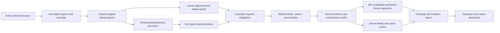

# Definition Formal Assurance: complete design analysis

Status: detailed **candidate** analysis, 2026-10-07. Authority effect: none. The user requested analysis and a detailed DAG; no implementation, owner semantic review, canonical mutation, admission or tool installation occurs in this delivery. Exact inspected bytes and all selected definitions are bound in [source-baseline.json](source-baseline.json).

## Outcome and scope

The project has a credible finite feasibility pilot, but not yet a reusable semantic assurance architecture. The next implementation must close interpretation and input-contract gaps before scaling the pilot. The design below accounts for the complete current queue, future additions and revisions, cross-definition dependencies, provider evidence, combined consistency, non-vacuity, source fidelity, owner review and admission boundaries.

The proposed work comprises **112 task nodes and 788 smallest working units**: 42 shared tasks, 56 family phase tasks, and 14 family closure tasks. Every one of the **183 current identities** has four source-bound units: translation, obligation generation, candidate evidence and owner fidelity review. The remaining 56 units implement shared infrastructure or family closure checks. These are planned units; their count is not proof coverage or a duration estimate.

The complete task graph is in [dag.json](dag.json), per-unit implementation/validation contracts in [swu-manifest.json](swu-manifest.json), human navigation in [WORK-PACK.md](WORK-PACK.md), and every current identity in [DEFINITION-QUEUE.md](DEFINITION-QUEUE.md). The execution graph is acyclic. The semantic dependency graph is a separate declared/reviewed artifact and may contain legitimate mutually dependent definitions.

## Current baseline and evidence ceiling

| Element | Verified state | Consequence |
| --- | --- | --- |
| Live registry | 183 current identities, 189 admitted version entries; all 183 selected source hashes match | Current intake remains valid; six noncurrent versions stay historical, not silently discarded |
| Current source voices | Every identity has normative text and a formal expression | Field presence is not an executable translation or correspondence proof |
| Whole-definition assurance | No owner-reviewed complete translations in this project | Three partial pilot interpretations cannot stand for all 183 meanings |
| Pilot | 192 configurations per completed case; positive joint theory has 50 models, including required inhabited and distinction witnesses | Feasibility for the exact finite projection only |
| Existing evidence bundle | Recomputed bundle matches submitted evidence under the present checker | Current reproducibility, not an independent generic soundness theorem |
| Formal tooling | Python available; prior inspection found no usable Lean/SMT/Alloy/TLC/Souffle runtime | Reassess exact availability when selecting profiles; no tools installed now |
| Same displayed terms | Three Lab/Craft term pairs; 46 labels shared across distinct identities through terms/aliases | Preserve identities and scopes; name similarity cannot select aliases or prove distinction |
| Original project plan | D0–D6 scaffold still records intake-era statuses; candidate delivery status records later work | Do not overwrite preserved snapshots; later closeout must supply coherent project-owned current navigation |

The same-term pairs are Decision Checkpoint, User Decision Preference and Workflow Decision Profile. Their Lab and Craft source identities remain independent until actual scope and meaning comparison establishes the appropriate relation. Shared labels are discovery signals, not semantic edges.

## Design findings and required repairs

| ID | Finding and source evidence | Design consequence | Plan tasks |
| --- | --- | --- | --- |
| DF01 | `checker.py: subject/models` uses one owner-act choice to generate both a complete claim and its active grant | A successor must express a claim without a grant, a grant/right independently of a claim record, and responsibility separately. The v1 pilot remains valid only for its restricted modeled cases. | A07–A10 |
| DF02 | `models/theory_holds/valid_move` conjoins move validity with records but has no move subject ID or relation between posture and record before/after states | The first satisfying theory model can have no record trails while its unrelated move ends with provenance recorded. Bind transitions to exact subject snapshots and active grant deltas; do not claim a combined transition theory from disconnected predicates. | A07, A08, C02, I03 |
| DF03 | Provenance uses a nonempty path projection; source notation permits a sequence of length zero and components may be unknown/deferred/source-local | Review recorded-empty, absent, unknown and incomplete states explicitly. Unknown historical origin is not false provenance, and a typed string is not source authentication. | A04, A05, A07 |
| DF04 | `structural_issues` has no full input decoder/schema; removing `required_dependencies` raises `KeyError`, while adding an unknown top-level marker is ignored and the candidate checks still satisfy | Strict duplicate-key/type/unknown-field decoding must precede all semantic evaluation. Malformed, missing translation and unsupported logic are different outcomes. These read-only probes were reproduced; the pilot was not patched during planning. | A01, E04 |
| DF05 | Dependencies in the pilot are a fixed three-definition partial closure; complete owner, boundary, decision, responsibility and lineage semantics are abstracted | Add clause-level correspondence and explicitly declared transitive dependencies. Do not treat `primary_consumer_refs`, shared source lineage or term names as dependency declarations. | A04, C03, S01 |
| DF06 | `verify_evidence.py` compares submitted evidence to a freshly computed `checker.bundle`, then replays emitted witnesses | Useful integrity/reproducibility, but cannot independently prove generic absence-search correctness or obligation-generation coverage. Keep a trusted-checker profile or add separately checked generic correctness statements. | C02, E03, P04 |
| DF07 | Discovery searches can locate prose and planning identity mentions rather than actual current provider bindings | Coverage requires exact source/version/statement/evidence joins and actual replay status. “Found a formal expression” and “found a mention” must never become formalization coverage. | A03, E01, G02 |
| DF08 | Non-entailment witness, pairwise distinction, bounded no-counterexample search and universal separation are distinct mathematical properties | Relation classes must generate the exact intended strength, prerequisites and carrier alignment. Preserve aliases, subtype overlap and explicit couplings. | A05, A06, S02, Z04 |
| DF09 | Different families can share scoped symbols, axioms, rules and required populations | Local family satisfiability and pairwise checks do not establish joint consistency. One complete joint theory must be checked after all shared meanings and alignments are included. | F01–F14 J, Z01–Z06 |
| DF10 | Existing profiles and schemas have DomainSpec/TDE/EVF-specific identity/ownership fields | Reuse their distinctions and exact bindings through an explicit candidate fit map. Do not silently rename owner fields, activate TDE or label Python output a theorem. | A04, E01, P01 |
| DF11 | Formal provider absence, input malformation, source staleness and search timeout have different causes | Keep execution, currentness, source fidelity, verdict, strength and readiness separate. An unknown or unsupported result cannot become a pass through aggregation. | A01, P01, E01, I04, Z07 |
| DF12 | Arbitrary quantified logic and mixed dynamic semantics cannot be promised automatically decidable | Select supported fragments by actual clauses. Unsupported meanings and assumptions must remain explicit, even if the owner administratively dispositions them. | P01–P05, Z02, Z07 |

DF01–DF06 refine the claim ceiling of the pilot; they do not erase its measured witness/control results. The purpose is to prevent those results from being generalized beyond their actual interpretation.

## Context view: users, ownership and boundaries

The definition owner owns canonical meaning and fidelity decisions. A formalization implementer owns source-to-statement translation, explicit assumptions, exact dependencies and candidate code. A reviewer checks correspondence and evidence applicability. A provider checks one exact supported interpretation. An admission owner selects or applies separately authorized effects. These are responsibilities, not invented people, authority grants or spawned agents.

The source boundary is the live admitted definition registry plus exact selected source bytes and their current versions. A candidate formal interpretation may add an explicit evaluation universe and assumptions but cannot silently alter source meaning. Formalized strings describing owners or grants do not establish that real-world authorization exists.

Present authoring writes are limited to this new planning directory. Future implementation scopes are `craft/formalization/candidates/definition-assurance-v1/` and `docs/plans/definition-formal-assurance/candidate/assurance-snapshots-v1/`. Canonical definitions, admission records, registry state, frozen schemas, historical Lean files and unrelated project work are protected read inputs. Admission effects remain outside ordinary candidate execution.

## High-level structure view

The dependency arrows describe processing and evidence requirements. They introduce no Lab Relation Kind. Invalidation points backward to sources in the operational workflow, but retry iterations are separate attempt DAGs, not cycles in the fixed implementation DAG.

## Low-level component and contract view

| Component | Input | Output | Required failure behavior |
| --- | --- | --- | --- |
| Decoder/contracts | Candidate JSON bytes and exact schema | Closed typed input or malformed diagnostics | Reject unknown fields, duplicate keys/identities, type errors and absent fields before evaluation |
| Resolver/capture | Selected registry, exact source refs and allowed root | Immutable source snapshot and currentness receipt | Missing, substituted or changed sources unresolved/stale; no remote schema retrieval or source rewrite |
| Interpretation registry | Current sources, clause maps, scopes and canonical statements | Exact signatures, assumptions, dependency edges, population policy and examples | Deferred clause and premise remain visible; incomplete translation not counted complete |
| Theory IR | Explicit typed declarations and aligned carriers | Deterministic normalized theory and source mapping | Unbound symbol, unsupported operator, ambiguous scope or ill-typed application non-pass |
| SCC/closure compiler | Explicit semantic dependency graph | Joint recursive components and condensed ordering | Legitimate semantic cycles handled jointly; prohibited value-constraining cycles separately fail |
| Requirement generator | Relation/change policy and whole neighbour denominator | Complete required statements and prerequisites | Submitter cannot omit a difficult requirement or weaken its statement |
| Provider adapters | Exact supported IR, query, assumptions and bounds | Native source, execution receipt, witness/proof/result | Timeout, unsupported logic, provider error and unsat/sat remain distinct |
| Evidence verifier | Required statement set and supplied bound artifacts | Verified applicability and witness/proof outcomes | Recompute hashes, compare statements and dependencies, reject stale/omitted/tampered inputs |
| Invalidation/regression | Exact old/new source and interpretation diff | Reverse dependency invalidation and full selected-theory results | Partial cache hit cannot replace full theory consistency; stale evidence cannot be reused |
| Reporting/review | Full dimensioned coverage and actual outcomes | Human examples, machine report, owner dispositions | No approval simulation or universal claim from bounded absence |

The contracts should carry at least source identity/version/path/digest; source selector and clause status; interpretation ID and typed signature; dependency edge IDs and basis; assumptions and legitimacy route; required/exempt populations; relation class/direction; exact logical obligation; minimum evidence strength; selected profile/domain/budget; native input/result; toolchain digest; execution and currentness; fidelity review; and authority effect `none`.

Source fidelity is an independent requirement: each normative clause is encoded, a declared premise, explanatory with rationale, deferred, or unresolved. A definition cannot become complete while required clauses or assumptions are merely omitted. Older reconstruction lineage can inform interpretation, but target-specific normative text and source precedence need review rather than blind concatenation into axioms.

## Workflow process view

For an addition or revision: resolve exact baseline → capture bytes → declare or update the interpretation and clause map → classify neighbours, shared carriers and allowed couplings → derive all requirements → compile the complete dependency theory → check satisfiability → check required inhabitation in the same combined model → check distinctions, inclusions and forbidden inferences → replay evidence → invalidate dependants and rerun the full selected snapshot → show exact revised interpretation and examples → owner decision.

Candidate drafting and evidence can precede owner fidelity review, but semantic readiness cannot. Changing a source, premise, dependency, coupling, bound, provider or required statement invalidates the relevant evidence. A new candidate iteration gets a fresh identity and attempt graph. No backwards edge “retry until proved” is inserted into the fixed DAG.

For the 183-current intake, families organize authorship; they do not define closed theories. The first plan uses a conservative all-draft declaration barrier followed by a full neighbour/dependency closure. All family fidelity reviews precede family readiness joins so unknown cross-family dependencies cannot be silently approved. Once explicit SCCs are sealed, a successor execution slice may remove unnecessary broad barriers with exact reviewed dependency evidence. This is planned optimization, not a fabricated semantic order today.

## Decision flow and evidence semantics

1. **Are source identity, digest and selected version current?** Otherwise stale/missing; stop readiness for affected evidence.
2. **Are the signature, dependency closure, source correspondence and carrier alignment complete?** Otherwise incomplete/unknown; candidate results may still be exploratory but cannot establish whole-definition assurance.
3. **Is the required logical fragment supported at the selected strength?** Otherwise unsupported. Do not downgrade a required theorem to bounded search without an explicit changed requirement.
4. **Does the combined included theory admit a model?** A verified model establishes satisfiability for that exact encoding. No finite model found means only bounded absence unless a complete solver/proof route establishes more.
5. **Can all declared required populations be inhabited together?** A satisfiable theory with empty required populations is a vacuity failure. “Every definition must have an actual real-world instance” is not assumed: population requirements are explicitly scoped hypothetical/model inhabitants, with reviewed exemptions where applicable.
6. **Does the intended relation hold?** Use the class-specific obligation, not automatic pairwise inequality.
7. **Is all evidence current and applicable, and has correspondence actually been reviewed?** Derive readiness from the complete required set. An owner disposition of unsupported work remains an assurance limitation, not a successful theorem.

| Relation | Required semantics | Evidence to avoid overclaiming |
| --- | --- | --- |
| Equivalent alias | `T entails forall x, A(x) iff B(x)` under an explicit shared carrier | No difference witness demanded; source identities remain distinct when scoped identities require it |
| Specialization | `A -> B`; properness only when declared, with `exists B and not A` | Inhabit A and retain overlap; subtype inclusion is not collapse |
| Overlapping distinct | Intersection witness plus specified directed difference(s) | One difference does not prove both directions or all-model separation |
| Disjoint | No intersection under the selected method, with both required populations inhabited | Empty predicates cannot vacuously prove useful distinct concepts |
| Independent axes | Countermodel for each named forbidden inference; moves obey an explicit frame condition; declared couplings preserved | Do not assume every Cartesian combination or independence from labels |
| Unresolved | Missing meaning, direction, universe, alignment or dependency | No semantic success generated |

For a permitted distinction, search `T and I and exists x (A(x) xor B(x))`, where `I` is the complete required inhabitation policy. For a required separation in **every** admissible model, the target is stronger: `T entails exists x (A(x) xor B(x))`, guarded by satisfiability and inhabitation. These differ. A model with a distinction refutes a universal identity assertion but does not prove that all models preserve the distinction.

The finite evidence profile uses exhaustive enumeration and replay with an explicit trust boundary. The solver profile binds native formulas and exact runtimes and does not turn `unknown` into success. The mechanized profile checks exact propositions, proof dependencies and axioms; proving a statement under contradictory premises does not establish consistency. Full consistency needs a model of the included axioms and required inhabitants, not merely a theorem assuming those axioms.

## Dependency and interface view

There are three graphs:

1. The **source/meaning graph** binds definitions to exact versions, clauses, assumptions and explicit `uses_definition` edges. Mutual dependencies are analyzed in SCCs. A prohibition on cyclic value constraints remains a separate normative invariant; SCC condensation does not waive it.
2. The **obligation/evidence graph** connects required statements to theory components, provider projections, toolchains, witnesses/proofs and owner correspondence records. It supports transitive invalidation.
3. The **execution DAG** orders implementation and review artifacts. Its edges are procedural prerequisites and never become semantic facts.

Inter-family symbol reuse requires exact scoped identity, signature compatibility and a reviewed alignment map. Separately inventing nominal sorts for Authority and Provenance to make them unequal would defeat the assurance purpose. Conversely, merging Lab/Craft records solely because names match would destroy scoped meanings. Historical source versions remain interpretable under their own exact snapshot and are not substituted for current versions.

Conservativity is a distinct extension requirement: a model expansion preserving the old interpretation can support it; an unchanged finite fixture or one satisfiable successor cannot. A representation revision needs its own equivalence/correspondence evidence; a semantic successor needs revised meaning and requirements. The actual current Semantic Epoch, Representation Revision, Authority Boundary and Admission Transaction definitions inform these distinctions.

## Provider alternatives and selection rationale

| Approach | Useful outcome | Main cost or limitation | Decision |
| --- | --- | --- | --- |
| Extend fixed Python pilot directly | Fast isolated demonstrations | Hardcoded IDs, incomplete interpretation and non-generic input path | Keep historical; create a corrected successor, then generic IR/provider |
| Generic finite IR/evaluator first | Reproducible witnesses, exact scope and hostile controls without installation | Exponential search; absence bounded; handwritten evaluator trusted | Recommended L1 route |
| SMT-first complete theory | Efficient satisfiability for selected logical fragments | Quantifiers/temporal semantics may be unsupported; projection fidelity needed | Conditional selected-fragment adapter, not universal default |
| Lean-first every definition | Generic checker and universal proposition checking | Translation/proof labor and model existence still required | Conditional mechanized route where strength is required |
| Install every formal tool | Broad apparent capability | No guarantee of common semantics; higher integration/trust cost | Do not select by availability or label |

Use actual logical requirements before provider availability. The official [Z3 quantifier guide](https://microsoft.github.io/z3guide/docs/logic/Quantifiers/) documents supported fragments and limits of general quantified reasoning. The [Alloy specification](https://alloytools.org/spec.html) makes scopes part of model search. The [Lean validation reference](https://lean-lang.org/doc/reference/latest/ValidatingProofs/) emphasizes checking the actual theorem and assumptions. The versioned [cvc5 proof-production documentation](https://cvc5.github.io/docs/cvc5-1.3.1/proofs/proofs.html) provides a candidate proof-producing solver route; that does not establish which fragments or artifacts this project can verify. These primary sources inform selection; no provider was installed or executed during planning.

A temporal or fixed-point profile may be necessary for actual transaction, replay or recursive provenance clauses. Such a route must preserve the canonical interpretation and state its bounds. A collection of independently satisfiable provider projections is not a single model of the complete theory unless their shared-symbol compatibility is separately established.

## Validation and failure design

The required hostile matrix covers collapse; contradictory premises; empty required populations; missing and stale source/translation/dependency; omitted or weakened statements; malformed and unknown fields; duplicate identities; scope mismatch; alias/subtype misclassification; claimed permission without a root; record/move mismatch; illegal cycle; unsupported logic; timeout/cancellation; forged witness; substituted toolchain; and cross-family contradiction.

The combined-theory control is concrete: `{p, q, not(p and q)}`. Every pair is satisfiable, while their conjunction is not. Its expected failure proves why pairwise successes cannot aggregate to consistency. A second control adds satisfiable constraints that force a required predicate empty; that must fail inhabitation without being reported as contradiction.

Checks are classified by pre-execution, post-produce and closeout phases. Future created outputs need not exist while planning; their producers and validation contracts must be explicit. Each shared unit declares a same-unit post-produce test module, avoiding a false dependency on the later CLI. Each per-definition review uses an actual attributable reviewable check rather than a command simulating approval.

The plan's own validator checks graph acyclicity, reference integrity, complete current-definition partition, one parent task per SWU, all phase memberships, protected write scopes, source hashes, output ownership, local links and manifest consistency. Those checks validate planning structure, not future implementation or semantic truth.

## Cost, sequencing and measurable progress

The dominant cost is interpreting 183 natural-language meanings and reviewing their dependency/assumption boundaries, not running 183 solver commands. Exact duration depends on staffing, clause complexity, requested evidence strength and available reviewer time; this plan makes no fabricated calendar promise.

Four per-definition units allow progress to be measured separately: translation authored; requirements sealed; actual candidate evidence produced; fidelity reviewed. Core/provider work is medium to high complexity. Full-theory composition and generic proof work are high complexity. Human review is an explicit scheduling dependency and cannot be automated into acceptance.

All 16,653 unordered identity pairs are accounted for as comparable, scoped non-comparable or unresolved; this does not demand 16,653 nominal inequalities. Directed forbidden implications can have two obligations per relevant pair. A sparse actual neighbour set is permitted only with an auditable relevance/exclusion matrix. The full combined theory still includes all shared constraints regardless of comparison pruning.

The dependency depth is 28 logical frontiers, not 28 elapsed weeks. Parallel drafting or independent component development is possible after prerequisites; no agents were spawned and this plan does not authorize delegation. A review barrier may be narrowed after explicit SCC closure in a separately derived successor slice.

## Unresolved decisions, disposition and completion

| Decision | Owner or responsible role | Resolve before |
| --- | --- | --- |
| Authority/Authority Claim/Responsibility carrier and root legitimacy | Definition owner | A10 correspondence acceptance |
| Empty, unknown and incomplete provenance semantics | Definition owner | A10 and F03 readiness |
| Pilot workflow coupling versus global implication | Definition owner | A10 and S02 class approval |
| Population requirements/exemptions and all-model distinction strength | Definition owner with formalization reviewer | A05/A06 sealing and per-definition reviews |
| Minimum accepted evidence strengths and provider fragment support | Formalization reviewer and profile owner | P01 selection and evidence execution |
| Every actual semantic dependency, alias and cross-scope alignment | Each meaning owner | S01/S02 and family readiness |
| Any revised canonical meaning or actual admission effect | Exact semantic/admission owner | H02/H03; never inferred from a candidate plan |

These do not block authoring this requested plan. They are concrete future gates with reviewable artifacts and failure behavior. Conditional provider non-applicability cannot remove a required semantic obligation; unsupported cases remain unresolved. A declined admission is a valid no-effect branch. A rejected interpretation produces a new candidate and affected-evidence invalidation.

Completion requires all current identities accounted, source-faithful supported interpretations reviewed, their complete required obligations checked at declared strengths, future changes covered by currentness/invalidation, and the complete included theory checked jointly with required inhabitation. Administrative owner disposition of unsupported concepts may close a workflow item while leaving assurance incomplete. The final report must state that limitation rather than advertise all-definition consistency.

## Planning provenance

The installed Invoke root skill was consulted, followed by its current canonical Design/Plan contracts because the generated skill installation lacks those mode files. Those contracts require producer-backed admitted Define/Design inputs for normal Invoke production; this project does not have them. The user's explicit request authorizes direct candidate analysis/planning. This package is therefore clearly labelled a project-local candidate, not a fabricated Invoke stage/admission PASS. The current Plan contract makes JSON authoritative; the older Work Pack template is navigation guidance only.

Implementation Layering is used for L0–L3 decisions, non-regression and per-layer exit evidence. Existing project and pilot files, other active projects and source authority are preserved. No formal assurance implementation is claimed by writing or structurally validating this plan.
