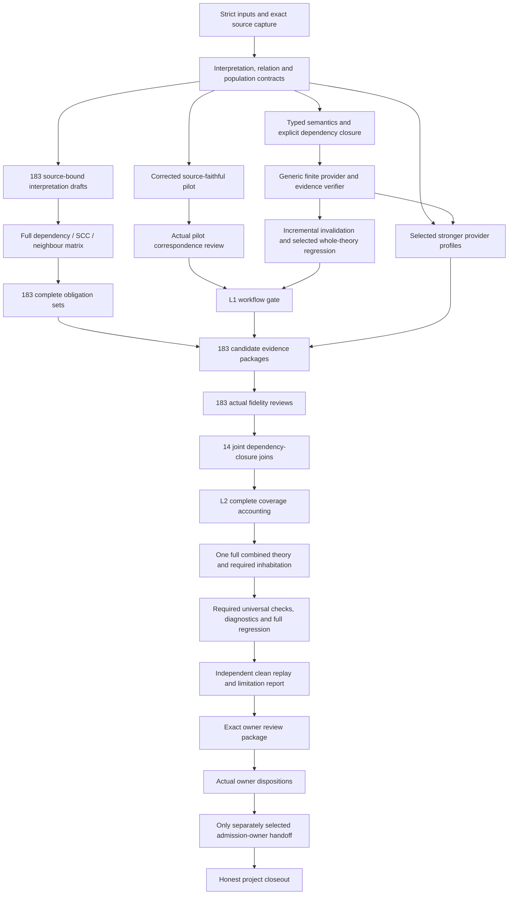

# Definition Formal Assurance: detailed DAG plan

Candidate plan, 2026-10-07. Authority effect: none. **112 task nodes, 788 smallest working units, 14 work families, all 183 current identities.** Implementation is not started by this delivery; owner semantic fidelity and admission remain separate.

The design analysis found necessary repairs before expanding the pilot: strict input decoding, independently modeled grants and claims, provenance state semantics, subject-bound governance moves and complete clause/dependency correspondence. The detailed plan retains all D0–D6 scope and adds the missing shared infrastructure, full-current execution units and global consistency work.

## Read the package

| Artifact | Purpose |
| --- | --- |
| [Complete analysis](ANALYSIS.md) | Current evidence, twelve design findings, six architecture views, alternatives, ownership, risks and decisions |
| [Implementation detail](IMPLEMENTATION-DETAILS.md) | Algorithm inputs/outputs, ordered rules, pseudocode, edge cases, failures and evidence contracts |
| [Layering](IMPLEMENTATION-LAYERING.md) | Four decision layers, smallest useful slices, non-regression and promotion evidence |
| [Work Pack](WORK-PACK.md) | Full task board, prerequisites, unit counts and execution navigation |
| [Complete DAG](DAG.md) / [machine graph](dag.json) | Every task node and procedural edge |
| [Unit manifest](swu-manifest.json) | Every unit's exact source, parent, scope, outputs, validation and closeout |
| [Full definition queue](DEFINITION-QUEUE.md) | All 183 identities, exact versions and current source links |
| [Validation strategy](VALIDATION-STRATEGY.md) | Planning checks, per-layer actual evidence and exact hostile outcomes |
| [Execution protocol](EXECUTION-PACK.md) | Ready-unit selection, conditional routes, future production and honest closeout |
| [Decision ledger](design-decisions.json) | Confirmed choices and explicit future owner/profile decisions |
| [Source baseline](source-baseline.json) | Hashes of inspected sources and full selected queue |
| [Planning validation](planning-validation.json) | Actual graph/source/unit/link check results; no implementation or proof claim |
| [Package manifest](manifest.json) | Exact delivery file hashes; verified with `check_delivery.py` |

## Main DAG



This overview compresses branches; [dag.json](dag.json) contains the exact ordering. Profiles P03–P05 require activation or explicit non-applicability; non-applicability cannot waive a required semantic obligation. The full graph has **28 logical frontiers**, not a calendar estimate.

## Delivery slices and gates

| Slice | Tasks | Delivery outcome |
| --- | --- | --- |
| Contract/source baseline | A01–A06 | Strict inputs, exact currentness, full correspondence and required obligation denominator |
| Corrected pilot | A07–A10 | Independent claim/grant states, bound transitions, actual controls and owner fidelity review |
| Reusable workflow | C01–C03, P01–P02, E01–E04, I01–I05, G01 | One repeatable selected-scope candidate workflow with exact evidence and invalidation |
| All-current formalization | S01–S02, P03–P05, F01–F14 T/O/E/R/J, G02 | Every current meaning accounted with complete required records or explicit unresolved outcomes |
| Combined theory | Z01–Z07 | One joint included theory, required populations, distinctions and universal obligations at declared strengths |
| Owner closeout | H01–H04 | Concrete reviewable interpretations/examples, actual dispositions and only separately selected effects |

Every definition has a T translation unit, O requirement unit, E evidence unit and R owner fidelity unit. Family J units verify actual cross-family closures. No family is assumed semantically independent. The semantic graph may be cyclic; SCCs are checked jointly. The execution DAG remains acyclic, with rejected reviews or failed proofs handled by new candidate attempts.

## Next executable unit

[A01.1](tasks/A01.md): strict candidate input envelope and decoder. Create closed schemas/decoder behavior and same-unit malformed controls, then validate that missing fields, unknown fields, duplicate keys/identities and incorrect types return typed diagnostics. This corrects a reproduced pilot gap before generic invalidation is built.

Future write scopes are isolated new candidate paths:

- `craft/formalization/candidates/definition-assurance-v1/`
- `docs/plans/definition-formal-assurance/candidate/assurance-snapshots-v1/`

The present request writes only the planning package. No implementation, tool installation, subagent delegation, live admission integration, canonical definition rewrite or unrelated project edit is included. Shared task tests are declared same-unit post-produce outputs; later CLI dependencies do not create a validation cycle.

## What “complete” will mean

All current identities must remain accounted, supported source-faithful interpretations actually reviewed, and their complete required obligations backed by current evidence. The complete included theory must be jointly satisfiable with every declared required population inhabited. Pairwise checks and separate provider projections cannot substitute for that result.

Aliases need equivalence rather than forced difference. Subtypes need inclusion and optional properness while retaining overlap. Independent axes need specific forbidden-inference witnesses and explicit allowed couplings. Stronger all-model separation or universal preservation requires separately specified evidence. Unsupported meanings, missing translations, stale evidence and timeout remain visible limitations; administrative disposition does not turn them into proofs.

## Plan validation and authority boundary

Run:

```bash
python3 docs/plans/definition-formal-assurance/candidate/detailed-plan-v1/check_plan.py
python3 docs/plans/definition-formal-assurance/candidate/detailed-plan-v1/check_delivery.py
```

This checks the detailed graph and exact current input bindings. It executes no planned implementation command. The package follows project-local candidate conventions and the inspected Invoke/Implementation Layering structure; it is not a normal producer-backed admitted Invoke Plan. The original project-start and pilot snapshots remain preserved.
