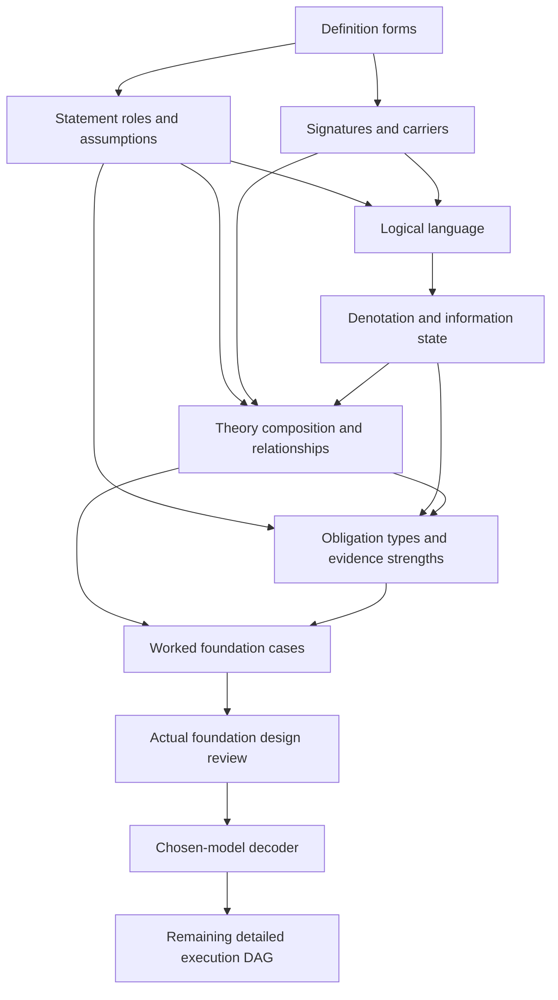

# Definition formal assurance: foundations first

Candidate priority revision, 2026-10-07. Authority effect: none. The user's priority is **definition kinds, logical structure and other formalization foundations before tooling or the full-definition rollout**.

The [formalization model draft](FORMALIZATION-MODEL.md) makes those foundations concrete. The [revised DAG](DAG.md) / [machine graph](dag.json) adds nine first-priority tasks and retains every prior task. It now has 121 tasks and 797 working units. The original detailed plan and finite pilot remain preserved.

## Priority sequence

| Order | Task | Deliverable |
| --- | --- | --- |
| 1 | M01 | Definition forms and independent classification axes |
| 2 | M02 / M03 | Logical statement roles and assumption discipline; typed signatures, carriers and identity |
| 3 | M04 | Logical language, syntax/binding/typing and fragment boundaries |
| 4 | M05 | Mathematical denotation, domain policy and unknown/absent/false distinctions |
| 5 | M06 | Theory composition, dependencies, recursion, aliases, subtypes and permitted overlap |
| 6 | M07 | Required proof/check types, statement strengths and evidence rules |
| 7 | M08 | Worked cases for the eight foundational definitions and an explicit ambiguity ledger |
| 8 | M09 | Actual model-design review and the concrete implementation contract |
| 9 | A01 onward | Strict decoder, corrected pilot, reusable workflow, full queue and combined theory |

The first future production unit is **M01.1**, replacing A01.1 as the next unit. The initial model and sample-source drafts are available now, but production criteria and actual review are not claimed complete.

## First definitions and what remains deferred

Read Definition, Semantic Primitive, Schema, Axiom, Premise, Hypothesis, Invariant and Governed Model first. [Their exact current sources](foundation-source-queue.json) are bound by the original verified registry baseline. They are examples for developing the model, not an assumed closed theory. A source's artifact type `definition` cannot select its logical role.

After the foundation gate, prefer the F01 translation drafts when their prerequisites are met. Dependencies and review still govern later evidence. The ordering does not pretend that eight definitions can be fully proved without their actual dependency closures.

Provider installation, decoder/evaluator implementation, workflow automation, all-183 execution and admission handoff stay downstream. Required source correspondence, honest evidence strengths and complete joint theory checks remain mandatory.

## Package and verification

- [Formalization model](FORMALIZATION-MODEL.md): candidate taxonomy, logic, semantics, composition, proof obligations and concrete examples.
- [Layering](LAYERING.md): new L0 foundation decision and preserved later guarantees.
- [Full DAG](DAG.md), [frontiers](topological-frontiers.json) and [unit manifest](swu-manifest.json): exact revised prerequisites and producer/validation contracts.
- [Source sample](foundation-source-queue.json): eight actual foundational identities and current normative/formal voices.
- [Predecessor bindings](predecessor-bindings.json): exact original plan inputs retained.
- [Planning validation](planning-validation.json): actual source, graph, scope and coverage checks.

Run `python3 docs/plans/definition-formal-assurance/candidate/foundations-first-v1/check_plan.py` to check the planning structure and source currentness. It produces no implementation or formal-proof result.

The new JSON owns the revised dependency ordering. Prior task pages and algorithm analysis remain content references; their old dependency/next-unit labels do not override this successor. All existing source identities, 183 four-phase memberships and required final theory work remain present.
