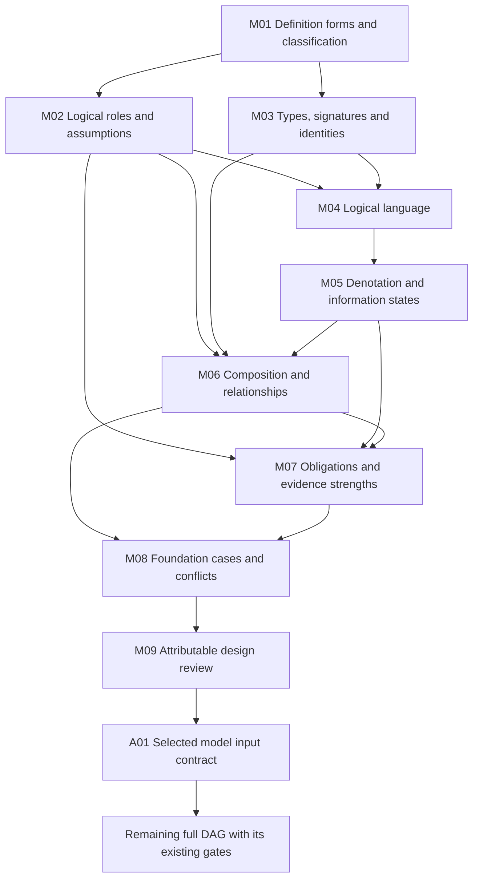

# Formalization foundations and priority review

Candidate planning review, 2026-10-08. Authority effect: none.

Prioritize definition forms, types and identities, logical roles, language and semantics before expanding formalization automation. The existing [formalization model](../foundations-first-v1/FORMALIZATION-MODEL.md) and [full execution DAG](../foundations-first-v1/DAG.md) already encode this order. This review explains the model, distinguishes existing candidate work from accepted meaning, and identifies the foundation decisions that still need attention.

The full retained plan contains 121 tasks, 511 dependency edges and 797 working units across 183 current definition identities and 189 admitted source versions. Its nine foundation tasks precede all inherited tasks. These are work counts, not proof counts or time estimates. [The focused DAG and evidence bindings](priority-dag.json) retain the original foundation prerequisites; they do not change execution gates.

## Definition forms and types come first

“Definition type” has several independent meanings. Classifying an artifact as a Definition establishes its carrier category. Classifying a clause as an abbreviation, assumption or invariant determines how to reason about its content. Classifying a symbol as a sort, predicate or function determines its mathematical signature. These decisions belong in separate fields.

| Aspect | Question | Required output |
| --- | --- | --- |
| Artifact kind | What record carries the text? | Exact artifact identity, version and schema |
| Definitional form | How does this clause introduce meaning? | Primitive, explicit, genus/differentia, enumeration, implicit/axiomatic, constructive, inductive/recursive, operational, mixed or unresolved treatment |
| Logical role | What may reasoning do with this statement? | Definition, selected axiom/premise, hypothesis, constraint, proof obligation, derived claim, observation or explanation |
| Signature | What object is introduced? | Sort, constant, function, predicate, relation, record, state or transition, with arity and sorts |
| Required logic | What semantics does the meaning require? | Static first-order, recursive, temporal, normative or empirical features and selected support |

Classification is per exact source clause or segment. A whole source can contain several forms and roles. A Definition of Axiom characterizes axiom records; it does not adopt their propositions. A Semantic Primitive record does not automatically supply the meaning of an uninterpreted mathematical symbol. The [definition kinds](../assurance-snapshots-v1/foundations/definition-kinds.json) and [logical roles](../assurance-snapshots-v1/foundations/statement-roles.json) contracts implement these candidate distinctions.

Each form carries different obligations:

| Form | Central check |
| --- | --- |
| Primitive declaration | Explicit signature and scope; consistent interpretation and required populations |
| Explicit abbreviation | Well-typed expansion using selected meanings; no unintended restriction of existing vocabulary |
| Genus and differentia | Child inclusion and inhabitation; properness only when claimed |
| Enumeration | Exact identities and completeness at the selected scope |
| Implicit or axiomatic specification | Joint existence and consistency; uniqueness only when claimed |
| Constructive specification | Admitted input conditions, output characterization, and required totality or termination |
| Inductive or recursive specification | Selected least/greatest fixed point or well-founded semantics; a recursive equivalence alone is insufficient |
| Operational specification | Exact subject and state binding, preconditions, postconditions and frame conditions; temporal progress separately specified |

## The formalization model

A formalization binds an exact source to a typed interpretation, rather than replacing the source with a formula string:

```text
F = (source identity/version/digest, scope, signature,
     clause correspondence and logical roles, dependencies,
     selected assumptions, semantic profile,
     required obligations, evidence, review disposition)
```

The initial static core is classical many-sorted first-order logic. It has typed variables, constants and total functions; predicate applications and equality; Boolean connectives; and explicit universal and existential quantifiers. The [signature](../assurance-snapshots-v1/foundations/signatures.json), [language](../assurance-snapshots-v1/foundations/logical-language.json) and [denotation](../assurance-snapshots-v1/foundations/denotation.json) contracts state the candidate meaning independently from executable checking.

A structure supplies a domain for each sort, an element for each constant, a total interpretation for each total function, and typed tuples for each predicate or relation. Sort domains are nonempty under the initial profile. Predicate extensions can be empty, so a required population needs its own existential obligation. Function result sorts, arity, variable binding and scope are checked explicitly. Partiality requires selected definedness/result semantics or a relational encoding.

Equal display names do not identify symbols. Separate nominal types do not prove that two source meanings are disjoint. Semantic comparison needs a reviewed common carrier or alignment map. Records, referenced entities and actual people or organizations require distinct denotation decisions; a reference string cannot establish the entity or authority it names.

For example, a candidate genus/differentia definition can have:

```text
forall x:Entity . Child(x) iff (Parent(x) and Marked(x))
exists x:Entity . Child(x)                  -- required child population
exists x:Entity . Parent(x) and not Child(x) -- only if properness is required
```

The definition preserves overlap between parent and child. Encoding disjoint sorts would answer a different question. Whether this expression matches a real source still requires correspondence review.

## Logical reasoning and evidence

Keep the theory, population requirements and questions separate:

```text
T = selected definitions + explicit assumptions + scoped constraints
I = all required population obligations
Q = exact claims to check, with their required evidence strengths
```

One model must satisfy `T` and `I` together. Separately satisfiable fragments cannot establish joint consistency. An invariant may constrain an allowed-state consistency query, while preservation by transitions is a separate target. Adding preservation to its own premises cannot establish implementation correctness.

| Check | What its evidence establishes | Limit |
| --- | --- | --- |
| Shape and typing | The representation meets selected structural rules | Does not establish source meaning or world truth |
| Checked model | This exact interpretation has the supplied witness | Does not establish all-model behavior |
| Countermodel | An exact claimed entailment fails in the selected theory | Depends on the interpretation and assumptions |
| Bounded exhaustive search | Result across every configuration in the declared finite universe | Does not establish an unbounded theorem |
| Solver result | The result under the selected encoding and provider contract | Requires exact applicability and declared trust |
| Independently verified proof | The exact theorem follows under its audited premises and proof system | Does not independently justify source correspondence or premise adoption |

Missing information, an absent value, a false proposition and an execution failure have different meanings. Timeout and unsupported logic remain execution outcomes. They are not falsehood, satisfaction or additional truth values. Closed-world interpretation requires an explicit completeness decision.

Temporal behavior, recursion, obligations/permissions and empirical claims need selected semantic extensions when their meanings require them. A static predicate named `Eventually`, `Authorized` or `Measured` does not supply those semantics. The [obligation contract](../assurance-snapshots-v1/foundations/obligation-types.json) retains required statements independently of the submitted results.

## Composition and the other design elements

The formalization architecture has three different graphs: source/meaning dependencies, obligations/evidence dependencies, and the procedural execution DAG. Meaning dependencies may contain mutually recursive components. Their semantics require joint analysis. The execution DAG remains acyclic; revisions create subsequent attempts. Editorial families are navigation groups and cannot establish semantic independence.

| Element | Design requirement | Priority implication |
| --- | --- | --- |
| Source correspondence | Every relevant clause is encoded, explanatory or explicitly deferred, with exact bindings | Full character accounting alone cannot close a meaning gap |
| Source precedence | Resolve competing voices and inherited statements through an attributable disposition | Keep unresolved conflicts visible before accepting the affected translation |
| Identity and alignment | Preserve version, scope and symbol identity; review aliases, subtype inclusion, overlap and couplings | Do not manufacture distinctions with type names or merge by labels |
| Dependency closure | Declare exact semantic uses and resolve their transitive closure | Local drafts remain incomplete when required counterparts or alignments are missing |
| Required populations | Require selected meaningful witnesses jointly with the theory | Avoid vacuous satisfaction through empty predicates |
| Operational semantics | Bind subject, before/after state, independent effects and unchanged fields | Synthetic frames are candidates; actual preservation and liveness need their own evidence |
| Providers | Select supported fragments and minimum evidence strength from the actual clauses | Engine convenience cannot weaken a required meaning |
| Evidence integrity | Bind source, interpretation, query, assumptions, provider and checker | Reproducibility and authenticity of source bytes differ from fidelity of meaning |
| Revisions | Invalidate affected interpretations and evidence through exact dependencies | A cached local success cannot replace required joint regression |
| Review and authority | Distinguish author review, independent review, semantic owner acceptance and admission | Candidate success does not supply owner acceptance or effects |

The [complete design analysis](../detailed-plan-v1/ANALYSIS.md) and [algorithm details](../detailed-plan-v1/IMPLEMENTATION-DETAILS.md) retain the wider architecture. Their intake-era implementation descriptions are historical planning context; current receipts and evidence determine current execution state.

## Priority DAG and review sequence



These are the exact foundation dependencies in the retained plan. Existing M01–M09 artifacts need not be recreated. Review their open meaning decisions first, then propagate any agreed changes through affected interpretations and evidence.

| Priority | Focus | Review exit condition |
| --- | --- | --- |
| 1 | Definition forms, clause granularity and type/signature distinctions | Mixed forms retained; exact signature and meaning of each introduced object inspectable |
| 2 | Logical roles and source precedence | Selected assumptions identified; hypotheses and proof targets remain separate; conflicting voices have explicit dispositions |
| 3 | Logic, denotation and identity | Supported operators, domain policy, partiality, equality, scope and information states unambiguous |
| 4 | Composition and required obligations | Exact dependencies and alignments; meaningful populations; relationship direction and proof strength explicit |
| 5 | Worked foundation cases and review | Source-bound examples, counterexamples, deferred clauses and attributable review dispositions available |
| 6 | Downstream implementation and wider coverage | Consume the selected contracts and retain every existing full-plan gate |

Begin with Definition, Semantic Primitive, Schema, Axiom, Premise, Hypothesis, Invariant and Governed Model. Then review the adjacent type, relation, identity and classification interpretations that exercise shared carriers and couplings. This is a review priority, not a claim that those meanings form a dependency-closed theory.

The first concrete unresolved source decision is **Hypothesis versus Premise**: the Hypothesis target describes investigation without adoption, while an inherited expression describes an adopted proposition. Keep the identities separate and present the conflicting expressions for a source-owner disposition. No approval is inferred from a candidate encoding.

## Current evidence and remaining work

The foundation package contains seven concrete contracts and an attributable agent design review. That review accepts the static candidate for controlled prototype work; it explicitly records the same author as reviewer and grants no independent or semantic owner acceptance. See the [foundation review](../assurance-snapshots-v1/units/M09/REVIEW.md) and [bound review record](../assurance-snapshots-v1/foundations/foundation-review.json).

At this inspection, 24 per-definition coverage records report pending whole translations and pending owner reviews. A twenty-fifth Team interpretation packet has finite model controls, but its delivery is unfinished and has no coverage/receipt closeout. These counts describe candidate records. They do not establish 25 faithful translations. The review found no owner-accepted whole translation or whole-definition proof in those coverage records.

The retained open decisions are source fidelity, the Hypothesis/Premise conflict, required recursive/temporal/normative/empirical extensions, and generic mechanized evaluator/requirement-generation correctness. Complete joint current theory assurance also remains unfinished. More local drafts cannot resolve these automatically.

The immediate outcome sought is a reviewed account of definitions, types and logical semantics with explicit remaining decisions. Wider implementation, full-current translation and final joint assurance stay in the detailed plan. [Validation](validation.json) records the read-only graph, source binding and evidence-reference checks for this review; it grants no formal proof or semantic acceptance.
